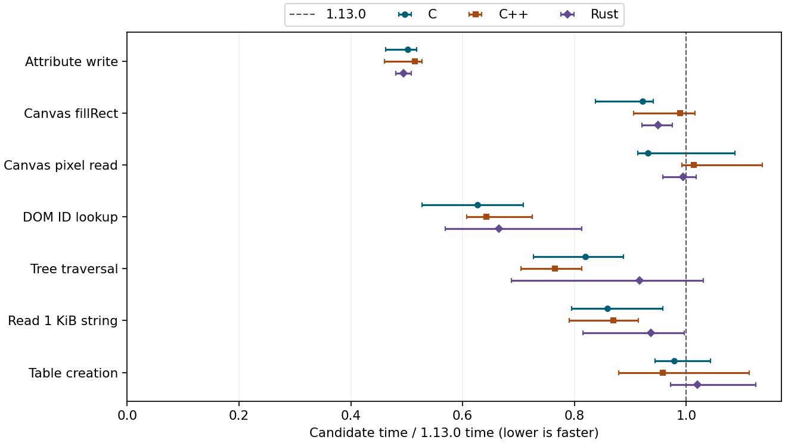

# Component demos

This fork benchmarks the browser examples from [eqrion/component-demos at d0b9dd1](https://github.com/eqrion/component-demos/tree/d0b9dd1390a300978193adc623838fef4e4b632b). It runs the same compiled C, C++, and Rust WebAssembly components through jco 1.13.0, pinned upstream main, and a branch that optimizes synchronous host imports. The comparison also includes the demos’ JavaScript, Emscripten (Embind and EM_JS), and Rust wasm-bindgen implementations where available.

The performance branch also specializes UTF-8 conversion in both directions. For strings of up to 32 ASCII bytes, the bindings read or write the bytes directly. Non-ASCII text uses the checked codec, including its malformed-input traps. [Short-string changes](https://github.com/vados-cosmonic/jco/compare/ac28d5d481f3cfca94bc4c62f3571511c19386d9...9eeb7f0b9ab82a982810af5cdd1d9035b302aa39)

For longer host-returned strings, the runtime can encode into a reusable buffer before allocating guest memory. On the preceding upstream revision, a 16 KiB read took 26–28 µs across C, C++, and Rust, or 46–50% of the time for 1.13.0. The archived run compares the bindings immediately before and after this change. [UTF-8 benchmark and raw measurements](https://github.com/vados-cosmonic/component-demos/blob/7550fa7523931f918b6bd599174af07e6537961b/README.md#optimized-browser-bindings)

<!-- candidate:start -->

## Optimized browser bindings

The candidate uses js-component-bindgen’s internal Oxc bundler and the checked jco-cm-runtime. For eligible single-instance, synchronous components, a host import reuses the caller’s task. Resource drops use a one-argument trampoline that checks the instance flag and records traps. The internal Oxc bundle drops the general asynchronous import fallback for these components. The adapter holds direct references to its task stack and instance flags, checks the store for interruptions, and lifts short ASCII strings in groups of four bytes. Synchronous UTF-8 results of 256 to 262,144 code units can reuse a per-instance byte buffer, capped at 256 KiB. The runtime encodes there before requesting the exact guest allocation. Nested calls and larger results use the ordinary encoder. When lifting a borrowed host resource, the runtime validates the handle and reads its 32-bit representation directly. Imported host resources with automatically assigned representations use their guest handle as an array index. Explicit host representations and shared tables use a representation map. Components with async operations, cross-component resource transfers or call tracking keep the general adapter. [Jco commit `5db31f3a5`](https://github.com/vados-cosmonic/jco/commit/5db31f3a5bb23c4392f76f68845b37e7f4d2c3bf)

All Jco builds used the same guest binaries. Each value is the median of 7 fresh-page samples with one warm-up per page. The run collected 728 samples on 2026-11-25 with HeadlessChrome/156.0.8078.47 on Intel(R) Xeon(R) Processor @ 2.60GHz.

The candidate finished within **10× of the fastest available compiled shim in 21/21** headline comparisons. The largest ratio was **4.88×**. On separate fresh pages it matched or beat **1.13.0 in 16/21** and **stock main in 20/21**. On the same warmed page it matched or beat **1.13.0 in 19/21** headline cases and 78/84 across all phases. The shim comparison selects the lowest median among Embind, EM_JS and wasm-bindgen for each operation, including shims written in a different guest language. The phase tables in the original comparison describe workload differences and include raw JavaScript.


| Operation | Guest | Unit | 1.13.0 | Stock main | Candidate | Candidate / 1.13.0 | Fastest shim | Shim time | Candidate / shim |
| --- | --- | --- | --- | --- | --- | --- | --- | --- | --- |
| Attribute write | C | µs | 2.67 | 8.21 | 1.31 | 0.49× | Embind | 2.32 | 0.56× |
| Attribute write | C++ | µs | 2.11 | 7.88 | 1.43 | 0.68× | Embind | 2.32 | 0.62× |
| Attribute write | Rust | µs | 3.00 | 8.50 | 1.46 | 0.49× | Embind | 2.32 | 0.63× |
| Canvas fillRect | C | µs | 2.15 | 6.84 | 2.00 | 0.93× | Embind | 2.79 | 0.72× |
| Canvas fillRect | C++ | µs | 1.76 | 7.69 | 1.75 | 0.99× | Embind | 2.79 | 0.63× |
| Canvas fillRect | Rust | µs | 1.79 | 7.39 | 1.87 | 1.05× | Embind | 2.79 | 0.67× |
| Canvas pixel read | C | µs | 696.90 | 636.60 | 705.90 | 1.01× | Embind | 357.50 | 1.97× |
| Canvas pixel read | C++ | µs | 715.60 | 785.90 | 493.60 | 0.69× | Embind | 357.50 | 1.38× |
| Canvas pixel read | Rust | µs | 630.00 | 600.50 | 552.20 | 0.88× | Embind | 357.50 | 1.54× |
| DOM ID lookup | C | µs | 2.65 | 9.55 | 2.10 | 0.79× | Embind | 2.26 | 0.93× |
| DOM ID lookup | C++ | µs | 2.34 | 11.68 | 1.60 | 0.69× | Embind | 2.26 | 0.71× |
| DOM ID lookup | Rust | µs | 1.96 | 10.98 | 1.50 | 0.76× | Embind | 2.26 | 0.66× |
| Tree traversal | C | ms | 16.90 | 122.62 | 18.61 | 1.10× | EM_JS | 5.19 | 3.59× |
| Tree traversal | C++ | ms | 16.52 | 120.09 | 18.69 | 1.13× | EM_JS | 5.19 | 3.60× |
| Tree traversal | Rust | ms | 17.88 | 128.53 | 25.31 | 1.42× | EM_JS | 5.19 | 4.88× |
| Read 1 KiB string | C | µs | 6.37 | 8.09 | 2.29 | 0.36× | wasm-bindgen | 6.06 | 0.38× |
| Read 1 KiB string | C++ | µs | 4.29 | 7.34 | 2.30 | 0.54× | wasm-bindgen | 6.06 | 0.38× |
| Read 1 KiB string | Rust | µs | 7.01 | 8.91 | 2.33 | 0.33× | wasm-bindgen | 6.06 | 0.38× |
| Table creation | C | ms | 16.98 | 78.19 | 12.90 | 0.76× | EM_JS | 6.56 | 1.97× |
| Table creation | C++ | ms | 15.18 | 74.88 | 14.38 | 0.95× | EM_JS | 6.56 | 2.19× |
| Table creation | Rust | ms | 15.33 | 76.03 | 12.62 | 0.82× | EM_JS | 6.56 | 1.92× |

### Change from the previous branch revision

Both revisions ran on the same guest binaries in the same browser session. Each cell divides the candidate median by the previous revision’s median. Parentheses count the rounds in which the candidate finished faster. [Compare `3f65947fd` and `5db31f3a5`](https://github.com/vados-cosmonic/jco/compare/3f65947fd57caf61bd5ad2fba06f3fd00734049c...5db31f3a5bb23c4392f76f68845b37e7f4d2c3bf)

| Operation | C | C++ | Rust |
| --- | --- | --- | --- |
| Attribute write | 0.92× (4/7) | 1.06× (1/7) | 0.79× (6/7) |
| Canvas fillRect | 1.29× (4/7) | 0.77× (5/7) | 1.25× (2/7) |
| Canvas pixel read | 0.96× (5/7) | 0.66× (6/7) | 1.09× (2/7) |
| DOM ID lookup | 1.05× (2/7) | 0.93× (5/7) | 0.88× (5/7) |
| Tree traversal | 0.93× (3/7) | 0.99× (6/7) | 1.15× (3/7) |
| Read 1 KiB string | 0.89× (6/7) | 1.00× (3/7) | 0.99× (2/7) |
| Table creation | 0.79× (3/7) | 0.95× (5/7) | 0.91× (4/7) |
| Bulk DOM query | 1.38× (3/7) | 1.20× (3/7) | 0.65× (5/7) |
| Tree construction | 0.90× (4/7) | 0.97× (5/7) | 0.94× (3/7) |
| set 8 B | 0.83× (5/7) | 1.14× (2/7) | 0.98× (4/7) |
| get 8 B | 0.92× (5/7) | 0.98× (4/7) | 0.96× (4/7) |
| get 16384 B | 0.91× (4/7) | 0.99× (3/7) | 1.07× (2/7) |
| get 262144 B | 0.98× (4/7) | 0.98× (6/7) | 1.02× (3/7) |

### Warm 1.13.0 comparison on the same page

For each guest and workload, both builds run once to warm up, then 4 times each on the same page. Each pair alternates which build runs first. The runner clears the DOM and performance entries before every call. It repeats this on 9 fresh pages. Each page contributes the median of its candidate / 1.13.0 ratios. The median across pages was at or below 1× for **19/21** headline cases. [Raw paired timings](web/bench/results/paired-browser.json)



| Operation | Guest | Candidate / 1.13.0 | Middle 50% of page ratios | Pages at or below 1× |
| --- | --- | --- | --- | --- |
| Attribute write | C | 0.50× | 0.49–0.51× | 9/9 |
| Attribute write | C++ | 0.51× | 0.51–0.53× | 9/9 |
| Attribute write | Rust | 0.55× | 0.54–0.58× | 9/9 |
| Canvas fillRect | C | 0.90× | 0.89–0.92× | 9/9 |
| Canvas fillRect | C++ | 0.90× | 0.88–1.00× | 6/9 |
| Canvas fillRect | Rust | 0.90× | 0.89–0.92× | 9/9 |
| Canvas pixel read | C | 0.93× | 0.86–0.96× | 8/9 |
| Canvas pixel read | C++ | 1.05× | 1.02–1.20× | 2/9 |
| Canvas pixel read | Rust | 1.01× | 0.96–1.09× | 4/9 |
| DOM ID lookup | C | 0.61× | 0.58–0.67× | 9/9 |
| DOM ID lookup | C++ | 0.63× | 0.58–0.72× | 9/9 |
| DOM ID lookup | Rust | 0.64× | 0.56–0.77× | 9/9 |
| Tree traversal | C | 0.80× | 0.75–0.83× | 9/9 |
| Tree traversal | C++ | 0.85× | 0.81–0.89× | 9/9 |
| Tree traversal | Rust | 0.69× | 0.58–0.89× | 8/9 |
| Read 1 KiB string | C | 0.49× | 0.41–0.56× | 9/9 |
| Read 1 KiB string | C++ | 0.51× | 0.47–0.55× | 9/9 |
| Read 1 KiB string | Rust | 0.50× | 0.48–0.53× | 9/9 |
| Table creation | C | 0.88× | 0.82–0.99× | 7/9 |
| Table creation | C++ | 0.95× | 0.79–1.02× | 6/9 |
| Table creation | Rust | 0.93× | 0.91–1.01× | 5/9 |

Across all 84 reported phases and string lengths, the same-page comparison matched or beat 1.13.0 in **78/84** cases. Totals and subphases overlap.

| Slower paired phase | Guest | Metric | Candidate / 1.13.0 | Pages at or below 1× |
| --- | --- | --- | --- | --- |
| canvas-pixels | C | putImageData(): µs/call | 1.062× | 3/9 |
| canvas-pixels | C++ | getImageData(): µs/call | 1.050× | 2/9 |
| string-marshalling | Rust | set 1024 B | 1.030× | 4/9 |
| string-marshalling | Rust | set 16384 B | 1.023× | 4/9 |
| string-marshalling | C++ | set 16384 B | 1.019× | 3/9 |
| canvas-pixels | Rust | getImageData(): µs/call | 1.012× | 4/9 |

Across all reported phases and string lengths, 81/84 comparable candidate medians were within 10× of the fastest compiled shim and 66/84 matched or beat 1.13.0. Totals and their subphases overlap. Each ratio compares the same phase on both sides.

| Phases above 10× | Phase | Guest | Shim | Candidate / shim |
| --- | --- | --- | --- | --- |
| dom-query | bulk: total ms | C | Embind | 817.17× |
| dom-query | bulk: total ms | C++ | Embind | 700.00× |
| dom-query | bulk: total ms | Rust | Embind | 461.50× |

The bulk DOM query returns a live collection to Embind, which discards it. The component host materializes the collection with `Array.from`, then the bindings lower every element into a WIT resource handle. The ratio includes that difference in work. [Embind loop](cpp/dom-query/emscripten/main.cpp) · [Component host](web/host/web-host.js) · [C guest loop](c/dom-query/main.c)

### DOM bindings with identical guest code

These 216 fresh-page samples compare each language’s exact core Wasm binary with each set of bindings in the table. The direct JS shim calls the same DOM host, puts owned handles in guest memory and recycles them on guest drops. It implements the synchronous imports used by these guests. Jco also provides Canonical ABI checks, task tracking and instance shutdown. [Direct shim](web/bench/dom-core-shim.mjs) · [Raw timings and correctness checks](web/bench/results/dom-control-browser.json)

The bulk query copies 2,000 handles per call, 10 times. Each traversal visits 19,531 nodes. The runner checks the rendered fixture or node count for each guest and verifies list counts and handle release for the direct shim after warm-up and measurement.

With list materialization on both sides, the candidate took **1.54–1.65×** the direct shim’s bulk-query time across the three guests. Times below are per measured workload, after warm-up.


| Phase | Guest | Direct (ms) | 1.13.0 (ms) | Candidate (ms) | Candidate / direct | Candidate / 1.13.0 | Rounds at or below 1.13.0 | Candidate / previous | Rounds at or below previous |
| --- | --- | --- | --- | --- | --- | --- | --- | --- | --- |
| DOM ID lookup | C | 15.53 | 29.48 | 20.91 | 1.35× | 0.71× | 9/9 | 0.98× | 4/9 |
| DOM ID lookup | C++ | 18.01 | 28.20 | 23.58 | 1.31× | 0.84× | 8/9 | 1.01× | 6/9 |
| DOM ID lookup | Rust | 15.03 | 26.26 | 19.82 | 1.32× | 0.75× | 8/9 | 1.07× | 3/9 |
| Bulk DOM query | C | 6.84 | 12.71 | 10.99 | 1.61× | 0.87× | 7/9 | 0.90× | 5/9 |
| Bulk DOM query | C++ | 7.87 | 11.88 | 12.96 | 1.65× | 1.09× | 4/9 | 1.11× | 3/9 |
| Bulk DOM query | Rust | 7.25 | 11.86 | 11.19 | 1.54× | 0.94× | 5/9 | 0.99× | 4/9 |
| Tree construction | C | 28.35 | 56.18 | 53.40 | 1.88× | 0.95× | 7/9 | 0.99× | 7/9 |
| Tree construction | C++ | 28.86 | 52.71 | 51.94 | 1.80× | 0.99× | 5/9 | 0.99× | 6/9 |
| Tree construction | Rust | 28.06 | 47.79 | 49.93 | 1.78× | 1.04× | 3/9 | 0.99× | 5/9 |
| Tree traversal | C | 6.81 | 15.37 | 15.37 | 2.26× | 1.00× | 2/9 | 0.94× | 6/9 |
| Tree traversal | C++ | 7.05 | 14.50 | 15.92 | 2.26× | 1.10× | 2/9 | 0.99× | 6/9 |
| Tree traversal | Rust | 8.01 | 17.06 | 19.03 | 2.38× | 1.12× | 2/9 | 0.92× | 6/9 |

### Cost of a synchronous host import

The scalar, string and resource loops run 131,072 iterations per pass. The string loop changes the first byte before each call. The resource loop acquires a host object, borrows it to read its value, and drops it. The optional-resource loop checks the discriminant in guest memory every time and reads and drops each present handle. Each pass checks its checksum. All four adapters use byte-identical core modules. The direct shim keeps the fixture’s single live handle in one slot.

The byte-list loops copy a 176 × 176 RGBA region (123,904 bytes) 2,048 times per pass in each direction. The host-to-guest case uses a reusable host view and a fixed guest allocation. In the reverse direction the host keeps the final snapshot while the guest changes the source in Wasm. Both cases sum the changing first byte during the loop and verify the whole payload afterward. The canvas demo also measures browser readback, host allocation and guest allocation.

The string-return loops make 1,024 calls per pass. Each result occupies 16 KiB in Wasm. One host returns a repeated ASCII string. The other rotates four strings containing two-, three-, and four-byte UTF-8 sequences. The guest checks each byte length, sums the first bytes, and hashes every distinct result outside the timer.

Times are nanoseconds per guest iteration, including the loop and host work. Each cell is the median of 7 fresh-page medians, with 2 warm-ups and 5 timed passes per page. The runner interleaves the four builds. [Raw timings and digests](web/bench/results/import-loop.json)

| Operation | Direct | 1.13.0 | Stock main | Candidate | Candidate / 1.13.0 | Candidate / direct |
| --- | --- | --- | --- | --- | --- | --- |
| u32 | 13.7 | 12.2 | 1,896.7 | 14.5 | 1.19× | 1.06× |
| 2-byte string | 489.0 | 479.9 | 2,873.2 | 133.5 | 0.28× | 0.27× |
| 9-byte string | 499.0 | 486.8 | 2,916.0 | 212.9 | 0.44× | 0.43× |
| 32-byte string | 444.8 | 447.8 | 2,584.8 | 476.8 | 1.06× | 1.07× |
| Acquire, borrow, drop | 51.1 | 334.2 | 5,252.8 | 144.2 | 0.43× | 2.82× |
| Optional resource, half present | 32.0 | 235.7 | 3,295.9 | 142.7 | 0.61× | 4.45× |
| 121 KiB host-to-guest byte list | 5,712.9 | 5,371.1 | 10,693.4 | 6,445.3 | 1.20× | 1.13× |
| 121 KiB guest-to-host byte list | 111,767.6 | 112,939.5 | 118,066.4 | 113,037.1 | 1.00× | 1.01× |
| 16 KiB UTF-8 result, repeated ASCII | 38,281.2 | 38,378.9 | 62,988.3 | 22,851.6 | 0.60× | 0.60× |
| 16 KiB UTF-8 result, rotating Unicode | 53,710.9 | 51,074.2 | 84,375.0 | 35,546.9 | 0.70× | 0.66× |

### Where the canvas read spends its time

The same-page comparison was repeated with a clock around the demo’s host method. That method reads 176 × 176 pixels from Chromium and creates a JavaScript byte array. The remainder includes guest allocation and freeing, the copy into Wasm, binding checks, the loop and observer overhead. Each cell is a median across 9 page medians. Columns are summarized independently. [Raw instrumented samples](web/bench/results/canvas-control-browser.json)

| Guest | Bindings | Full read (µs) | Inside host (µs) | Remainder (µs) | Inside host (%) |
| --- | --- | --- | --- | --- | --- |
| C | 1.13.0 | 500.5 | 476.9 | 24.1 | 95.6% |
| C | Candidate | 604.8 | 569.6 | 28.5 | 95.0% |
| C++ | 1.13.0 | 531.2 | 506.1 | 25.2 | 95.5% |
| C++ | Candidate | 563.8 | 531.0 | 32.8 | 94.4% |
| Rust | 1.13.0 | 474.2 | 452.7 | 25.4 | 95.3% |
| Rust | Candidate | 573.7 | 540.3 | 32.8 | 94.6% |

The host accounted for 94.4–95.6% of the full read across these builds. The candidate spent 28.5–32.8 µs per read outside the host, compared with 24.1–25.4 µs for 1.13.0.

<details><summary>All timed phases and string lengths</summary>

| Demo | Phase | Guest | Candidate time | Fresh-page / 1.13.0 | Same-page / 1.13.0 | Candidate / main | Fastest shim | Candidate / shim |
| --- | --- | --- | --- | --- | --- | --- | --- | --- |
| attribute-churn | total time | C | 104.45 ms | 0.49× | 0.50× | 0.16× | Embind | 0.56× |
| attribute-churn | total time | C++ | 114.53 ms | 0.68× | 0.51× | 0.18× | Embind | 0.62× |
| attribute-churn | total time | Rust | 116.83 ms | 0.49× | 0.55× | 0.17× | Embind | 0.63× |
| attribute-churn | per setAttribute() | C | 1.31 µs | 0.49× | 0.50× | 0.16× | Embind | 0.56× |
| attribute-churn | per setAttribute() | C++ | 1.43 µs | 0.68× | 0.51× | 0.18× | Embind | 0.62× |
| attribute-churn | per setAttribute() | Rust | 1.46 µs | 0.49× | 0.55× | 0.17× | Embind | 0.63× |
| canvas-draw | total | C | 99.91 ms | 0.93× | 0.90× | 0.29× | Embind | 0.72× |
| canvas-draw | total | C++ | 87.33 ms | 0.99× | 0.90× | 0.23× | Embind | 0.63× |
| canvas-draw | total | Rust | 93.53 ms | 1.05× | 0.90× | 0.25× | Embind | 0.67× |
| canvas-draw | per fill_rect() | C | 2.00 µs | 0.93× | 0.90× | 0.29× | Embind | 0.72× |
| canvas-draw | per fill_rect() | C++ | 1.75 µs | 0.99× | 0.90× | 0.23× | Embind | 0.63× |
| canvas-draw | per fill_rect() | Rust | 1.87 µs | 1.05× | 0.90× | 0.25× | Embind | 0.67× |
| canvas-pixels | getImageData(): µs/call | C | 705.90 µs | 1.01× | 0.93× | 1.11× | Embind | 1.97× |
| canvas-pixels | getImageData(): µs/call | C++ | 493.60 µs | 0.69× | 1.05× | 0.63× | Embind | 1.38× |
| canvas-pixels | getImageData(): µs/call | Rust | 552.20 µs | 0.88× | 1.01× | 0.92× | Embind | 1.54× |
| canvas-pixels | putImageData(): µs/call | C | 517.70 µs | 1.00× | 1.06× | 1.17× | Embind | 1.90× |
| canvas-pixels | putImageData(): µs/call | C++ | 376.20 µs | 0.73× | 0.96× | 0.59× | Embind | 1.38× |
| canvas-pixels | putImageData(): µs/call | Rust | 425.20 µs | 0.95× | 0.99× | 0.97× | Embind | 1.56× |
| dom-query | individual: total ms | C | 41.93 ms | 0.79× | 0.61× | 0.22× | Embind | 0.93× |
| dom-query | individual: total ms | C++ | 32.05 ms | 0.69× | 0.63× | 0.14× | Embind | 0.71× |
| dom-query | individual: total ms | Rust | 29.95 ms | 0.77× | 0.64× | 0.14× | Embind | 0.66× |
| dom-query | bulk: total ms | C | 24.52 ms | 1.01× | 0.73× | 0.82× | Embind | 817.17× |
| dom-query | bulk: total ms | C++ | 21.00 ms | 1.25× | 0.76× | 0.56× | Embind | 700.00× |
| dom-query | bulk: total ms | Rust | 13.85 ms | 0.75× | 0.74× | 0.42× | Embind | 461.50× |
| dom-query | individual: µs/element | C | 2.10 µs | 0.79× | 0.61× | 0.22× | Embind | 0.93× |
| dom-query | individual: µs/element | C++ | 1.60 µs | 0.69× | 0.63× | 0.14× | Embind | 0.71× |
| dom-query | individual: µs/element | Rust | 1.50 µs | 0.76× | 0.64× | 0.14× | Embind | 0.66× |
| dom-traversal | build | C | 56.34 ms | 0.96× | 0.85× | 0.21× | EM_JS | 2.55× |
| dom-traversal | build | C++ | 63.02 ms | 1.07× | 0.80× | 0.25× | EM_JS | 2.85× |
| dom-traversal | build | Rust | 53.09 ms | 0.93× | 0.83× | 0.20× | EM_JS | 2.40× |
| dom-traversal | traverse (total) | C | 18.61 ms | 1.10× | 0.80× | 0.15× | EM_JS | 3.59× |
| dom-traversal | traverse (total) | C++ | 18.69 ms | 1.13× | 0.85× | 0.16× | EM_JS | 3.60× |
| dom-traversal | traverse (total) | Rust | 25.31 ms | 1.42× | 0.69× | 0.20× | EM_JS | 4.88× |
| dom-traversal | traverse (per node) | C | 0.95 µs | 1.10× | 0.80× | 0.15× | EM_JS | 3.58× |
| dom-traversal | traverse (per node) | C++ | 0.96 µs | 1.13× | 0.85× | 0.16× | EM_JS | 3.60× |
| dom-traversal | traverse (per node) | Rust | 1.30 µs | 1.42× | 0.69× | 0.20× | EM_JS | 4.87× |
| string-marshalling | set 8 B | C | 0.42 µs | 0.44× | 0.64× | 0.12× | EM_JS | 1.13× |
| string-marshalling | set 8 B | C++ | 0.48 µs | 0.46× | 0.64× | 0.15× | EM_JS | 1.27× |
| string-marshalling | set 8 B | Rust | 0.49 µs | 0.54× | 0.74× | 0.12× | EM_JS | 1.30× |
| string-marshalling | get 8 B | C | 0.83 µs | 0.35× | 0.31× | 0.13× | EM_JS | 3.56× |
| string-marshalling | get 8 B | C++ | 0.86 µs | 0.33× | 0.30× | 0.18× | EM_JS | 3.69× |
| string-marshalling | get 8 B | Rust | 0.78 µs | 0.34× | 0.29× | 0.13× | EM_JS | 3.34× |
| string-marshalling | set 128 B | C | 0.82 µs | 0.73× | 0.90× | 0.18× | wasm-bindgen | 1.31× |
| string-marshalling | set 128 B | C++ | 0.68 µs | 0.54× | 0.96× | 0.16× | wasm-bindgen | 1.09× |
| string-marshalling | set 128 B | Rust | 0.73 µs | 0.78× | 0.90× | 0.17× | wasm-bindgen | 1.16× |
| string-marshalling | get 128 B | C | 2.15 µs | 0.41× | 0.73× | 0.32× | wasm-bindgen | 2.24× |
| string-marshalling | get 128 B | C++ | 2.02 µs | 0.73× | 0.68× | 0.32× | wasm-bindgen | 2.10× |
| string-marshalling | get 128 B | Rust | 2.19 µs | 1.02× | 0.77× | 0.33× | wasm-bindgen | 2.28× |
| string-marshalling | set 1024 B | C | 1.07 µs | 0.88× | 0.98× | 0.22× | wasm-bindgen | 1.08× |
| string-marshalling | set 1024 B | C++ | 1.06 µs | 0.98× | 0.98× | 0.25× | wasm-bindgen | 1.07× |
| string-marshalling | set 1024 B | Rust | 1.17 µs | 1.12× | 1.03× | 0.26× | wasm-bindgen | 1.18× |
| string-marshalling | get 1024 B | C | 2.29 µs | 0.36× | 0.49× | 0.28× | wasm-bindgen | 0.38× |
| string-marshalling | get 1024 B | C++ | 2.30 µs | 0.54× | 0.51× | 0.31× | wasm-bindgen | 0.38× |
| string-marshalling | get 1024 B | Rust | 2.33 µs | 0.33× | 0.50× | 0.26× | wasm-bindgen | 0.38× |
| string-marshalling | set 16384 B | C | 7.52 µs | 0.92× | 0.98× | 0.65× | wasm-bindgen | 1.01× |
| string-marshalling | set 16384 B | C++ | 7.54 µs | 0.99× | 1.02× | 0.69× | wasm-bindgen | 1.01× |
| string-marshalling | set 16384 B | Rust | 7.81 µs | 1.05× | 1.02× | 0.68× | wasm-bindgen | 1.05× |
| string-marshalling | get 16384 B | C | 19.66 µs | 0.47× | 0.54× | 0.32× | wasm-bindgen | 0.20× |
| string-marshalling | get 16384 B | C++ | 18.86 µs | 0.19× | 0.45× | 0.31× | wasm-bindgen | 0.19× |
| string-marshalling | get 16384 B | Rust | 21.39 µs | 0.42× | 0.55× | 0.36× | wasm-bindgen | 0.22× |
| string-marshalling | set 262144 B | C | 117.95 µs | 0.40× | 0.76× | 0.38× | Embind | 0.83× |
| string-marshalling | set 262144 B | C++ | 110.20 µs | 0.36× | 0.73× | 0.36× | Embind | 0.78× |
| string-marshalling | set 262144 B | Rust | 115.90 µs | 0.43× | 0.89× | 0.38× | Embind | 0.82× |
| string-marshalling | get 262144 B | C | 308.10 µs | 0.28× | 0.29× | 0.35× | wasm-bindgen | 0.20× |
| string-marshalling | get 262144 B | C++ | 286.00 µs | 0.27× | 0.29× | 0.35× | wasm-bindgen | 0.19× |
| string-marshalling | get 262144 B | Rust | 296.00 µs | 0.27× | 0.29× | 0.33× | wasm-bindgen | 0.19× |
| table-update | create: total ms | C | 12.90 ms | 0.76× | 0.88× | 0.17× | EM_JS | 1.97× |
| table-update | create: total ms | C++ | 14.38 ms | 0.95× | 0.95× | 0.19× | EM_JS | 2.19× |
| table-update | create: total ms | Rust | 12.62 ms | 0.82× | 0.93× | 0.17× | EM_JS | 1.92× |
| table-update | create: µs/row | C | 6.45 µs | 0.76× | 0.88× | 0.17× | EM_JS | 1.97× |
| table-update | create: µs/row | C++ | 7.19 µs | 0.95× | 0.95× | 0.19× | EM_JS | 2.19× |
| table-update | create: µs/row | Rust | 6.31 µs | 0.82× | 0.93× | 0.17× | EM_JS | 1.92× |
| table-update | update (selected): total ms | C | 0.99 ms | 0.74× | 0.83× | 0.26× | wasm-bindgen | 0.87× |
| table-update | update (selected): total ms | C++ | 1.06 ms | 0.91× | 0.90× | 0.27× | wasm-bindgen | 0.93× |
| table-update | update (selected): total ms | Rust | 1.44 ms | 1.19× | 0.86× | 0.38× | wasm-bindgen | 1.26× |
| table-update | update (selected): µs/row | C | 0.50 µs | 0.74× | 0.83× | 0.26× | wasm-bindgen | 0.87× |
| table-update | update (selected): µs/row | C++ | 0.53 µs | 0.91× | 0.90× | 0.27× | wasm-bindgen | 0.93× |
| table-update | update (selected): µs/row | Rust | 0.72 µs | 1.19× | 0.86× | 0.38× | wasm-bindgen | 1.27× |
| table-update | clear (unselected): total ms | C | 3.42 ms | 0.69× | 0.79× | 0.18× | wasm-bindgen | 1.11× |
| table-update | clear (unselected): total ms | C++ | 3.59 ms | 0.80× | 0.82× | 0.16× | wasm-bindgen | 1.17× |
| table-update | clear (unselected): total ms | Rust | 3.15 ms | 0.73× | 0.80× | 0.16× | wasm-bindgen | 1.02× |
| table-update | clear (unselected): µs/row | C | 1.71 µs | 0.69× | 0.79× | 0.18× | wasm-bindgen | 1.11× |
| table-update | clear (unselected): µs/row | C++ | 1.79 µs | 0.80× | 0.82× | 0.16× | wasm-bindgen | 1.17× |
| table-update | clear (unselected): µs/row | Rust | 1.57 µs | 0.73× | 0.80× | 0.16× | wasm-bindgen | 1.02× |

</details>

### Payload and startup

Payload medians cover 34 component inputs. Compression is per file. Startup is the median of the 21 per-workload and guest medians, from dynamic import through initialization, with browser caching disabled.

| Build | JS (KiB) | Core Wasm (KiB) | Total (KiB) | Gzip (KiB) | Brotli (KiB) | Startup (ms) |
| --- | --- | --- | --- | --- | --- | --- |
| 1.13.0 | 19.4 | 64.4 | 85.4 | 29.3 | 24.1 | 18.09 |
| Stock main | 180.8 | 64.4 | 252.1 | 57.6 | 47.8 | 42.08 |
| Candidate | 149.7 | 64.4 | 217.5 | 53.6 | 44.5 | 37.03 |

### Generated JavaScript reached by each demo

Chromium recorded block coverage on 126 fresh pages in a separate run. One page imported each module and finished initialization. A second also ran the demo once and checked its output. The table reports medians over the 21 guest and workload combinations. Sizes count UTF-8 bytes in V8’s covered source ranges. A demo can leave error handling, shutdown or other supported operations unexercised. [Per-module coverage and hashes](web/bench/results/js-coverage.json)

| Build | Reached at init (KiB) | Reached through first run (KiB) | Share through first run | Unreached through first run (KiB) |
| --- | --- | --- | --- | --- |
| 1.13.0 | 4.8 | 16.3 | 76.6% | 5.0 |
| Stock main | 53.9 | 96.3 | 51.2% | 91.3 |
| Candidate | 42.6 | 67.5 | 44.1% | 85.1 |

<details><summary>Candidate startup, variation and paired comparison to 1.13.0</summary>

The paired ratio divides the candidate time by the 1.13.0 time within each round, then takes the median. The final column counts rounds where the candidate was at least as fast.

| Operation | Guest | Startup median (ms) | Warm phase p25 | Warm phase p50 | Warm phase p75 | Phase unit | Paired ratio to 1.13.0 | Rounds at or below 1.13.0 |
| --- | --- | --- | --- | --- | --- | --- | --- | --- |
| Attribute write | C | 40.25 | 0.98 | 1.31 | 1.63 | µs | 0.49× | 7/7 |
| Attribute write | C++ | 45.07 | 1.13 | 1.43 | 1.58 | µs | 0.64× | 7/7 |
| Attribute write | Rust | 40.48 | 1.32 | 1.46 | 1.73 | µs | 0.56× | 7/7 |
| Canvas fillRect | C | 41.51 | 1.48 | 2.00 | 2.04 | µs | 0.87× | 5/7 |
| Canvas fillRect | C++ | 40.55 | 1.57 | 1.75 | 2.38 | µs | 0.93× | 5/7 |
| Canvas fillRect | Rust | 37.03 | 1.75 | 1.87 | 2.49 | µs | 1.02× | 3/7 |
| Canvas pixel read | C | 44.68 | 506.00 | 705.90 | 748.25 | µs | 1.03× | 3/7 |
| Canvas pixel read | C++ | 44.88 | 473.85 | 493.60 | 587.40 | µs | 0.72× | 6/7 |
| Canvas pixel read | Rust | 39.08 | 490.75 | 552.20 | 662.45 | µs | 0.92× | 6/7 |
| DOM ID lookup | C | 44.56 | 1.80 | 2.10 | 2.15 | µs | 0.76× | 4/7 |
| DOM ID lookup | C++ | 42.20 | 1.53 | 1.60 | 1.71 | µs | 0.69× | 6/7 |
| DOM ID lookup | Rust | 35.64 | 1.34 | 1.50 | 1.81 | µs | 0.74× | 6/7 |
| Tree traversal | C | 27.57 | 18.04 | 18.61 | 19.47 | ms | 1.03× | 1/7 |
| Tree traversal | C++ | 29.12 | 15.07 | 18.69 | 19.32 | ms | 0.93× | 4/7 |
| Tree traversal | Rust | 28.53 | 20.62 | 25.31 | 28.44 | ms | 1.39× | 2/7 |
| Read 1 KiB string | C | 26.01 | 2.00 | 2.29 | 2.51 | µs | 0.44× | 7/7 |
| Read 1 KiB string | C++ | 24.13 | 2.21 | 2.30 | 2.42 | µs | 0.53× | 7/7 |
| Read 1 KiB string | Rust | 26.51 | 2.23 | 2.33 | 2.60 | µs | 0.37× | 7/7 |
| Table creation | C | 23.97 | 11.82 | 12.90 | 14.71 | ms | 0.80× | 5/7 |
| Table creation | C++ | 24.08 | 10.98 | 14.38 | 15.47 | ms | 0.91× | 6/7 |
| Table creation | Rust | 26.29 | 11.43 | 12.62 | 14.55 | ms | 0.84× | 5/7 |

</details>

[Raw browser timings](web/bench/results/candidate-browser.json) · [File sizes, digests and generator revision](web/bench/results/candidate-sizes.json)

### Reproduce the candidate run

Run the dependency installation, main setup and size commands in [Reproduce the comparison](#reproduce-the-comparison), then run the following from the repository root. Cargo uses the Jco checkout’s pinned toolchain and lockfile.

```sh
git clone https://github.com/vados-cosmonic/jco ../jco-candidate
git -C ../jco-candidate checkout 5db31f3a5bb23c4392f76f68845b37e7f4d2c3bf
node web/bench/candidate.mjs ../jco-candidate
git -C ../jco-candidate worktree add --detach ../jco-reference 3f65947fd57caf61bd5ad2fba06f3fd00734049c
node web/bench/candidate.mjs --reference ../jco-reference
CHROME_BIN=/path/to/chrome BENCH_CANDIDATE=1 ROUNDS=7 node web/bench/browser.mjs
CHROME_BIN=/path/to/chrome BENCH_DOM_CONTROL=1 ROUNDS=9 node web/bench/browser.mjs
CHROME_BIN=/path/to/chrome BENCH_PAIRED=1 ROUNDS=9 node web/bench/browser.mjs
CHROME_BIN=/path/to/chrome BENCH_CANVAS_CONTROL=1 ROUNDS=9 node web/bench/browser.mjs
CHROME_BIN=/path/to/chrome ROUNDS=7 node web/bench/import-loop.mjs ../jco-candidate
CHROME_BIN=/path/to/chrome node web/bench/coverage.mjs
python3 web/bench/report.py --from-candidate
python3 web/bench/candidate-report.py
```

To verify that the packaged WebAssembly transpiler emits the same files as the native generator used for timing, build it at the candidate commit and compare every generated JavaScript and core Wasm file against the recorded inventory.

```sh
pnpm -C ../jco-candidate install --frozen-lockfile
pnpm -C ../jco-candidate --filter @bytecodealliance/jco-transpile run build
node web/bench/candidate.mjs --verify-wasm ../jco-candidate
```

<!-- candidate:end -->

<!-- benchmark:start -->

## Browser performance

**jco 1.13.0 vs. main at `37f1dfaa`** · 2026-11-25 · HeadlessChrome/156.0.8078.47 · Intel(R) Xeon(R) Processor @ 2.60GHz · linux 6.12.111 x64 · Node v26.13.0. [Upstream commit](https://github.com/bytecodealliance/jco/commit/37f1dfaa31eef82d4ac38975cba66bafaca20b73) · [Transpiler build](https://github.com/bytecodealliance/jco/actions/runs/45716763144)

These stock and shim timings come from the same interleaved fresh-page trial as the performance branch. [Full trial](web/bench/results/candidate-browser.json) · [Stock and shim samples](web/bench/results/browser.json)

Across the seven operations below and three guest languages, main took longer in **19 of 21** median comparisons. The highest ratio was **7.27×** for the C++ guest in `dom-traversal`.

For 256 KiB string reads, the median time on main changed by -23% to -19% across the three guest languages. The phase tables below include every tested string size.

Each cell is the median of 7 fresh-page samples. The chart divides main’s median time by 1.13.0’s for the same guest and operation. A value below 1× means main finished faster.


| Operation | JS | Embind | EM_JS | wasm-bindgen | C 1.13.0 | C main | C++ 1.13.0 | C++ main | Rust 1.13.0 | Rust main |
| --- | ---: | ---: | ---: | ---: | ---: | ---: | ---: | ---: | ---: | ---: |
| Attribute write (µs) | 0.574 | 2.32 | — | — | 2.67 | 8.21 | 2.11 | 7.88 | 3.00 | 8.50 |
| Canvas fillRect (µs) | 1.90 | 2.79 | — | — | 2.15 | 6.84 | 1.76 | 7.69 | 1.79 | 7.39 |
| Canvas pixel read (µs) | 384.50 | 357.50 | — | — | 696.90 | 636.60 | 715.60 | 785.90 | 630.00 | 600.50 |
| DOM ID lookup (µs) | 0.743 | 2.26 | — | — | 2.65 | 9.55 | 2.34 | 11.68 | 1.96 | 10.98 |
| Tree traversal (ms) | 1.08 | 24.72 | 5.19 | 7.43 | 16.90 | 122.62 | 16.52 | 120.09 | 17.88 | 128.53 |
| Read 1 KiB string (µs) | 0.105 | 13.53 | 10.62 | 6.06 | 6.37 | 8.09 | 4.29 | 7.34 | 7.01 | 8.91 |
| Table creation (ms) | 4.17 | 17.73 | 6.56 | 10.58 | 16.98 | 78.19 | 15.18 | 74.88 | 15.33 | 76.03 |

Embind and EM_JS are the C++ Emscripten variants. An em dash marks an unavailable combination. Across toolchains, the upstream implementations can do different amounts of work. For example, the JavaScript bulk DOM query obtains a live collection while the component host materializes a list.

<details><summary>Run-to-run variation for the two jco versions</summary>

Each cell spans the 25th to 75th percentile of measured times, using linear interpolation between sorted samples.

| Operation | C 1.13.0 | C main | C++ 1.13.0 | C++ main | Rust 1.13.0 | Rust main |
| --- | ---: | ---: | ---: | ---: | ---: | ---: |
| Attribute write (µs) | 2.26–2.94 | 7.30–9.75 | 1.95–2.60 | 7.46–8.52 | 2.33–3.20 | 8.13–9.62 |
| Canvas fillRect (µs) | 1.68–2.39 | 6.11–7.44 | 1.64–2.58 | 6.60–9.24 | 1.68–2.37 | 6.51–8.43 |
| Canvas pixel read (µs) | 587.80–738.75 | 581.50–825.85 | 545.95–791.75 | 706.55–815.15 | 512.85–727.15 | 562.75–700.95 |
| DOM ID lookup (µs) | 2.25–2.78 | 8.73–9.85 | 2.22–2.60 | 8.64–11.87 | 1.80–2.05 | 8.25–12.21 |
| Tree traversal (ms) | 16.09–20.15 | 121.52–157.06 | 15.65–19.56 | 117.53–141.24 | 17.21–22.08 | 126.56–137.66 |
| Read 1 KiB string (µs) | 4.72–6.85 | 8.00–8.22 | 4.12–4.68 | 7.26–8.33 | 4.66–11.30 | 8.08–9.47 |
| Table creation (ms) | 16.02–17.73 | 71.43–83.98 | 12.88–17.23 | 69.29–86.19 | 15.10–17.09 | 71.96–80.42 |

</details>

<details><summary>All workload phases, per-call timings, and string transfer rates</summary>

Times come from the tables rendered by the demos and retain their original reporting precision. Effective string throughput uses the ASCII payload length divided by median call time (decimal MB/s).

**attribute-churn**

| Operation | JS | Embind | EM_JS | wasm-bindgen | C 1.13.0 | C main | C++ 1.13.0 | C++ main | Rust 1.13.0 | Rust main |
| --- | ---: | ---: | ---: | ---: | ---: | ---: | ---: | ---: | ---: | ---: |
| total time (ms) | 45.90 | 185.75 | — | — | 213.78 | 656.79 | 168.66 | 630.05 | 239.85 | 679.94 |
| per setAttribute() (µs) | 0.574 | 2.32 | — | — | 2.67 | 8.21 | 2.11 | 7.88 | 3.00 | 8.50 |

**canvas-draw**

| Operation | JS | Embind | EM_JS | wasm-bindgen | C 1.13.0 | C main | C++ 1.13.0 | C++ main | Rust 1.13.0 | Rust main |
| --- | ---: | ---: | ---: | ---: | ---: | ---: | ---: | ---: | ---: | ---: |
| total (ms) | 95.12 | 139.53 | — | — | 107.65 | 341.89 | 88.07 | 384.61 | 89.32 | 369.33 |
| per fill_rect() (µs) | 1.90 | 2.79 | — | — | 2.15 | 6.84 | 1.76 | 7.69 | 1.79 | 7.39 |

**canvas-pixels**

| Operation | JS | Embind | EM_JS | wasm-bindgen | C 1.13.0 | C main | C++ 1.13.0 | C++ main | Rust 1.13.0 | Rust main |
| --- | ---: | ---: | ---: | ---: | ---: | ---: | ---: | ---: | ---: | ---: |
| getImageData() (µs) | 384.50 | 357.50 | — | — | 696.90 | 636.60 | 715.60 | 785.90 | 630.00 | 600.50 |
| putImageData() (µs) | 27.40 | 272.60 | — | — | 517.30 | 443.00 | 514.20 | 638.80 | 447.00 | 438.00 |

**dom-query**

| Operation | JS | Embind | EM_JS | wasm-bindgen | C 1.13.0 | C main | C++ 1.13.0 | C++ main | Rust 1.13.0 | Rust main |
| --- | ---: | ---: | ---: | ---: | ---: | ---: | ---: | ---: | ---: | ---: |
| individual, total (ms) | 14.87 | 45.15 | — | — | 52.95 | 191.01 | 46.74 | 233.66 | 39.14 | 219.62 |
| bulk, total (ms) | 0.025 | 0.03 | — | — | 24.30 | 29.75 | 16.81 | 37.48 | 18.35 | 32.88 |
| individual: µs/element (µs) | 0.743 | 2.26 | — | — | 2.65 | 9.55 | 2.34 | 11.68 | 1.96 | 10.98 |

**dom-traversal**

| Operation | JS | Embind | EM_JS | wasm-bindgen | C 1.13.0 | C main | C++ 1.13.0 | C++ main | Rust 1.13.0 | Rust main |
| --- | ---: | ---: | ---: | ---: | ---: | ---: | ---: | ---: | ---: | ---: |
| build (ms) | 14.86 | 42.09 | 22.12 | 34.36 | 58.80 | 264.44 | 58.63 | 255.15 | 57.39 | 266.56 |
| traverse (total) (ms) | 1.08 | 24.72 | 5.19 | 7.43 | 16.90 | 122.62 | 16.52 | 120.09 | 17.88 | 128.53 |
| traverse (per node) (µs) | 0.055 | 1.26 | 0.266 | 0.38 | 0.865 | 6.28 | 0.846 | 6.15 | 0.915 | 6.58 |

**string-marshalling**


| Operation | JS | Embind | EM_JS | wasm-bindgen | C 1.13.0 | C main | C++ 1.13.0 | C++ main | Rust 1.13.0 | Rust main |
| --- | ---: | ---: | ---: | ---: | ---: | ---: | ---: | ---: | ---: | ---: |
| set 8 B (µs) | 0.211 | 0.896 | 0.376 | 0.566 | 0.969 | 3.41 | 1.04 | 3.29 | 0.905 | 4.04 |
| set 8 B (MB/s) | 37.91 | 8.93 | 21.28 | 14.13 | 8.26 | 2.35 | 7.67 | 2.43 | 8.84 | 1.98 |
| get 8 B (µs) | 0.09 | 1.11 | 0.233 | 0.259 | 2.34 | 6.27 | 2.63 | 4.71 | 2.29 | 6.06 |
| get 8 B (MB/s) | 88.89 | 7.20 | 34.33 | 30.89 | 3.42 | 1.28 | 3.04 | 1.70 | 3.49 | 1.32 |
| set 128 B (µs) | 0.333 | 1.41 | 0.877 | 0.625 | 1.11 | 4.52 | 1.26 | 4.24 | 0.928 | 4.26 |
| set 128 B (MB/s) | 384.38 | 90.72 | 145.95 | 204.80 | 114.80 | 28.31 | 101.35 | 30.20 | 137.93 | 30.05 |
| get 128 B (µs) | 0.08 | 3.05 | 1.43 | 0.961 | 5.20 | 6.66 | 2.76 | 6.33 | 2.15 | 6.75 |
| get 128 B (MB/s) | 1,600.00 | 42.01 | 89.57 | 133.19 | 24.64 | 19.21 | 46.39 | 20.24 | 59.62 | 18.95 |
| set 1024 B (µs) | 1.06 | 1.73 | 2.72 | 0.991 | 1.22 | 4.88 | 1.08 | 4.24 | 1.05 | 4.50 |
| set 1024 B (MB/s) | 967.86 | 592.59 | 376.75 | 1,033.30 | 840.03 | 209.71 | 946.40 | 241.62 | 978.97 | 227.66 |
| get 1024 B (µs) | 0.105 | 13.53 | 10.62 | 6.06 | 6.37 | 8.09 | 4.29 | 7.34 | 7.01 | 8.91 |
| get 1024 B (MB/s) | 9,752.38 | 75.71 | 96.40 | 168.87 | 160.78 | 126.56 | 238.64 | 139.57 | 146.16 | 114.98 |
| set 16384 B (µs) | 13.52 | 9.85 | 36.38 | 7.47 | 8.13 | 11.56 | 7.61 | 10.95 | 7.42 | 11.47 |
| set 16384 B (MB/s) | 1,211.74 | 1,663.86 | 450.42 | 2,192.72 | 2,015.00 | 1,417.79 | 2,154.09 | 1,495.85 | 2,206.60 | 1,428.92 |
| get 16384 B (µs) | 0.493 | 198.85 | 175.35 | 97.17 | 41.95 | 60.83 | 98.53 | 60.17 | 50.34 | 60.12 |
| get 16384 B (MB/s) | 33,233.27 | 82.39 | 93.44 | 168.60 | 390.56 | 269.36 | 166.29 | 272.27 | 325.49 | 272.50 |
| set 262144 B (µs) | 199.22 | 141.45 | 539.20 | 280.90 | 291.70 | 311.60 | 305.70 | 305.20 | 269.70 | 302.75 |
| set 262144 B (MB/s) | 1,315.86 | 1,853.26 | 486.17 | 933.23 | 898.68 | 841.28 | 857.52 | 858.93 | 971.98 | 865.88 |
| get 262144 B (µs) | 13.81 | 3,420.05 | 2,604.90 | 1,520.55 | 1,091.90 | 883.00 | 1,076.30 | 826.10 | 1,091.15 | 888.70 |
| get 262144 B (MB/s) | 18,978.06 | 76.65 | 100.63 | 172.40 | 240.08 | 296.88 | 243.56 | 317.33 | 240.25 | 294.97 |

**table-update**

| Operation | JS | Embind | EM_JS | wasm-bindgen | C 1.13.0 | C main | C++ 1.13.0 | C++ main | Rust 1.13.0 | Rust main |
| --- | ---: | ---: | ---: | ---: | ---: | ---: | ---: | ---: | ---: | ---: |
| create, total (ms) | 4.17 | 17.73 | 6.56 | 10.58 | 16.98 | 78.19 | 15.18 | 74.88 | 15.33 | 76.03 |
| create, per row (µs) | 2.08 | 8.86 | 3.28 | 5.29 | 8.49 | 39.09 | 7.59 | 37.44 | 7.67 | 38.02 |
| update (selected), total (ms) | 0.56 | 1.42 | 1.16 | 1.14 | 1.34 | 3.86 | 1.16 | 4.00 | 1.21 | 3.73 |
| update (selected), per row (µs) | 0.28 | 0.708 | 0.58 | 0.567 | 0.673 | 1.93 | 0.58 | 2.00 | 0.603 | 1.86 |
| clear (unselected), total (ms) | 2.00 | 4.08 | 3.73 | 3.08 | 4.95 | 18.86 | 4.47 | 22.02 | 4.32 | 19.57 |
| clear (unselected), per row (µs) | 1.00 | 2.04 | 1.86 | 1.54 | 2.48 | 9.43 | 2.23 | 11.01 | 2.16 | 9.78 |

</details>

<details><summary>Module load and initialization, median milliseconds</summary>

Elapsed browser time for dynamic import through instantiation, with the shared demo host already loaded. The browser process is reused, each page has HTTP caching disabled, and assets are served uncompressed over loopback. These timings include scheduling and local requests. JS is already loaded by the harness.

| Workload | Embind | EM_JS | wasm-bindgen | C 1.13.0 | C main | C++ 1.13.0 | C++ main | Rust 1.13.0 | Rust main |
| --- | ---: | ---: | ---: | ---: | ---: | ---: | ---: | ---: | ---: |
| attribute-churn | 25.62 | — | — | 25.52 | 50.19 | 21.49 | 48.72 | 19.56 | 46.75 |
| canvas-draw | 26.42 | — | — | 19.61 | 49.05 | 22.86 | 45.44 | 21.82 | 47.63 |
| canvas-pixels | 27.59 | — | — | 20.29 | 49.62 | 20.36 | 51.18 | 18.79 | 48.22 |
| dom-query | 24.00 | — | — | 18.09 | 41.94 | 19.97 | 47.11 | 17.42 | 42.08 |
| dom-traversal | 18.37 | 12.45 | 11.54 | 14.69 | 35.58 | 13.45 | 32.79 | 14.47 | 32.62 |
| string-marshalling | 16.19 | 9.70 | 8.90 | 12.70 | 29.90 | 11.99 | 28.12 | 11.49 | 25.62 |
| table-update | 16.07 | 10.00 | 8.72 | 11.94 | 25.21 | 12.94 | 25.94 | 11.99 | 30.36 |

</details>

<details><summary>Workload parameters and sampling</summary>

| Workload | Arguments |
| --- | ---: |
| attribute-churn | `elements=2000`, `iters=10` |
| canvas-draw | `rects=50000` |
| canvas-pixels | `size=256`, `minMs=10` |
| dom-query | `numElements=2000`, `iters=10` |
| dom-traversal | `depth=6`, `numChildren=5` |
| string-marshalling | `minMs=10` |
| table-update | `rows=2000` |

The regenerated 1.13.0 runtime assets match the checked-in jco output byte for byte for 21 of the 21 timed components.

Each page runs one warm-up, clears the document and performance entries, and runs the same workload again on the initialized module. The runner rotates the implementation order each round and reverses traversal on alternating rounds. Browser timings cover the work instrumented inside the demos. Canvas timings measure the API calls, which can finish before painting. Native Firefox execution was outside this Chromium run. [Individual samples in seconds and load times in milliseconds](web/bench/results/browser.json)

</details>

## Module size

Across 34 component inputs, the median change in gzip payload on main was **+27.2 KiB** per component (range +19.7 to +30.4 KiB). The payload sums the emitted JavaScript and external core Wasm files, including any Wasm inlined into JavaScript. Gzip level 9 and Brotli quality 11 are applied per file. Shared host code, HTML, type declarations and HTTP headers are excluded. The raw JavaScript reference lives in the demo page controller.

All external core Wasm files match byte for byte between the two generators. The size differences come entirely from the emitted JavaScript.


**DOM traversal download size** in KiB, gzip. Each row compares implementations from one guest language.

| Guest | Native component | jco 1.13.0 | jco main | Embind | EM_JS | wasm-bindgen |
| --- | ---: | ---: | ---: | ---: | ---: | ---: |
| C | 26.4 | 28.5 | 55.6 | — | — | — |
| C++ | 26.9 | 29.0 | 56.1 | 21.4 | 14.2 | — |
| Rust | 50.6 | 52.7 | 79.7 | — | — | 27.0 |

<details><summary>All component sizes, in KiB</summary>

Paired columns list **1.13.0 / main**. Native is the original component binary. Core Wasm counts only separate .wasm files.

| Component | Native | Files | JS | Core Wasm | Raw total | Gzip | Brotli |
| --- | ---: | ---: | ---: | ---: | ---: | ---: | ---: |
| C attribute-churn | 65.1 | 2 / 2 | 19.0 / 174.8 | 61.4 / 61.4 | 80.5 / 236.2 | 28.4 / 55.4 | 23.3 / 45.9 |
| C calculator | 0.9 | 1 / 1 | 2.3 / 98.6 | 0.0 / 0.0 | 2.3 / 98.6 | 1.3 / 21.1 | 1.2 / 18.1 |
| C canvas-draw | 66.5 | 2 / 2 | 22.6 / 189.2 | 61.9 / 61.9 | 84.6 / 251.1 | 28.6 / 56.1 | 23.6 / 46.4 |
| C canvas-pixels | 70.1 | 2 / 2 | 24.2 / 207.7 | 64.7 / 64.7 | 88.9 / 272.4 | 29.7 / 60.1 | 24.5 / 49.7 |
| C dom-query | 68.0 | 2 / 2 | 22.0 / 191.0 | 63.7 / 63.7 | 85.6 / 254.7 | 29.2 / 57.9 | 24.0 / 48.0 |
| C dom-traversal | 66.0 | 2 / 2 | 21.1 / 182.2 | 62.0 / 62.0 | 83.1 / 244.2 | 28.5 / 55.6 | 23.4 / 46.0 |
| C greet-bindgen | 56.3 | 2 / 2 | 2.6 / 106.1 | 55.9 / 55.9 | 58.5 / 162.0 | 24.3 / 45.8 | 20.0 / 38.4 |
| C greet-freestanding | 0.9 | 1 / 1 | 3.0 / 103.1 | 0.0 / 0.0 | 3.0 / 103.1 | 1.6 / 22.7 | 1.5 / 19.5 |
| C greet-libc | 54.9 | 2 / 2 | 2.6 / 106.1 | 54.5 / 54.5 | 57.1 / 160.6 | 23.8 / 45.3 | 19.5 / 38.0 |
| C hello-world | 60.4 | 2 / 2 | 13.8 / 161.1 | 57.8 / 57.8 | 71.6 / 218.9 | 26.7 / 54.0 | 22.0 / 45.0 |
| C string-marshalling | 66.2 | 2 / 2 | 19.4 / 181.8 | 62.6 / 62.6 | 82.0 / 244.4 | 28.9 / 57.3 | 23.9 / 47.7 |
| C table-update | 70.7 | 2 / 2 | 21.2 / 189.3 | 66.6 / 66.6 | 87.8 / 255.9 | 29.3 / 58.0 | 24.2 / 48.1 |
| C++ attribute-churn | 68.9 | 2 / 2 | 19.0 / 174.8 | 65.3 / 65.3 | 84.3 / 240.1 | 29.7 / 56.6 | 24.4 / 47.0 |
| C++ canvas-draw | 68.5 | 2 / 2 | 22.6 / 189.2 | 63.9 / 63.9 | 86.6 / 253.1 | 29.1 / 56.6 | 24.0 / 46.8 |
| C++ canvas-pixels | 73.1 | 2 / 2 | 24.2 / 207.7 | 67.8 / 67.8 | 91.9 / 275.4 | 30.6 / 61.0 | 25.1 / 50.3 |
| C++ dom-query | 71.7 | 2 / 2 | 22.0 / 191.0 | 67.4 / 67.4 | 89.4 / 258.4 | 30.7 / 59.4 | 25.1 / 49.1 |
| C++ dom-traversal | 68.0 | 2 / 2 | 21.1 / 182.2 | 64.0 / 64.0 | 85.1 / 246.2 | 29.0 / 56.1 | 23.8 / 46.5 |
| C++ hello-world | 60.4 | 2 / 2 | 13.8 / 161.1 | 57.8 / 57.8 | 71.6 / 218.8 | 26.6 / 53.9 | 21.9 / 44.9 |
| C++ string-marshalling | 68.3 | 2 / 2 | 19.4 / 181.8 | 64.8 / 64.8 | 84.1 / 246.5 | 29.5 / 57.9 | 24.3 / 48.0 |
| C++ table-update | 74.9 | 2 / 2 | 21.2 / 189.2 | 70.9 / 70.9 | 92.1 / 260.1 | 31.2 / 59.8 | 25.4 / 49.2 |
| Rust attribute-churn | 152.0 | 2 / 2 | 18.8 / 173.4 | 148.5 / 148.5 | 167.3 / 321.9 | 55.8 / 82.6 | 45.9 / 68.3 |
| Rust calculator-raw | 258.7 | 2 / 2 | 1.4 / 98.2 | 258.4 / 258.4 | 259.8 / 356.6 | 85.4 / 105.1 | 72.3 / 89.2 |
| Rust calculator | 258.0 | 2 / 2 | 1.4 / 98.2 | 257.7 / 257.7 | 259.1 / 355.9 | 85.1 / 104.9 | 72.1 / 89.0 |
| Rust canvas-draw | 140.9 | 2 / 2 | 22.4 / 187.8 | 136.4 / 136.4 | 158.8 / 324.2 | 53.0 / 80.3 | 43.8 / 66.5 |
| Rust canvas-pixels | 142.9 | 2 / 2 | 24.0 / 206.3 | 137.7 / 137.7 | 161.6 / 343.9 | 53.7 / 83.8 | 44.2 / 69.3 |
| Rust dom-query | 148.8 | 2 / 2 | 21.7 / 189.6 | 144.7 / 144.7 | 166.4 / 334.3 | 55.9 / 84.5 | 46.0 / 69.9 |
| Rust dom-traversal (dom_traversal.my.component) | 138.7 | 2 / 2 | 20.2 / 180.8 | 135.7 / 135.7 | 155.9 / 316.5 | 52.7 / 79.7 | 43.5 / 66.2 |
| Rust dom-traversal | 138.7 | 2 / 2 | 20.2 / 180.8 | 135.7 / 135.7 | 155.9 / 316.5 | 52.7 / 79.7 | 43.5 / 66.1 |
| Rust hello-world | 17.4 | 2 / 2 | 13.6 / 159.7 | 14.9 / 14.9 | 28.5 / 174.6 | 8.9 / 36.0 | 7.4 / 30.3 |
| Rust string-marshalling | 146.9 | 2 / 2 | 19.1 / 180.4 | 143.4 / 143.4 | 162.5 / 323.8 | 55.2 / 83.5 | 45.6 / 69.3 |
| Rust table-rows | 33.3 | 2 / 2 | 13.1 / 157.1 | 31.1 / 31.1 | 44.2 / 188.2 | 16.2 / 42.5 | 14.0 / 36.2 |
| Rust table-update | 149.5 | 2 / 2 | 20.6 / 188.4 | 146.2 / 146.2 | 166.8 / 334.6 | 56.1 / 84.7 | 46.3 / 70.2 |
| Rust todomvc | 14.4 | 2 / 2 | 15.3 / 161.7 | 11.6 / 11.6 | 26.8 / 173.2 | 7.6 / 34.0 | 6.5 / 28.7 |
| Rust vdom-diff | 40.9 | 2 / 2 | 14.8 / 161.5 | 38.5 / 38.5 | 53.3 / 200.0 | 19.7 / 46.1 | 17.0 / 39.3 |

</details>

<details><summary>Emscripten and wasm-bindgen payloads, in KiB</summary>

| Artifact directory | Files | Raw total | Gzip | Brotli |
| --- | ---: | ---: | ---: | ---: |
| cpp/attribute-churn/emscripten | 2 | 58.7 | 22.1 | 19.5 |
| cpp/canvas-draw/emscripten | 2 | 57.7 | 21.3 | 18.7 |
| cpp/canvas-pixels/emscripten | 2 | 63.8 | 23.4 | 20.4 |
| cpp/dom-query/emscripten | 2 | 60.0 | 22.3 | 19.6 |
| cpp/dom-traversal/em-js | 2 | 31.9 | 14.2 | 12.4 |
| cpp/dom-traversal/emscripten | 2 | 57.4 | 21.4 | 18.8 |
| cpp/string-marshalling/em-js | 2 | 33.4 | 14.8 | 13.0 |
| cpp/string-marshalling/emscripten | 2 | 58.4 | 21.8 | 19.2 |
| cpp/table-update/em-js | 2 | 35.6 | 15.5 | 13.6 |
| cpp/table-update/emscripten | 2 | 63.7 | 23.1 | 20.2 |
| rust/dom-traversal-wasm-bindgen | 2 | 72.0 | 27.0 | 22.6 |
| rust/string-marshalling-wasm-bindgen | 2 | 72.6 | 27.1 | 22.5 |
| rust/table-update-wasm-bindgen | 2 | 77.3 | 28.1 | 23.5 |

</details>

[Per-file byte counts and SHA-256 digests](web/bench/results/sizes.json)

<!-- benchmark:end -->

## Reproduce the comparison

From the repository root, use Node 24 or newer, npm, an authenticated GitHub CLI, Chrome or Chromium, and Python with Matplotlib 3.10.8 for the graphs.

```sh
npm ci --prefix web
web/bench/setup-main.sh
npm run --prefix web bench:sizes
CHROME_BIN=/path/to/chrome npm run --prefix web bench:browser
python3 web/bench/report.py
```

The setup script verifies the upstream CI run against the Git SHA in [pin.json](web/bench/pin.json) before downloading its transpiler. If the artifacts have expired, run `web/bench/setup-main.sh --source` with Git, pnpm 11, and the upstream Rust toolchain available. To measure a newer main, update the SHA and matching Linux test run in the pin, check the transpiler dependencies in `web/bench/main/package.json` against that checkout’s lockfile, and rerun the commands. Set `ROUNDS` to change the sample count.

The size pass reads the committed `web/{c,cpp,rust}/*/native/*.wasm` inputs and emits both browser variants in sibling `jco-baseline/` and `jco-main/` directories. They share the demo’s host mappings, disable Node compatibility, and use each generator’s default browser output. Each asset has a SHA-256 digest and separate raw, gzip, and Brotli byte counts. Generated bindings are local build products.

To run the original interactive demos, use `npm run --prefix web dev` after installing web dependencies. Their native mode requires a Firefox build with experimental WebAssembly Component Model support. The guest sources and their original build scripts remain in `c/`, `cpp/`, and `rust/`.
