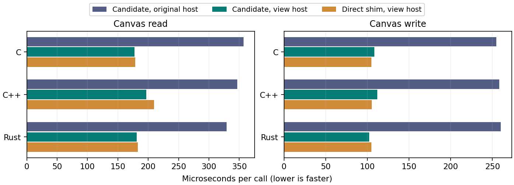
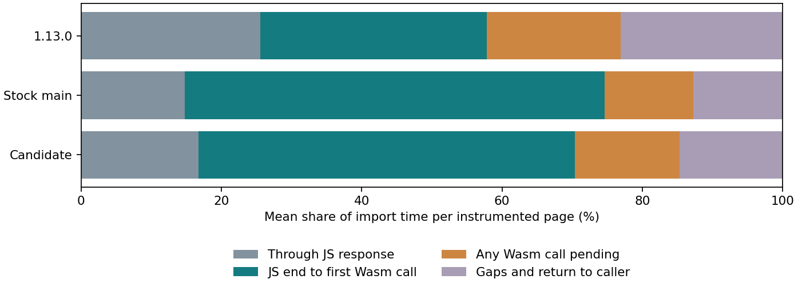
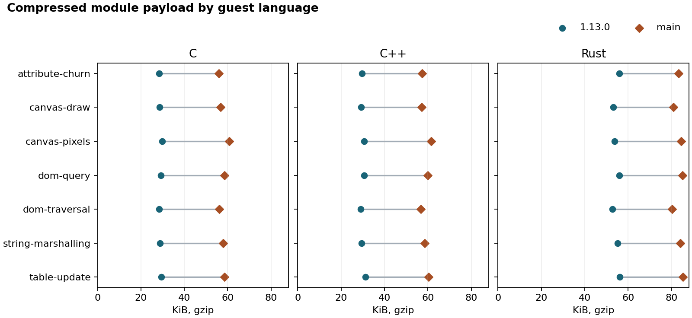

# Component demos

This fork benchmarks the browser examples from [eqrion/component-demos at d0b9dd1](https://github.com/eqrion/component-demos/tree/d0b9dd1390a300978193adc623838fef4e4b632b). It runs the same compiled C, C++, and Rust WebAssembly components through jco 1.13.0, pinned upstream main, and a branch that optimizes synchronous host imports. The comparison also includes the demos’ JavaScript, Emscripten (Embind and EM_JS), and Rust wasm-bindgen implementations where available.

<!-- candidate:start -->

## Optimized browser bindings

The branch uses js-component-bindgen’s internal Oxc bundler and the checked jco-cm-runtime. [Measured Jco commit `5c6ddda44`](https://github.com/vados-cosmonic/jco/commit/5c6ddda44bce1730a61a69f2d48db94e3065ca31) · [Canvas host comparison](#canvas-pixel-transfers-with-the-same-guest-binary) · [Payload and startup](#payload-and-startup) · [First guest result](#time-to-the-first-guest-result) · [Wasm startup timing](#where-startup-time-goes) · [Startup by revision](#startup-against-the-previous-branch) · [Eager compilation](#eager-javascript-compilation) · [Reproduction commands](#reproduce-the-candidate-run)

All Jco builds used the same guest binaries. Each value is the median of 7 fresh-page samples with one warm-up per page. The run collected 728 samples on 2026-11-26 with HeadlessChrome/156.0.8078.47 on Intel(R) Xeon(R) Processor @ 2.60GHz.

Stock main is pinned to `fdbf1ae2d`. [Upstream source](https://github.com/bytecodealliance/jco/commit/fdbf1ae2dbc9469b5c275b5686d8a4c43681618f) · [Transpiler CI build](https://github.com/bytecodealliance/jco/actions/runs/45736422241)

The candidate finished within **10× of the fastest available compiled shim in 21/21** headline comparisons. The largest ratio was **3.71×**. On separate fresh pages it matched or beat **1.13.0 in 16/21** and **stock main in 21/21**. On the same warmed page it matched or beat **1.13.0 in 19/21** headline cases and 80/84 across all phases. The shim comparison selects the lowest median among Embind, EM_JS and wasm-bindgen for each operation, including shims written in a different guest language. The phase tables in the original comparison describe workload differences and include raw JavaScript.


| Operation | Guest | Unit | 1.13.0 | Stock main | Candidate | Candidate / 1.13.0 | Fastest shim | Shim time | Candidate / shim |
| --- | --- | --- | --- | --- | --- | --- | --- | --- | --- |
| Attribute write | C | µs | 1.43 | 4.06 | 0.68 | 0.48× | Embind | 1.28 | 0.53× |
| Attribute write | C++ | µs | 1.27 | 4.16 | 0.64 | 0.50× | Embind | 1.28 | 0.50× |
| Attribute write | Rust | µs | 1.49 | 4.14 | 0.92 | 0.62× | Embind | 1.28 | 0.72× |
| Canvas fillRect | C | µs | 1.19 | 4.14 | 1.11 | 0.93× | Embind | 1.85 | 0.60× |
| Canvas fillRect | C++ | µs | 1.24 | 3.84 | 0.89 | 0.72× | Embind | 1.85 | 0.48× |
| Canvas fillRect | Rust | µs | 1.02 | 3.78 | 0.89 | 0.88× | Embind | 1.85 | 0.48× |
| Canvas pixel read | C | µs | 350.20 | 352.20 | 350.50 | 1.00× | Embind | 209.80 | 1.67× |
| Canvas pixel read | C++ | µs | 364.20 | 346.10 | 305.00 | 0.84× | Embind | 209.80 | 1.45× |
| Canvas pixel read | Rust | µs | 345.50 | 367.80 | 307.00 | 0.89× | Embind | 209.80 | 1.46× |
| DOM ID lookup | C | µs | 1.44 | 5.28 | 1.02 | 0.71× | Embind | 1.31 | 0.78× |
| DOM ID lookup | C++ | µs | 1.52 | 5.65 | 1.13 | 0.74× | Embind | 1.31 | 0.86× |
| DOM ID lookup | Rust | µs | 1.35 | 5.54 | 0.94 | 0.70× | Embind | 1.31 | 0.72× |
| Tree traversal | C | ms | 13.16 | 109.51 | 15.31 | 1.16× | EM_JS | 4.55 | 3.36× |
| Tree traversal | C++ | ms | 14.83 | 111.44 | 13.17 | 0.89× | EM_JS | 4.55 | 2.89× |
| Tree traversal | Rust | ms | 17.98 | 116.75 | 16.90 | 0.94× | EM_JS | 4.55 | 3.71× |
| Read 1 KiB string | C | µs | 4.76 | 7.22 | 2.02 | 0.42× | wasm-bindgen | 5.43 | 0.37× |
| Read 1 KiB string | C++ | µs | 17.44 | 7.79 | 1.97 | 0.11× | wasm-bindgen | 5.43 | 0.36× |
| Read 1 KiB string | Rust | µs | 9.58 | 6.63 | 2.19 | 0.23× | wasm-bindgen | 5.43 | 0.40× |
| Table creation | C | ms | 12.94 | 72.33 | 15.37 | 1.19× | EM_JS | 5.95 | 2.59× |
| Table creation | C++ | ms | 14.89 | 69.26 | 15.51 | 1.04× | EM_JS | 5.95 | 2.61× |
| Table creation | Rust | ms | 13.28 | 77.46 | 15.99 | 1.20× | EM_JS | 5.95 | 2.69× |

Comparing implementations in the same language, the branch stayed within 10× in **13/13** available headline comparisons. Each cell divides the branch’s median by that shim’s median. A dash means the demo has no implementation for that binding. The demos supply compiled shims for C++ and Rust.

| Operation | C++ / Embind | C++ / EM_JS | Rust / wasm-bindgen |
| --- | --- | --- | --- |
| Attribute write | 0.50× | — | — |
| Canvas fillRect | 0.48× | — | — |
| Canvas pixel read | 1.45× | — | — |
| DOM ID lookup | 0.86× | — | — |
| Tree traversal | 0.61× | 2.89× | 2.91× |
| Read 1 KiB string | 0.16× | 0.18× | 0.40× |
| Table creation | 1.02× | 2.61× | 1.50× |

<details><summary>How the synchronous bindings work</summary>

Eligible single-instance, synchronous components reuse the caller’s task for host imports. The adapter keeps direct references to its task stack and instance flags and checks for store interruptions. Oxc removes the asynchronous import fallback and the subtask, waitable, and future constructors. The shutdown path skips creating the two empty stream and future tables. The generator skips asynchronous wrappers for synchronous allocators and post-return hooks. Standalone modules also omit suspension markers on core imports.

In checked standalone bindings, the Oxc linker can put a runtime initializer’s value directly where the module first declares its state. Each declaration still allocates its own maps, arrays or objects in the original order. Calls with arguments, calls inside functions and factories with more complex bodies keep their original implementation.

During a guest allocation, the checked runtime clears the instance’s may-leave flag and restores it on return or throw. Allocators in components with context-slot operations use the general guard to supply fresh slots for each call. The adapter lifts short ASCII strings four bytes at a time. Synchronous UTF-8 results of 256 to 262,144 code units can reuse a per-instance byte buffer capped at 256 KiB. The runtime encodes there before requesting the exact guest allocation. Nested calls and larger results use the ordinary encoder.

Resource drops check the instance flag and record traps. When lifting a borrowed host resource, the adapter validates the handle and reads its 32-bit representation directly. Imported host resources with automatically assigned representations use their guest handle as an array index. Explicit host representations and shared tables use a representation map. Components with async operations, cross-component resource transfers or call tracking use the general adapter.

Earlier runs measured how the linker handles runtime dependencies and initializes module state. [Subtask constructors](https://github.com/vados-cosmonic/component-demos/blob/255eca61b14b5ab63567da558b5f561149cc5163/README.md#change-from-the-previous-branch-revision) · [Future and waitable constructors](https://github.com/vados-cosmonic/component-demos/blob/c25f90d93af43e9261dff31b186d5b01115e8a0f/README.md#change-from-the-previous-branch-revision) · [Direct module initialization](https://github.com/vados-cosmonic/component-demos/blob/bd6eb358c6c106711f5e75022a1498d1051f8989/README.md#direct-module-initialization)

</details>

### Change from the previous branch revision

Both revisions ran on the same guest binaries in the same browser session. Each cell divides the candidate median by the previous revision’s median. Parentheses count the rounds in which the candidate finished faster. [Compare `165324dda` and `5c6ddda44`](https://github.com/vados-cosmonic/jco/compare/165324dda277eef1407d43b80c19401c2d7de37c...5c6ddda44bce1730a61a69f2d48db94e3065ca31)

External core Wasm files matched byte for byte for 32/32 inputs that emitted them. Across the 21 timed guest and workload combinations, the median ratio of candidate to previous startup time was 0.99×.

| Payload | Smallest saving (bytes) | Median saving (bytes) | Largest saving (bytes) | Smaller outputs |
| --- | --- | --- | --- | --- |
| JavaScript | 4,063 | 5,066 | 5,440 | 34/34 |
| Total gzip | 165 | 204 | 230 | 34/34 |
| Total Brotli | 107 | 142 | 180 | 34/34 |

Both branch revisions also ran with their default output and caching disabled. The change column takes the difference for each guest and workload first, then the median of those differences.

| Startup interval | Previous (ms) | Candidate (ms) | Median change (ms) | Faster workloads |
| --- | --- | --- | --- | --- |
| Import to ready | 21.38 | 20.75 | -0.16 | 11/21 |
| Import to JS response end | 2.45 | 2.35 | -0.10 | 13/21 |
| JS end to first Wasm request | 12.16 | 11.94 | +0.04 | 8/21 |
| First Wasm request to last Wasm response | 2.42 | 2.39 | -0.06 | 12/21 |
| Last Wasm response to ready | 4.32 | 4.19 | -0.04 | 11/21 |

| Operation | C | C++ | Rust |
| --- | --- | --- | --- |
| Attribute write | 1.20× (1/7) | 0.95× (5/7) | 1.10× (3/7) |
| Canvas fillRect | 1.31× (3/7) | 0.86× (5/7) | 0.85× (5/7) |
| Canvas pixel read | 1.08× (1/7) | 0.92× (4/7) | 0.98× (3/7) |
| DOM ID lookup | 0.97× (6/7) | 1.05× (3/7) | 1.09× (3/7) |
| Tree traversal | 0.96× (5/7) | 0.83× (5/7) | 0.88× (4/7) |
| Read 1 KiB string | 0.86× (7/7) | 0.86× (6/7) | 1.03× (3/7) |
| Table creation | 1.13× (2/7) | 1.15× (2/7) | 1.15× (2/7) |
| Bulk DOM query | 1.21× (1/7) | 1.01× (3/7) | 0.89× (5/7) |
| Tree construction | 0.84× (6/7) | 0.92× (4/7) | 0.96× (4/7) |
| set 8 B | 0.94× (4/7) | 1.01× (4/7) | 1.11× (3/7) |
| get 8 B | 0.97× (3/7) | 0.95× (4/7) | 1.03× (4/7) |
| get 128 B | 0.97× (3/7) | 0.89× (6/7) | 0.97× (4/7) |
| get 16384 B | 0.96× (5/7) | 0.94× (4/7) | 1.04× (2/7) |
| get 262144 B | 0.93× (6/7) | 0.86× (5/7) | 1.04× (4/7) |

### Warm 1.13.0 comparison on the same page

For each guest and workload, both builds run once to warm up, then 4 times each on the same page. Each pair alternates which build runs first. The runner clears the DOM and performance entries before every call. It repeats this on 9 fresh pages. Each page contributes the median of its candidate / 1.13.0 ratios. The median across pages was at or below 1× for **19/21** headline cases. [Raw paired timings](web/bench/results/paired-browser.json)


The middle 50% describes variation between pages. The median interval uses a two-sided sign test over independent page medians at the 95% level for each phase individually. Measurements on this CPU and browser can share machine load across pages.

| Operation | Guest | Candidate / 1.13.0 | Middle 50% of page ratios | 95% median interval | Pages at or below 1× |
| --- | --- | --- | --- | --- | --- |
| Attribute write | C | 0.50× | 0.49–0.50× | 0.489–0.512× | 9/9 |
| Attribute write | C++ | 0.51× | 0.50–0.52× | 0.489–0.519× | 9/9 |
| Attribute write | Rust | 0.57× | 0.55–0.60× | 0.543–0.602× | 9/9 |
| Canvas fillRect | C | 0.92× | 0.91–0.96× | 0.902–0.964× | 9/9 |
| Canvas fillRect | C++ | 0.92× | 0.90–0.96× | 0.886–0.968× | 8/9 |
| Canvas fillRect | Rust | 0.93× | 0.90–0.98× | 0.893–0.991× | 8/9 |
| Canvas pixel read | C | 1.02× | 0.94–1.07× | 0.860–1.081× | 4/9 |
| Canvas pixel read | C++ | 0.95× | 0.90–1.00× | 0.838–1.021× | 6/9 |
| Canvas pixel read | Rust | 1.07× | 1.01–1.11× | 0.995–1.298× | 2/9 |
| DOM ID lookup | C | 0.60× | 0.56–0.71× | 0.556–0.720× | 9/9 |
| DOM ID lookup | C++ | 0.57× | 0.57–0.74× | 0.567–0.772× | 9/9 |
| DOM ID lookup | Rust | 0.60× | 0.57–0.73× | 0.564–0.770× | 9/9 |
| Tree traversal | C | 0.85× | 0.83–0.91× | 0.813–0.930× | 9/9 |
| Tree traversal | C++ | 0.90× | 0.83–0.95× | 0.816–0.978× | 8/9 |
| Tree traversal | Rust | 0.66× | 0.59–1.10× | 0.569–1.120× | 6/9 |
| Read 1 KiB string | C | 0.44× | 0.42–0.48× | 0.412–0.486× | 9/9 |
| Read 1 KiB string | C++ | 0.48× | 0.46–0.49× | 0.376–0.504× | 9/9 |
| Read 1 KiB string | Rust | 0.43× | 0.39–0.46× | 0.349–0.468× | 9/9 |
| Table creation | C | 0.93× | 0.86–0.99× | 0.837–1.011× | 7/9 |
| Table creation | C++ | 0.92× | 0.85–0.97× | 0.837–1.020× | 7/9 |
| Table creation | Rust | 0.96× | 0.94–1.02× | 0.929–1.042× | 5/9 |

Across all 84 reported phases and string lengths, the same-page comparison matched or beat 1.13.0 in **80/84** cases. The median interval lay entirely above 1× in **0/84** cases. Totals and subphases overlap.

| Slower paired phase | Guest | Metric | Candidate / 1.13.0 | 95% median interval | Pages at or below 1× |
| --- | --- | --- | --- | --- | --- |
| canvas-pixels | Rust | getImageData(): µs/call | 1.071× | 0.995–1.298× | 2/9 |
| canvas-pixels | Rust | putImageData(): µs/call | 1.019× | 0.711–1.099× | 4/9 |
| canvas-pixels | C | getImageData(): µs/call | 1.018× | 0.860–1.081× | 4/9 |
| string-marshalling | C++ | set 16384 B | 1.001× | 0.965–1.029× | 4/9 |

Across all reported phases and string lengths, 81/84 comparable candidate medians were within 10× of the fastest compiled shim and 69/84 matched or beat 1.13.0. Totals and their subphases overlap. Each ratio compares the same phase on both sides.

| Phases above 10× | Phase | Guest | Shim | Candidate / shim |
| --- | --- | --- | --- | --- |
| dom-query | bulk: total ms | C | Embind | 496.20× |
| dom-query | bulk: total ms | C++ | Embind | 484.80× |
| dom-query | bulk: total ms | Rust | Embind | 415.40× |

The bulk DOM query returns a live collection to Embind, which discards it. The component host materializes the collection with `Array.from`, then the bindings lower every element into a WIT resource handle. The ratio includes that difference in work. [Embind loop](cpp/dom-query/emscripten/main.cpp) · [Component host](web/host/web-host.js) · [C guest loop](c/dom-query/main.c)

### DOM bindings with identical guest code

These 216 fresh-page samples compare each language’s exact core Wasm binary with each set of bindings in the table. The direct JS shim calls the same DOM host, puts owned handles in guest memory and recycles them on guest drops. It implements the synchronous imports used by these guests. Jco also provides Canonical ABI checks, task tracking and instance shutdown. [Direct shim](web/bench/dom-core-shim.mjs) · [Raw timings and correctness checks](web/bench/results/dom-control-browser.json)

The bulk query copies 2,000 handles per call, 10 times. Each traversal visits 19,531 nodes. The runner checks the rendered fixture or node count for each guest and verifies list counts and handle release for the direct shim after warm-up and measurement.

With list materialization on both sides, the candidate took **1.64–1.97×** the direct shim’s bulk-query time across the three guests. Times below are per measured workload, after warm-up.


| Phase | Guest | Direct (ms) | 1.13.0 (ms) | Candidate (ms) | Candidate / direct | Candidate / 1.13.0 | Rounds at or below 1.13.0 | Candidate / previous | Rounds at or below previous |
| --- | --- | --- | --- | --- | --- | --- | --- | --- | --- |
| DOM ID lookup | C | 12.22 | 21.93 | 20.32 | 1.66× | 0.93× | 5/9 | 0.97× | 4/9 |
| DOM ID lookup | C++ | 18.89 | 28.32 | 23.27 | 1.23× | 0.82× | 8/9 | 1.00× | 4/9 |
| DOM ID lookup | Rust | 15.06 | 24.89 | 19.97 | 1.33× | 0.80× | 8/9 | 1.07× | 3/9 |
| Bulk DOM query | C | 5.39 | 10.13 | 10.62 | 1.97× | 1.05× | 3/9 | 1.05× | 4/9 |
| Bulk DOM query | C++ | 7.16 | 11.12 | 12.73 | 1.78× | 1.14× | 4/9 | 1.00× | 4/9 |
| Bulk DOM query | Rust | 6.92 | 11.49 | 11.38 | 1.64× | 0.99× | 5/9 | 1.01× | 5/9 |
| Tree construction | C | 27.14 | 50.22 | 48.65 | 1.79× | 0.97× | 3/9 | 0.92× | 6/9 |
| Tree construction | C++ | 26.35 | 52.97 | 47.80 | 1.81× | 0.90× | 7/9 | 1.02× | 5/9 |
| Tree construction | Rust | 21.04 | 50.98 | 48.70 | 2.31× | 0.96× | 5/9 | 0.95× | 6/9 |
| Tree traversal | C | 6.72 | 13.20 | 14.88 | 2.21× | 1.13× | 1/9 | 0.98× | 5/9 |
| Tree traversal | C++ | 6.92 | 14.82 | 14.00 | 2.02× | 0.94× | 6/9 | 1.03× | 5/9 |
| Tree traversal | Rust | 6.21 | 16.69 | 18.94 | 3.05× | 1.13× | 3/9 | 0.94× | 5/9 |

On the same guest binaries, initialization took the following times before the first guest call. Each median covers 9 fresh pages and includes importing the binding module, fetching the guest and instantiating it. The direct shim uses `WebAssembly.instantiateStreaming`.

| Workload | Guest | Direct startup (ms) | 1.13.0 (ms) | Candidate (ms) | Candidate / direct | Candidate / 1.13.0 |
| --- | --- | --- | --- | --- | --- | --- |
| ID and bulk query | C | 10.12 | 11.55 | 22.60 | 2.23× | 1.96× |
| ID and bulk query | C++ | 8.97 | 11.26 | 21.31 | 2.38× | 1.89× |
| ID and bulk query | Rust | 9.79 | 11.55 | 18.67 | 1.91× | 1.62× |
| Tree traversal | C | 8.75 | 12.30 | 21.06 | 2.41× | 1.71× |
| Tree traversal | C++ | 8.35 | 11.13 | 21.00 | 2.52× | 1.89× |
| Tree traversal | Rust | 9.15 | 11.30 | 21.82 | 2.39× | 1.93× |

### Cost of a synchronous host import

The scalar, string and resource loops run 131,072 iterations per pass. The string loop changes the first byte before each call. The resource loop acquires a host object, borrows it to read its value, and drops it. The optional-resource loop checks the discriminant in guest memory every time and reads and drops each present handle. Each pass checks its checksum. All four adapters use byte-identical core modules. The direct shim keeps the fixture’s single live handle in one slot.

The byte-list loops copy a 176 × 176 RGBA region (123,904 bytes) 2,048 times per pass in each direction. The host-to-guest case uses a reusable host view and a fixed guest allocation. In the reverse direction the host keeps the final snapshot while the guest changes the source in Wasm. Both cases sum the changing first byte during the loop and verify the whole payload afterward. The canvas demo also measures browser readback, host allocation and guest allocation.

The string-return loops make 32,768 calls per pass for 16-byte results and 1,024 for 16 KiB results. One host returns a repeated ASCII string. The other rotates four strings containing two-, three-, and four-byte UTF-8 sequences. The guest checks each byte length, sums the first bytes, and hashes every distinct result outside the timer.

Times are nanoseconds per guest iteration, including the loop and host work. Each cell is the median of 7 fresh-page medians, with 2 warm-ups and 5 timed passes per page. The runner interleaves the four builds. [Raw timings and digests](web/bench/results/import-loop.json)

| Operation | Direct | 1.13.0 | Stock main | Candidate | Candidate / 1.13.0 | Candidate / direct |
| --- | --- | --- | --- | --- | --- | --- |
| u32 | 13.7 | 11.4 | 1,711.3 | 14.5 | 1.27× | 1.06× |
| 2-byte string | 420.4 | 415.0 | 2,362.1 | 109.1 | 0.26× | 0.26× |
| 9-byte string | 395.2 | 384.5 | 2,264.4 | 177.0 | 0.46× | 0.45× |
| 32-byte string | 428.0 | 401.3 | 2,372.0 | 421.1 | 1.05× | 0.98× |
| Acquire, borrow, drop | 41.2 | 256.3 | 4,705.0 | 129.7 | 0.51× | 3.15× |
| Optional resource, half present | 31.3 | 206.8 | 3,348.5 | 138.9 | 0.67× | 4.44× |
| 121 KiB host-to-guest byte list | 5,078.1 | 5,175.8 | 9,423.8 | 5,273.4 | 1.02× | 1.04× |
| 121 KiB guest-to-host byte list | 100,781.3 | 99,072.3 | 105,761.7 | 101,269.5 | 1.02× | 1.00× |
| 16-byte UTF-8 result, repeated ASCII | 1,681.5 | 1,675.4 | 3,857.4 | 341.8 | 0.20× | 0.20× |
| 16-byte UTF-8 result, rotating Unicode | 1,840.2 | 1,837.2 | 4,434.2 | 1,022.3 | 0.56× | 0.56× |
| 16 KiB UTF-8 result, repeated ASCII | 35,546.9 | 33,593.7 | 51,562.5 | 18,457.0 | 0.55× | 0.52× |
| 16 KiB UTF-8 result, rotating Unicode | 45,019.5 | 45,019.5 | 71,484.4 | 30,468.7 | 0.68× | 0.68× |


### Where the canvas read spends its time

The same-page comparison was repeated with a clock around the demo’s host method. That method reads 176 × 176 pixels from Chromium and creates a JavaScript byte array. The remainder includes guest allocation and freeing, the copy into Wasm, binding checks, the loop and observer overhead. Each cell is a median across 9 page medians. Columns are summarized independently. [Raw instrumented samples](web/bench/results/canvas-control-browser.json)

| Guest | Bindings | Full read (µs) | Inside host (µs) | Remainder (µs) | Inside host (%) |
| --- | --- | --- | --- | --- | --- |
| C | 1.13.0 | 354.5 | 340.5 | 14.1 | 96.2% |
| C | Candidate | 338.7 | 324.7 | 14.4 | 95.8% |
| C++ | 1.13.0 | 347.9 | 333.7 | 14.6 | 95.8% |
| C++ | Candidate | 339.5 | 324.8 | 14.4 | 96.1% |
| Rust | 1.13.0 | 361.6 | 346.7 | 14.1 | 96.1% |
| Rust | Candidate | 339.2 | 325.9 | 14.2 | 95.8% |

The host accounted for 95.8–96.2% of the full read across these builds. The candidate spent 14.2–14.4 µs per read outside the host, compared with 14.1–14.6 µs for 1.13.0.

### Canvas pixel transfers with the same guest binary

Each call transfers a 176 × 176 RGBA region (123,904 bytes). The original browser host copies the pixel array on both read and write. The alternate host creates a typed-array view over the browser’s readback or the binding’s write snapshot, preserving its offset and length. All four implementations still copy the bytes across the Wasm boundary. [View adapter](web/bench/canvas-host.mjs) · [Direct shim](web/bench/dom-core-shim.mjs)

For each guest, all four bindings use identical core Wasm. Each table cell is the median of 9 page medians, with one warm-up and 4 measured passes per page. The runner rotates the four bindings on each page, alternates the host order and checks every pixel on both canvases after each invocation. [Raw timings and pixel checks](web/bench/results/canvas-host.json)

Changing the host reduced the candidate’s read time by **43–50%** and write time by **57–61%**. With the view adapter, its six timings were **0.94–1.06×** the corresponding direct shim times. The headline benchmarks use the original host.



| Guest | Bindings | Original read (µs) | View read (µs) | Original write (µs) | View write (µs) |
| --- | --- | --- | --- | --- | --- |
| C | Direct shim | 318.1 | 178.8 | 249.2 | 104.8 |
| C | 1.13.0 | 345.2 | 185.8 | 247.6 | 101.2 |
| C | Stock main | 353.7 | 200.0 | 324.8 | 141.5 |
| C | Candidate | 357.1 | 177.7 | 254.9 | 108.5 |
| C++ | Direct shim | 341.1 | 209.9 | 254.1 | 105.5 |
| C++ | 1.13.0 | 335.9 | 194.6 | 264.4 | 108.6 |
| C++ | Stock main | 356.6 | 208.7 | 402.0 | 215.8 |
| C++ | Candidate | 346.8 | 196.7 | 258.3 | 111.8 |
| Rust | Direct shim | 338.8 | 182.8 | 245.5 | 104.9 |
| Rust | 1.13.0 | 379.0 | 187.8 | 255.8 | 106.7 |
| Rust | Stock main | 343.4 | 188.8 | 296.1 | 152.7 |
| Rust | Candidate | 329.0 | 181.1 | 260.0 | 102.2 |

<details><summary>All timed phases and string lengths</summary>

| Demo | Phase | Guest | Candidate time | Fresh-page / 1.13.0 | Same-page / 1.13.0 | Candidate / main | Fastest shim | Candidate / shim |
| --- | --- | --- | --- | --- | --- | --- | --- | --- |
| attribute-churn | total time | C | 54.65 ms | 0.48× | 0.50× | 0.17× | Embind | 0.53× |
| attribute-churn | total time | C++ | 51.13 ms | 0.50× | 0.51× | 0.15× | Embind | 0.50× |
| attribute-churn | total time | Rust | 73.38 ms | 0.62× | 0.57× | 0.22× | Embind | 0.72× |
| attribute-churn | per setAttribute() | C | 0.68 µs | 0.48× | 0.50× | 0.17× | Embind | 0.53× |
| attribute-churn | per setAttribute() | C++ | 0.64 µs | 0.50× | 0.51× | 0.15× | Embind | 0.50× |
| attribute-churn | per setAttribute() | Rust | 0.92 µs | 0.62× | 0.57× | 0.22× | Embind | 0.72× |
| canvas-draw | total | C | 55.33 ms | 0.93× | 0.92× | 0.27× | Embind | 0.60× |
| canvas-draw | total | C++ | 44.45 ms | 0.72× | 0.92× | 0.23× | Embind | 0.48× |
| canvas-draw | total | Rust | 44.65 ms | 0.88× | 0.93× | 0.24× | Embind | 0.48× |
| canvas-draw | per fill_rect() | C | 1.11 µs | 0.93× | 0.92× | 0.27× | Embind | 0.60× |
| canvas-draw | per fill_rect() | C++ | 0.89 µs | 0.72× | 0.92× | 0.23× | Embind | 0.48× |
| canvas-draw | per fill_rect() | Rust | 0.89 µs | 0.88× | 0.93× | 0.24× | Embind | 0.48× |
| canvas-pixels | getImageData(): µs/call | C | 350.50 µs | 1.00× | 1.02× | 1.00× | Embind | 1.67× |
| canvas-pixels | getImageData(): µs/call | C++ | 305.00 µs | 0.84× | 0.95× | 0.88× | Embind | 1.45× |
| canvas-pixels | getImageData(): µs/call | Rust | 307.00 µs | 0.89× | 1.07× | 0.83× | Embind | 1.46× |
| canvas-pixels | putImageData(): µs/call | C | 292.90 µs | 1.09× | 0.96× | 0.94× | Embind | 1.25× |
| canvas-pixels | putImageData(): µs/call | C++ | 268.30 µs | 1.00× | 0.95× | 0.82× | Embind | 1.15× |
| canvas-pixels | putImageData(): µs/call | Rust | 285.20 µs | 0.78× | 1.02× | 0.86× | Embind | 1.22× |
| dom-query | individual: total ms | C | 20.37 ms | 0.71× | 0.60× | 0.19× | Embind | 0.78× |
| dom-query | individual: total ms | C++ | 22.62 ms | 0.74× | 0.57× | 0.20× | Embind | 0.86× |
| dom-query | individual: total ms | Rust | 18.80 ms | 0.70× | 0.60× | 0.17× | Embind | 0.72× |
| dom-query | bulk: total ms | C | 12.40 ms | 1.00× | 0.71× | 0.66× | Embind | 496.20× |
| dom-query | bulk: total ms | C++ | 12.12 ms | 1.04× | 0.75× | 0.60× | Embind | 484.80× |
| dom-query | bulk: total ms | Rust | 10.38 ms | 0.85× | 0.76× | 0.58× | Embind | 415.40× |
| dom-query | individual: µs/element | C | 1.02 µs | 0.71× | 0.60× | 0.19× | Embind | 0.78× |
| dom-query | individual: µs/element | C++ | 1.13 µs | 0.74× | 0.57× | 0.20× | Embind | 0.86× |
| dom-query | individual: µs/element | Rust | 0.94 µs | 0.70× | 0.60× | 0.17× | Embind | 0.72× |
| dom-traversal | build | C | 46.90 ms | 1.06× | 0.77× | 0.22× | EM_JS | 2.25× |
| dom-traversal | build | C++ | 44.59 ms | 0.88× | 0.84× | 0.20× | EM_JS | 2.14× |
| dom-traversal | build | Rust | 48.94 ms | 0.96× | 0.81× | 0.22× | EM_JS | 2.34× |
| dom-traversal | traverse (total) | C | 15.31 ms | 1.16× | 0.85× | 0.14× | EM_JS | 3.36× |
| dom-traversal | traverse (total) | C++ | 13.17 ms | 0.89× | 0.90× | 0.12× | EM_JS | 2.89× |
| dom-traversal | traverse (total) | Rust | 16.90 ms | 0.94× | 0.66× | 0.14× | EM_JS | 3.71× |
| dom-traversal | traverse (per node) | C | 0.78 µs | 1.16× | 0.85× | 0.14× | EM_JS | 3.36× |
| dom-traversal | traverse (per node) | C++ | 0.67 µs | 0.89× | 0.90× | 0.12× | EM_JS | 2.89× |
| dom-traversal | traverse (per node) | Rust | 0.86 µs | 0.94× | 0.66× | 0.14× | EM_JS | 3.71× |
| string-marshalling | set 8 B | C | 0.42 µs | 0.47× | 0.72× | 0.12× | EM_JS | 1.14× |
| string-marshalling | set 8 B | C++ | 0.43 µs | 0.48× | 0.72× | 0.13× | EM_JS | 1.14× |
| string-marshalling | set 8 B | Rust | 0.48 µs | 0.53× | 0.67× | 0.16× | EM_JS | 1.29× |
| string-marshalling | get 8 B | C | 0.57 µs | 0.23× | 0.25× | 0.11× | EM_JS | 2.65× |
| string-marshalling | get 8 B | C++ | 0.52 µs | 0.23× | 0.25× | 0.11× | EM_JS | 2.39× |
| string-marshalling | get 8 B | Rust | 0.61 µs | 0.24× | 0.25× | 0.10× | EM_JS | 2.85× |
| string-marshalling | set 128 B | C | 0.63 µs | 0.66× | 0.91× | 0.14× | wasm-bindgen | 1.12× |
| string-marshalling | set 128 B | C++ | 0.65 µs | 0.87× | 0.91× | 0.16× | wasm-bindgen | 1.15× |
| string-marshalling | set 128 B | Rust | 0.71 µs | 0.74× | 0.98× | 0.19× | wasm-bindgen | 1.26× |
| string-marshalling | get 128 B | C | 1.95 µs | 0.83× | 0.70× | 0.37× | wasm-bindgen | 2.40× |
| string-marshalling | get 128 B | C++ | 1.83 µs | 0.81× | 0.81× | 0.35× | wasm-bindgen | 2.24× |
| string-marshalling | get 128 B | Rust | 1.86 µs | 0.70× | 0.76× | 0.39× | wasm-bindgen | 2.28× |
| string-marshalling | set 1024 B | C | 1.02 µs | 0.91× | 0.96× | 0.24× | wasm-bindgen | 1.15× |
| string-marshalling | set 1024 B | C++ | 0.98 µs | 0.85× | 0.87× | 0.25× | wasm-bindgen | 1.11× |
| string-marshalling | set 1024 B | Rust | 1.05 µs | 0.96× | 0.88× | 0.27× | wasm-bindgen | 1.19× |
| string-marshalling | get 1024 B | C | 2.02 µs | 0.42× | 0.44× | 0.28× | wasm-bindgen | 0.37× |
| string-marshalling | get 1024 B | C++ | 1.97 µs | 0.11× | 0.48× | 0.25× | wasm-bindgen | 0.36× |
| string-marshalling | get 1024 B | Rust | 2.19 µs | 0.23× | 0.43× | 0.33× | wasm-bindgen | 0.40× |
| string-marshalling | set 16384 B | C | 7.36 µs | 0.95× | 0.99× | 0.68× | wasm-bindgen | 1.09× |
| string-marshalling | set 16384 B | C++ | 7.21 µs | 1.07× | 1.00× | 0.63× | wasm-bindgen | 1.06× |
| string-marshalling | set 16384 B | Rust | 7.69 µs | 1.06× | 0.99× | 0.80× | wasm-bindgen | 1.13× |
| string-marshalling | get 16384 B | C | 18.93 µs | 0.32× | 0.47× | 0.34× | wasm-bindgen | 0.22× |
| string-marshalling | get 16384 B | C++ | 18.76 µs | 0.59× | 0.53× | 0.32× | wasm-bindgen | 0.22× |
| string-marshalling | get 16384 B | Rust | 20.22 µs | 0.50× | 0.48× | 0.39× | wasm-bindgen | 0.24× |
| string-marshalling | set 262144 B | C | 111.05 µs | 0.42× | 0.94× | 0.40× | Embind | 0.91× |
| string-marshalling | set 262144 B | C++ | 109.85 µs | 0.45× | 0.86× | 0.38× | Embind | 0.90× |
| string-marshalling | set 262144 B | Rust | 119.15 µs | 0.45× | 0.95× | 0.46× | Embind | 0.98× |
| string-marshalling | get 262144 B | C | 278.05 µs | 0.29× | 0.29× | 0.35× | wasm-bindgen | 0.21× |
| string-marshalling | get 262144 B | C++ | 269.35 µs | 0.28× | 0.29× | 0.33× | wasm-bindgen | 0.20× |
| string-marshalling | get 262144 B | Rust | 297.75 µs | 0.28× | 0.30× | 0.39× | wasm-bindgen | 0.23× |
| table-update | create: total ms | C | 15.37 ms | 1.19× | 0.93× | 0.21× | EM_JS | 2.59× |
| table-update | create: total ms | C++ | 15.51 ms | 1.04× | 0.92× | 0.22× | EM_JS | 2.61× |
| table-update | create: total ms | Rust | 15.99 ms | 1.20× | 0.96× | 0.21× | EM_JS | 2.69× |
| table-update | create: µs/row | C | 7.69 µs | 1.19× | 0.93× | 0.21× | EM_JS | 2.59× |
| table-update | create: µs/row | C++ | 7.75 µs | 1.04× | 0.92× | 0.22× | EM_JS | 2.61× |
| table-update | create: µs/row | Rust | 8.00 µs | 1.20× | 0.96× | 0.21× | EM_JS | 2.69× |
| table-update | update (selected): total ms | C | 0.97 ms | 0.97× | 0.94× | 0.27× | wasm-bindgen | 0.89× |
| table-update | update (selected): total ms | C++ | 0.93 ms | 0.89× | 0.86× | 0.25× | wasm-bindgen | 0.85× |
| table-update | update (selected): total ms | Rust | 0.95 ms | 0.93× | 0.92× | 0.28× | wasm-bindgen | 0.88× |
| table-update | update (selected): µs/row | C | 0.49 µs | 0.97× | 0.94× | 0.27× | wasm-bindgen | 0.89× |
| table-update | update (selected): µs/row | C++ | 0.46 µs | 0.89× | 0.86× | 0.25× | wasm-bindgen | 0.85× |
| table-update | update (selected): µs/row | Rust | 0.47 µs | 0.93× | 0.92× | 0.28× | wasm-bindgen | 0.88× |
| table-update | clear (unselected): total ms | C | 3.83 ms | 0.99× | 0.74× | 0.24× | wasm-bindgen | 1.42× |
| table-update | clear (unselected): total ms | C++ | 4.12 ms | 0.88× | 0.73× | 0.20× | wasm-bindgen | 1.52× |
| table-update | clear (unselected): total ms | Rust | 3.52 ms | 0.83× | 0.76× | 0.20× | wasm-bindgen | 1.30× |
| table-update | clear (unselected): µs/row | C | 1.92 µs | 0.99× | 0.74× | 0.24× | wasm-bindgen | 1.42× |
| table-update | clear (unselected): µs/row | C++ | 2.06 µs | 0.88× | 0.73× | 0.20× | wasm-bindgen | 1.52× |
| table-update | clear (unselected): µs/row | Rust | 1.76 µs | 0.83× | 0.76× | 0.20× | wasm-bindgen | 1.30× |

</details>

### Payload and startup

Payload medians cover 34 component inputs. Compression is per file. Startup is the median of the 21 per-workload and guest medians, from dynamic import through initialization, with browser caching disabled.

| Build | JS (KiB) | Core Wasm (KiB) | Total (KiB) | Gzip (KiB) | Brotli (KiB) | Startup (ms) |
| --- | --- | --- | --- | --- | --- | --- |
| 1.13.0 | 19.4 | 64.4 | 85.4 | 29.3 | 24.1 | 11.13 |
| Stock main | 183.9 | 64.4 | 255.2 | 58.2 | 48.3 | 27.08 |
| Candidate | 127.5 | 64.4 | 194.9 | 50.2 | 41.8 | 20.75 |

### What ships with `--minify`

Each Jco build generated its default and minified distribution from the same 34 components. Jco 1.13.0 uses Terser for its minify option. Stock main and the branch use Oxc. All external Wasm files matched byte for byte across formats. Payloads include JavaScript and external Wasm, compressed per file. Chromium interleaved the six distributions across 630 fresh pages, with 5 rounds for each of the 21 guest and workload combinations. The two ratio columns compare each format to that build’s default for the same guest and workload, then take the median of the 21 ratios. The final column compares workload times to the same format of 1.13.0. [Distribution sizes](web/bench/results/minified-sizes.json) · [Timings and resource requests](web/bench/results/minified-browser.json)

| Distribution | JS (KiB) | Total gzip (KiB) | Total Brotli (KiB) | Startup (ms) | Startup / default | Runtime / default | At or below 1.13.0 |
| --- | --- | --- | --- | --- | --- | --- | --- |
| 1.13.0 default | 19.4 | 29.3 | 24.1 | 11.21 | 1.00× | 1.00× | 21/21 |
| 1.13.0 minified | 8.7 | 28.8 | 23.7 | 10.75 | 0.98× | 0.96× | 21/21 |
| Stock main default | 183.9 | 58.2 | 48.3 | 26.15 | 1.00× | 1.00× | 2/21 |
| Stock main minified | 106.9 | 51.2 | 43.2 | 23.61 | 0.91× | 0.99× | 1/21 |
| Candidate default | 127.5 | 50.2 | 41.8 | 20.69 | 1.00× | 1.00× | 15/21 |
| Candidate minified | 69.8 | 44.7 | 37.9 | 19.16 | 0.93× | 1.02× | 14/21 |

Chromium’s Resource Timing entries give four consecutive intervals from the start of dynamic import until the module is ready. The gap before the first Wasm request includes resolving dependencies and executing JavaScript. The local server served uncompressed assets with caching disabled. Browser response-body sizes were checked against the generated file sizes. Each column reports its own median over workload medians.

| Distribution | Import to JS response end (ms) | JS response end to first Wasm request (ms) | First Wasm request to last Wasm response (ms) | Last Wasm response to ready (ms) |
| --- | --- | --- | --- | --- |
| 1.13.0 default | 2.32 | 3.32 | 2.50 | 2.98 |
| 1.13.0 minified | 2.24 | 2.99 | 2.44 | 2.96 |
| Stock main default | 2.58 | 16.67 | 2.56 | 4.13 |
| Stock main minified | 2.39 | 14.15 | 2.53 | 4.29 |
| Candidate default | 2.54 | 11.98 | 2.39 | 4.31 |
| Candidate minified | 2.43 | 10.42 | 2.55 | 4.07 |

Minifying the branch reduced startup by 7% on the median same-workload comparison. Its median import-to-ready time was 19.16 ms, compared with 10.75 ms for minified 1.13.0. Between the end of the entry JavaScript response and the first Wasm request, the corresponding medians were 10.42 and 2.99 ms.


### Startup with DevTools disconnected

In 1,470 fresh documents, the page timed its own dynamic import, ran the guest and sent the result to a local server. One browser kept the Puppeteer DevTools connection open. The other disconnected before the first measured navigation. Both navigated the same tab, with matching Chrome flags, no-store responses and verified network transfers. The order of the two browsers alternated over 5 rounds. Each table cell is the median of the 21 workload medians. [Observer timings](web/bench/results/startup-observer.json)

| Distribution | Attached startup (ms) | Detached startup (ms) | Attached JS end to Wasm request (ms) | Detached JS end to Wasm request (ms) |
| --- | --- | --- | --- | --- |
| 1.13.0 default | 8.95 | 6.58 | 3.00 | 1.75 |
| 1.13.0 minified | 8.37 | 6.26 | 2.69 | 1.79 |
| Stock main default | 23.08 | 14.78 | 15.90 | 8.63 |
| Stock main minified | 21.09 | 14.08 | 13.95 | 8.12 |
| Candidate default | 18.06 | 12.06 | 10.90 | 6.19 |
| Candidate minified | 16.69 | 11.54 | 10.00 | 5.78 |
| Previous branch default | 18.17 | 12.45 | 10.88 | 6.33 |

With DevTools disconnected, default-output startup took **1.01×** the previous revision’s time. The candidate was faster in 9/21 workloads. Each workload contributes its median within-round time ratio.

### Where startup time goes

Across 9 rounds, 1,134 fresh pages imported a default module and checked its first guest result with DevTools disconnected. Half recorded when the browser’s asynchronous WebAssembly compile and instantiate calls began and when their promises settled. Each instrumented page had an ordinary control with the same build, workload and round. The last column gives the median paired import-time ratio.

| Build | Import (ms) | Through JS response (ms) | JS end to first Wasm call (ms) | Compile only (ms) | Instantiate only (ms) | Both pending (ms) | Between calls (ms) | Last settlement to ready (ms) | Traced / ordinary |
| --- | --- | --- | --- | --- | --- | --- | --- | --- | --- |
| 1.13.0 | 6.26 | 1.68 | 1.95 | 1.03 | 0.14 | 0.05 | 1.28 | 0.13 | 0.99× |
| Stock main | 13.81 | 1.95 | 8.05 | 1.48 | 0.15 | 0.04 | 1.11 | 0.31 | 0.95× |
| Candidate | 10.97 | 1.84 | 5.94 | 1.31 | 0.17 | 0.00 | 1.18 | 0.23 | 0.99× |

Compared with 1.13.0, the candidate’s median paired difference was **+4.79 ms** for import and **+3.97 ms** between the JavaScript response and the first Wasm call. These differences pair the two traced pages within each round before taking the median per workload and across workloads.

Each instant on a page counts once, including when several compile calls overlap. Pending calls measure elapsed wall time and can include fetching a module, scheduling and JavaScript running on the same page. The time from the entry script’s response to the first Wasm call also includes loading its dependencies. Instrumented pages copy the interval records after import readiness and before calling the guest. Columns are medians across workload medians and can sum to a different value from the median import. [Call intervals and ordinary control samples](web/bench/results/wasm-startup.json)



### Time to the first guest result

Each fresh page called the guest immediately after import, using the same workload arguments across builds. The first call includes the complete guest workload and its browser API calls. The final column times both import and execution on one clock. Each column reports the median of the 21 workload medians with DevTools disconnected.

| Distribution | Import (ms) | First guest call (ms) | Time to first result (ms) |
| --- | --- | --- | --- |
| 1.13.0 default | 6.58 | 57.12 | 65.25 |
| 1.13.0 minified | 6.26 | 58.65 | 64.78 |
| Stock main default | 14.78 | 211.00 | 227.91 |
| Stock main minified | 14.08 | 211.66 | 226.54 |
| Candidate default | 12.06 | 58.83 | 71.43 |
| Candidate minified | 11.54 | 60.59 | 75.08 |
| Previous branch default | 12.45 | 55.96 | 68.44 |

The following ratios compare default builds within each round. Each row summarizes the three language medians. A ratio below 1 means the candidate returned the guest result sooner.

| Workload | Candidate / 1.13.0 | Candidate / stock main |
| --- | --- | --- |
| Attribute write | 0.69× | 0.22× |
| Canvas fillRect | 1.11× | 0.32× |
| Canvas pixel read | 1.01× | 0.78× |
| DOM ID lookup | 0.99× | 0.29× |
| Tree traversal | 1.05× | 0.20× |
| Read 1 KiB string | 0.90× | 0.73× |
| Table creation | 1.29× | 0.30× |

The candidate reached the first result at or before 1.13.0 in **9/21** language/workload pairs and at or before stock main in **21/21**.


### Eager JavaScript compilation

The branch exposes `jco transpile --eager-compile` and the JS API option `eagerCompile: true`. The option reproduced all 21 hinted candidate modules served in these trials. Verification also checked 68 ordinary and minified JS outputs after removing the hint, and all 64 accompanying Wasm outputs against their original hashes. [Jco transpile options at the verified revision](https://github.com/vados-cosmonic/jco/blob/5c6ddda44bce1730a61a69f2d48db94e3065ca31/docs/src/transpiling.md) · [Verification](web/bench/verify-compile-hint.mjs)

The server prepended `//# allFunctionsCalledOnLoad` and a newline to each ordinary entry module. Chromium can use these 29 bytes to compile functions while the module loads. Each guest used identical Wasm and the same browser host. DevTools was disconnected. The full run used the headline workloads. A second run measured a first call that writes attributes on eight elements twice, draws 16 rectangles, queries eight elements twice, traverses a seven-node tree, or creates and updates eight table rows. [V8 compile hints](https://v8.dev/blog/explicit-compile-hints) · [Full workload timings](web/bench/results/compile-hint.json) · [Small workload timings](web/bench/results/compile-hint-small.json)

Each cell summarizes the median hinted / ordinary ratio within rounds, then takes the median across language/workload pairs. A ratio below 1 favors eager compilation. The last column counts pairs for which the guest returned its first result sooner.

| Workload | Build | Rounds | Import | First guest call | Time to first result | Pairs with earlier first result |
| --- | --- | --- | --- | --- | --- | --- |
| Full | 1.13.0 | 9 | 1.12× | 0.93× | 0.94× | 20/21 |
| Full | Stock main | 9 | 1.28× | 0.98× | 1.00× | 10/21 |
| Full | Candidate | 9 | 1.26× | 0.91× | 0.99× | 12/21 |
| Small | 1.13.0 | 15 | 1.06× | 0.34× | 0.79× | 15/15 |
| Small | Stock main | 15 | 1.28× | 0.47× | 0.92× | 15/15 |
| Small | Candidate | 15 | 1.28× | 0.29× | 0.96× | 14/15 |

For applications that import the component ahead of an interaction, the first-call column measures the remaining wait. Applications that import on demand also pay the import time. The absolute times below are candidate medians across workload medians, with each column summarized independently.

| Workload | Candidate output | Import (ms) | First guest call (ms) | Time to first result (ms) |
| --- | --- | --- | --- | --- |
| Full | Ordinary | 12.10 | 58.00 | 69.55 |
| Full | Eager | 15.94 | 54.16 | 70.07 |
| Small | Ordinary | 13.07 | 6.35 | 19.36 |
| Small | Eager | 16.94 | 2.00 | 18.80 |

| Eager candidate first result at or before release | Ordinary 1.13.0 | Eager 1.13.0 |
| --- | --- | --- |
| Full | 7/21 | 6/21 |
| Small | 0/15 | 0/15 |

Each pair also has a two-sided 95% sign-test interval for its median first-result ratio across fresh-browser rounds. The counts below show how often the interval establishes a direction on this machine. Coverage applies to each comparison individually.

| Candidate workload | Interval favors eager | Interval includes 1 | Interval favors ordinary |
| --- | --- | --- | --- |
| Full | 1 | 20 | 0 |
| Small | 1 | 14 | 0 |

| Candidate first result | Small workload | Full workload |
| --- | --- | --- |
| Attribute write | 0.97× | 1.03× |
| Canvas fillRect | 0.96× | 0.97× |
| Canvas pixel read | — | 0.96× |
| DOM ID lookup | 0.94× | 1.01× |
| Tree traversal | 0.96× | 1.02× |
| Read 1 KiB string | — | 1.00× |
| Table creation | 0.97× | 0.93× |


### Shorter private runtime names

The Oxc linker prefixes private module-scope runtime names to avoid collisions with component bindings. The candidate uses `$cm$` and adds another dollar sign if a component already uses the prefix. Intrinsic names remain visible in stack traces. Public exports retain their original names.

Across 34 inputs the verifier found 10,010 occurrences of the old prefix. Replacing just those bytes reproduced every default JavaScript file. All external core modules matched. The packaged minifier preserves function names, so the shorter prefix can also reduce minified payloads. The table compares the recorded minified files for the same guest binaries. [Previous minified inventory](https://github.com/vados-cosmonic/component-demos/blob/bd6eb358c6c106711f5e75022a1498d1051f8989/web/bench/results/minified-sizes.json) · [Per-input verification](web/bench/results/runtime-names.json)

| Minified payload | Smallest saving (bytes) | Median saving (bytes) | Largest saving (bytes) | Smaller outputs |
| --- | --- | --- | --- | --- |
| Uncompressed | 2,822 | 3,689 | 4,063 | 34/34 |
| Gzip | 99 | 154.5 | 189 | 34/34 |
| Brotli | 66 | 106.5 | 176 | 34/34 |

### Startup against the previous branch

The same detached runs included ordinary output from the previous generator `165324dda`. The table compares the two default builds, using the same component binaries and workload arguments in each round. For each language/workload pair, it divides candidate time by previous time and takes the median across rounds. Each timing column summarizes those pair medians. The last columns count the two-sided 95% sign-test intervals for time to first result that lie wholly below or above parity.

| Workload | Rounds | Import | First call | Time to first result | Pairs with earlier first result | Interval favors candidate | Interval favors previous |
| --- | --- | --- | --- | --- | --- | --- | --- |
| Full | 9 | 1.02× | 0.97× | 0.97× | 13/21 | 3 | 0 |
| Small | 15 | 0.96× | 0.90× | 0.94× | 14/15 | 1 | 0 |

### Generated JavaScript reached by each demo

Chromium recorded block coverage on 126 fresh pages in a separate run. One page imported each module and finished initialization. A second also ran the demo once and checked its output. The table reports medians over the 21 guest and workload combinations. Sizes count UTF-8 bytes in V8’s covered source ranges. A demo can leave error handling, shutdown or other supported operations unexercised. [Per-module coverage and hashes](web/bench/results/js-coverage.json)

| Build | Reached at init (KiB) | Reached through first run (KiB) | Share through first run | Unreached through first run (KiB) |
| --- | --- | --- | --- | --- |
| 1.13.0 | 4.8 | 16.3 | 76.6% | 5.0 |
| Stock main | 54.6 | 97.4 | 50.9% | 93.3 |
| Candidate | 32.8 | 56.6 | 43.9% | 72.7 |

V8 also identified the functions that define the candidate’s shared runtime classes. Each row counts the function and its nested methods in the generated JavaScript. Reached bytes come from V8 block coverage on the same pages. The values are medians across modules containing that function.

| Runtime class | Modules | Emitted (KiB) | Reached at init (KiB) | Through first run (KiB) | Unreached through first run (KiB) |
| --- | --- | --- | --- | --- | --- |
| `AsyncTask` | 21 | 25.0 | 5.6 | 7.1 | 17.9 |
| `ComponentAsyncState` | 21 | 18.2 | 1.8 | 2.8 | 15.4 |
| `AsyncThread` | 21 | 3.4 | 0.8 | 0.8 | 2.6 |
| `RepTable` | 21 | 3.0 | 1.1 | 1.3 | 1.7 |

<details><summary>Candidate startup, variation and paired comparison to 1.13.0</summary>

The paired ratio divides the candidate time by the 1.13.0 time within each round, then takes the median. The final column counts rounds where the candidate was at least as fast.

| Operation | Guest | Startup median (ms) | Warm phase p25 | Warm phase p50 | Warm phase p75 | Phase unit | Paired ratio to 1.13.0 | Rounds at or below 1.13.0 |
| --- | --- | --- | --- | --- | --- | --- | --- | --- |
| Attribute write | C | 22.03 | 0.64 | 0.68 | 0.77 | µs | 0.52× | 7/7 |
| Attribute write | C++ | 20.06 | 0.60 | 0.64 | 0.74 | µs | 0.47× | 7/7 |
| Attribute write | Rust | 18.73 | 0.85 | 0.92 | 0.92 | µs | 0.59× | 7/7 |
| Canvas fillRect | C | 21.23 | 0.96 | 1.11 | 1.14 | µs | 0.88× | 4/7 |
| Canvas fillRect | C++ | 22.14 | 0.84 | 0.89 | 1.01 | µs | 0.72× | 6/7 |
| Canvas fillRect | Rust | 20.01 | 0.82 | 0.89 | 0.95 | µs | 0.90× | 5/7 |
| Canvas pixel read | C | 22.30 | 308.65 | 350.50 | 409.55 | µs | 1.11× | 3/7 |
| Canvas pixel read | C++ | 20.69 | 294.30 | 305.00 | 363.30 | µs | 0.84× | 5/7 |
| Canvas pixel read | Rust | 19.65 | 289.00 | 307.00 | 348.80 | µs | 0.98× | 4/7 |
| DOM ID lookup | C | 21.40 | 0.91 | 1.02 | 1.13 | µs | 0.74× | 6/7 |
| DOM ID lookup | C++ | 23.60 | 1.05 | 1.13 | 1.26 | µs | 0.86× | 6/7 |
| DOM ID lookup | Rust | 19.51 | 0.77 | 0.94 | 0.98 | µs | 0.70× | 6/7 |
| Tree traversal | C | 21.41 | 14.86 | 15.31 | 15.87 | ms | 1.16× | 1/7 |
| Tree traversal | C++ | 19.65 | 12.74 | 13.17 | 13.88 | ms | 1.01× | 3/7 |
| Tree traversal | Rust | 20.75 | 16.69 | 16.90 | 20.75 | ms | 1.04× | 3/7 |
| Read 1 KiB string | C | 18.56 | 1.85 | 2.02 | 2.05 | µs | 0.41× | 7/7 |
| Read 1 KiB string | C++ | 20.70 | 1.79 | 1.97 | 2.05 | µs | 0.12× | 7/7 |
| Read 1 KiB string | Rust | 19.54 | 1.95 | 2.19 | 2.35 | µs | 0.25× | 7/7 |
| Table creation | C | 21.73 | 14.67 | 15.37 | 16.99 | ms | 1.13× | 0/7 |
| Table creation | C++ | 21.80 | 14.78 | 15.51 | 15.65 | ms | 1.04× | 1/7 |
| Table creation | Rust | 21.00 | 13.12 | 15.99 | 16.43 | ms | 1.08× | 2/7 |

</details>

[Raw browser timings](web/bench/results/candidate-browser.json) · [File sizes, digests and generator revision](web/bench/results/candidate-sizes.json)

### Reproduce the candidate run

Run the dependency installation, main setup and size commands in [Reproduce the comparison](#reproduce-the-comparison), then run the following from the repository root. Cargo uses the Jco checkout’s pinned toolchain and lockfile.

```sh
git clone https://github.com/vados-cosmonic/jco ../jco-candidate
git -C ../jco-candidate checkout 5c6ddda44bce1730a61a69f2d48db94e3065ca31
node web/bench/candidate.mjs ../jco-candidate
git -C ../jco-candidate worktree add --detach ../jco-reference 165324dda277eef1407d43b80c19401c2d7de37c
node web/bench/candidate.mjs --reference ../jco-reference
CHROME_BIN=/path/to/chrome BENCH_CANDIDATE=1 ROUNDS=7 node web/bench/browser.mjs
CHROME_BIN=/path/to/chrome BENCH_DOM_CONTROL=1 ROUNDS=9 node web/bench/browser.mjs
CHROME_BIN=/path/to/chrome BENCH_PAIRED=1 ROUNDS=9 node web/bench/browser.mjs
CHROME_BIN=/path/to/chrome BENCH_CANVAS_CONTROL=1 ROUNDS=9 node web/bench/browser.mjs
CHROME_BIN=/path/to/chrome ROUNDS=9 node web/bench/canvas-host-bench.mjs
CHROME_BIN=/path/to/chrome ROUNDS=7 node web/bench/import-loop.mjs ../jco-candidate
CHROME_BIN=/path/to/chrome node web/bench/coverage.mjs
pnpm -C ../jco-candidate install --frozen-lockfile
pnpm -C ../jco-candidate --filter @bytecodealliance/jco-transpile run build
node web/bench/candidate.mjs --verify-wasm ../jco-candidate
node web/bench/minified.mjs ../jco-candidate
python3 web/bench/verify-runtime-names.py bd6eb358c6c106711f5e75022a1498d1051f8989
CHROME_BIN=/path/to/chrome BENCH_MINIFIED=1 ROUNDS=5 node web/bench/browser.mjs
CHROME_BIN=/path/to/chrome ROUNDS=5 node web/bench/startup-observer.mjs
CHROME_BIN=/path/to/chrome ROUNDS=9 node web/bench/startup-observer.mjs --wasm-timing
CHROME_BIN=/path/to/chrome ROUNDS=9 node web/bench/startup-observer.mjs --compile-hint
CHROME_BIN=/path/to/chrome ROUNDS=15 node web/bench/startup-observer.mjs --compile-hint --small
node web/bench/verify-compile-hint.mjs ../jco-candidate
python3 web/bench/report.py --from-candidate
python3 web/bench/candidate-report.py
```

The minification comparison uses each version’s packaged transpiler. The verification command compares the packaged candidate’s default JavaScript and core Wasm to the native generator’s measured output for every input.

<details><summary>Run the Jco binding correctness checks</summary>

After building the candidate above, these tests exercise the inline and bundled generators, both runtime profiles, synchronous imports and the async operations that share their runtime. The integration tests use the guest fixtures from the pinned upstream build.

```sh
cd ../jco-candidate
cargo test --locked -p js-component-bindgen --lib
cargo test --locked -p js-component-bindgen --lib --features embedded-cm-runtime
pnpm --filter @bytecodealliance/jco-cm-runtime test
pnpm --filter @bytecodealliance/jco-cm-runtime test:checked
gh run download 45736422241 --repo bytecodealliance/jco --name js-generated-tests --dir packages/jco-transpile/test/fixtures/generated
cd packages/jco-transpile
node node_modules/vitest/vitest.mjs run -c test/vitest.ts \
  test/sync-host-import.ts test/p3/canonical-abi-traps.ts test/p3/task-return-memory.ts \
  test/p3/sync-call-block-trap.ts test/p3/async-export-future-result.ts \
  test/p3/future-lifts.ts test/p3/future-lowers.ts test/p3/future-drop.ts test/p3/future-transfer-g2g.ts \
  test/p3/stream-lifts.ts test/p3/stream-lowers.ts test/p3/stream-pass-through.ts test/p3/sync-stream-copy.ts
```

</details>

<!-- candidate:end -->

<!-- benchmark:start -->

## Browser performance

**jco 1.13.0 vs. main at `fdbf1ae2`** · 2026-11-26 · HeadlessChrome/156.0.8078.47 · Intel(R) Xeon(R) Processor @ 2.60GHz · linux 6.12.111 x64 · Node v26.13.0. [Upstream commit](https://github.com/bytecodealliance/jco/commit/fdbf1ae2dbc9469b5c275b5686d8a4c43681618f) · [Transpiler build](https://github.com/bytecodealliance/jco/actions/runs/45736422241)

These stock and shim timings come from the same interleaved fresh-page trial as the performance branch. [Full trial](web/bench/results/candidate-browser.json) · [Stock and shim samples](web/bench/results/browser.json)

Across the seven operations below and three guest languages, main took longer in **18 of 21** median comparisons. The highest ratio was **8.32×** for the C guest in `dom-traversal`.

For 256 KiB string reads, the median time on main changed by -28% to -15% across the three guest languages. The phase tables below include every tested string size.

Each cell is the median of 7 fresh-page samples. The chart divides main’s median time by 1.13.0’s for the same guest and operation. A value below 1× means main finished faster.


| Operation | JS | Embind | EM_JS | wasm-bindgen | C 1.13.0 | C main | C++ 1.13.0 | C++ main | Rust 1.13.0 | Rust main |
| --- | ---: | ---: | ---: | ---: | ---: | ---: | ---: | ---: | ---: | ---: |
| Attribute write (µs) | 0.307 | 1.28 | — | — | 1.43 | 4.06 | 1.27 | 4.16 | 1.49 | 4.14 |
| Canvas fillRect (µs) | 0.871 | 1.85 | — | — | 1.19 | 4.14 | 1.24 | 3.84 | 1.02 | 3.78 |
| Canvas pixel read (µs) | 159.80 | 209.80 | — | — | 350.20 | 352.20 | 364.20 | 346.10 | 345.50 | 367.80 |
| DOM ID lookup (µs) | 0.318 | 1.31 | — | — | 1.44 | 5.28 | 1.52 | 5.65 | 1.35 | 5.54 |
| Tree traversal (ms) | 0.925 | 21.59 | 4.55 | 5.81 | 13.16 | 109.51 | 14.83 | 111.44 | 17.98 | 116.75 |
| Read 1 KiB string (µs) | 0.091 | 12.01 | 10.86 | 5.43 | 4.76 | 7.22 | 17.44 | 7.79 | 9.58 | 6.63 |
| Table creation (ms) | 4.03 | 15.18 | 5.95 | 10.67 | 12.94 | 72.33 | 14.89 | 69.26 | 13.28 | 77.46 |

Embind and EM_JS are the C++ Emscripten variants. An em dash marks an unavailable combination. Across toolchains, the upstream implementations can do different amounts of work. For example, the JavaScript bulk DOM query obtains a live collection while the component host materializes a list.

<details><summary>Run-to-run variation for the two jco versions</summary>

Each cell spans the 25th to 75th percentile of measured times, using linear interpolation between sorted samples.

| Operation | C 1.13.0 | C main | C++ 1.13.0 | C++ main | Rust 1.13.0 | Rust main |
| --- | ---: | ---: | ---: | ---: | ---: | ---: |
| Attribute write (µs) | 1.25–1.43 | 3.92–4.18 | 1.26–1.47 | 4.03–4.25 | 1.43–1.57 | 3.86–4.39 |
| Canvas fillRect (µs) | 0.884–1.27 | 3.57–4.29 | 1.06–1.29 | 3.76–3.94 | 0.884–1.16 | 3.34–4.04 |
| Canvas pixel read (µs) | 320.40–358.80 | 334.35–369.50 | 357.40–385.00 | 331.00–387.50 | 308.15–363.65 | 352.45–378.30 |
| DOM ID lookup (µs) | 1.24–1.54 | 4.98–5.89 | 1.23–1.56 | 5.15–5.97 | 1.10–1.35 | 5.32–5.65 |
| Tree traversal (ms) | 12.36–14.22 | 106.15–115.33 | 13.07–16.13 | 109.42–113.89 | 14.69–19.59 | 112.46–121.11 |
| Read 1 KiB string (µs) | 4.28–5.07 | 7.02–7.98 | 9.17–22.75 | 7.01–8.37 | 5.15–14.87 | 6.42–7.40 |
| Table creation (ms) | 12.21–15.12 | 67.00–79.10 | 13.49–15.50 | 63.84–77.03 | 12.71–15.34 | 68.05–79.23 |

</details>

<details><summary>All workload phases, per-call timings, and string transfer rates</summary>

Times come from the tables rendered by the demos and retain their original reporting precision. Effective string throughput uses the ASCII payload length divided by median call time (decimal MB/s).

**attribute-churn**

| Operation | JS | Embind | EM_JS | wasm-bindgen | C 1.13.0 | C main | C++ 1.13.0 | C++ main | Rust 1.13.0 | Rust main |
| --- | ---: | ---: | ---: | ---: | ---: | ---: | ---: | ---: | ---: | ---: |
| total time (ms) | 24.59 | 102.52 | — | — | 114.43 | 324.95 | 101.42 | 333.15 | 119.05 | 331.21 |
| per setAttribute() (µs) | 0.307 | 1.28 | — | — | 1.43 | 4.06 | 1.27 | 4.16 | 1.49 | 4.14 |

**canvas-draw**

| Operation | JS | Embind | EM_JS | wasm-bindgen | C 1.13.0 | C main | C++ 1.13.0 | C++ main | Rust 1.13.0 | Rust main |
| --- | ---: | ---: | ---: | ---: | ---: | ---: | ---: | ---: | ---: | ---: |
| total (ms) | 43.55 | 92.36 | — | — | 59.48 | 207.04 | 61.82 | 192.06 | 50.94 | 189.03 |
| per fill_rect() (µs) | 0.871 | 1.85 | — | — | 1.19 | 4.14 | 1.24 | 3.84 | 1.02 | 3.78 |

**canvas-pixels**

| Operation | JS | Embind | EM_JS | wasm-bindgen | C 1.13.0 | C main | C++ 1.13.0 | C++ main | Rust 1.13.0 | Rust main |
| --- | ---: | ---: | ---: | ---: | ---: | ---: | ---: | ---: | ---: | ---: |
| getImageData() (µs) | 159.80 | 209.80 | — | — | 350.20 | 352.20 | 364.20 | 346.10 | 345.50 | 367.80 |
| putImageData() (µs) | 13.00 | 234.00 | — | — | 269.80 | 312.70 | 268.50 | 327.70 | 367.30 | 333.00 |

**dom-query**

| Operation | JS | Embind | EM_JS | wasm-bindgen | C 1.13.0 | C main | C++ 1.13.0 | C++ main | Rust 1.13.0 | Rust main |
| --- | ---: | ---: | ---: | ---: | ---: | ---: | ---: | ---: | ---: | ---: |
| individual, total (ms) | 6.37 | 26.21 | — | — | 28.80 | 105.59 | 30.37 | 113.08 | 27.02 | 110.79 |
| bulk, total (ms) | 0.01 | 0.025 | — | — | 12.38 | 18.79 | 11.70 | 20.30 | 12.16 | 17.80 |
| individual: µs/element (µs) | 0.318 | 1.31 | — | — | 1.44 | 5.28 | 1.52 | 5.65 | 1.35 | 5.54 |

**dom-traversal**

| Operation | JS | Embind | EM_JS | wasm-bindgen | C 1.13.0 | C main | C++ 1.13.0 | C++ main | Rust 1.13.0 | Rust main |
| --- | ---: | ---: | ---: | ---: | ---: | ---: | ---: | ---: | ---: | ---: |
| build (ms) | 10.77 | 32.73 | 20.87 | 25.61 | 44.28 | 209.97 | 50.45 | 217.60 | 50.96 | 220.69 |
| traverse (total) (ms) | 0.925 | 21.59 | 4.55 | 5.81 | 13.16 | 109.51 | 14.83 | 111.44 | 17.98 | 116.75 |
| traverse (per node) (µs) | 0.047 | 1.10 | 0.233 | 0.297 | 0.674 | 5.61 | 0.76 | 5.71 | 0.92 | 5.98 |

**string-marshalling**


| Operation | JS | Embind | EM_JS | wasm-bindgen | C 1.13.0 | C main | C++ 1.13.0 | C++ main | Rust 1.13.0 | Rust main |
| --- | ---: | ---: | ---: | ---: | ---: | ---: | ---: | ---: | ---: | ---: |
| set 8 B (µs) | 0.19 | 0.892 | 0.374 | 0.485 | 0.897 | 3.47 | 0.88 | 3.18 | 0.904 | 2.94 |
| set 8 B (MB/s) | 42.11 | 8.97 | 21.39 | 16.49 | 8.92 | 2.31 | 9.09 | 2.52 | 8.85 | 2.72 |
| get 8 B (µs) | 0.078 | 0.945 | 0.216 | 0.234 | 2.54 | 5.06 | 2.25 | 4.64 | 2.52 | 6.43 |
| get 8 B (MB/s) | 102.56 | 8.47 | 37.04 | 34.19 | 3.14 | 1.58 | 3.56 | 1.72 | 3.17 | 1.24 |
| set 128 B (µs) | 0.283 | 1.14 | 0.903 | 0.564 | 0.963 | 4.42 | 0.749 | 4.08 | 0.959 | 3.63 |
| set 128 B (MB/s) | 452.30 | 112.78 | 141.75 | 226.95 | 132.92 | 28.97 | 170.89 | 31.41 | 133.47 | 35.25 |
| get 128 B (µs) | 0.082 | 2.37 | 1.50 | 0.816 | 2.36 | 5.29 | 2.27 | 5.24 | 2.67 | 4.71 |
| get 128 B (MB/s) | 1,560.98 | 53.94 | 85.05 | 156.86 | 54.26 | 24.21 | 56.41 | 24.45 | 47.89 | 27.16 |
| set 1024 B (µs) | 1.00 | 1.58 | 2.90 | 0.884 | 1.12 | 4.17 | 1.16 | 3.95 | 1.09 | 3.95 |
| set 1024 B (MB/s) | 1,020.94 | 648.10 | 352.50 | 1,158.37 | 917.56 | 245.56 | 884.28 | 259.37 | 937.73 | 259.24 |
| get 1024 B (µs) | 0.091 | 12.01 | 10.86 | 5.43 | 4.76 | 7.22 | 17.44 | 7.79 | 9.58 | 6.63 |
| get 1024 B (MB/s) | 11,252.75 | 85.29 | 94.33 | 188.55 | 215.17 | 141.91 | 58.71 | 131.43 | 106.92 | 154.50 |
| set 16384 B (µs) | 12.32 | 8.23 | 36.12 | 6.78 | 7.74 | 10.82 | 6.74 | 11.37 | 7.28 | 9.65 |
| set 16384 B (MB/s) | 1,329.44 | 1,990.52 | 453.54 | 2,416.16 | 2,115.70 | 1,514.37 | 2,430.50 | 1,441.11 | 2,251.17 | 1,697.82 |
| get 16384 B (µs) | 0.434 | 171.65 | 168.65 | 85.50 | 58.64 | 56.25 | 31.66 | 58.98 | 40.41 | 51.58 |
| get 16384 B (MB/s) | 37,751.15 | 95.45 | 97.15 | 191.63 | 279.41 | 291.27 | 517.45 | 277.81 | 405.41 | 317.67 |
| set 262144 B (µs) | 160.08 | 121.80 | 564.40 | 249.50 | 265.40 | 280.35 | 242.55 | 285.50 | 266.40 | 261.25 |
| set 262144 B (MB/s) | 1,637.60 | 2,152.25 | 464.46 | 1,050.68 | 987.73 | 935.06 | 1,080.78 | 918.19 | 984.02 | 1,003.42 |
| get 262144 B (µs) | 11.61 | 2,708.55 | 2,689.85 | 1,315.90 | 963.70 | 802.25 | 947.15 | 807.55 | 1,048.50 | 754.20 |
| get 262144 B (MB/s) | 22,586.94 | 96.78 | 97.46 | 199.21 | 272.02 | 326.76 | 276.77 | 324.62 | 250.02 | 347.58 |

**table-update**

| Operation | JS | Embind | EM_JS | wasm-bindgen | C 1.13.0 | C main | C++ 1.13.0 | C++ main | Rust 1.13.0 | Rust main |
| --- | ---: | ---: | ---: | ---: | ---: | ---: | ---: | ---: | ---: | ---: |
| create, total (ms) | 4.03 | 15.18 | 5.95 | 10.67 | 12.94 | 72.33 | 14.89 | 69.26 | 13.28 | 77.46 |
| create, per row (µs) | 2.01 | 7.59 | 2.97 | 5.33 | 6.47 | 36.16 | 7.45 | 34.63 | 6.64 | 38.73 |
| update (selected), total (ms) | 0.505 | 1.29 | 1.20 | 1.08 | 0.995 | 3.61 | 1.04 | 3.70 | 1.02 | 3.38 |
| update (selected), per row (µs) | 0.252 | 0.645 | 0.6 | 0.542 | 0.498 | 1.80 | 0.523 | 1.85 | 0.513 | 1.69 |
| clear (unselected), total (ms) | 1.78 | 3.64 | 4.48 | 2.71 | 3.88 | 16.20 | 4.71 | 20.23 | 4.22 | 17.78 |
| clear (unselected), per row (µs) | 0.89 | 1.82 | 2.24 | 1.35 | 1.94 | 8.10 | 2.35 | 10.12 | 2.11 | 8.89 |

</details>

<details><summary>Module load and initialization, median milliseconds</summary>

Elapsed browser time for dynamic import through instantiation, with the shared demo host already loaded. The browser process is reused, each page has HTTP caching disabled, and assets are served uncompressed over loopback. These timings include scheduling and local requests. JS is already loaded by the harness.

| Workload | Embind | EM_JS | wasm-bindgen | C 1.13.0 | C main | C++ 1.13.0 | C++ main | Rust 1.13.0 | Rust main |
| --- | ---: | ---: | ---: | ---: | ---: | ---: | ---: | ---: | ---: |
| attribute-churn | 13.20 | — | — | 11.07 | 26.69 | 10.17 | 24.81 | 11.13 | 22.92 |
| canvas-draw | 14.76 | — | — | 12.17 | 24.78 | 11.46 | 27.08 | 11.43 | 25.14 |
| canvas-pixels | 15.76 | — | — | 11.91 | 28.23 | 12.94 | 28.88 | 12.04 | 26.40 |
| dom-query | 14.59 | — | — | 10.31 | 28.29 | 10.54 | 27.28 | 11.67 | 26.94 |
| dom-traversal | 13.73 | 9.56 | 9.02 | 11.08 | 27.23 | 10.63 | 27.94 | 12.07 | 28.57 |
| string-marshalling | 13.18 | 9.05 | 8.13 | 10.00 | 24.31 | 10.10 | 25.96 | 10.26 | 22.86 |
| table-update | 13.23 | 10.02 | 9.62 | 10.91 | 27.82 | 11.13 | 28.08 | 11.15 | 28.53 |

</details>

<details><summary>Workload parameters and sampling</summary>

| Workload | Arguments |
| --- | ---: |
| attribute-churn | `elements=2000`, `iters=10` |
| canvas-draw | `rects=50000` |
| canvas-pixels | `size=256`, `minMs=10` |
| dom-query | `numElements=2000`, `iters=10` |
| dom-traversal | `depth=6`, `numChildren=5` |
| string-marshalling | `minMs=10` |
| table-update | `rows=2000` |

The regenerated 1.13.0 runtime assets match the checked-in jco output byte for byte for 21 of the 21 timed components.

Each page runs one warm-up, clears the document and performance entries, and runs the same workload again on the initialized module. The runner rotates the implementation order each round and reverses traversal on alternating rounds. Browser timings cover the work instrumented inside the demos. Canvas timings measure the API calls, which can finish before painting. Native Firefox execution was outside this Chromium run. [Individual samples in seconds and load times in milliseconds](web/bench/results/browser.json)

</details>

## Module size

Across 34 component inputs, the median change in gzip payload on main was **+27.8 KiB** per component (range +20.2 to +31.0 KiB). The payload sums the emitted JavaScript and external core Wasm files, including any Wasm inlined into JavaScript. Gzip level 9 and Brotli quality 11 are applied per file. Shared host code, HTML, type declarations and HTTP headers are excluded. The raw JavaScript reference lives in the demo page controller.

All external core Wasm files match byte for byte between the two generators. The size differences come entirely from the emitted JavaScript.



**DOM traversal download size** in KiB, gzip. Each row compares implementations from one guest language.

| Guest | Native component | jco 1.13.0 | jco main | Embind | EM_JS | wasm-bindgen |
| --- | ---: | ---: | ---: | ---: | ---: | ---: |
| C | 26.4 | 28.5 | 56.2 | — | — | — |
| C++ | 26.9 | 29.0 | 56.7 | 21.4 | 14.2 | — |
| Rust | 50.6 | 52.7 | 80.3 | — | — | 27.0 |

<details><summary>All component sizes, in KiB</summary>

Paired columns list **1.13.0 / main**. Native is the original component binary. Core Wasm counts only separate .wasm files.

| Component | Native | Files | JS | Core Wasm | Raw total | Gzip | Brotli |
| --- | ---: | ---: | ---: | ---: | ---: | ---: | ---: |
| C attribute-churn | 65.1 | 2 / 2 | 19.0 / 177.9 | 61.4 / 61.4 | 80.5 / 239.3 | 28.4 / 56.0 | 23.3 / 46.4 |
| C calculator | 0.9 | 1 / 1 | 2.3 / 101.4 | 0.0 / 0.0 | 2.3 / 101.4 | 1.3 / 21.6 | 1.2 / 18.5 |
| C canvas-draw | 66.5 | 2 / 2 | 22.6 / 192.3 | 61.9 / 61.9 | 84.6 / 254.2 | 28.6 / 56.7 | 23.6 / 46.9 |
| C canvas-pixels | 70.1 | 2 / 2 | 24.2 / 210.8 | 64.7 / 64.7 | 88.9 / 275.5 | 29.7 / 60.7 | 24.5 / 50.2 |
| C dom-query | 68.0 | 2 / 2 | 22.0 / 194.1 | 63.7 / 63.7 | 85.6 / 257.8 | 29.2 / 58.5 | 24.0 / 48.5 |
| C dom-traversal | 66.0 | 2 / 2 | 21.1 / 185.3 | 62.0 / 62.0 | 83.1 / 247.3 | 28.5 / 56.2 | 23.4 / 46.5 |
| C greet-bindgen | 56.3 | 2 / 2 | 2.6 / 108.8 | 55.9 / 55.9 | 58.5 / 164.8 | 24.3 / 46.3 | 20.0 / 38.8 |
| C greet-freestanding | 0.9 | 1 / 1 | 3.0 / 105.9 | 0.0 / 0.0 | 3.0 / 105.9 | 1.6 / 23.2 | 1.5 / 19.9 |
| C greet-libc | 54.9 | 2 / 2 | 2.6 / 108.8 | 54.5 / 54.5 | 57.1 / 163.3 | 23.8 / 45.8 | 19.5 / 38.4 |
| C hello-world | 60.4 | 2 / 2 | 13.8 / 164.1 | 57.8 / 57.8 | 71.6 / 222.0 | 26.7 / 54.6 | 22.0 / 45.5 |
| C string-marshalling | 66.2 | 2 / 2 | 19.4 / 184.9 | 62.6 / 62.6 | 82.0 / 247.5 | 28.9 / 57.9 | 23.9 / 48.2 |
| C table-update | 70.7 | 2 / 2 | 21.2 / 192.3 | 66.6 / 66.6 | 87.8 / 258.9 | 29.3 / 58.5 | 24.2 / 48.6 |
| C++ attribute-churn | 68.9 | 2 / 2 | 19.0 / 177.9 | 65.3 / 65.3 | 84.3 / 243.2 | 29.7 / 57.2 | 24.4 / 47.4 |
| C++ canvas-draw | 68.5 | 2 / 2 | 22.6 / 192.3 | 63.9 / 63.9 | 86.6 / 256.2 | 29.1 / 57.2 | 24.0 / 47.3 |
| C++ canvas-pixels | 73.1 | 2 / 2 | 24.2 / 210.8 | 67.8 / 67.8 | 91.9 / 278.5 | 30.6 / 61.6 | 25.1 / 50.7 |
| C++ dom-query | 71.7 | 2 / 2 | 22.0 / 194.1 | 67.4 / 67.4 | 89.4 / 261.5 | 30.7 / 60.0 | 25.1 / 49.6 |
| C++ dom-traversal | 68.0 | 2 / 2 | 21.1 / 185.3 | 64.0 / 64.0 | 85.1 / 249.3 | 29.0 / 56.7 | 23.8 / 47.0 |
| C++ hello-world | 60.4 | 2 / 2 | 13.8 / 164.1 | 57.8 / 57.8 | 71.6 / 221.9 | 26.6 / 54.5 | 21.9 / 45.4 |
| C++ string-marshalling | 68.3 | 2 / 2 | 19.4 / 184.9 | 64.8 / 64.8 | 84.1 / 249.6 | 29.5 / 58.5 | 24.3 / 48.5 |
| C++ table-update | 74.9 | 2 / 2 | 21.2 / 192.3 | 70.9 / 70.9 | 92.1 / 263.2 | 31.2 / 60.3 | 25.4 / 49.8 |
| Rust attribute-churn | 152.0 | 2 / 2 | 18.8 / 176.5 | 148.5 / 148.5 | 167.3 / 325.0 | 55.8 / 83.2 | 45.9 / 68.8 |
| Rust calculator-raw | 258.7 | 2 / 2 | 1.4 / 101.0 | 258.4 / 258.4 | 259.8 / 359.3 | 85.4 / 105.6 | 72.3 / 89.6 |
| Rust calculator | 258.0 | 2 / 2 | 1.4 / 101.0 | 257.7 / 257.7 | 259.1 / 358.7 | 85.1 / 105.4 | 72.1 / 89.4 |
| Rust canvas-draw | 140.9 | 2 / 2 | 22.4 / 190.9 | 136.4 / 136.4 | 158.8 / 327.3 | 53.0 / 80.9 | 43.8 / 67.1 |
| Rust canvas-pixels | 142.9 | 2 / 2 | 24.0 / 209.4 | 137.7 / 137.7 | 161.6 / 347.0 | 53.7 / 84.4 | 44.2 / 69.7 |
| Rust dom-query | 148.8 | 2 / 2 | 21.7 / 192.7 | 144.7 / 144.7 | 166.4 / 337.4 | 55.9 / 85.1 | 46.0 / 70.4 |
| Rust dom-traversal (dom_traversal.my.component) | 138.7 | 2 / 2 | 20.2 / 183.9 | 135.7 / 135.7 | 155.9 / 319.6 | 52.7 / 80.3 | 43.5 / 66.6 |
| Rust dom-traversal | 138.7 | 2 / 2 | 20.2 / 183.9 | 135.7 / 135.7 | 155.9 / 319.6 | 52.7 / 80.3 | 43.5 / 66.6 |
| Rust hello-world | 17.4 | 2 / 2 | 13.6 / 162.8 | 14.9 / 14.9 | 28.5 / 177.7 | 8.9 / 36.6 | 7.4 / 30.8 |
| Rust string-marshalling | 146.9 | 2 / 2 | 19.1 / 183.5 | 143.4 / 143.4 | 162.5 / 326.9 | 55.2 / 84.0 | 45.6 / 69.7 |
| Rust table-rows | 33.3 | 2 / 2 | 13.1 / 160.2 | 31.1 / 31.1 | 44.2 / 191.3 | 16.2 / 43.1 | 14.0 / 36.7 |
| Rust table-update | 149.5 | 2 / 2 | 20.6 / 191.5 | 146.2 / 146.2 | 166.8 / 337.7 | 56.1 / 85.2 | 46.3 / 70.7 |
| Rust todomvc | 14.4 | 2 / 2 | 15.3 / 164.7 | 11.6 / 11.6 | 26.8 / 176.3 | 7.6 / 34.6 | 6.5 / 29.2 |
| Rust vdom-diff | 40.9 | 2 / 2 | 14.8 / 164.6 | 38.5 / 38.5 | 53.3 / 203.1 | 19.7 / 46.7 | 17.0 / 39.8 |

</details>

<details><summary>Emscripten and wasm-bindgen payloads, in KiB</summary>

| Artifact directory | Files | Raw total | Gzip | Brotli |
| --- | ---: | ---: | ---: | ---: |
| cpp/attribute-churn/emscripten | 2 | 58.7 | 22.1 | 19.5 |
| cpp/canvas-draw/emscripten | 2 | 57.7 | 21.3 | 18.7 |
| cpp/canvas-pixels/emscripten | 2 | 63.8 | 23.4 | 20.4 |
| cpp/dom-query/emscripten | 2 | 60.0 | 22.3 | 19.6 |
| cpp/dom-traversal/em-js | 2 | 31.9 | 14.2 | 12.4 |
| cpp/dom-traversal/emscripten | 2 | 57.4 | 21.4 | 18.8 |
| cpp/string-marshalling/em-js | 2 | 33.4 | 14.8 | 13.0 |
| cpp/string-marshalling/emscripten | 2 | 58.4 | 21.8 | 19.2 |
| cpp/table-update/em-js | 2 | 35.6 | 15.5 | 13.6 |
| cpp/table-update/emscripten | 2 | 63.7 | 23.1 | 20.2 |
| rust/dom-traversal-wasm-bindgen | 2 | 72.0 | 27.0 | 22.6 |
| rust/string-marshalling-wasm-bindgen | 2 | 72.6 | 27.1 | 22.5 |
| rust/table-update-wasm-bindgen | 2 | 77.3 | 28.1 | 23.5 |

</details>

[Per-file byte counts and SHA-256 digests](web/bench/results/sizes.json)

<!-- benchmark:end -->

<details><summary>Earlier UTF-8 measurements</summary>

The performance branch also specializes UTF-8 conversion in both directions. For strings of up to 32 ASCII bytes, the bindings read or write the bytes directly. Non-ASCII text uses the checked codec, including its malformed-input traps. [Short-string changes](https://github.com/vados-cosmonic/jco/compare/ac28d5d481f3cfca94bc4c62f3571511c19386d9...9eeb7f0b9ab82a982810af5cdd1d9035b302aa39)

For longer host-returned strings, the runtime can encode into a reusable buffer before allocating guest memory. On the preceding upstream revision, a 16 KiB read took 26–28 µs across C, C++, and Rust, or 46–50% of the time for 1.13.0. The archived run compares the bindings immediately before and after this change. [UTF-8 benchmark and raw measurements](https://github.com/vados-cosmonic/component-demos/blob/7550fa7523931f918b6bd599174af07e6537961b/README.md#optimized-browser-bindings)

</details>

## Reproduce the comparison

From the repository root, use Node 24 or newer, npm, an authenticated GitHub CLI, Chrome or Chromium, and Python with Matplotlib 3.10.8 for the graphs.

```sh
npm ci --prefix web
web/bench/setup-main.sh
npm run --prefix web bench:sizes
CHROME_BIN=/path/to/chrome npm run --prefix web bench:browser
python3 web/bench/report.py
```

The setup script verifies the upstream CI run against the Git SHA in [pin.json](web/bench/pin.json) before downloading its transpiler. If the artifacts have expired, run `web/bench/setup-main.sh --source` with Git, pnpm 11, and the upstream Rust toolchain available. To measure a newer main, update the SHA and matching Linux test run in the pin, check the transpiler dependencies in `web/bench/main/package.json` against that checkout’s lockfile, and rerun the commands. Set `ROUNDS` to change the sample count.

The size pass reads the committed `web/{c,cpp,rust}/*/native/*.wasm` inputs and emits both browser variants in sibling `jco-baseline/` and `jco-main/` directories. They share the demo’s host mappings, disable Node compatibility, and use each generator’s default browser output. Each asset has a SHA-256 digest and separate raw, gzip, and Brotli byte counts. Generated bindings are local build products.

To run the original interactive demos, use `npm run --prefix web dev` after installing web dependencies. Their native mode requires a Firefox build with experimental WebAssembly Component Model support. The guest sources and their original build scripts remain in `c/`, `cpp/`, and `rust/`.
