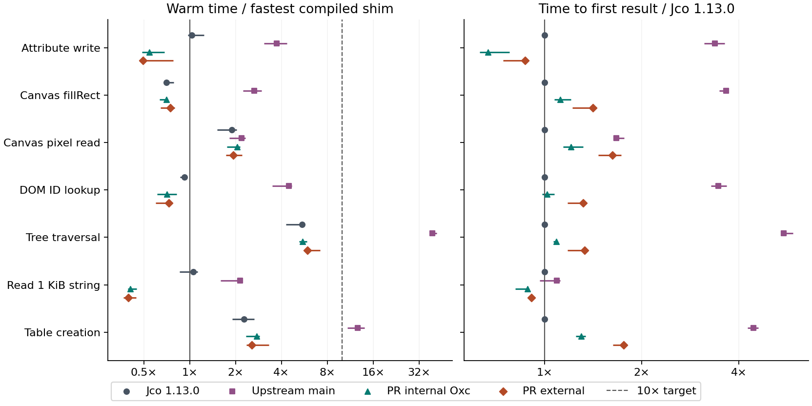

# Component demos

This fork measures browser bindings for the same C, C++, and Rust WebAssembly components from [eqrion/component-demos](https://github.com/eqrion/component-demos/tree/d0b9dd1390a300978193adc623838fef4e4b632b). The controls are the demos’ compiled shims, Jco 1.13.0, and upstream main at `326f52ab4`. The review branch uses the checked TypeScript runtime through both internal Oxc bundling and the external `jco-cm-runtime` package. [Upstream Jco PR](https://github.com/bytecodealliance/jco/pull/2551)

## Browser performance on the upstream PR

With task reuse restricted to the executing guest, both providers were faster than upstream main and within 10× of the fastest compiled shim on all 21 warm headline workloads. Across C, C++ and Rust, warm tree traversal was **6.8–8.7× faster than main** and table creation was **4.9–5.8× faster**. The matrix used 12 balanced Chromium rounds and 1,164 fresh documents at Jco revision `8030a21cf`. [Per-workload results and prior revisions](docs/browser-performance.md) · [DOM and canvas breakdown](docs/dom-performance.md)

| Across 21 workloads | Internal Oxc | External runtime |
| --- | ---: | ---: |
| Warm medians faster than upstream main | 21/21 | 21/21 |
| Largest warm time relative to fastest compiled shim (C tree traversal) | 5.90× | 7.15× |
| Warm medians at or below Jco 1.13.0 | 12/21 | 13/21 |
| First-result medians at or below Jco 1.13.0 | 7/21 | 6/21 |

Across all 84 original warm phases, 81 met the 10× target. In the other three phases, the fastest shim discarded a live DOM collection. When it also materialized and dropped the 2,000 handles returned by the component, both Jco modes took 1.46–1.64× the shim time. [Equal-work measurements](docs/runtime-packaging.md#loading-synchronous-task-operations-in-the-browser)

## Host calls and resources

A synchronous leaf can reuse its active guest task and skip a subtask allocation on each host crossing. Detached host imports and calls during initialization still acquire a task when needed. The following medians come from controlled loops inside the guest, in nanoseconds per operation. [Binding measurements](docs/bindings.md) · [Resource lifetime and shutdown](docs/resources.md) · [PR-base controls](docs/revision-comparisons.md#pr-head-against-upstream-main)

| Guest loop | Jco 1.13.0 | PR base | Internal Oxc | External runtime |
| --- | ---: | ---: | ---: | ---: |
| Scalar host call | 16.8 | 2,378.8 | 21.4 | 24.4 |
| Acquire, borrow, and drop a resource | 329.6 | 5,218.5 | 152.6 | 148.0 |

## Module size and cold startup

These are medians across the 21 workloads on the upstream PR. JavaScript sizes include the generated binding and all runtime modules it fetches. Guest Wasm and per-file Brotli measurements are in the size breakdown. [Module size](docs/module-size.md) · [Cold-start and instantiation breakdown](docs/cold-start.md)

| Median | Jco 1.13.0 | Upstream main | Internal Oxc | External runtime |
| --- | ---: | ---: | ---: | ---: |
| Import and initialization (ms) | 12.22 | 27.14 | 22.35 | 43.82 |
| First completed result (ms) | 121.89 | 435.89 | 122.96 | 159.70 |
| Complete JS, raw (KiB) | 9.58 | 111.34 | 69.76 | 107.84 |
| Complete JS, gzip (KiB) | 3.01 | 25.42 | 18.61 | 34.85 |
| JS requests | 1 | 1 | 1 | 15 |

Cold startup is the remaining gap. Import was measurably slower than 1.13.0 on all 21 workloads in both modes. Even with all cores compiled and the bindings imported, the first table instance took about 1.0 ms on release, 4.6–4.8 ms internally and 5.2–5.3 ms externally. Splitting seven synchronous task operations out of the external async driver saved 4,212 Brotli bytes and reduced paired import time by 6.7% against the preceding external build. [Runtime packaging](docs/runtime-packaging.md) · [HTTP, caching and application bundling](docs/browser-delivery.md)

Preload links on the HTML response reduced time from navigation to the first table result. Across the C repeat, C++ and Rust trials, internal Jco took 12–15% less time with hints. External point estimates improved 11–16%, with the C interval including parity. Against an equally hinted release, internal intervals included parity and external Jco still took 25–26% longer across the three guests. [Cold-navigation measurements](docs/cold-start.md#preloading-the-bindings-from-the-navigation-response)

## Review and remaining work

| Fork PR | Scope and review order |
| --- | --- |
| [#63](https://github.com/vados-cosmonic/jco/pull/63) | Shared synchronous task and resource operations on the pinned upstream main. Includes provider documentation, the checked runtime and the embedded snapshot. Passed 509 checked tests and packed-consumer conformance. |
| [#62](https://github.com/vados-cosmonic/jco/pull/62) | Integration branch with compiler eligibility rules and measurements for both bindgen modes. |
| [#64](https://github.com/vados-cosmonic/jco/pull/64) | Two packaging commits already in #62, isolated against the point immediately before the package split. |
| [#65](https://github.com/vados-cosmonic/jco/pull/65) | Reentrant FIFO callback fix on top of #62. The exact head passed 527 checked runtime tests, 374 Rust tests and 71 integration fixtures. |

The FIFO change fixes duplicate callbacks on nested lock release. In the first focused trial, the empty lock cycle fell from 36.39 to 19.54 ns and the 32-callback cycle from 1,464.84 to 673.22 ns. In an independent repeat the empty cycle took 0.535× the previous time and the 32-callback cycle took 0.499×. Both one-callback point estimates were about 17% slower, and both intervals included parity. [Callback measurements](docs/lock-release.md) · [Revision comparisons](docs/revision-comparisons.md)

## Reproduce the comparison

Run benchmark commands from the repository root. The original guests and build scripts are under `c/`, `cpp/`, and `rust/`. To open the interactive demos, install the web dependencies with `npm ci --prefix web` and run `npm run --prefix web dev`. [Build and benchmark instructions](docs/reproduce.md) · [Original release and main comparison](docs/baseline-study.md) · [Original candidate, controls and reproduction](docs/candidate-study.md)
