# Component demos

This fork benchmarks the browser examples from [eqrion/component-demos at d0b9dd1](https://github.com/eqrion/component-demos/tree/d0b9dd1390a300978193adc623838fef4e4b632b). It runs the same compiled C, C++, and Rust WebAssembly components through jco 1.13.0, pinned upstream main, and a branch that optimizes synchronous host imports and numeric guest exports. The comparison also includes the demos’ JavaScript, Emscripten (Embind and EM_JS), and Rust wasm-bindgen implementations where available.

## Resource table initialization at eda794c50

A resource transfer between component instances needs to find the destination table by ID. A synchronous component with one instance can use its table directly. The checked compiler now omits the array that indexed these tables and the assignments that populated it. Shutdown still uses its separate list of live tables and captures. Custom runtime providers continue to receive the registry. [Compiler change, runtime explanation and regression test](https://github.com/vados-cosmonic/jco/commit/eda794c504bb0a53ac50bf41ee1b240d3e714aab)

Across 21 external demo entries, the compiler removed 21 array initializations and 156 table assignments (7–8 per component). Removing the initializer import and those statements from the previous unminified output reproduced the new external source apart from blank lines. Internal Oxc already eliminated the registry in the 21 minified direct modules. Bindings that expose an explicit `instantiate` function were smaller in both modes. [Per-entry sizes and hashes](web/bench/results/resource-table-registry-eda794c50.json.gz)

| Minified entry size reduction, raw / gzip bytes | Internal Oxc | External checked |
| --- | ---: | ---: |
| Direct module, median of 21 demos | 0 / 0 | 98 / 63 |
| C table, direct module | 0 / 0 | 107 / 68 |
| C table, synchronous `instantiate` | 137 / 67 | 105 / 66 |
| C table, asynchronous `instantiate` | 137 / 65 | 101 / 64 |

In the paired Chromium comparison with `1919c56ed`, the suite-wide external time ratios were 1.014× for import (95% interval 0.956–1.037), 0.996× for first result (0.970–1.016) and 0.983× for warm execution (0.926–1.050). Each interval includes parity. The measurable gain from removing the registry was in generated size and initialization work. [All 1,668 documents from 12 paired browser rounds](web/bench/results/review-matrix-registry-eda794c50.json.gz)

| Browser metric | Jco 1.13.0 | Upstream main at `326f52ab4` | Internal Oxc | External checked |
| --- | ---: | ---: | ---: | ---: |
| Import and initialization (ms) | 5.00 | 11.97 | 9.50 | 19.36 |
| Time to first guest result (ms) | 57.59 | 201.02 | 61.77 | 72.86 |
| Minified JS entry (KiB) | 9.58 | 111.34 | 70.21 | 23.62 |
| Total gzipped JS (KiB) | 3.01 | 25.42 | 18.63 | 39.32 |

Both modes finished within 10× of the fastest compiled shim on 21/21 warm headline operations and 81/84 individual phases. The worst headline ratios were 3.96× internally and 5.15× externally. Warm medians matched or beat release on 18/21 internal and 16/21 external workloads. First result matched or beat release on 8/21 and 4/21, respectively. No individual warm interval was wholly slower than release in this run. The earlier 18-round matrix found one such case. The table summarizes medians across the 21 workload medians.


### Where C table startup spends time

The external entry finished downloading in a median of 1.52 ms. The last of its JavaScript dependencies finished another **16.60 ms** later (95% interval 13.85–18.81 ms across rounds). Internal Oxc and release each served one JavaScript module. Between the final JavaScript response and the start of the guest Wasm request, internal Oxc took a paired **6.42 ms more** than release (5.43–6.55 ms). That interval can include linking, parsing, running module code and browser scheduling. [Per-request timings and V8 coverage](web/bench/results/c-table-registry-startup-eda794c50.json.gz)

| C table, fresh document | Jco 1.13.0 | Internal Oxc | External checked |
| --- | ---: | ---: | ---: |
| Final JS response to guest Wasm request (ms) | 2.81 | 9.16 | 7.34 |
| Guest Wasm request to response end (ms) | 1.64 | 1.43 | 1.56 |
| Guest Wasm response end to import ready (ms) | 2.77 | 2.92 | 3.37 |
| Total import (ms) | 8.78 | 15.24 | 30.55 |
| JS served (bytes) | 9,809 | 73,079 | 125,332 |
| JS reached by import readiness (bytes) | 2,799 | 17,343 | 26,328 |
| JS reached by the first guest result (bytes) | 6,983 | 28,184 | 36,811 |

The timing probe used 18 balanced rounds on uncompressed loopback, with a fresh browser context per build and the shared host already loaded. It used the same JS and Wasm bytes as the full matrix. Six separate documents collected V8 block coverage at readiness or after the complete guest result. Coverage counts UTF-8 source bytes in reached ranges. Error handling, shutdown and other workloads can reach additional code.

#### How much does the asynchronous driver cost synchronous demos?

The six C, C++ and Rust DOM-query and table-update adapters import seven task operations. An experimental package entry re-exports those operations from their implementations, letting a synchronous page skip the asynchronous driver. A document import map selects that entry for this benchmark. Both treatments run the same generated JavaScript and guest Wasm. The general task entry still exports its original API and costs 193 additional raw bytes when imported alone. No other existing public entry grew. [Runtime package experiment](web/bench/experiments/sync-task-entry.patch)

| External checked runtime, six workloads | Shipped | Narrow task entry |
| --- | ---: | ---: |
| Runtime JS requests per workload | 15 | 14 |
| Runtime JS, uncompressed bytes | 101,147 | 85,602 |
| Runtime JS, Brotli bytes | 31,045 | 26,833 |

| HTTP/2 transport | Import time, trial / shipped | Time to first result, trial / shipped |
| --- | ---: | ---: |
| Loopback | 0.961× (0.915–0.988) | 0.974× (0.956–0.989) |
| 40 ms latency, 10 Mbit/s | 0.986× (0.983–0.990) | 0.990× (0.985–0.995) |

Across the six workloads, removing 4,212 Brotli bytes cut first-result time by 2.6% on loopback and 1.0% on the limited connection in this run. Each of 16 fresh Chromium processes ran all four treatments for every workload in a balanced order, for 384 documents. The table gives medians and individual 95% sign intervals across rounds, using the geometric mean of the six paired ratios within each round. The experiment exercises external package delivery. The internal Oxc bundle and the public runtime contract on the Jco PR are unchanged. [Per-document timings, request traces and public-entry sizes](web/bench/results/sync-task-entry-eda794c50.json.gz)

<details><summary>Reproduce the narrow runtime entry comparison</summary>

Use a built Jco checkout at `eda794c50` as `$after` and set `CHROME_BIN` to a Chromium executable. From the demo checkout, apply the experimental patch to a copy of the package-layout runner and run the paired comparison.

```sh
matrix=web/bench/results/review-matrix-registry-eda794c50.json.gz
runner=web/bench/sync-task-trial.mjs
patch -o "$runner" web/bench/runtime-chunks.mjs web/bench/experiments/sync-task-entry.patch
node "$runner" "$after" "$matrix" /tmp/sync-task-entry.json.gz --sync-task-entry
python3 web/bench/sync-task-entry-report.py /tmp/sync-task-entry.json.gz "$matrix" "$runner"
```

</details>

#### Does earlier discovery of the last two runtime chunks help?

The checked external runtime's `async-task.js` entry already depends indirectly on the core and numeric-conversion chunks. A benchmark variant appended direct imports for those two files after its existing imports. This added 80 bytes (41 Brotli) to one module. Every document still fetched the same 16 JavaScript URLs and one guest Wasm URL exactly once and completed the 2,000-row C table workload.

| Transport | Last of the two chunks discovered earlier, trial 1 / repeat | Paired first-result ratio, trial 1 (95% interval) | Paired first-result ratio, repeat (95% interval) |
| --- | ---: | ---: | ---: |
| HTTP/1.1, uncompressed loopback | 3.91 / 4.21 ms | 1.011× (0.963–1.167) | 0.972× (0.935–1.031) |
| HTTP/2, Brotli loopback | 2.75 / 1.99 ms | 0.940× (0.890–1.100) | 1.032× (0.964–1.120) |
| HTTP/2, Brotli, 40 ms and 10 Mbit/s | 3.43 / 3.14 ms | 1.009× (0.996–1.018) | 0.992× (0.978–1.015) |

The first-result ratios compare the added imports with the shipped package. On the limited connection, the paired median time saved at the **last JS response** was only 0.05 ms in trial 1 (−0.92 to 1.55) and 0.10 ms in the repeat (−1.45 to 1.58). Earlier discovery did not produce a repeatable import or first-result improvement on any transport. The extra imports remain a benchmark experiment. Each trial ran 18 balanced rounds in a new Chromium process with 108 fresh browser contexts. The raw samples distinguish when Chromium scheduled the fetch, sent its request, received its first byte and finished the response. [First trial](web/bench/results/task-import-order-eda794c50.json.gz) · [Independent repeat](web/bench/results/task-import-order-repeat-eda794c50.json.gz)

```sh
matrix=web/bench/results/review-matrix-registry-eda794c50.json.gz
node web/bench/task-import-order.mjs "$after" "$matrix" /tmp/task-order.json.gz
python3 web/bench/task-import-order-report.py /tmp/task-order.json.gz "$matrix"
```

<details><summary>Reproduce the size, timing and startup comparisons</summary>

Build `1919c56ed` in `before` and `eda794c50` in `after`. Install the benchmark dependencies, prepare the upstream distribution using the full matrix setup and point `CHROME_BIN` at Chromium. The first command checks the staged upstream revision used in this comparison.

```sh
set -e
test "$(cat "$stage/commit")" = 326f52ab4403466b21b989c995f9bb97b2b9e038
previous=web/bench/results/review-matrix-init-ae16355e9.json.gz
node web/bench/resource-table-registry.mjs "$before/packages/jco-transpile" "$after/packages/jco-transpile" "$previous" /tmp/registry-sizes.json.gz
ROUNDS=12 node web/bench/review-matrix.mjs "$after" "$stage" /tmp/registry-matrix.json.gz --compare-compilers "$before/packages/jco-transpile"
python3 web/bench/review-matrix-report.py /tmp/registry-matrix.json.gz --release-intervals --plot /tmp/registry-matrix.png
node web/bench/matrix-startup-phases.mjs "$after" /tmp/registry-matrix.json.gz c table-update /tmp/registry-startup.json.gz
python3 web/bench/matrix-startup-phases-report.py /tmp/registry-startup.json.gz /tmp/registry-matrix.json.gz
```

</details>

## Native await in browser module initialization

A direct ES module already waits for core Wasm compilation and instantiation. Jco now emits native `await` for the internal Oxc bundle and the standard checked external runtime. This removes the per-module generator and its promise driver from all 42 measured entries. A custom instantiator or a `--tla-compat` caller can observe synchronous completion, so these modes still use the driver. [Compiler change](https://github.com/vados-cosmonic/jco/commit/ae16355e9)

The remaining driver now returns as soon as its generator finishes. Previously it resolved the initialization promise, tried to call `.then` on the generator’s final `undefined` value and caught the resulting `TypeError`. An ordinary import appeared to succeed either way. A Node inspector check recorded one caught exception on the old compiler and zero on the final compiler, in both binding modes with and without `--tla-compat`. The loader tests also exercise host errors and JSPI suspension during a core start. [Driver fix and regression test](https://github.com/vados-cosmonic/jco/commit/578b213ef)

| Change from the preceding PR compiler | Internal Oxc | External checked |
| --- | ---: | ---: |
| Median reduction per minified JS entry | 362 bytes | 365 bytes |
| Median reduction per gzipped JS entry | 148 bytes | 158 bytes |
| Import and initialization time, new / previous | 0.999× (0.964–1.011) | 0.950× (0.926–0.977) |
| First-result time, new / previous | 0.999× (0.966–1.014) | 1.004× (0.994–1.024) |
| Warm operation time, new / previous | 1.026× (0.967–1.052) | 1.026× (0.976–1.049) |

External import and initialization took 5.0% less time in the paired comparison (95% interval 2.3–7.4% less). The intervals for internal import, first result and warm execution included parity. Some earlier rounds shared the machine with compiler checks. In the final six-round scheduling block the paired median import ratios were 1.002× internally and 0.960× externally.

Each of 18 Chromium processes ran the previous and new compilers in both modes, Jco 1.13.0, pinned upstream main and the available compiled shims. The 2,502 fresh documents each executed a full first call and a second call. The timing ratios above use one median across the 21 paired workloads within each browser process, then an individual 95% sign interval across processes. Every treatment occupied every position and followed every other treatment equally within each workload. The separately served Wasm and external runtime bytes matched across both compilers. [Raw samples, assets and compiler hashes](web/bench/results/review-matrix-init-ae16355e9.json.gz)

| Browser metric | Jco 1.13.0 | Upstream main at `326f52ab4` | Internal Oxc | External checked |
| --- | ---: | ---: | ---: | ---: |
| Import (ms) | 5.26 | 12.53 | 9.83 | 20.80 |
| Time to first guest result (ms) | 60.88 | 210.92 | 65.44 | 76.50 |
| Minified JS entry (KiB) | 9.58 | 111.34 | 70.21 | 23.72 |
| Total JS (KiB) | 9.58 | 111.34 | 70.21 | 122.50 |
| Total gzipped JS (KiB) | 3.01 | 25.42 | 18.63 | 39.38 |

Across the 21 warm headline workloads, internal Oxc met the 10× shim target in 21/21 and the external runtime in 21/21. The slowest ratios were 4.78× and 5.26× respectively. Internal and external matched or beat release on 16/21 and 16/21 warm workloads and 8/21 and 6/21 first results. Both modes met the 10× target on 81/84 individual phases. Absolute times and sizes in the table are medians of workload medians.

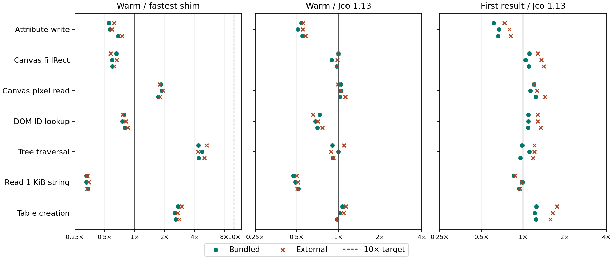

<details><summary>Reproduce the paired compiler comparison</summary>

Build Jco at `084063ed1` for `before`, at `ae16355e9` for `after`, and at `578b213ef` for `final`. Prepare `stage` using the [full matrix setup](#full-demo-matrix-on-the-merged-pr) and set `CHROME_BIN` to Chromium. The final revision consolidates the driver used by custom instantiation and TLA compatibility. The adapter verifier checks all 42 timed default-mode entries and their guest and runtime files against the final build.

```sh
old=web/bench/results/review-matrix-minified-084063ed1.json.gz
ROUNDS=18 node web/bench/review-matrix.mjs "$after" "$stage" /tmp/init.json.gz --compare-compilers "$before/packages/jco-transpile"
python3 web/bench/review-matrix-report.py /tmp/init.json.gz --compare-entries "$old" --release-intervals --plot /tmp/init.png
node web/bench/verify-matrix-adapters.mjs "$final" /tmp/init.json.gz
```

</details>

## Owned resource arguments in synchronous exports

A host can pass a new resource to a guest export that immediately drops it. Both modes ran the destructor on every call, but kept a numeric ID for every resource in a set used for borrowing across component instances. Bindgen now skips that insertion when it can prove the component has one synchronous instance and cannot transfer resources. After 131,072 calls, the set held zero IDs in both modes. The measurements count numeric IDs, not heap bytes. [Compiler change, runtime comments and regression test](https://github.com/vados-cosmonic/jco/commit/1919c56ed6450890eddafc1431d368956b2e3f66)

| Chromium metric | Jco 1.13.0 | Internal Oxc, before → after | External checked, before → after |
| --- | ---: | ---: | ---: |
| Numeric IDs retained after 131,072 drops and garbage collection | 0 | 131,072 → 0 | 131,072 → 0 |
| Disposal callbacks | 131,072 | 131,072 → 131,072 | 131,072 → 131,072 |
| Time per call (µs) | 0.356 | 2.683 → 2.407 | 2.627 → 2.589 |
| Paired time ratio, after / before (95% interval) | — | 0.943× (0.882–1.007) | 0.918× (0.851–0.982) |
| Minified fixture entry (bytes) | 2,606 | 56,638 → 56,647 | 9,705 → 9,714 |
| Gzipped fixture entry (bytes) | 1,074 | 16,027 → 16,027 | 3,318 → 3,317 |

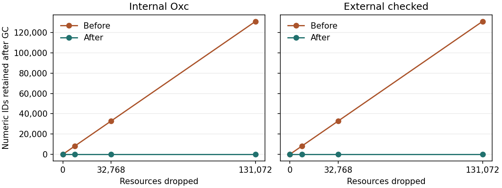

Five Chromium documents measured retention, one per treatment. Twenty separate documents measured timing with ordinary, uninstrumented sets and balanced execution order. Each timing document warmed every treatment, then ran three batches of 8,192 calls per treatment. The absolute times are medians of document medians. The paired ratios compare treatments within each batch before taking the document median. External calls took 8.2% less time in the paired comparison. The internal timing interval included parity. All five treatments ran identical guest Wasm. The 42 adapters from the full demo matrix also matched the preceding revision byte for byte. [Samples, browser version and asset hashes](web/bench/results/owned-resource-history.json.gz)

<details><summary>Reproduce the owned-resource comparison</summary>

Build Jco at `578b213ef` and `1919c56ed` in the directories named by `before` and `after`. Install the pinned web benchmark dependencies and set `CHROME_BIN` to the Chromium executable. The report can also regenerate the chart with `--plot /tmp/owned-resource-history.png` when Matplotlib is installed.

```sh
node web/bench/owned-resource-history.mjs "$after" "$before/packages/jco-transpile" "$after/packages/jco-transpile" /tmp/owned-resource-history.json.gz
python3 web/bench/owned-resource-history-report.py /tmp/owned-resource-history.json.gz
node web/bench/verify-matrix-adapters.mjs "$after" web/bench/results/review-matrix-init-ae16355e9.json.gz
```

</details>

## Smaller synchronous import adapters at 084063ed1

A general host import copies the adapter’s diagnostic name onto its subtask. The standard checked synchronous lower returns its result directly and never constructs a subtask, including when it must create a task for a detached call. Bindgen now skips that private name assignment on this path. Both internal Oxc and the external checked package benefit. The comparison found 297 assignments across the 21 demos (12–17 per entry). The unminified external adapters differed only in those assignments and whitespace. The checked runtime, guest Wasm and exported interface are shared with the control. [Jco compiler change and regression test](https://github.com/vados-cosmonic/jco/commit/084063ed1)

| Minified JS per entry, paired across 21 workloads | Internal Oxc | External checked |
| --- | ---: | ---: |
| Median reduction | 941 bytes (1.31%) | 941 bytes (3.71%) |
| Range of reductions | 799–1,282 bytes | 799–1,282 bytes |
| Median gzip reduction | 178 bytes (0.95%) | 183 bytes (2.99%) |
| Range of gzip reductions | 148–217 bytes | 150–223 bytes |

Every entry became smaller. Gzip measures the entry compressed alone at level 9. The comparison also checked the general lowering path, tracked calls, debug mode and an opted-in custom provider on the same fixture. All four controls produced byte-identical output before and after the change. [Sizes, diagnostic counts, and asset hashes](web/bench/results/sync-import-names-084063ed1.json.gz) · [Source comparison](web/bench/sync-import-names.mjs)

The full comparison used 12 rounds and 1,164 fresh Chromium documents. Each value below summarizes the 21 workload medians. Both modes were within 10× of the fastest compiled shim in 21/21 warm workloads internally and 21/21 externally. The worst ratios were 4.24× and 4.94× respectively. Both builds matched or beat pinned main on 21/21 warm medians, and met the shim target in 81/84 individual phases. Against Jco 1.13.0 the internal and external builds matched or beat release in 18/21 and 15/21 warm workloads and 8/21 and 5/21 first results. These end-to-end comparisons use all PR changes. The controlled size comparison above isolates the removed labels. [Full browser matrix](web/bench/results/review-matrix-minified-084063ed1.json.gz)

| Metric | Jco 1.13.0 | Upstream main at `326f52ab4` | Internal Oxc | External checked |
| --- | ---: | ---: | ---: | ---: |
| Import (ms) | 5.13 | 12.04 | 9.46 | 19.44 |
| Time to first guest result (ms) | 60.55 | 205.03 | 63.03 | 74.29 |
| Minified JS entry (KiB) | 9.58 | 111.34 | 70.56 | 24.08 |
| Total JS (KiB) | 9.58 | 111.34 | 70.56 | 122.85 |
| Total gzipped JS (KiB) | 3.01 | 25.42 | 18.78 | 39.54 |
| JS requests | 1 | 1 | 1 | 16 |

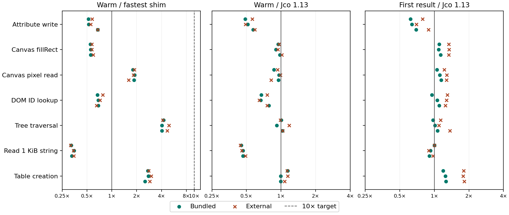

<details><summary>Reproduce the adapter-size and full browser comparisons</summary>

Use built Jco checkouts at `427b9c0d7` (before) and `084063ed1` (after). Prepare the release assets and pinned upstream compiler using the [full matrix setup](#full-demo-matrix-on-the-merged-pr). Run these commands from the benchmark fork.

```sh
old=web/bench/results/review-matrix-minified-427b9c0d7.json.gz
ROUNDS=12 node web/bench/review-matrix.mjs "$after" "$stage" /tmp/names-matrix.json.gz --minify-checked
python3 web/bench/review-matrix-report.py /tmp/names-matrix.json.gz --release-intervals --plot /tmp/names-matrix.png
node web/bench/sync-import-names.mjs "$before/packages/jco-transpile" "$after/packages/jco-transpile" "$old" /tmp/names-matrix.json.gz /tmp/names.json.gz
```

</details>

### How much does recording dropped resources cost?

Creating 2,000 C table rows makes 10,000 DOM calls. Jco also records 4,001 resource drops during creation so that shutdown can recognize a host object the guest has already dropped. Across 24 invocations, omitting those writes in a diagnostic build saved a paired median of **48.66 ms internally (20.3%)** and **44.87 ms externally (18.7%)** in row creation. In a separate correctness check, a disposal getter stopped the guest while it held another handle to the same heading. The diagnostic build disposed the heading twice. The PR disposed it once in both binding modes. [Generated drop and shutdown regression](https://github.com/vados-cosmonic/jco/commit/cbd43f45f) · [External runtime shutdown](https://github.com/vados-cosmonic/jco/blob/eade82c6c/packages/jco-cm-runtime/src/intrinsics/component/lifecycle.ts#L130)

A second experiment kept the history and distributed blocks of 1,024 insertions across eight weak sets. Shutdown searched all eight. This preserved single disposal in the reentry check and brought row creation on call 22 down by about 4.4 ms in both builds. Across all 24 calls, the intervals for aggregate creation time and for the worst creation time in each document included zero improvement in both modes. Across the **complete guest calls**, the grouped version took a paired **40.93 ms longer internally** (95% interval 8.67–64.07 ms longer). The extra bookkeeping remains a benchmark experiment. [Raw timings, asset hashes and correctness checks](web/bench/results/table-drop-history-c-084063ed1.json.gz)

| Paired milliseconds saved by the eight-set experiment | Internal Oxc | External checked |
| --- | ---: | ---: |
| Row creation on call 22 | 4.37 (3.04 to 5.42) | 4.38 (0.42 to 6.83) |
| Sum of row creation across 24 calls | −12.99 (−34.39 to 13.50) | 4.62 (−10.24 to 23.30) |
| Worst row creation in each document | 1.31 (−1.59 to 2.68) | −0.41 (−3.64 to 3.51) |

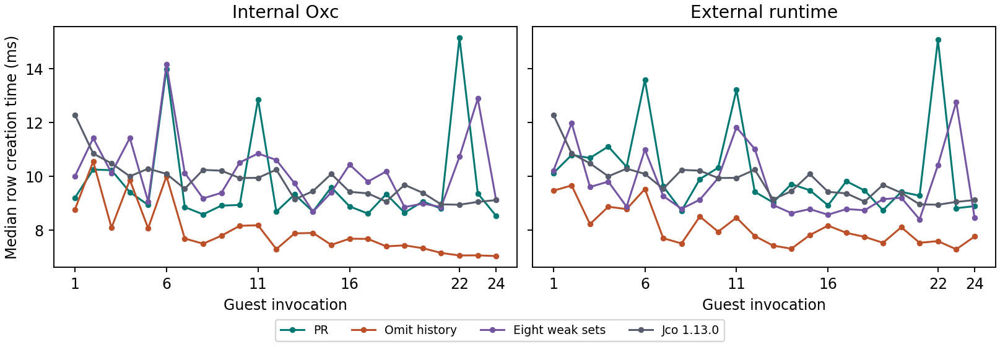

<details><summary>Reproduce the resource-drop comparison</summary>

Use a built Jco checkout at `084063ed1` and set `CHROME_BIN` to a Chromium executable. The runner verifies the original assets against the full matrix and changes only the generated entries in the two experiments. Each of 28 fresh browser processes ran seven treatments in fresh documents, including an unchanged Jco 1.13.0 control. Every treatment occupied each timing position equally and followed every other treatment equally. The report uses individual two-sided sign intervals on within-browser differences. Separate untimed documents checked the live rows, host call counts, history insertions and reentrant shutdown.

```sh
matrix=web/bench/results/review-matrix-minified-084063ed1.json.gz
GUEST_LANGUAGE=c node web/bench/table-warmup.mjs "$after" "$matrix" /tmp/drop-history.json.gz --drop-history-control
python3 web/bench/drop-history-report.py /tmp/drop-history.json.gz "$matrix" --plot /tmp/drop-history.png
```

</details>

### Does caching the handle allocator speed up C table creation?

C table creation was the only warm headline workload whose individual 95% interval fell entirely above Jco 1.13.0 in the 18-round matrix. The external runtime took 1.129× the release time (1.011–1.249×). Both binding modes resolve a component's handle allocator on each allocation and removal. The experiment kept the allocator on each resource table after its first lookup. During creation of 2,000 rows this eliminated all **12,002 lookups**. Across two complete guest calls it reduced **32,272 lookups to seven** in both modes.

| Paired time ratio, cache / ordinary bindings | Internal Oxc, trial 1 | Internal Oxc, repeat | External checked, trial 1 | External checked, repeat |
| --- | ---: | ---: | ---: | ---: |
| Row creation on the second call | 1.024 (0.932–1.232) | 0.909 (0.822–1.018) | 0.922 (0.718–1.036) | 1.019 (0.885–1.172) |
| Row creation summed over calls 5–8 | 1.069 (0.955–1.209) | 1.018 (0.912–1.112) | 0.908 (0.778–0.968) | 1.085 (0.945–1.131) |
| Complete guest time summed over calls 1–8 | 1.073 (0.879–1.147) | 0.938 (0.902–1.050) | 0.943 (0.827–1.014) | 1.026 (0.920–1.125) |

The external late-call speedup in the first trial disappeared in the repeat. All four intervals for complete guest time include parity. The cache remains a benchmark experiment. Each trial used a fresh Chromium process, 100 timed documents with isolated browser contexts and five separate documents to count lookups and check the live table. Each round included Jco 1.13.0 and both binding modes with and without the cache. Each treatment occupied each position and followed each other treatment equally. Parentheses give individual 95% sign intervals across the 20 paired rounds. [First trial](web/bench/results/table-handle-space-1919c56ed.json.gz) · [Independent repeat](web/bench/results/table-handle-space-repeat-1919c56ed.json.gz)

For the same C demo, module import and initialization account for most of the **cold** gap. These are within-round differences from Jco 1.13.0 in the original 18-round matrix. Row creation is part of the first guest call. Each row is summarized independently. [Full matrix samples](web/bench/results/review-matrix-init-ae16355e9.json.gz)

| Extra time over Jco 1.13.0, median ms (95% interval) | Internal Oxc | External checked |
| --- | ---: | ---: |
| Module import and initialization | 5.32 (4.93 to 5.69) | 16.27 (13.18 to 19.54) |
| First guest call | 2.38 (−3.44 to 5.82) | 3.02 (1.02 to 5.69) |
| Row creation inside the first call | −0.34 (−3.80 to 0.51) | −0.02 (−3.00 to 0.75) |
| Time to first result | 6.53 (1.44 to 11.19) | 19.87 (13.86 to 22.57) |

<details><summary>Reproduce the allocator trials and cold-start breakdown</summary>

Build Jco at `1919c56ed` and prepare the release assets as in the full matrix setup. Set `CHROME_BIN` to Chromium. The runner verifies every original served asset against the matrix, then patches the allocator lookup in the generated internal entry or checked external runtime chunk. Only the audit pages count lookups.

```sh
matrix=web/bench/results/review-matrix-init-ae16355e9.json.gz
for trial in first repeat; do
  node web/bench/table-handle-space.mjs "$checkout" "$matrix" "/tmp/handle-space-$trial.json.gz"
  python3 web/bench/table-handle-space-report.py "/tmp/handle-space-$trial.json.gz" "$matrix"
done
```

</details>

## External runtime startup at 427b9c0d7

The checked runtime package groups the short UTF-8 decoder, synchronous waiter and JS helpers into one shared chunk. Across all 21 generated C, C++ and Rust demos this removes three runtime requests, from 18 to 15. Each standalone numeric conversion still loads 2,779 bytes. The largest cost is for a standalone import of the component-state module, which grows by 5,613 bytes (1,502 gzipped). All 18 public entries expose the same names. The internal Oxc bundle gets its runtime from the embedded source. [Package build change](https://github.com/vados-cosmonic/jco/commit/427b9c0d7)

Two independent 20-round Chromium trials used six small DOM-query and table-update cases. Each trial ran 1,280 fresh documents. Each guest used the same Wasm and generated JS entry in both package layouts. The server used TLS on loopback and sent uncompressed responses. Relative gains pair builds within a workload and round. Absolute times summarize the six workload medians.

| Time to first guest result | Previous external | Grouped helpers | Paired reduction | Application bundle |
| --- | ---: | ---: | ---: | ---: |
| HTTP/1.1, first trial | 48.81 ms | 45.08 ms | 6.8% | 26.80 ms |
| HTTP/1.1, repeat | 49.54 ms | 45.67 ms | 7.0% | 27.74 ms |
| HTTP/2, first trial | 49.42 ms | 45.23 ms | 8.0% | 28.41 ms |
| HTTP/2, repeat | 49.47 ms | 45.29 ms | 8.1% | 28.28 ms |

The conversion-only import's timing intervals included parity on both protocols. The standalone component-state probe took 8.56 → 9.12 ms on HTTP/1.1 (paired time ratio 1.071×, individual 95% interval 0.980–1.260) and 8.97 → 9.00 ms on HTTP/2 (1.014×, 0.940–1.080). [First trial and conversion probe](web/bench/results/compact-helpers-47f6dc0c1.json.gz) · [Replication and component-state probe](web/bench/results/compact-component-47f6dc0c1.json.gz)

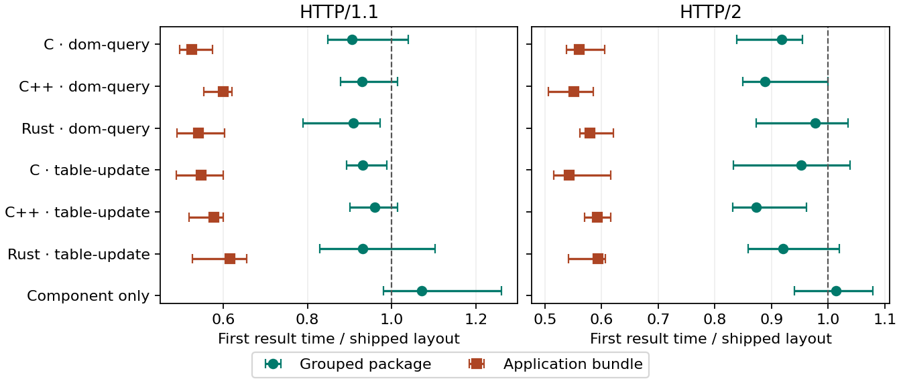

| Runtime layout | Runtime requests per demo | Runtime gzip per demo (KiB) | Standalone numeric conversion (bytes) | Largest standalone increase (bytes) |
| --- | ---: | ---: | ---: | ---: |
| Previous automatic splitting | 18 | 34.61 | 2,779 | — |
| One group for modules shared by at least four entries | 11 | 30.29 | 93,326 | 90,547 |
| Split that group by importing entries, 1 KiB merge threshold | 17 | 35.20 | 2,877 | 6,401 |
| Split by importing entries, 16 KiB threshold | 14 | 34.03 | 54,067 | 51,288 |
| Group component-state source files | 17 | 34.19 | 2,779 | 4,760 |
| Group the three helpers | 15 | 33.77 | 2,779 | 5,613 |

The analysis starts at the static imports of each generated adapter and follows the browser module graph. It checks each adapter against the full matrix, every original runtime file against its hash and all public export names across the eight layouts. Gzip is the sum of individually compressed runtime modules at level 9. [All layouts, module graphs, file sizes and hashes](web/bench/results/runtime-layouts-47f6dc0c1.json.gz)

### Full workloads over compressed HTTP/2

A third trial used 2,000-element DOM queries and 2,000-row tables in C, C++ and Rust, across 16 rounds and 768 fresh documents. Chromium fetched Brotli-compressed modules over TLS. All 33 regenerated control modules matched the previous package byte for byte. The grouped package served the same entry and guest Wasm in each pair. [Timings, requests and browser settings](web/bench/results/compact-helpers-http2-427b9c0d7.json.gz)

| Time to first guest result | Jco 1.13.0 | Internal Oxc | Previous external | Grouped helpers | Paired reduction vs previous external |
| --- | ---: | ---: | ---: | ---: | ---: |
| Loopback | 59.14 ms | 62.96 ms | 89.95 ms | 87.31 ms | 4.9% |
| 40 ms latency, 10 Mbit/s | 160.93 ms | 173.00 ms | 320.90 ms | 273.69 ms | 14.4% |

On the limited connection, individual paired 95% intervals favored the grouped package on all six workloads. On loopback, one favored grouping and five included parity. On the limited connection the median start of the guest Wasm fetch moved from 206.75 to 161.83 ms. Median Brotli JS fell from 36.14 to 35.37 KiB. Including the guest Wasm, the external builds used 20 and 17 requests respectively. Release and internal Oxc used two each.


### Starting the guest Wasm and shared JavaScript together

On a 40 ms, 10 Mbit/s connection, the application bundle of the external bindings reached its first guest result in **131.26 ms** when the page preloaded both assets, down from **218.72 ms** with ordinary loading. Internal Oxc with its guest Wasm preloaded took **130.40 ms**. The equivalent release control took **116.90 ms**. The compiled guest, generated entry and response bytes were identical within each scheduling comparison. [Raw first results, request timings, asset hashes and server inventories](web/bench/results/core-hints-http2-427b9c0d7.json.gz)

| Build at `427b9c0d7` and preload choice | Loopback first result (ms) | Limited first result (ms) | Limited paired reduction vs ordinary |
| --- | ---: | ---: | ---: |
| Jco 1.13.0, ordinary → guest Wasm | 58.03 → 58.63 | 161.22 → 116.90 | 27.3% |
| Internal Oxc, ordinary → guest Wasm | 66.36 → 60.94 | 175.11 → 130.40 | 25.8% |
| External package, ordinary → guest Wasm | 85.17 → 86.51 | 278.44 → 215.44 | 21.1% |
| External application bundle, ordinary → guest Wasm | 66.30 → 67.83 | 218.72 → 156.38 | 28.4% |
| External application bundle, ordinary → shared JS | 66.30 → 63.07 | 218.72 → 178.58 | 19.6% |
| External application bundle, ordinary → both | 66.30 → 65.11 | 218.72 → 131.26 | 40.1% |

Six full-sized C, C++ and Rust DOM-query and table workloads ran in 20 rounds and 2,400 fresh Chromium documents with HTTP/2 and Brotli. Each page inserted the links immediately before importing its entry. Every observed request matched the server inventory and every guest Wasm transferred exactly once. The guest fetch for the application bundle started at 106.31 ms with ordinary loading and at 0.59 ms with both hints on the limited connection.

On that connection all six individual paired 95% intervals favored both hints over either hint alone. With an equally preloaded release, the median paired ratio was 1.115× for internal Oxc, 1.910× for the separately served external package and 1.121× for the external application bundle. On loopback all six intervals for adding the guest preload to a shared-JS preload included parity. [Application build and preload markup](https://github.com/vados-cosmonic/jco/blob/1cbc8afe9/packages/jco-cm-runtime/docs/runtime.md#bindings-that-import-the-runtime)

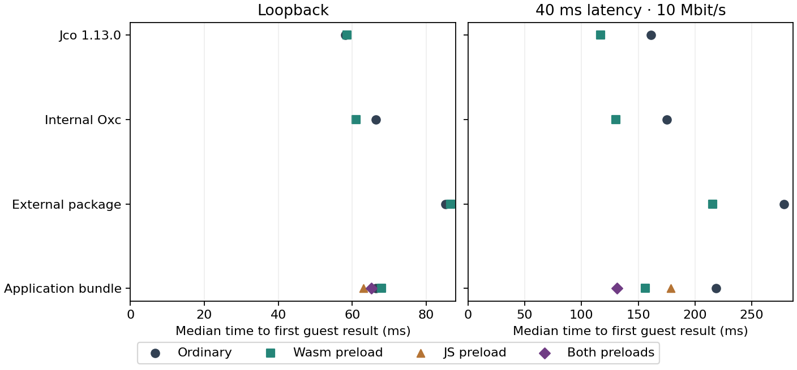

<details><summary>Reproduce the HTTP/2 preload comparison</summary>

Use built Jco at `427b9c0d7`, the staged demo assets and the same browser as the full matrix. The runner counterbalances the order of all 20 build, hint and network combinations on each workload. The report verifies their position and predecessor counts as well as the browser and server request records.

```sh
export CHROME_BIN=/path/to/chrome
matrix=web/bench/results/review-matrix-minified-427b9c0d7.json.gz
node web/bench/runtime-chunks.mjs "$before" "$matrix" /tmp/hints.json.gz --core-hints
python3 web/bench/runtime-chunks-report.py /tmp/hints.json.gz "$matrix" --plot /tmp/hints.png
```

</details>

### Full demo matrix

The head-to-head comparison used 12 rounds and 1,164 fresh Chromium documents. Times and sizes below summarize 21 workload medians. The 203 assets outside the external runtime matched their previous hashes, including every generated adapter, internal bundle and guest Wasm file. The two controlled package-layout trials above isolate the effect of the change. [Full timings and served asset hashes](web/bench/results/review-matrix-minified-427b9c0d7.json.gz)

| Median across 21 workloads | Jco 1.13.0 | Upstream main at `326f52ab4` | Internal Oxc | External checked |
| --- | ---: | ---: | ---: | ---: |
| Import and initialization (ms) | 5.09 | 12.68 | 9.50 | 19.42 |
| Time to first guest result (ms) | 61.18 | 198.56 | 65.28 | 76.42 |
| Minified JS entry (KiB) | 9.58 | 111.34 | 71.54 | 24.99 |
| Total JS (KiB) | 9.58 | 111.34 | 71.54 | 123.76 |
| Total gzipped JS (KiB) | 3.01 | 25.42 | 18.96 | 39.74 |
| JS requests | 1 | 1 | 1 | 16 |
| Warm workloads matching or beating release | — | — | 15/21 | 15/21 |
| Warm workloads matching or beating main | — | — | 20/21 | 21/21 |
| Worst warm time / fastest compiled shim | — | — | 4.82× | 5.93× |

Both modes stayed within 10× of the fastest compiled shim on 21/21 warm headline operations and 81/84 individual phases. Against Jco 1.13.0, individual paired 95% intervals were entirely slower on 0/21 internal and 2/21 external warm operations. The two were C++ table creation (1.109×, interval 1.024–1.213) and Rust table creation (1.149×, 1.013–1.371). First result matched or beat release on 8/21 internal and 6/21 external medians. Five internal and fifteen external first-result intervals were entirely slower.


<details><summary>Reproduce the package and browser comparisons</summary>

Build the two Jco checkouts and prepare the upstream and release assets using the [matrix setup](#full-demo-matrix-on-the-merged-pr). Set `before` and `after` to their respective checkout paths and `stage` to the prepared upstream build. The two small-workload trials build the alternative and original packages at `47f6dc0c1`. The full matrix and full-workload transport trial use the built checkout at `427b9c0d7`, including its rebuilt checked runtime. The transport trial regenerates automatic splitting from the same compiled sources as its control. The runner checks requested URLs, sizes, protocol, returned measurements, and the position and immediate predecessor of each treatment.

```sh
export CHROME_BIN=/path/to/chrome
old=web/bench/results/review-matrix-minified-47f6dc0c1.json.gz
node web/bench/runtime-layouts.mjs "$before" "$old" /tmp/layouts.json.gz
node web/bench/runtime-chunks.mjs "$before" "$old" /tmp/first.json.gz --compact-helpers
node web/bench/runtime-chunks.mjs "$before" "$old" /tmp/repeat.json.gz --compact-component
python3 web/bench/runtime-chunks-report.py /tmp/repeat.json.gz "$old" --plot /tmp/repeat.png
ROUNDS=12 node web/bench/review-matrix.mjs "$after" "$stage" /tmp/full.json.gz --minify-checked
python3 web/bench/review-matrix-report.py /tmp/full.json.gz --release-intervals --plot /tmp/full.png
node web/bench/runtime-chunks.mjs "$after" /tmp/full.json.gz /tmp/network.json.gz --automatic-control
python3 web/bench/runtime-chunks-report.py /tmp/network.json.gz /tmp/full.json.gz --previous-matrix "$old" --plot /tmp/network.png
```

</details>

### Does deferring task completion state speed up guest entry?

A synchronous guest that returns to JavaScript normally never uses its task's completion promise. We built a variant of `427b9c0d7` that puts the promise, its resolvers and its settlement state in a single record allocated on first use. The experiment uses the same TypeScript implementation for the checked external package and the runtime embedded by internal Oxc. The change is available as a [standalone experimental patch](web/bench/experiments/task-completion-state.patch).

| One host call per guest entry | Internal Oxc | External checked |
| --- | ---: | ---: |
| Sampled allocation, current → experiment (bytes/entry) | 655.7 → 633.1 | 648.6 → 632.4 |
| Paired allocation ratio, experiment / current | 0.969× (0.956–0.978) | 0.968× (0.954–0.995) |
| Paired elapsed time, first run | 0.989× (0.975–1.019) | 0.990× (0.966–1.012) |
| Paired elapsed time, independent run | 0.982× (0.972–1.005) | 0.996× (0.976–1.014) |

The allocation trial used 12 fresh Chromium pages. Each timing run used 18 fresh pages with sampling disabled. Each page ran the same core Wasm in six configurations and checked the result of every batch. Parentheses give individual 95% intervals for the paired median. All browser assets matched by SHA-256 across the three runs. No timing interval favored the experiment in both runs at any tested batch size (1, 4, 16, 64 or 256 host calls). At one host call the experiment still took 25–28× the release time. The approximately 3% allocation saving leaves the latency gap open, so the Jco PR retains its current task representation. [Allocation profiles](web/bench/results/task-completion-heap-427b9c0d7.json.gz) · [First timing run](web/bench/results/task-completion-time-427b9c0d7.json.gz) · [Independent timing run](web/bench/results/task-completion-repeat-427b9c0d7.json.gz)

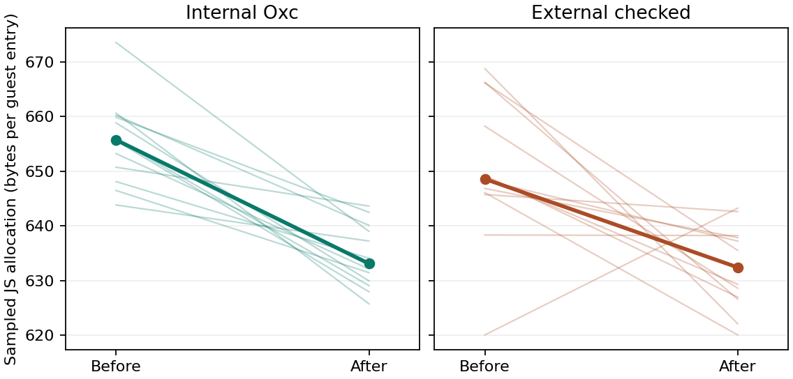

<details><summary>Reproduce the task completion experiment</summary>

Use two Jco checkouts at `427b9c0d7` with dependencies installed. Set `before` and `after` to their absolute paths, and run these commands from the benchmark fork. The component produced by each compiler contains the same guest Wasm. Its external adapter also matches across both builds.

```sh
git -C "$after" apply "$PWD/web/bench/experiments/task-completion-state.patch"
for checkout in "$before" "$after"; do
  pnpm --dir "$checkout" --filter @bytecodealliance/jco-transpile run build:embedded-runtime
  pnpm --dir "$checkout" --filter @bytecodealliance/jco-transpile run build
done

export CHROME_BIN=/path/to/chrome
run_batch() {
  node web/bench/export-host-batch.mjs \
    "$before/packages/jco-transpile" "$before/packages/jco-cm-runtime/dist" \
    "$after/packages/jco-transpile" "$after/packages/jco-cm-runtime/dist" "$@"
}
run_batch /tmp/time.json.gz
run_batch /tmp/repeat.json.gz
run_batch /tmp/heap.json.gz --heap
python3 web/bench/export-host-batch-report.py /tmp/time.json.gz
python3 web/bench/export-host-batch-report.py /tmp/repeat.json.gz
python3 web/bench/export-host-batch-report.py /tmp/heap.json.gz --plot /tmp/heap.png
```

</details>

## Browser bindings at 47f6dc0c1

Across the branch, reusing the active export task for eligible synchronous host calls produced the largest measured gain. These controlled guest-loop measurements come from the earlier implementation at `ad2aacc9b` and its upstream base at `83e25bb19`. Each guest enters once and repeats the measured operation. [Host-loop experiment and raw data](#pr-head-against-upstream-main)

| Warm guest-loop operation (ns per iteration) | Upstream base | Jco 1.13.0 | Internal Oxc | External checked |
| --- | ---: | ---: | ---: | ---: |
| Scalar host call | 2,378.8 | 16.8 | 21.4 | 24.4 |
| Acquire, borrow and drop a resource | 5,218.5 | 329.6 | 152.6 | 148.0 |
| Return a 16-byte ASCII string | 5,369.6 | 2,307.1 | 762.9 | 843.8 |

### Demo performance and module size

The demo matrix used 12 rounds and 1,164 fresh Chromium documents. Each column below summarizes seven demos in C, C++ and Rust. Sizes and times are medians of the 21 workload medians. First result includes loading the JavaScript and completing the first guest call. [Per-workload results and asset manifest](web/bench/results/review-matrix-minified-47f6dc0c1.json.gz)

| Demo matrix | Jco 1.13.0 | Upstream main at `326f52ab4` | Internal Oxc | External checked |
| --- | ---: | ---: | ---: | ---: |
| Minified entry (KiB) | 9.58 | 111.34 | 71.54 | 24.99 |
| Total JS (KiB) | 9.58 | 111.34 | 71.54 | 124.13 |
| Total gzipped JS (KiB) | 3.01 | 25.42 | 18.96 | 40.58 |
| JS requests | 1 | 1 | 1 | 19 |
| Import (ms) | 5.03 | 12.05 | 9.43 | 21.97 |
| First result (ms) | 59.91 | 198.72 | 63.25 | 76.15 |
| Warm workloads matching or beating 1.13.0 | — | — | 15/21 | 16/21 |
| Warm workloads matching or beating main | — | — | 20/21 | 21/21 |
| Worst warm time / fastest compiled shim | — | — | 5.29× | 5.28× |

Both builds met the 10× target in 21/21 warm headline workloads and 81/84 individual phases. Against Jco 1.13.0, individual 95% paired intervals were entirely slower for 0 internal and 2 external warm workloads, and for 4 internal and 15 external first results. The two external warm regressions in this run were C++ tree traversal (1.332× release, interval 1.147–1.595×) and C table creation (1.145×, interval 1.062–1.466×). The original bulk-query shim discards its result collection. The equal-work fixture returns and drops every handle. [Equal-work bulk queries](#browser-bindings-at-6a00c9e7d)

Compared with the previous matrix, the median total JS size changed by +97 bytes internally (+37 gzip) and +97 bytes externally (+40 gzip). Every external entry, separately served Wasm module, release asset, upstream asset and shim matched its previous hash.

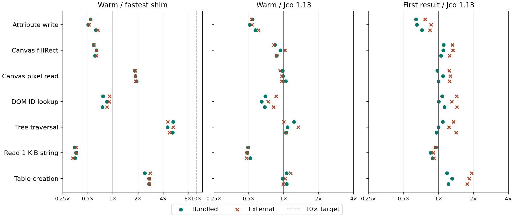

### Which differences from Jco 1.13.0 repeat?

A second run at `47f6dc0c1` used 24 fresh Chromium processes and 2,328 documents, following the original 12 rounds and 1,164 documents. All 236 entries in the asset manifest, compiler hashes, workload inputs and the browser version matched. Both builds met the 10× target on all 21 warm workloads in each run. The worst warm ratios to the fastest compiled shim in the repeat were 4.24× internal and 4.51× external. Both builds beat upstream main on all 21 warm medians in the repeat. [Repeat timings and asset hashes](web/bench/results/review-matrix-repeat-47f6dc0c1.json.gz)

| External warm time / 1.13.0 | Initial 12 rounds | Independent 24 rounds |
| --- | ---: | ---: |
| C++ tree traversal | 1.332× (1.147–1.595) | 1.050× (0.899–1.206) |
| C table creation | 1.145× (1.062–1.466) | 1.012× (0.965–1.194) |
| Rust table creation | 0.987× (0.927–1.103) | 1.097× (1.033–1.229) |

The first two warm comparisons were the ones flagged by the original run. Their repeat intervals both include parity. Rust table creation crossed the threshold in the repeat only. Across 42 warm comparisons, none had an individual 95% interval wholly slower than release in both runs. The repeat's warm medians matched or beat release in 15/21 internal and 14/21 external cases. These intervals allow some remaining warm slowdowns.

| Workloads with an interval wholly slower than release in **both** runs | Internal Oxc | External checked |
| --- | ---: | ---: |
| Import and initialization | 21/21 | 21/21 |
| First guest call after import | 0/21 | 1/21 |
| First result including import | 4/21 | 15/21 |
| Second guest call, headline operation | 0/21 | 0/21 |

For the 15 external workloads consistently slower to first result, the median paired difference was **+17.78 ms** to first result, **+17.10 ms** in import and initialization, and **−0.44 ms** in the first guest call. For the four internal workloads the differences were +6.40, +4.91 and +0.95 ms. Each column is summarized independently across workloads. The first guest call includes the entire demo. For external C table update it took 1.197× release initially and 1.196× on repeat, a reproducible cost beyond loading the module. [Browser measurements and release intervals](web/bench/review-matrix-report.py)


### C table creation across 24 calls

With no prior work in the document, the aggregate time to create 2,000 rows on each of 24 guest calls was **235.80 ms for release, 228.80 ms internally and 240.27 ms externally**. The paired ratios were 0.978× (0.853–1.137) and 1.031× (0.984–1.097). The aggregate covers the creation loop. The full first guest call also builds the report and releases the retained handles. All three builds created the same rows and made 10,000 audited host calls within the creation phase. [Raw measurements from 18 browser rounds](web/bench/results/table-warmup-c-47f6dc0c1.json.gz)

| Guest call, no prior work | Jco 1.13.0 (ms) | Internal Oxc (ms) | External checked (ms) |
| ---: | ---: | ---: | ---: |
| 2 | 10.66 | 9.10 | 10.50 |
| 6 | 9.54 | 11.88 | 12.83 |
| 11 | 8.91 | 13.46 | 12.90 |
| 21 | 8.95 | 8.20 | 8.82 |
| 22 | 8.77 | 16.01 | 14.14 |
| 23 | 9.06 | 8.16 | 8.30 |

Calls 6, 11 and 22 took measurably longer than release in both modes. On call 22, the paired ratios were 1.854× (1.472–2.063) and 1.745× (1.506–2.037). The same invocation pattern appeared in the earlier Rust guest. Its instrumented run measured long insertions in the weak set used to track disposed resources. [Rust timings and insertion probe](#rust-table-creation-over-repeated-calls)

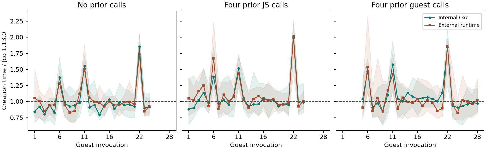

A separate 18-round run read the C guest’s existing performance marks after each call. On the first call, the time from the guest’s final mark to the export returning exceeded release by **0.62 ms internally** (0.45–0.94 ms) and **0.68 ms externally** (0.45–0.99 ms). The guest releases its 2,000 retained row handles and 2,000 cell handles in that interval. On call 22, the largest excess was within the creation loop itself, +6.17 ms internally and +6.78 ms externally. The isolated whole first call had an external difference of +1.05 ms (−1.59 to +2.31 ms), so the final cleanup accounts for a measurable cost without establishing the cause of the full first-call difference seen in the matrix. [Stage timings](web/bench/results/table-stages-c-47f6dc0c1.json.gz) · [C guest implementation](c/table-update/main.c)

<details><summary>Reproduce the release comparison and repeated C table calls</summary>

Build Jco at `47f6dc0c1` and stage upstream main at `326f52ab4` using the [matrix setup](#full-demo-matrix-on-the-merged-pr). The two matrices use the same deterministic scheduling algorithm and fresh browser processes in every round. The repeat report checks the compiler hashes, all served assets, runner, browser, CPU model and workload parameters against the initial archive. It pairs each candidate with the release in its own round. Intervals are individual two-sided sign intervals for the median across rounds.

```sh
export CHROME_BIN=/path/to/chrome
initial=web/bench/results/review-matrix-minified-47f6dc0c1.json.gz
ROUNDS=24 node web/bench/review-matrix.mjs "$after" "$stage" /tmp/repeat.json.gz --minify-checked
python3 web/bench/review-matrix-report.py /tmp/repeat.json.gz --repeat-of "$initial" --release-intervals --plot /tmp/repeat.png
GUEST_LANGUAGE=c node web/bench/table-warmup.mjs "$after" "$initial" /tmp/c-table.json.gz
python3 web/bench/table-warmup-report.py /tmp/c-table.json.gz "$initial" --plot /tmp/c-table.png
GUEST_LANGUAGE=c node web/bench/table-warmup.mjs "$after" "$initial" /tmp/c-stages.json.gz --stages
python3 web/bench/table-warmup-report.py /tmp/c-stages.json.gz "$initial"
```

</details>

### Allocation and timing of a single export

An export task stores its first implicit thread directly. It allocates an ordered array when a second thread joins. The runtime comment explains why the oldest live thread must remain the default, and the regression test removes siblings out of order. The external checked package and internal Oxc bundle share this implementation. [Runtime change and test](https://github.com/vados-cosmonic/jco/commit/3ffabc739b72a4a8afdcfdd3051d50d5dd1d379f)

| One host call per guest entry | Internal Oxc | External checked |
| --- | ---: | ---: |
| Sampled JS bytes per entry, before → after | 740.0 → 651.5 | 739.7 → 654.2 |
| Paired allocation reduction (individual 95% interval) | 12.3% (10.6–13.2%) | 11.9% (11.1–12.7%) |
| Elapsed time before → after (ns) | 828.9 → 780.7 | 833.4 → 808.4 |
| Paired elapsed time after / before (individual 95% interval) | 0.956× (0.928–0.972) | 0.984× (0.954–1.003) |
| Paired elapsed time after / Jco 1.13.0 | 26.39× | 26.33× |

Each of 12 fresh Chromium pages ran six builds with identical Wasm. The allocation sampler included objects collected by minor or major GC and estimated JS bytes allocated over 262,144 checksum-verified entries per build. The figures measure allocation traffic. The direct Wasm and 1.13.0 controls both registered 0.0 sampled bytes per entry at the 32 KiB sampling interval. [Allocation profiles, compiler hashes and browser version](web/bench/results/export-host-heap-47f6dc0c1.json.gz)


Elapsed time was measured separately with profiling off. At 16 host calls per entry, internal Oxc took 1,042 ns and the external runtime took 1,121 ns. The paired improvements were 4.5% and 4.1%, respectively. With one host call per entry, Jco 1.13.0 took 29.7 ns and direct Wasm took 31.5 ns. Larger batches spread the cost of entering the guest across multiple host calls. At 256 calls per entry, the paired ratios to Jco 1.13.0 were 1.43× and 1.65×. [18-page timing samples](web/bench/results/export-host-batch-47f6dc0c1.json.gz)


<details><summary>Reproduce the allocation, timing and demo comparisons</summary>

Build Jco at `f2c5ef195` (before) and `47f6dc0c1` (after). Use the compiler and checked package from the same checkout for each pair. The upstream compiler was built from `326f52ab4`. Use the demo guest assets from the benchmark setup below.

```sh
export CHROME_BIN=/path/to/chrome
node web/bench/export-host-batch.mjs \
  "$before/packages/jco-transpile" "$before/packages/jco-cm-runtime/dist" \
  "$after/packages/jco-transpile" "$after/packages/jco-cm-runtime/dist" /tmp/heap.json.gz --heap
python3 web/bench/export-host-batch-report.py /tmp/heap.json.gz --plot /tmp/heap.png
node web/bench/export-host-batch.mjs \
  "$before/packages/jco-transpile" "$before/packages/jco-cm-runtime/dist" \
  "$after/packages/jco-transpile" "$after/packages/jco-cm-runtime/dist" /tmp/timing.json.gz
python3 web/bench/export-host-batch-report.py /tmp/timing.json.gz --plot /tmp/timing.png
ROUNDS=12 node web/bench/review-matrix.mjs "$after" "$stage" /tmp/matrix.json.gz --minify-checked
python3 web/bench/review-matrix-report.py /tmp/matrix.json.gz --release-intervals --plot /tmp/matrix.png
```

</details>

### Sharing constant task options across guest entries

The one-host-call fixture constructs a task-options object on each entry. All ten properties are constants for that export. This experiment moves the literal just before the exported function declaration, so the object lives for the lifetime of the component instance. Each invocation still creates its own task and thread. Both treatments use compiler `47f6dc0c1`. The runner checks for byte-identical entries before moving the literal, verifies identical core Wasm, and records both runtime inventories. This is a benchmark-only edit to the generated adapters.

| One host call per guest entry | Internal Oxc | External checked |
| --- | ---: | ---: |
| Sampled JS bytes per entry, current → shared | 661.2 → 595.6 | 650.0 → 604.3 |
| Paired bytes, shared / current | 0.907× (0.899–0.924) | 0.925× (0.910–0.945) |
| Paired elapsed time, first run | 0.996× (0.973–1.004) | 0.974× (0.943–0.992) |
| Paired elapsed time, second run | 0.988× (0.976–1.012) | 1.001× (0.977–1.016) |

The allocation trial sampled 12 pages. Each timing run used 18 fresh pages in a separate browser process with allocation profiling off. Parentheses give individual 95% intervals across paired pages. The external single-call timing improvement in the first run did not reproduce in the second. At 16 host calls per guest entry the internal intervals favored sharing in both runs, by 2.6% and 1.3%. With the shared literal, one host call per entry still took 26–28× the time of Jco 1.13.0 across both runs and renderers. The allocation saving is measurable, but these timings give little reason to broaden the compiler change for latency. [Allocation profiles](web/bench/results/shared-task-options-heap-47f6dc0c1.json.gz) · [First timing run](web/bench/results/shared-task-options-timing-47f6dc0c1.json.gz) · [Independent timing run](web/bench/results/shared-task-options-repeat-47f6dc0c1.json.gz)

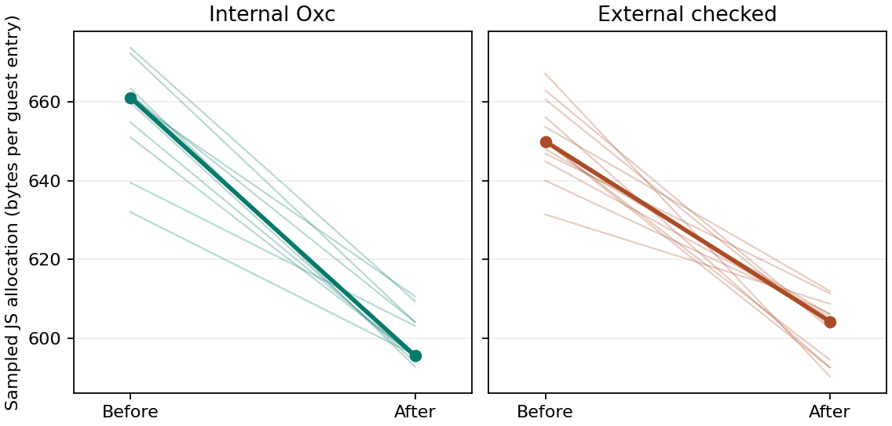

<details><summary>Reproduce the task-options experiment</summary>

Use the same built compiler and checked runtime for both inputs. Each timing command launches a fresh Chromium process.

```sh
export CHROME_BIN=/path/to/chrome
compiler="$after/packages/jco-transpile"
runtime="$after/packages/jco-cm-runtime/dist"
for trial in first second; do
  node web/bench/export-host-batch.mjs "$compiler" "$runtime" "$compiler" "$runtime" "/tmp/$trial.json.gz" --share-task-options
  python3 web/bench/export-host-batch-report.py "/tmp/$trial.json.gz"
done
node web/bench/export-host-batch.mjs "$compiler" "$runtime" "$compiler" "$runtime" /tmp/shared-heap.json.gz --share-task-options --heap
python3 web/bench/export-host-batch-report.py /tmp/shared-heap.json.gz --plot /tmp/shared-heap.png
```

</details>

## Browser bindings at f2c5ef195

A checked synchronous export now enters its task without writing the async flags, the canonical result type, or the return and lift memories. The task uses its synchronous defaults. The compiler checks that the component has no `task.return`, cross-component callee, or other trampoline that could read the omitted metadata. Ordinary canonical lowering still uses the guest memory. Source-generation tests cover the internal Oxc bundle, the external checked package, opt-in custom providers, debug and tracked exports. [Compiler change, runtime rationale and test](https://github.com/vados-cosmonic/jco/commit/83bfa2d4c)

Across all 21 demos, each generated export dropped four calls and both minified renderers saved exactly **98 bytes per entry**. Gzip savings were **25–40 bytes internally** and **42–46 bytes externally**. All other served asset hashes matched the preceding matrix, including the guest Wasm, checked runtime modules, release, upstream and shim controls. [Full inventory and fresh-document samples](web/bench/results/review-matrix-minified-f2c5ef195.json.gz)

The paired host-call experiment used one JS-to-Wasm entry per guest batch. At one host call per entry, internal Oxc took 817.1 ns and the external runtime took 844.5 ns, compared with 817.5 and 835.9 ns before the change. All ten individual 95% before/after intervals included parity across batches of 1, 4, 16, 64 and 256 host calls. The isolated one-call case still cost 26.5× direct Wasm internally and 27.2× externally. [Paired samples and compiler hashes](web/bench/results/export-host-batch-f2c5ef195.json.gz)


| Twelve-round Chromium matrix | Jco 1.13.0 | Upstream main at `326f52ab4` | Internal Oxc | External checked |
| --- | ---: | ---: | ---: | ---: |
| Median first result (ms) | 62.30 | 208.26 | 65.45 | 78.91 |
| Total JS (KiB) | 9.58 | 111.34 | 71.45 | 124.03 |
| Gzipped JS (KiB) | 3.01 | 25.42 | 18.92 | 40.54 |
| JS requests | 1 | 1 | 1 | 19 |
| Warm workloads matching or beating 1.13.0 | baseline | — | 15/21 | 15/21 |
| Worst warm ratio to the fastest compiled shim | — | — | 5.12× | 5.49× |

Both modes beat upstream main on 21/21 warm headline workloads and fell within 10× on 81/84 original subphases. The three exceptions are the bulk queries whose shim discards the result collection. No individual 95% warm interval was wholly slower than 1.13.0 in this run. First result was measurably slower on eight internal and fourteen external workloads. The preceding matrix found an internal Rust canvas readback regression. Its median here was 1.071× release with an interval of 0.995–1.179×. The two runs do not establish that removing these setters speeds up canvas readback. [Equal-work bulk comparisons and preceding matrix](#browser-bindings-at-6a00c9e7d)

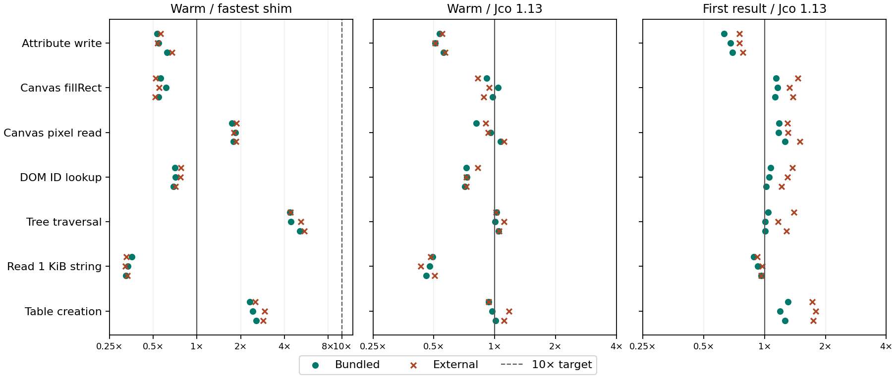

<details><summary>Reproduce the export-task and full browser measurements</summary>

Build the transpiler and checked runtime at `9e90e10f7` (before) and `f2c5ef195` (after). Use the benchmark setup below and the upstream compiler at `326f52ab4`. The host-call fixture runs all six builds on each of 18 fresh Chromium pages with identical guest Wasm. Each build occupies each timing position once at every batch size. The runner checks the checksum from each call. The full matrix uses 12 rounds and fresh documents. The inventory comparison checks that every asset outside the 42 candidate JS entries matches the previous matrix.

```sh
export CHROME_BIN=/path/to/chrome
node web/bench/export-host-batch.mjs \
  "$before/packages/jco-transpile" "$before/packages/jco-cm-runtime/dist" \
  "$after/packages/jco-transpile" "$after/packages/jco-cm-runtime/dist" \
  /tmp/batch.json.gz --sync-task-fields
python3 web/bench/export-host-batch-report.py /tmp/batch.json.gz --plot /tmp/batch.png
ROUNDS=12 node web/bench/review-matrix.mjs "$after" "$stage" /tmp/matrix.json.gz --minify-checked
python3 web/bench/review-matrix-report.py /tmp/matrix.json.gz --release-intervals \
  --compare-entries web/bench/results/review-matrix-minified-6a00c9e7d.json.gz --plot /tmp/matrix.png
```

</details>

## Browser bindings at 6a00c9e7d

Bindgen now reads the length of a compound list once. The internal Oxc bundle and external runtime use that length to allocate guest memory, lower the elements and report the count to the guest. A host list with 2,000 elements previously received 2,002 length reads. The runner checks that the loop bound is the only generated JS difference in all six DOM-query adapters and verifies identical guest Wasm. [Compiler change and regression test](https://github.com/vados-cosmonic/jco/commit/6a00c9e7d7e0364f6de5eb819e0b944128575ad9)

Across C, C++ and Rust, each guest returned and dropped 20,000 DOM handles per pass. For ordinary arrays, the individual 95% before/after timing intervals included parity in **9/9 internal** and **9/9 external** comparisons. The table shows the range of the three language medians at each batch size. The chart includes every language and its interval. [Matched before/after timings and asset hashes](web/bench/results/bulk-dom-6a00c9e7d.json.gz)

| Handles per query | Internal / prior compiler | External / prior compiler | Internal / direct shim | External / direct shim |
| ---: | ---: | ---: | ---: | ---: |
| 25 | 0.99–1.02× | 0.99–1.01× | 1.43–1.44× | 1.45–1.46× |
| 250 | 1.00–1.01× | 0.98–1.00× | 1.56–1.59× | 1.55–1.63× |
| 2000 | 1.00–1.03× | 0.98–1.01× | 1.55–1.63× | 1.58–1.64× |

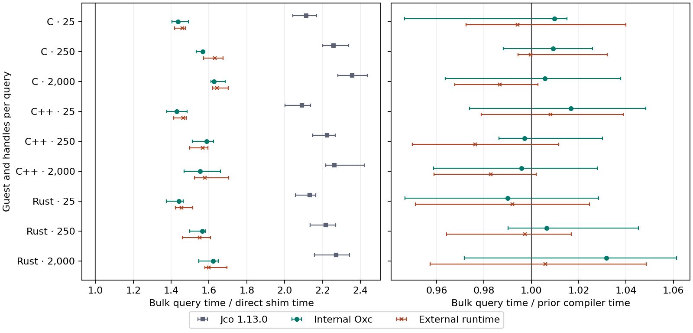

The full comparison used 12 rounds and 21 language/workload pairs. On the warm headline operation, both builds came within 10× of the fastest compiled shim in all 21 cases. Of 84 comparable subphases, 81 internal and 81 external fell within 10×. In the original bulk query the shim discards a live collection. The comparison above makes each implementation return all handles and run the guest's drop loop. [Full demo timings, compiler and module hashes](web/bench/results/review-matrix-minified-6a00c9e7d.json.gz)

| Build | Entry JS (KiB) | Total JS (KiB) | Gzipped JS (KiB) | JS requests | Import (ms) | First result incl. import (ms) |
| --- | ---: | ---: | ---: | ---: | ---: | ---: |
| Jco 1.13.0 | 9.58 | 9.58 | 3.01 | 1 | 5.15 | 60.72 |
| Upstream main at `326f52ab4` | 111.34 | 111.34 | 25.42 | 1 | 12.14 | 205.50 |
| Internal Oxc | 71.54 | 71.54 | 18.95 | 1 | 9.71 | 63.65 |
| External checked | 25.08 | 124.13 | 40.59 | 19 | 22.57 | 77.35 |

Each of the six minified DOM-query entries shrank by seven bytes. The other 36 PR entries, the checked runtime modules and all separately served Wasm cores matched the previous matrix byte for byte. Each column is the median of the 21 workload medians. Gzip is the sum of compressed JS asset sizes per workload. HTTP timings use uncompressed loopback responses.

| Warm headline operation | Internal Oxc | External checked |
| --- | ---: | ---: |
| Matching or beating Jco 1.13.0 | 18/21 | 15/21 |
| Matching or beating upstream main | 21/21 | 20/21 |
| Worst ratio to the fastest compiled shim | 5.29× | 5.90× |

The internal Rust canvas pixel read took 1.067× the release time (individual 95% interval 1.014–1.152×). It was the only warm headline interval entirely above parity. For first result, seven internal and fourteen external intervals were entirely slower than release.


<details><summary>Reproduce the comparison</summary>

Use built Jco checkouts at `cbd43f45f` (before) and `6a00c9e7d` (after), plus the upstream build at `326f52ab4`. Each bulk comparison runs all six builds on one page with six warmups and six timed passes per build. Each build occupies every timing position. The matrix uses a fresh document per build and reports the second invocation as warm.

```sh
export CHROME_BIN=/path/to/chrome
ROUNDS=12 node web/bench/bulk-dom.mjs "$after" /tmp/bulk.json.gz "$before"
python3 web/bench/bulk-dom-report.py /tmp/bulk.json.gz --plot /tmp/bulk.png
ROUNDS=12 node web/bench/review-matrix.mjs "$after" "$stage" /tmp/matrix.json.gz --minify-checked
python3 web/bench/review-matrix-report.py /tmp/matrix.json.gz --release-intervals --plot /tmp/matrix.png
```

</details>

### External runtime startup on HTTP/1.1 and HTTP/2

Across six small DOM workloads, building the external entries together reduced first-result time by **44% on HTTP/1.1** and **44% on HTTP/2** relative to loading the checked package directly. The application bundle uses the same generated inputs and guest Wasm. The improvement held in 6/6 and 6/6 individual 95% paired intervals, respectively. [Request traces, timings and asset hashes](web/bench/results/runtime-chunks-6a00c9e7d.json.gz)

| Build | JS requests | Total JS (KiB) | Gzipped JS (KiB) | HTTP/1.1 first result (ms) | HTTP/2 first result (ms) |
| --- | ---: | ---: | ---: | ---: | ---: |
| Jco 1.13.0 | 1 | 9.71 | 3.07 | 14.73 | 15.01 |
| Internal Oxc | 1 | 71.87 | 19.13 | 26.59 | 26.85 |
| External, shipped package | 19 | 124.33 | 40.72 | 50.61 | 50.39 |
| External, grouped package | 12 | 122.87 | 36.40 | 42.48 | 43.46 |
| External, six-entry application bundle | 2 | 71.02 | 20.37 | 28.02 | 28.12 |

Each time is the median of six workload medians. The percentages above pair treatments within workload and round first. Gzip is the sum of individually compressed JS assets. Both protocols served uncompressed responses over TLS on loopback. For the demos, the timer starts after document navigation and host setup, immediately before importing the component. It ends after the first guest call.

The grouped-package experiment put code used by four or more package entries into one common chunk. It preserved all public export names and reduced demo runtime requests from 18 to 11. The same policy increased the download for a standalone numeric conversion from **2.71 KiB to 91.04 KiB**. Its median first result rose from 7.02 to 12.16 ms on HTTP/2. Application bundling lets a deployment optimize the components it loads together while retaining the smaller standalone import for other consumers. The runtime guide includes a two-entry configuration verified by loading both components independently in Chromium. [Browser build recipe](https://github.com/vados-cosmonic/jco/blob/a23e39602cb09c7cf55aefd23defcb43d3229f02/packages/jco-cm-runtime/docs/runtime.md#L197)


<details><summary>Reproduce the transport and package comparison</summary>

Use the built checkout at `6a00c9e7d`, Chromium, and OpenSSL. The runner creates an ephemeral loopback TLS certificate and pins its key in the test browser. It checks the negotiated protocol and exact transferred asset list on each document. Each of 20 fresh Chromium processes runs all treatments in balanced order, with a fresh document and HTTP caching disabled for every observation. The six workloads are the C, C++ and Rust DOM-query and table demos with eight elements or rows.

```sh
export CHROME_BIN=/path/to/chrome
matrix=web/bench/results/review-matrix-minified-6a00c9e7d.json.gz
node web/bench/runtime-chunks.mjs "$after" "$matrix" /tmp/chunks.json.gz
python3 web/bench/runtime-chunks-report.py /tmp/chunks.json.gz "$matrix" --plot /tmp/chunks.png
```

</details>

### Compressed browser startup on a limited connection

How much of the external runtime's startup cost comes from waiting for the next import? With HTTP/2 and Brotli, the multi-entry application bundle and internal Oxc took 29.08 and 27.92 ms on loopback. With Chromium set to 40 ms latency and 10 Mbit/s in both directions, they took 176.48 and 131.62 ms. The application downloaded only 1.10 KiB more JS and Wasm than internal Oxc, but its entry had to request a shared JS chunk before it could start the Wasm fetch. The median Wasm request began at 106.11 ms for the application and 62.59 ms for internal Oxc. [Per-request timings, sizes and digests](web/bench/results/brotli-http2-6a00c9e7d.json.gz)

| Build | JS + Wasm requests | Brotli JS (KiB) | Brotli JS + Wasm (KiB) | First result on loopback (ms) | First result at 40 ms / 10 Mbit/s (ms) |
| --- | ---: | ---: | ---: | ---: | ---: |
| Jco 1.13.0 | 2 | 2.54 | 24.83 | 15.38 | 114.57 |
| Internal Oxc | 2 | 16.79 | 39.14 | 27.92 | 131.62 |
| External checked package | 20 | 36.15 | 58.50 | 51.88 | 277.24 |
| External multi-entry application | 3 | 17.90 | 40.24 | 29.08 | 176.48 |

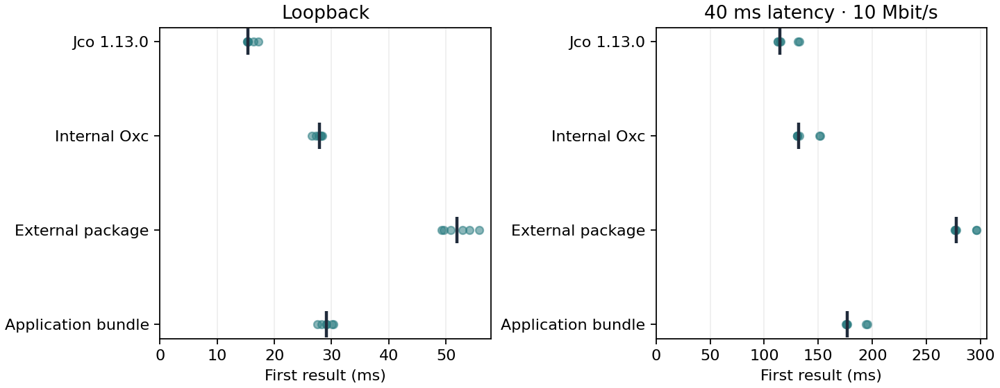

In a second, paired trial on the limited connection, the page inserted a module preload for its shared chunk immediately before importing the entry. That moved the Wasm fetch from **106.43 to 63.16 ms** and the first result from **177.02 to 133.28 ms**. The same three assets loaded once in both layouts. With the hint, the browser started fetching the shared chunk before the entry response finished on all 96 hinted pages. The paired reduction in first-result time was 24.5%, with all six individual 95% intervals favoring the hint. Internal Oxc took 133.85 ms and Jco 1.13.0 took 113.90 ms in that same trial. All six individual intervals comparing the hinted bundle with internal Oxc included parity. All six still favored release over the hinted bundle. [Preload trial samples](web/bench/results/brotli-preload-6a00c9e7d.json.gz)

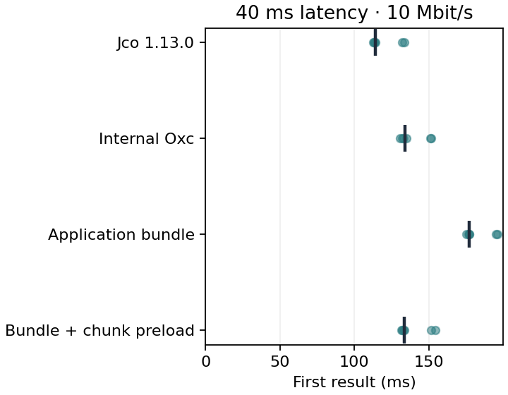

The two trials used fresh Chromium documents, an established loopback TLS connection, no HTTP caching and precompressed Brotli quality 11 responses. Timing started after common host setup and included component import, any hint, initialization and the first call. Within each workload, every treatment occupied every timing position equally often across 16 fresh browsers. The runner checked the guest reports, HTTP/2, every requested URL, and both compressed and decoded lengths. The shipped inputs matched the matrix digests. The application bundler used those same inputs and copied the guest Wasm unchanged. Each reported time is the median of the six workload medians. The limited profile is Chromium network emulation.

<details><summary>Reproduce the compressed startup and shared-chunk preload trials</summary>

Use a built Jco checkout at `a23e39602`, the six demo guests from the benchmark setup, OpenSSL and Chromium.

```sh
matrix=web/bench/results/review-matrix-minified-6a00c9e7d.json.gz
export CHROME_BIN=/path/to/chrome
node web/bench/runtime-chunks.mjs /path/to/built/jco "$matrix" /tmp/brotli.json.gz --shaped
node web/bench/runtime-chunks.mjs /path/to/built/jco "$matrix" /tmp/preload.json.gz --shaped-preload
python3 web/bench/runtime-chunks-report.py /tmp/brotli.json.gz "$matrix" --plot /tmp/brotli.png
python3 web/bench/runtime-chunks-report.py /tmp/preload.json.gz "$matrix" --plot /tmp/preload.png
```

</details>

## Browser bindings at 89d7306a9

A task normally records its scope ID in a map so that dropping a borrowed handle can find the owning task. For a synchronous component that cannot create a borrowed handle, the checked compiler can prove that this lookup has no reader. The internal Oxc bundle and external runtime both skip the map insertion and deletion. They still assign a distinct scope ID to each task. Borrowed export arguments, cross-instance transfers and custom providers retain registration. [Runtime implementation and tests](https://github.com/vados-cosmonic/jco/commit/4b02f2fc1) · [Custom-provider compatibility](https://github.com/vados-cosmonic/jco/commit/8e64ebfdf)

For one JS call into Wasm that calls a scalar host function once and returns, elapsed time decreased by **15.8% (95% interval 10.6–16.9%) internally** and **16.7% (95% interval 14.6–19.0%) externally** relative to the previous compiler. At one host call per export the two renderers took 26.90× and 26.25× the direct Wasm time. With 16 host calls sharing one export they took 4.62× and 4.86×. The checked external entry differs from the control by a single property in the task context. The runner verifies this and checks identical guest Wasm across all six builds. [Paired timings, compiler and asset hashes](web/bench/results/export-host-batch-89d7306a9.json.gz)

| Host calls per export | Internal after / before | External after / before | Internal / direct Wasm | External / direct Wasm |
| ---: | ---: | ---: | ---: | ---: |
| 1 | 0.842× (0.831–0.894) | 0.833× (0.810–0.854) | 26.900× (25.226–27.653) | 26.248× (25.377–27.427) |
| 4 | 0.871× (0.857–0.900) | 0.856× (0.834–0.870) | 12.797× (12.244–13.473) | 12.791× (11.884–13.302) |
| 16 | 0.895× (0.878–0.953) | 0.901× (0.878–0.928) | 4.620× (4.586–4.801) | 4.855× (4.667–5.017) |
| 64 | 0.936× (0.910–0.966) | 0.925× (0.908–0.970) | 2.002× (1.932–2.177) | 2.272× (2.146–2.373) |
| 256 | 0.955× (0.936–1.009) | 0.971× (0.942–1.013) | 1.327× (1.293–1.403) | 1.533× (1.459–1.627) |

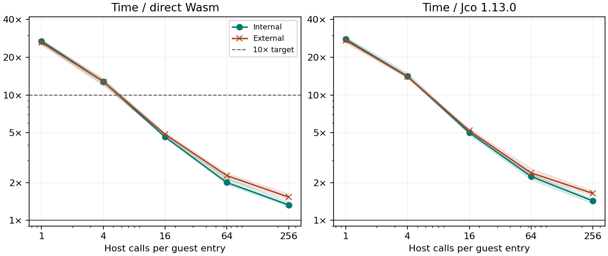

Across seven browser workloads in C, C++ and Rust, 12 rounds compared the same guest binaries against Jco 1.13.0, upstream main at `326f52ab4`, and the reference shims. All 21 checked external entries contained the new hint. Removing that property reproduced the previous entry byte for byte in each case. Each asset and time column is the median across 21 cases. The browser fetched uncompressed files over loopback. [Full demo measurements](web/bench/results/review-matrix-minified-89d7306a9.json.gz)

| Build | Minified JS entry (KiB) | Total JS (KiB) | Total gzipped JS¹ (KiB) | JS requests | Import (ms) | First result including import (ms) |
| --- | ---: | ---: | ---: | ---: | ---: | ---: |
| Jco 1.13.0 | 9.58 | 9.58 | 3.01 | 1 | 5.10 | 61.90 |
| Upstream main | 111.34 | 111.34 | 25.42 | 1 | 12.37 | 204.88 |
| Internal Oxc | 71.55 | 71.55 | 18.96 | 1 | 9.55 | 63.03 |
| External checked | 25.08 | 124.13 | 40.59 | 19 | 22.61 | 80.45 |

¹ Sum of the compressed JS asset sizes for each workload.

| Warm demo measurements | Internal Oxc | External checked |
| --- | ---: | ---: |
| Within 10× of the fastest compiled shim | 21/21 | 21/21 |
| Matching or beating upstream main | 20/21 | 21/21 |
| Matching or beating Jco 1.13.0 | 16/21 | 13/21 |
| Comparable subphases within 10× of the fastest shim | 81/84 | 81/84 |
| Worst warm headline ratio to the fastest shim | 4.52× | 4.72× |

For the warm operation, external Rust table creation took 1.25× the release time (individual 95% interval 1.05–1.31×). The other warm intervals included parity or favored the PR. For first result, 6 internal and 14 external intervals were entirely slower than release.

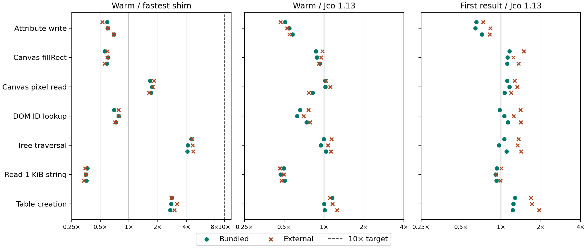

<details><summary>Reproduce both comparisons</summary>

Use the built Jco checkouts at `0309ec2a7` (before) and `89d7306a9` (after) and the upstream build at `326f52ab4`. The paired runner rotates all six builds through each timing position on 18 fresh pages per batch size. Its intervals use one paired observation per page. The full matrix runs each guest twice on a fresh document and reports the second invocation as warm.

```sh
export CHROME_BIN=/path/to/chrome
node web/bench/export-host-batch.mjs "$before/packages/jco-transpile" "$before/packages/jco-cm-runtime/dist" "$after/packages/jco-transpile" "$after/packages/jco-cm-runtime/dist" /tmp/batch.json.gz --borrow-scope-hint
python3 web/bench/export-host-batch-report.py /tmp/batch.json.gz --plot /tmp/batch.png
ROUNDS=12 node web/bench/review-matrix.mjs "$after" "$stage" /tmp/matrix.json.gz --minify-checked
python3 web/bench/review-matrix-report.py /tmp/matrix.json.gz --release-intervals --plot /tmp/matrix.png
```

</details>

### Rust table creation over repeated calls

Creating 2,000 Rust table rows takes about 9 ms on most later calls. Both PR renderers slow down on guest calls 6, 11 and 22. Four prior runs of the equivalent JavaScript demo leave the spikes on those same guest calls. Four prior runs through the Rust guest move them to measured calls 2, 7 and 18. Each build created the same rows and made the same 10,000 host calls during creation. [Timings from 18 Chromium rounds](web/bench/results/table-warmup-89d7306a9.json.gz)

| Guest call with no prior work | Jco 1.13.0 (ms) | Internal Oxc (ms) | External checked (ms) | Internal / release | External / release |
| ---: | ---: | ---: | ---: | ---: | ---: |
| 2 | 11.07 | 10.07 | 10.60 | 0.90× | 0.91× |
| 6 | 9.71 | 12.73 | 11.73 | 1.34× | 1.23× |
| 11 | 9.50 | 13.39 | 14.42 | 1.34× | 1.45× |
| 21 | 8.60 | 8.55 | 9.39 | 1.01× | 1.13× |
| 22 | 8.75 | 16.05 | 16.37 | 1.84× | 1.95× |
| 23 | 9.10 | 8.98 | 8.63 | 1.02× | 0.93× |

Times are medians. Ratios are the medians of 18 within-round pairs. On call 22 the individual 95% intervals were 1.43–2.27× internally and 1.71–2.19× externally. Both second-call intervals included parity in this isolated run. The broader demo matrix above measured a second-call slowdown for the external renderer.

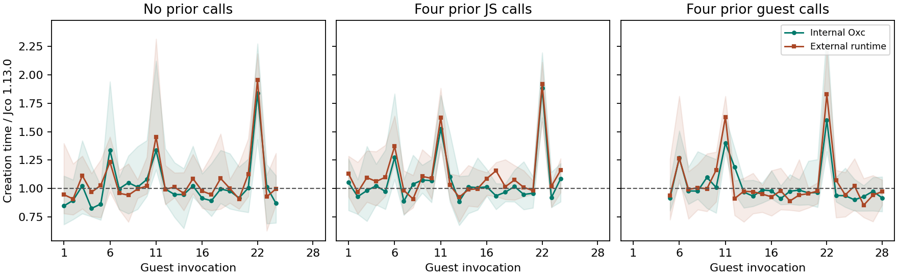

In a separate run that timed each `WeakSet.add`, each PR renderer called it 4,001 times per creation phase. Jco 1.13.0 made zero calls. On guest call 22, with no prior work, the median **longest single insertion** took 7.92 ms internally and 5.89 ms externally. On calls 21 and 23 it took under 0.02 ms for both. The resource-drop trampoline records each dropped host object so that stopping the instance can skip an alias that the guest already dropped. Reading the disposal hook can itself call back into shutdown. This ordering matters to implementations of both renderers. [Insertion timings](web/bench/results/table-warmup-weak-adds-89d7306a9.json.gz)

A third run traced foreground garbage collection and compiler activity. On call 22 the median recorded overlap of each category with creation was zero in both renderers. The trace report matches each start and end mark to the guest's own time and counts nested intervals once. [Traced timings](web/bench/results/table-warmup-traced-89d7306a9.json.gz) · [Foreground event intervals](web/bench/results/table-warmup-spans-89d7306a9.json.gz)

<details><summary>Reproduce the 24-call comparison and probes</summary>

Each command runs 18 fresh Chromium processes. Each process visits nine fresh documents, rotating the three builds and three prior workloads through every timing position. The runner checks served assets against the published matrix and verifies the created DOM and host call counts in separate untimed documents. The first command runs without tracing or patched built-ins. Set `CHROME_BIN` to a Chromium executable and use the built Jco checkout at `89d7306a9`.

```sh
matrix=web/bench/results/review-matrix-minified-89d7306a9.json.gz
node web/bench/table-warmup.mjs "$after" "$matrix" /tmp/table.json.gz
python3 web/bench/table-warmup-report.py /tmp/table.json.gz "$matrix" --plot /tmp/table.png
node web/bench/table-warmup.mjs "$after" "$matrix" /tmp/weak.json.gz --time-weak-adds
python3 web/bench/table-warmup-report.py /tmp/weak.json.gz "$matrix"
node web/bench/table-warmup.mjs "$after" "$matrix" /tmp/traced.json.gz /tmp/table-traces
python3 web/bench/table-warmup-trace.py /tmp/traced.json.gz /tmp/table-traces /tmp/spans.json.gz
python3 web/bench/table-warmup-report.py /tmp/traced.json.gz "$matrix" --spans /tmp/spans.json.gz
```

</details>

## Browser bindings at 0c3d12ad0

The PR shares the synchronous host adapter between the internal Oxc bundle and the external runtime package. Twelve Chromium rounds compared the same C, C++ and Rust guests across seven browser workloads. The comparison uses the compiler from upstream main at `326f52ab4`. [Fork PR](https://github.com/vados-cosmonic/jco/pull/62) · [Upstream CI build](https://github.com/bytecodealliance/jco/actions/runs/45795485943) · [Measurements, asset sizes and compiler hashes](web/bench/results/review-matrix-minified-0c3d12ad0.json.gz)

| Build | Minified JS entry (KiB) | Total JS (KiB) | Total gzipped JS¹ (KiB) | JS requests | Import (ms) | First result including import (ms) |
| --- | ---: | ---: | ---: | ---: | ---: | ---: |
| Jco 1.13.0 | 9.58 | 9.58 | 3.01 | 1 | 5.02 | 60.91 |
| Upstream main | 111.34 | 111.34 | 25.42 | 1 | 12.29 | 200.95 |
| Internal Oxc | 71.47 | 71.47 | 18.93 | 1 | 9.82 | 63.21 |
| External checked | 25.06 | 124.05 | 40.55 | 19 | 21.92 | 78.62 |

¹ Median across 21 workload and language pairs for each column. Gzip is the sum of compressed JS asset sizes. The timings use uncompressed loopback HTTP.

| Warm demo measurements | Internal Oxc | External checked |
| --- | ---: | ---: |
| Within 10× of the fastest compiled shim | 21/21 | 21/21 |
| Matching or beating upstream main | 21/21 | 21/21 |
| Matching or beating Jco 1.13.0 | 17/21 | 14/21 |
| Comparable subphases within 10× of the fastest shim | 81/84 | 81/84 |
| Worst warm headline ratio to the fastest shim | 4.29× | 4.84× |

On the second guest invocation, internal C canvas pixel read took 1.080× the 1.13.0 time (individual 95% interval 1.028–1.278×). It was the only internal interval entirely above parity. All external intervals included parity or favored the PR. For first result, 6 internal and 15 external intervals were entirely slower than release. [Materialized DOM queries](#materializing-bulk-dom-query-results) · [Later warm invocations](#warm-table-creation-and-tree-traversal) · [Repeat visits and HTTP caching](#repeat-visits-and-http-caching)


### Host calls per guest export

Returning from a synchronous export previously allocated an array to remove a single active call, then looked for runnable threads even when the suspension table was empty. The shared runtime now pops a lone matching call and skips the empty thread scan. Nested or suspended calls still resolve by task identity. A test covers an unknown task and two calls finishing out of order. [Runtime change and regression test](https://github.com/vados-cosmonic/jco/commit/070c350c7606b5badcdaf41e2bd94a5886d8ab21) · [Embedded Oxc snapshot](https://github.com/vados-cosmonic/jco/commit/0c3d12ad0d8d9dc2b0f9be3c7b51aa1223189041)

One JS invocation enters the guest, which calls a host increment function the indicated number of times before returning. With one host call, the reduction in elapsed time was **9.1% (95% interval 6.7–10.4%) internally** and **10.2% (95% interval 7.2–12.6%) externally**. Each row pairs all six builds on the same pages. The denominator for “before” is PR revision `e12260509`. [Raw timings and asset hashes](web/bench/results/export-host-batch-0c3d12ad0.json.gz)

| Host calls per export | Internal after / before | External after / before | Internal / direct Wasm | External / direct Wasm | Internal / 1.13.0 | External / 1.13.0 |
| ---: | ---: | ---: | ---: | ---: | ---: | ---: |
| 1 | 0.909× (0.896–0.933) | 0.898× (0.874–0.928) | 30.81× | 30.75× | 33.39× | 34.01× |
| 4 | 0.922× (0.864–0.939) | 0.911× (0.882–0.940) | 14.06× | 14.52× | 16.22× | 16.19× |
| 16 | 0.925× (0.886–0.956) | 0.910× (0.854–0.941) | 5.33× | 5.48× | 5.64× | 5.92× |
| 64 | 0.932× (0.902–1.000) | 0.951× (0.918–0.992) | 2.20× | 2.51× | 2.38× | 2.65× |
| 256 | 1.001× (0.975–1.021) | 0.968× (0.940–0.986) | 1.40× | 1.58× | 1.47× | 1.70× |

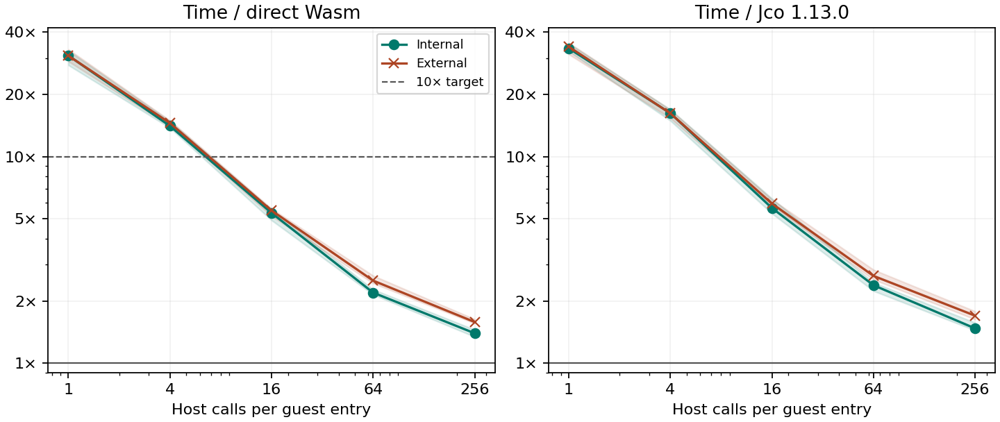

In the demo matrix, the external entry JS and separately served Wasm cores matched the preceding revision byte for byte. Each internal JS entry grew by 66 bytes. The external renderer fetched the updated shared runtime, increasing the total JavaScript by 66 bytes per demo.

<details><summary>Reproduce these measurements</summary>

Build `js-component-bindgen-component`, `@bytecodealliance/jco-transpile` and `@bytecodealliance/jco-cm-runtime` from both Jco revisions. The [matrix setup](#full-demo-matrix-on-the-merged-pr) describes the guest assets and the upstream CI staging directory. Use run `45795485943` and verify its SHA is `326f52ab4403466b21b989c995f9bb97b2b9e038`. Run the commands from the benchmark fork.

```sh
export CHROME_BIN=/path/to/chrome
node web/bench/export-host-batch.mjs \
  "$before/packages/jco-transpile" "$before/packages/jco-cm-runtime/dist" \
  "$after/packages/jco-transpile" "$after/packages/jco-cm-runtime/dist" /tmp/batch.json.gz
python3 web/bench/export-host-batch-report.py /tmp/batch.json.gz --plot /tmp/batch.png
ROUNDS=12 node web/bench/review-matrix.mjs "$after" "$stage" /tmp/full.json.gz --minify-checked
python3 web/bench/review-matrix-report.py /tmp/full.json.gz --release-intervals --plot /tmp/full.png
```

For each batch size, each of 18 fresh pages ran six warmup passes and six measured passes. Each build occupied every timing position once and immediately followed every other build once over the measured passes. All builds ran identical core Wasm and verified the expected checksum. Each individual interval is an order-statistic interval for the median of the within-page ratios.

</details>

## Browser bindings at e12260509

Both renderers met the 10× shim target on all 21 warm demo cases at this revision. Each matched or beat Jco 1.13.0 in 16/21. [Full comparison and graph](https://github.com/vados-cosmonic/component-demos/blob/3af35212fd1332204e24942081cd7cff0094396b/README.md#browser-bindings-at-e12260509)

### Cost of one synchronous export that calls back into the host

The latest change removes a mutable Wasm global used by suspending adapters. Bindgen already knows when a single-instance component has only synchronous calls. In that case there is no reader for the register, so bindgen can omit the allocation and the write on every export call. The ordinary task still handles entry, traps and exit. A custom runtime can observe task operations and keeps the full path. [Code, eligibility check and tests](https://github.com/vados-cosmonic/jco/commit/e12260509a95f602a8a62399c973954c3993360a)

Compared with the earlier minified matrix at `db4a3aca0`, all 21 internal entries shrank by 309–314 bytes and all 21 external entries by 121–124 bytes. Every separately served Wasm core matched the earlier hash.

A small guest export takes an integer, calls a JS host function once and returns its result. Each of 18 fresh Chromium pages ran all six configurations on identical core Wasm. A separate instantiation on each page counted allocations. Each timing comes from an instance created with the native global constructor. Individual timing intervals use one paired median ratio per page. [Raw samples](web/bench/results/export-task-register-e12260509.json.gz) · [Measured runner](https://github.com/vados-cosmonic/component-demos/blob/76a0fd0/web/bench/export-task-register.mjs)

| Renderer | Wasm globals allocated before → after | Minified entry bytes saved (gzip) | Time after / before (95% interval) | Time after / 1.13.0 | Time after / direct Wasm |
| --- | ---: | ---: | ---: | ---: | ---: |
| Internal Oxc | 1 → 0 | 286 (90) | 1.053× (0.834–1.194) | 37.31× | 44.61× |
| External checked | 1 → 0 | 98 (43) | 0.974× (0.917–1.162) | 37.10× | 43.64× |

Both timing intervals include parity. The measured gain from removing the register is in allocations and bytes. This round trip still cost about 2.33 µs in both renderers, versus 62.9 ns on 1.13.0 and 50.0 ns calling direct Wasm. A demo that makes many host calls inside one guest invocation amortizes the export task over the loop. A small export called repeatedly from JS pays for a task on every invocation.

<details><summary>Reproduce the PR-head measurements</summary>

Follow the [matrix setup](#full-demo-matrix-on-the-merged-pr) to prepare the component binaries and install the benchmark dependencies. Build the PR at `e12260509` and its parent at `ee0d0ff26`, including the bindgen compiler used by the transpiler. Stage the upstream artifacts using CI run `45795485943` and verify its head SHA is `326f52ab4403466b21b989c995f9bb97b2b9e038`. The runner records the common Git base, compiler artifact hashes and the SHA-256 of each served asset.

```sh
export CHROME_BIN=/path/to/chrome
ROUNDS=12 node web/bench/review-matrix.mjs "$jco" "$stage" /tmp/matrix.json.gz --minify-checked
python3 web/bench/review-matrix-report.py /tmp/matrix.json.gz --release-intervals --plot /tmp/matrix.png
node web/bench/export-task-register.mjs "$parent/packages/jco-transpile" \
  "$jco/packages/jco-transpile" "$jco/packages/jco-cm-runtime/dist" /tmp/register.json.gz
python3 web/bench/export-task-register-report.py /tmp/register.json.gz
```

</details>

<a id="minified-bindings-at-the-pr-head"></a>

## Minified external diagnostics at db4a3aca0

At `db4a3aca0`, the external JavaScript entry shrank **15.0–17.9% on every workload** when generated with `--minify --cm-runtime-es-module @bytecodealliance/jco-cm-runtime`. The standard checked package exports an empty logger. Removing its labeled calls before minification also removes their message strings and argument construction. The internal Oxc bundle already removes these calls. Custom and debug provider paths keep them. [Jco implementation, runtime notes and tests](https://github.com/vados-cosmonic/jco/commit/db4a3aca05eb0745561cced24e2407713831074e) · [Fork PR](https://github.com/vados-cosmonic/jco/pull/62)

| Median across 21 workload and language pairs | Jco 1.13.0 | Upstream base | PR internal Oxc | PR external checked |
| --- | ---: | ---: | ---: | ---: |
| Minified JS entry (KiB) | 9.58 | 111.34 | 71.71 | 25.18 |
| Total JS transferred (KiB) | 9.58 | 111.34 | 71.71 | 124.10 |
| JS requests | 1 | 1 | 1 | 19 |
| Import (ms) | 5.27 | 11.94 | 10.00 | 22.77 |
| First full result including import (ms) | 61.83 | 203.50 | 62.76 | 78.30 |

Both PR renderers were within 10× of the fastest compiled shim in **21/21 warm headline cases**. The largest ratios were **4.92× internal and 4.50× external**. Each renderer matched or beat 1.13.0 on 18/21 warm headlines in this run. Each met the shim target in 81/84 comparable subphases. The three exceptions return a materialized list of DOM handles, while the original shim discards a live collection. [Paired release intervals](#paired-timing-intervals-against-jco-1130) · [Equal-work DOM queries](#materializing-bulk-dom-query-results) · [Warmed tables and traversal](#warm-table-creation-and-tree-traversal) · [Canvas readback](#canvas-readback-at-the-pr-head) · [Wasm packaging](#fetching-or-embedding-the-primary-wasm-core) · [Preloading external runtime modules](#preloading-external-runtime-modules) · [HTTP gzip](#serving-the-browser-bindings-with-http-gzip) · [Multi-entry application build](#bundling-the-component-entries-as-one-browser-application) · [Trailing-slash fix](#checked-runtime-package-spelling)


The paired comparison used the same standard package, import map, runtime modules and guest Wasm before and after the minifier change. The previous external entry was 29.86 KiB at the median. The new entries saved 4,175–6,333 bytes each, or 402–549 bytes with gzip. Across the 21 cases, the median paired ratio was **0.971× for first result and 0.983× for warm operation**. Twenty first-result intervals and all warm intervals included parity. This run establishes a size reduction. Cold-start parity with 1.13.0 remains open. [Raw samples and compiler hashes](web/bench/results/review-matrix-minified-db4a3aca0.json.gz)

<details><summary>External after / before, individual 95% median intervals and reproduction</summary>

| Guest and operation | Entry bytes saved | Gzip bytes saved | Paired import | Paired first result | Paired warm operation |
| --- | ---: | ---: | ---: | ---: | ---: |
| C Attribute write | 4175 | 412 | 0.97× (0.87–1.10) | 0.95× (0.85–1.01) | 0.92× (0.79–1.06) |
| C++ Attribute write | 4175 | 416 | 1.01× (0.84–1.19) | 0.96× (0.79–1.29) | 0.98× (0.82–1.29) |
| Rust Attribute write | 4175 | 427 | 0.98× (0.82–1.05) | 0.93× (0.86–1.10) | 0.97× (0.75–1.09) |
| C Canvas fillRect | 5642 | 494 | 0.98× (0.85–1.09) | 1.06× (0.80–1.22) | 1.10× (0.92–1.29) |
| C++ Canvas fillRect | 5642 | 500 | 0.86× (0.77–0.94) | 0.90× (0.84–0.96) | 0.98× (0.81–1.06) |
| Rust Canvas fillRect | 5643 | 498 | 0.91× (0.81–1.13) | 0.90× (0.79–1.07) | 0.98× (0.92–1.27) |
| C Canvas pixel read | 6333 | 529 | 1.06× (0.84–1.32) | 1.02× (0.93–1.18) | 1.09× (0.86–1.44) |
| C++ Canvas pixel read | 6333 | 524 | 1.01× (0.78–1.28) | 0.97× (0.92–1.13) | 1.04× (0.76–1.48) |
| Rust Canvas pixel read | 6332 | 549 | 0.98× (0.88–1.23) | 0.99× (0.89–1.15) | 0.85× (0.66–1.04) |
| C DOM ID lookup | 4957 | 451 | 0.92× (0.80–1.20) | 0.95× (0.79–1.20) | 1.12× (0.93–1.35) |
| C++ DOM ID lookup | 4957 | 467 | 0.98× (0.87–1.06) | 0.97× (0.90–1.05) | 1.05× (0.78–1.24) |
| Rust DOM ID lookup | 4957 | 475 | 0.98× (0.76–1.51) | 0.98× (0.89–1.21) | 0.97× (0.74–1.43) |
| C Tree traversal | 4825 | 445 | 1.02× (0.80–1.32) | 0.92× (0.81–1.26) | 0.86× (0.72–1.22) |
| C++ Tree traversal | 4825 | 455 | 1.02× (0.85–1.56) | 1.02× (0.85–1.22) | 0.98× (0.46–1.17) |
| Rust Tree traversal | 4825 | 450 | 1.03× (0.90–1.18) | 0.97× (0.87–1.14) | 0.95× (0.73–1.74) |
| C Read 1 KiB string | 4190 | 402 | 0.93× (0.71–1.25) | 0.94× (0.89–1.04) | 1.02× (0.89–1.20) |
| C++ Read 1 KiB string | 4190 | 411 | 1.16× (0.40–1.53) | 0.97× (0.89–1.07) | 1.02× (0.90–1.09) |
| Rust Read 1 KiB string | 4190 | 428 | 1.01× (0.77–1.36) | 0.99× (0.87–1.09) | 0.99× (0.78–1.09) |
| C Table creation | 4799 | 438 | 1.11× (0.91–1.20) | 0.99× (0.88–1.28) | 1.03× (0.84–1.21) |
| C++ Table creation | 4799 | 453 | 0.94× (0.80–1.23) | 0.90× (0.78–1.11) | 0.90× (0.70–1.05) |
| Rust Table creation | 4799 | 444 | 0.98× (0.88–1.10) | 0.93× (0.85–1.08) | 1.01× (0.78–1.27) |

Each of ten rounds ran 118 fresh Chromium documents with DevTools disconnected. The five Jco configurations rotated through every timing position and immediate predecessor for each workload and language. Each page checked the first and second complete guest reports. The size comparison uses actual files. Import and first-result timing include the ordinary browser fetches over uncompressed loopback. The intervals apply individually to paired round ratios.

Follow the [full-matrix setup](#full-demo-matrix-on-the-merged-pr). Build the PR checkout at `db4a3aca0` and the previous transpiler at `95e8ae0d8`. The runner checks that both transpilers use the same bindgen compiler artifacts. The upstream base is `83e25bb19`. Upstream main at `326f52ab4` added one Node HTTP shim change since that base. [Upstream comparison](https://github.com/bytecodealliance/jco/compare/83e25bb19...326f52ab4) · [Measured runner](https://github.com/vados-cosmonic/component-demos/blob/f2d27b218062dbbe77f2da7013f5c613ab3aef87/web/bench/review-matrix.mjs)

```sh
CHROME_BIN=/path/to/chrome ROUNDS=10 node web/bench/review-matrix.mjs \
  "$jco" "$stage" /tmp/checked-provider.json.gz --minify "$previous/packages/jco-transpile"
python3 web/bench/review-matrix-report.py /tmp/checked-provider.json.gz --plot /tmp/checked-provider.png
```

</details>

### Paired timing intervals against Jco 1.13.0

Each timing ratio compares a PR build to 1.13.0 for the same language, workload and browser round. Across ten rounds, the individual intervals show a clearer regression in time to the first result on the external runtime than on the second guest call. Rust tree traversal had the highest warm point estimates, **1.065×** internally (interval 0.780–1.595×) and **1.068×** externally (0.603–1.128×). Those ranges allow both a speedup and a slowdown. [Raw samples](web/bench/results/review-matrix-minified-db4a3aca0.json.gz)

| Phase and build | Interval favors PR | Interval includes parity | Interval favors 1.13.0 |
| --- | ---: | ---: | ---: |
| Warm operation, internal Oxc | 8 | 13 | 0 |
| Warm operation, external runtime | 8 | 13 | 0 |
| First result, internal Oxc | 3 | 16 | 2 |
| First result, external runtime | 4 | 4 | 13 |

The bounds are distribution-free intervals for the median paired time ratio. With ten pairs, the second-lowest and second-highest observations give at least 95% coverage for each interval individually. These counts use no adjustment for testing multiple workloads. To print every interval, run `python3 web/bench/review-matrix-report.py web/bench/results/review-matrix-minified-db4a3aca0.json.gz --release-intervals`. [Report generator](web/bench/review-matrix-report.py)

## Checked runtime package spelling

A trailing slash on `@bytecodealliance/jco-cm-runtime/` used to resolve the right JavaScript modules while selecting the general host-call adapter. On the scalar host-call loop, fixing package recognition brought the slash spelling from **2,091 ns to 15.6 ns per call**. The bare spelling took 15.8 ns and Jco 1.13.0 took 11.6 ns in the same pages. All four configurations ran identical guest cores. [Jco fix and regression tests](https://github.com/vados-cosmonic/jco/commit/e088182a963a0fef03a5831a4409df60feeeae11) · [Timing samples and asset hashes](web/bench/results/provider-spelling-loop.json.gz)

Across all 21 browser workload and language pairs, the fix reduced the minified JS entry for the slash spelling by **41.8–45.6%**, saving 16,968–24,335 bytes per entry. Every emitted JS and Wasm file for both spellings now matches the published bare-package run byte for byte. Custom providers still select their own adapters. [Per-workload size and hash comparison](web/bench/results/provider-spelling.json)

<details><summary>Reproduce the package spelling comparison</summary>

Build the Jco checkouts at `5e5b15606` and `e088182a9` using the [benchmark setup](#reproduce-the-comparison). From this fork, verify the 21 workloads, then generate the pre-fix loop fixture with the older CLI and pass it to the browser runner.

```sh
node web/bench/provider-spelling.mjs /path/to/before /tmp/before-spellings.json --before
node web/bench/provider-spelling.mjs /path/to/after /tmp/after-spellings.json
wasm-tools parse web/bench/import-loop.wat -o /tmp/loop.wasm
node /path/to/before/packages/jco/dist/jco.js transpile /tmp/loop.wasm -o /tmp/old-loop --minify --no-nodejs-compat --instantiation async --base64-cutoff 0 --cm-runtime-es-module @bytecodealliance/jco-cm-runtime/
CHROME_BIN=/path/to/chrome node web/bench/provider-spelling-loop.mjs /path/to/after /tmp/old-loop /tmp/spelling-loop.json.gz
```

Each of 16 isolated Chromium documents ran four warmups and four timed passes per configuration. Each pass made 65,536 guest-to-host calls and checked the guest's checksum. The reported times are medians of page medians. [Size verifier](web/bench/provider-spelling.mjs) · [Browser runner](web/bench/provider-spelling-loop.mjs)

</details>

## Default browser bindings at revision b731ebc91

In the full timing run at `b731ebc91`, both the internal Oxc bundle and the external checked runtime stayed within 10× of the fastest compiled shim in **all 21 warm headline cases**. Tree traversal had the largest gap. The internal bundle took **5.50×** the shim’s time for the C guest, and the external runtime took **5.78×** for Rust. Cold startup and Jco 1.13.0 parity remain open. [Jco fork PR](https://github.com/vados-cosmonic/jco/pull/62) · [Minified builds](#minified-browser-bindings) · [Equal-work bulk queries](#materializing-bulk-dom-query-results) · [External runtime packaging](#packaging-the-external-runtime-for-browsers) · [Warmed tables and traversal](#warm-table-creation-and-tree-traversal)

| Headline comparison | Internal Oxc | External runtime |
| --- | ---: | ---: |
| Warm operation at or faster than upstream main | 20/21 | 21/21 |
| Warm operation at or faster than Jco 1.13.0 | 13/21 | 12/21 |
| First full result at or faster than Jco 1.13.0 | 5/21 | 4/21 |
| Warm subphases within 10× of the fastest compiled shim | 81/84 | 81/84 |

| Median across 21 workload and language pairs | Jco 1.13.0 | Upstream main | Internal Oxc | External runtime |
| --- | ---: | ---: | ---: | ---: |
| Import (ms) | 5.74 | 14.59 | 11.66 | 25.94 |
| First full result, including import (ms) | 65.70 | 246.70 | 72.12 | 87.55 |
| Generated JS entry (KiB) | 21.23 | 191.50 | 126.43 | 67.01 |
| Total JS transferred per document (KiB) | 21.23 | 191.50 | 126.43 | 165.94 |
| JS requests per document | 1 | 1 | 1 | 19 |


The full matrix ran in 776 fresh Chromium documents over eight balanced rounds. Each Jco build ran identical Wasm cores. The browser measured import and the first full guest call, then repeated the workload in the same document for the warm phase. Responses were uncompressed on loopback with caching disabled and DevTools disconnected. Release and upstream comparisons pair times within each round. Shim ratios divide each warm median by the lowest median from the compiled shims available for that operation. [Measured Jco revision](https://github.com/vados-cosmonic/jco/commit/b731ebc9160203466a5c2bf5bc2debb6a77d28e0) · [Measured upstream main](https://github.com/bytecodealliance/jco/commit/83e25bb19bc45c8a346e4ecdd19b4a1541700fe7) · [Raw samples, compiler hashes and request sizes](web/bench/results/review-matrix-b731ebc91.json.gz)

The three subphases outside the 10× target were bulk DOM queries. The WIT interface materializes a list of handles and the Embind shim discards a live collection. At 2,000 handles per query, materializing the list on both sides measured 1.50–1.57× the direct shim’s time for the internal bundle and 1.53–1.60× for the external runtime. The single bundled headline above upstream main was Rust canvas pixel readback at 1.03×, with individual rounds on either side of parity. The number of warm medians at or below 1.13.0 also varied between the two full runs. The separate decoder trial isolates the effect of the import change. [Equal-work bulk query results](#materializing-bulk-dom-query-results) · [Pre-decoder full run](#full-demo-matrix-on-the-merged-pr) · [Decoder trial](#loading-the-utf-8-decoder-for-synchronous-imports)

The synchronous host adapter reuses an enclosing task. An isolated numeric guest export can skip task allocation entirely. The decoder change reduces dependencies when the external adapter takes a string. Each has a separate comparison that measures its effect. [Host calls, resource handles and short string results](#pr-head-against-upstream-main) · [Numeric exports](#calling-a-scalar-wasm-export-from-javascript) · [External decoder requests and bytes](#loading-the-utf-8-decoder-for-synchronous-imports)

<details><summary>All 21 headline comparisons and reproduction</summary>

| Operation | Guest | Bundled / shim | External / shim | Bundled / 1.13 warm | External / 1.13 warm | Bundled / 1.13 first result | External / 1.13 first result |
| --- | --- | ---: | ---: | ---: | ---: | ---: | ---: |
| Attribute write | C | 0.46× | 0.50× | 0.51× | 0.54× | 0.72× | 0.82× |
| Attribute write | C++ | 0.52× | 0.59× | 0.54× | 0.56× | 0.64× | 0.76× |
| Attribute write | Rust | 0.56× | 0.59× | 0.54× | 0.56× | 0.72× | 0.90× |
| Canvas fillRect | C | 0.53× | 0.51× | 0.90× | 0.97× | 1.15× | 1.50× |
| Canvas fillRect | C++ | 0.60× | 0.61× | 0.94× | 0.96× | 1.11× | 1.39× |
| Canvas fillRect | Rust | 0.59× | 0.53× | 0.97× | 0.87× | 1.16× | 1.28× |
| Canvas pixel read | C | 1.90× | 2.05× | 1.00× | 1.05× | 1.29× | 1.52× |
| Canvas pixel read | C++ | 1.90× | 2.05× | 1.00× | 1.02× | 1.08× | 1.30× |
| Canvas pixel read | Rust | 1.99× | 1.79× | 1.06× | 1.01× | 1.22× | 1.31× |
| DOM ID lookup | C | 0.74× | 0.83× | 0.69× | 0.68× | 1.04× | 1.20× |
| DOM ID lookup | C++ | 0.97× | 1.03× | 0.72× | 0.75× | 1.07× | 1.31× |
| DOM ID lookup | Rust | 0.92× | 0.86× | 0.73× | 0.71× | 1.09× | 1.24× |
| Tree traversal | C | 5.50× | 5.49× | 1.13× | 1.27× | 1.07× | 1.34× |
| Tree traversal | C++ | 3.92× | 5.35× | 0.79× | 1.13× | 1.16× | 1.22× |
| Tree traversal | Rust | 4.47× | 5.78× | 1.09× | 1.25× | 1.12× | 1.29× |
| Read 1 KiB string | C | 0.33× | 0.33× | 0.44× | 0.44× | 1.00× | 1.05× |
| Read 1 KiB string | C++ | 0.34× | 0.33× | 0.47× | 0.44× | 0.89× | 1.01× |
| Read 1 KiB string | Rust | 0.36× | 0.30× | 0.46× | 0.42× | 0.89× | 0.94× |
| Table creation | C | 2.32× | 3.01× | 1.05× | 1.21× | 1.29× | 2.01× |
| Table creation | C++ | 2.38× | 2.93× | 1.02× | 1.06× | 1.25× | 1.84× |
| Table creation | Rust | 2.29× | 2.99× | 1.06× | 1.22× | 1.32× | 2.03× |

Use Jco revision `b731ebc91` for the PR checkout in the [full-matrix setup](#full-demo-matrix-on-the-merged-pr). The same runner, pinned upstream compiler, release entries and alternative shims were used in both runs. To reproduce the table and figure from the saved data, run the following from this fork with Matplotlib installed.

```sh
python3 web/bench/review-matrix-report.py web/bench/results/review-matrix-b731ebc91.json.gz \
  --plot /tmp/review-matrix-b731ebc91.png
```

</details>

## Canvas readback at the PR head

For C, C++ and Rust, **95.9–96.1%** of the measured read time in both PR builds was spent inside the demo host method. It calls Chromium’s `getImageData` and copies the pixels into a fresh JavaScript byte array. With the ordinary host, the paired medians were 0.95–1.09× the time of Jco 1.13.0. All six individual intervals included parity. The widest was 0.97–2.43× for external C++. [Demo host](web/host/web-host.js) · [Timing observer](web/bench/canvas-readback.mjs)

The replay control returns each build’s own warm-up pixels. It still sends 123,904 bytes through the same binding and guest allocator on every read. Median replay times were 5.1–6.1 µs for the PR builds. External C++ took 1.06× the release time (individual 95% interval 1.02–1.12×). The five other PR intervals included parity. [Browser runner](web/bench/canvas-bindings.mjs) · [Raw samples and asset hashes](web/bench/results/canvas-bindings.json.gz)

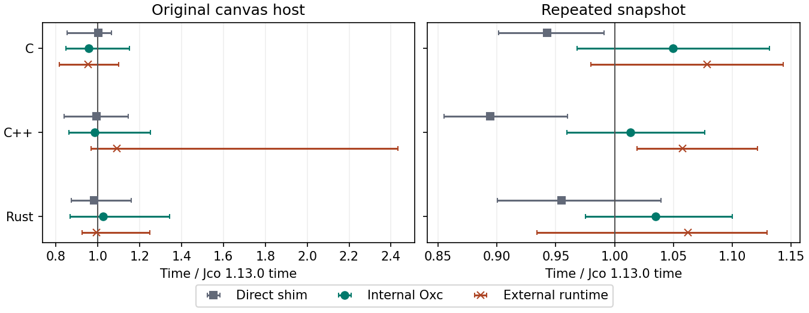

<details><summary>Read times, paired median intervals and reproduction</summary>

| Guest | Build | Original read (µs) | Original / 1.13.0 | Inside host (%) | Outside host (µs) | Replay read (µs) | Replay / 1.13.0 |
| --- | --- | ---: | ---: | ---: | ---: | ---: | ---: |
| C | Direct shim | 338.4 | 1.00× (0.85–1.07) | 96.7 | 13.0 | 4.8 | 0.94× (0.90–0.99) |
| C | Jco 1.13.0 | 325.6 | 1.00× (1.00–1.00) | 96.2 | 13.1 | 5.1 | 1.00× (1.00–1.00) |
| C | Internal Oxc | 329.5 | 0.96× (0.85–1.15) | 96.1 | 13.4 | 5.1 | 1.05× (0.97–1.13) |
| C | External runtime | 321.7 | 0.95× (0.82–1.10) | 96.0 | 13.6 | 5.5 | 1.08× (0.98–1.14) |
| C++ | Direct shim | 314.8 | 0.99× (0.84–1.15) | 96.5 | 11.1 | 5.0 | 0.89× (0.86–0.96) |
| C++ | Jco 1.13.0 | 315.5 | 1.00× (1.00–1.00) | 96.0 | 12.8 | 5.3 | 1.00× (1.00–1.00) |
| C++ | Internal Oxc | 323.3 | 0.99× (0.86–1.25) | 95.9 | 12.9 | 5.5 | 1.01× (0.96–1.08) |
| C++ | External runtime | 339.2 | 1.09× (0.97–2.43) | 95.9 | 14.1 | 5.8 | 1.06× (1.02–1.12) |
| Rust | Direct shim | 328.4 | 0.98× (0.87–1.16) | 96.8 | 11.7 | 5.5 | 0.95× (0.90–1.04) |
| Rust | Jco 1.13.0 | 325.5 | 1.00× (1.00–1.00) | 96.1 | 13.4 | 5.8 | 1.00× (1.00–1.00) |
| Rust | Internal Oxc | 326.8 | 1.03× (0.87–1.34) | 96.0 | 14.0 | 6.1 | 1.03× (0.98–1.10) |
| Rust | External runtime | 340.7 | 0.99× (0.93–1.25) | 95.9 | 13.6 | 6.0 | 1.06× (0.93–1.13) |

In 12 rounds, each of 108 fresh Chromium documents used one language and one host treatment. The four builds used identical core Wasm and ran in balanced orders. Each had one warm-up and four timed invocations per document. Every invocation checked every RGBA channel on the source and destination canvases. The direct shim serves these trusted guests. The observer clocks the original host method in a separate set of documents. Its remainder includes allocation, copying into Wasm, guest execution and observer overhead.

Microseconds and percentages are medians of page medians. Ratios first pair each build with 1.13.0 within a pass, then summarize the page medians. Intervals are individual two-sided, distribution-free median intervals across the 12 pages for each guest and treatment. The warmed-read comparison uses the published minified JS and Wasm hashes. Build Jco at `95e8ae0d8` and prepare the [minified release assets](#minified-browser-bindings), then run the following from this fork.

```sh
CHROME_BIN=/path/to/chrome ROUNDS=12 node web/bench/canvas-bindings.mjs \
  /path/to/built/jco /tmp/canvas-bindings.json.gz
python3 web/bench/canvas-bindings-report.py /tmp/canvas-bindings.json.gz --plot /tmp/canvas-bindings.png
```

</details>

### Sharing one memory view for a returned pointer and length

A host that returns a string or a byte list writes its length and pointer into the guest’s return area. Each write asks the runtime for the current memory view because growing Wasm memory can invalidate a view. This trial looks it up once for two adjacent stores when the return address and length are numbers. Other inputs retain both lookups so numeric conversion can run JavaScript between writes. The change was applied to generated adapters for measurement. [Compiler stores](https://github.com/vados-cosmonic/jco/blob/578b213ef/crates/js-component-bindgen/src/function_bindgen.rs#L689) · [Runtime view cache](https://github.com/vados-cosmonic/jco/blob/578b213ef/packages/jco-cm-runtime/src/intrinsics/js-helper.ts#L12)

The trial cut median time for 16-byte to 4-KiB byte-list returns by 9–12% in both modes. At the 123,904-byte canvas payload, both intervals included parity. All six real canvas readback intervals also included parity. The 8-byte string return improved for all three internal guests and for external C++ (9.7% internally and 12.7% externally for C++). Among the 24 comparisons at larger string sizes, only the internal Rust 1-KiB interval favored the trial. Eight-byte string returns are a candidate for a separate change. The current Jco PR keeps its existing stores.

| Workload | Internal PR → trial (µs) | Internal trial / PR | External PR → trial (µs) | External trial / PR |
| --- | ---: | ---: | ---: | ---: |
| Return 16 bytes | 0.273 → 0.241 | 0.897× (0.867–0.917) | 0.272 → 0.248 | 0.892× (0.860–0.910) |
| Return 256 bytes | 0.275 → 0.234 | 0.877× (0.833–0.921) | 0.276 → 0.243 | 0.900× (0.883–0.955) |
| Return 4,096 bytes | 0.330 → 0.298 | 0.910× (0.863–0.941) | 0.329 → 0.299 | 0.894× (0.857–0.924) |
| Return 123,904 bytes | 5.232 → 5.312 | 0.993× (0.976–1.024) | 5.364 → 5.173 | 0.969× (0.949–1.009) |
| C canvas readback | 310.275 → 322.575 | 0.969× (0.930–1.038) | 326.625 → 325.425 | 1.013× (0.878–1.239) |
| C get 8 B string | 0.537 → 0.442 | 0.840× (0.593–0.951) | 0.425 → 0.447 | 0.982× (0.790–1.146) |
| C get 1,024 B string | 1.827 → 1.899 | 1.012× (0.936–1.148) | 1.872 → 1.784 | 0.958× (0.873–1.052) |
| C++ canvas readback | 321.925 → 322.050 | 0.981× (0.886–1.180) | 312.850 → 311.400 | 1.000× (0.946–1.128) |
| C++ get 8 B string | 0.495 → 0.443 | 0.903× (0.738–0.969) | 0.503 → 0.428 | 0.873× (0.716–0.946) |
| C++ get 1,024 B string | 1.947 → 1.772 | 0.937× (0.872–1.047) | 1.873 → 1.943 | 1.013× (0.954–1.126) |
| Rust canvas readback | 317.075 → 331.325 | 1.000× (0.949–1.185) | 338.325 → 323.325 | 0.961× (0.776–1.027) |
| Rust get 8 B string | 0.475 → 0.416 | 0.809× (0.704–0.964) | 0.460 → 0.412 | 0.882× (0.727–1.244) |
| Rust get 1,024 B string | 1.966 → 1.800 | 0.905× (0.850–0.959) | 1.944 → 1.847 | 0.944× (0.886–1.050) |

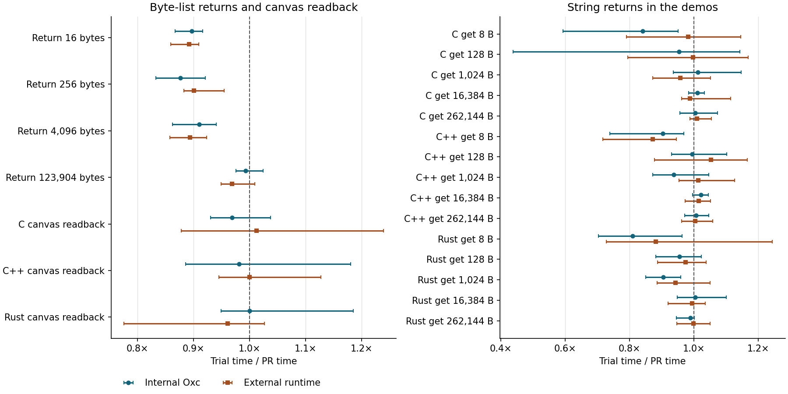

<details><summary>Method and reproduction</summary>

Sixteen fresh documents per case ran both builds in both binding modes, in a single Chromium process. A fixture returned a nonzero-offset byte array and checked its contents after each batch. The canvas demo ran its original host method and checked every channel on both canvases. The string demo ran its original 10 ms autoranging workload at all five lengths. The benchmark checks every minified demo control against the full matrix and uses identical core Wasm within each comparison. The table shows median times and within-page trial/control ratios with individual 95% intervals. The standalone times are summarized independently of the paired ratios. [Raw samples, hashes and browser version](web/bench/results/list-and-string-view-578b213ef.json.gz)

Build Jco at `578b213ef`, stage the demo assets as in the [full matrix setup](#full-demo-matrix-on-the-merged-pr), and set `CHROME_BIN` to the Chromium executable. Run these commands from the benchmark fork.

```sh
node web/bench/list-result-view.mjs "$checkout/packages/jco-transpile" \
  "$checkout/packages/jco-cm-runtime/dist" /tmp/list-and-string-view.json.gz
python3 web/bench/list-result-view-report.py /tmp/list-and-string-view.json.gz --plot /tmp/list-and-string-view.png
```

</details>

## Warm table creation and tree traversal

In the full minified matrix, external Rust table creation and tree traversal took **1.22×** and **1.16×** the time of Jco 1.13.0 on the second guest call. This follow-up ran the same generated assets side by side and timed eight guest calls per build. Over calls five through eight, median table creation took **0.95–1.02×** the release time across C, C++ and Rust on the two PR renderers. Tree traversal took **0.77–0.84×**. [Full matrix](#minified-browser-bindings) · [Timings for all eight calls](web/bench/results/paired-dom-minified.json.gz)

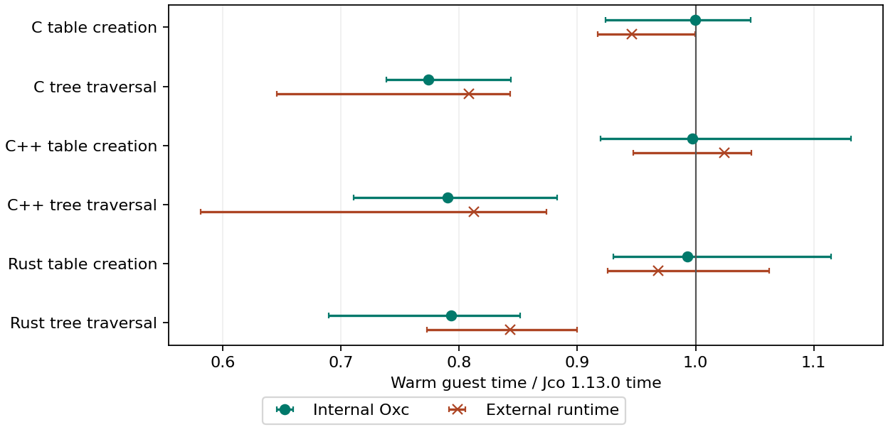

| Guest phase | Internal / 1.13.0, call 2 | External / 1.13.0, call 2 | Internal / 1.13.0, calls 5–8 | External / 1.13.0, calls 5–8 |
| --- | ---: | ---: | ---: | ---: |
| Create 2,000 table rows | 0.98–1.02× | 1.01–1.05× | 0.99–1.00× | 0.95–1.02× |
| Traverse 19,531 nodes | 0.85–0.94× | 0.98–1.10× | 0.77–0.79× | 0.81–0.84× |

The ranges summarize three language medians. Each of 96 fresh Chromium documents ran the four builds on one workload and language, with balanced order and immediate predecessors in each four-call block. The runner checked the report contents, node count for traversal, and runtime requests for each provider layout. Each ratio pairs measurements within a pass, takes the median per page, and then takes the median across 16 pages per language and workload. The full-matrix run used separate documents for each implementation. Page isolation and invocation count both affect the comparison. [Browser runner](web/bench/paired-dom-review.mjs) · [Report and chart](web/bench/paired-dom-report.py)

<details><summary>Phase ratios, individual 95% median intervals and reproduction</summary>

| Workload phase | Internal / 1.13.0 | External / 1.13.0 | Packed / external |
| --- | ---: | ---: | ---: |
| C table creation | 1.00× (0.92–1.05) | 0.95× (0.92–1.00) | 1.02× (0.96–1.07) |
| C selected-row update | 0.81× (0.75–0.85) | 0.77× (0.73–0.84) | 0.99× (0.95–1.05) |
| C unselected-row removal | 0.74× (0.64–0.81) | 0.74× (0.64–0.79) | 0.96× (0.90–1.01) |
| C tree construction | 0.80× (0.74–0.86) | 0.81× (0.73–0.93) | 1.01× (0.86–1.08) |
| C tree traversal | 0.77× (0.74–0.84) | 0.81× (0.65–0.84) | 0.99× (0.87–1.07) |
| C++ table creation | 1.00× (0.92–1.13) | 1.02× (0.95–1.05) | 1.02× (0.90–1.09) |
| C++ selected-row update | 0.78× (0.71–0.85) | 0.82× (0.74–0.94) | 0.99× (0.82–1.04) |
| C++ unselected-row removal | 0.75× (0.63–0.89) | 0.73× (0.63–0.76) | 0.96× (0.91–0.99) |
| C++ tree construction | 0.82× (0.74–0.87) | 0.85× (0.79–0.89) | 0.96× (0.86–1.08) |
| C++ tree traversal | 0.79× (0.71–0.88) | 0.81× (0.58–0.87) | 0.99× (0.93–1.08) |
| Rust table creation | 0.99× (0.93–1.11) | 0.97× (0.93–1.06) | 1.00× (0.94–1.09) |
| Rust selected-row update | 0.84× (0.79–0.90) | 0.82× (0.78–0.85) | 1.05× (0.89–1.13) |
| Rust unselected-row removal | 0.72× (0.63–0.77) | 0.70× (0.63–0.85) | 0.98× (0.83–1.03) |
| Rust tree construction | 0.78× (0.73–0.83) | 0.82× (0.66–1.01) | 1.02× (0.85–1.10) |
| Rust tree traversal | 0.79× (0.69–0.85) | 0.84× (0.77–0.90) | 1.00× (0.97–1.05) |

Use the built Jco checkout and minified 1.13.0 files from the full matrix, then run the following in this fork. The runner verifies the JavaScript and Wasm against the archived matrix before launching Chromium. The packed configuration additionally builds a shared provider from the checked runtime.

```sh
CHROME_BIN=/path/to/chrome ROUNDS=16 node web/bench/paired-dom-review.mjs \
  /path/to/built/jco /tmp/paired-dom.json.gz --minify
python3 web/bench/paired-dom-report.py /tmp/paired-dom.json.gz --plot /tmp/paired-dom.png
```

</details>

## Fetching or embedding the primary Wasm core

Raising `base64Cutoff` from 5,000 to 262,144 bytes moved the primary Wasm core into the JavaScript entry for all six DOM query and table workloads. This saved one request per document. Median paired time to the first guest result was **1.02×** the ordinary layout for internal Oxc, **0.97×** for the external runtime, and **2.17×** for Jco 1.13.0. Every build transferred more bytes with the core embedded. [Timings, request sizes and hashes](web/bench/results/core-startup.json.gz)

| Build | Import ms, fetched → embedded | First result ms, fetched → embedded | Paired first result | All JS + Wasm KiB, fetched → embedded | Gzip estimate KiB, fetched → embedded |
| --- | ---: | ---: | ---: | ---: | ---: |
| Jco 1.13.0 | 5.52 → 15.17 | 8.54 → 18.32 | 2.174× | 78.91 → 101.85 | 30.48 → 39.37 |
| Internal Oxc | 11.08 → 11.12 | 17.14 → 17.40 | 1.021× | 141.52 → 163.92 | 46.70 → 55.95 |
| External runtime | 24.28 → 24.04 | 30.52 → 29.84 | 0.967× | 198.31 → 221.21 | 68.60 → 77.91 |


<details><summary>Individual median intervals and reproduction</summary>

| Guest and workload | 1.13.0 | Internal Oxc | External runtime |
| --- | ---: | ---: | ---: |
| C DOM query | 2.06× (1.84–2.38) | 1.01× (0.92–1.14) | 0.96× (0.86–1.02) |
| C++ DOM query | 1.87× (1.71–2.24) | 0.98× (0.89–1.06) | 0.97× (0.95–1.06) |
| Rust DOM query | 3.60× (3.06–4.08) | 1.09× (0.98–1.19) | 0.98× (0.87–1.04) |
| C table update | 2.18× (1.92–2.40) | 1.01× (0.92–1.18) | 0.94× (0.85–1.05) |
| C++ table update | 2.17× (1.89–2.31) | 1.03× (0.92–1.09) | 0.96× (0.86–1.00) |
| Rust table update | 3.45× (2.86–4.08) | 1.11× (1.00–1.22) | 1.04× (0.89–1.33) |

Each of 18 rounds used 36 fresh Chromium documents with DevTools disconnected. All builds ran the same C, C++ and Rust guest cores. The runner matched the fetched layouts to the full minified matrix and decoded and hashed the embedded modules to verify identical Wasm. The two DOM workloads used small inputs so the first result includes import and a short guest call. The primary cores ranged from 65,203 to 149,690 bytes. Embedding cut release and bundled requests from two to one and external requests from 20 to 19. The common demo host was loaded before timing.

The first table summarizes six workload medians. The paired column divides first-result times within each workload and round before taking medians. The per-workload table and chart show individual two-sided median intervals with at least 95% coverage. Eleven of the twelve PR intervals included parity. Internal Rust table creation was slower with embedding (unrounded interval 1.001–1.225×). Responses were served uncompressed on loopback with caching disabled. The gzip estimates compress the requested assets individually. [Runner](web/bench/core-startup.mjs) · [Verifier and plot](web/bench/core-startup-report.py)

Build the PR at `95e8ae0d8` and install the demo’s pinned web dependencies, then run these commands in the fork.

```sh
CHROME_BIN=/path/to/chrome ROUNDS=18 node web/bench/core-startup.mjs \
  /path/to/built/jco /tmp/core-startup.json.gz
python3 web/bench/core-startup-report.py /tmp/core-startup.json.gz --plot /tmp/core-startup.png
```

</details>

## Preloading external runtime modules

When the browser loaded the checked runtime as separate ES modules, starting all 18 runtime fetches alongside the component import reduced median first-result time from **28.80 to 25.29 ms** on loopback. With the server delaying each JS and Wasm response by 10 ms, first result fell from **76.34 to 62.41 ms**. The last runtime fetch began at **1.55 ms**, down from **49.17 ms** in the delayed run. Each page still fetched the same entry, 18 runtime modules and one Wasm core exactly once. [Request timings, sizes and asset hashes](web/bench/results/modulepreload.json.gz)

| Asset delay | Build and hints | Import (ms) | First result (ms) | Last runtime fetch initiated (ms) | Paired first result / ordinary external |
| --- | --- | ---: | ---: | ---: | ---: |
| 0 ms | Jco 1.13.0 | 5.63 | 8.01 | — | 0.289× |
| 0 ms | Internal Oxc | 9.91 | 14.65 | — | 0.508× |
| 0 ms | External, ordinary import | 26.33 | 28.80 | 19.34 | 1.000× |
| 0 ms | External, direct imports hinted | 24.81 | 26.85 | 19.12 | 0.962× |
| 0 ms | External, indirect imports hinted | 24.00 | 25.70 | 11.82 | 0.904× |
| 0 ms | External, all runtime modules hinted | 23.16 | 25.29 | 1.92 | 0.910× |
| 10 ms | Jco 1.13.0 | 25.57 | 27.34 | — | 0.359× |
| 10 ms | Internal Oxc | 29.53 | 32.73 | — | 0.425× |
| 10 ms | External, ordinary import | 74.63 | 76.34 | 49.17 | 1.000× |
| 10 ms | External, direct imports hinted | 67.92 | 69.66 | 42.95 | 0.912× |
| 10 ms | External, indirect imports hinted | 66.27 | 68.04 | 27.97 | 0.879× |
| 10 ms | External, all runtime modules hinted | 60.78 | 62.41 | 1.55 | 0.822× |

Each guest's generated adapter directly imports nine runtime modules. Those import another nine modules. The runner derives both sets from the installed files, then adds `<link rel="modulepreload">` elements for one or both sets immediately before importing the adapter. The clock starts before the first link is created. This measures the deployable startup improvement, including the time Chromium spends scheduling and processing the requests. [HTML modulepreload processing](https://html.spec.whatwg.org/multipage/links.html#link-type-modulepreload) · [Runner](web/bench/core-startup.mjs)


<details><summary>Paired intervals and reproduction</summary>

| Case | Delay | Direct hints / external | Indirect hints / external | All hints / external |
| --- | ---: | ---: | ---: | ---: |
| /c/dom-query | 0 ms | 0.873× (0.802–0.949) | 0.807× (0.751–0.949) | 0.864× (0.746–1.026) |
| /c/dom-query | 10 ms | 0.919× (0.875–0.943) | 0.875× (0.853–0.914) | 0.806× (0.799–0.852) |
| /cpp/dom-query | 0 ms | 0.923× (0.807–1.046) | 0.893× (0.770–1.036) | 0.868× (0.780–0.944) |
| /cpp/dom-query | 10 ms | 0.910× (0.893–0.952) | 0.879× (0.860–0.918) | 0.823× (0.788–0.880) |
| /rust/dom-query | 0 ms | 0.977× (0.871–1.038) | 0.860× (0.782–0.952) | 0.945× (0.831–1.063) |
| /rust/dom-query | 10 ms | 0.913× (0.899–0.951) | 0.890× (0.875–0.923) | 0.822× (0.803–0.835) |
| /c/table-update | 0 ms | 0.992× (0.870–1.248) | 0.915× (0.850–1.109) | 0.926× (0.791–1.052) |
| /c/table-update | 10 ms | 0.904× (0.884–0.939) | 0.880× (0.864–0.903) | 0.806× (0.780–0.860) |
| /cpp/table-update | 0 ms | 0.947× (0.813–1.111) | 0.934× (0.882–1.023) | 0.968× (0.768–1.072) |
| /cpp/table-update | 10 ms | 0.929× (0.906–0.942) | 0.887× (0.866–0.915) | 0.822× (0.809–0.843) |
| /rust/table-update | 0 ms | 1.032× (0.905–1.125) | 0.942× (0.870–1.110) | 0.894× (0.843–1.005) |
| /rust/table-update | 10 ms | 0.892× (0.870–0.939) | 0.875× (0.859–0.893) | 0.825× (0.805–0.848) |

The study ran two small workloads in C, C++ and Rust across 18 balanced rounds and 1,296 fresh Chromium 156 documents with DevTools disconnected. Every guest produced its expected result table. Timed responses were uncompressed over HTTP/1.1 with caching disabled. The fixed 10 ms server wait models a cost at each request and excludes the common demo host, which loads before timing. Network protocols, caching and bandwidth can change these results.

Each duration summarizes six workload medians. Ratios pair first-result times within workload, round and delay before taking the medians. The intervals are individual two-sided median intervals with at least 95% coverage. All six intervals favored hinting every runtime module under the added delay. Five of the six loopback intervals included parity. [Verifier and chart](web/bench/modulepreload-report.py)

Build Jco at `db4a3aca0`, install the fork's pinned web dependencies and prepare the [full-matrix demo inputs](#full-demo-matrix-on-the-merged-pr). The runner verifies the generated bindings, Wasm cores and runtime modules against the published minified matrix.

```sh
CHROME_BIN=/path/to/chrome ROUNDS=18 node web/bench/core-startup.mjs \
  /path/to/built/jco /tmp/modulepreload.json.gz --modulepreload
python3 web/bench/modulepreload-report.py /tmp/modulepreload.json.gz --plot /tmp/modulepreload.png
```

</details>

### Preloading the guest Wasm

A page that knows the URL of its generated `.core.wasm` file can start the fetch alongside the bindings. With a 10 ms server delay per asset, this saved about **11 ms to the first guest result** on all three builds. The external runtime still took 66.11 ms with the hint, compared with 21.12 ms for internal Oxc and 16.29 ms for Jco 1.13.0. The external-to-release gap was about 50 ms with either layout. Without the added delay, the paired ratios for the PR builds were close to one. [Request timings, server counts and asset hashes](web/bench/results/wasm-preload.json.gz)

| Delay | Build | Wasm request start (ms), ordinary → hinted | First result (ms), ordinary → hinted | Paired first result |
| --- | --- | ---: | ---: | ---: |
| 0 ms | Jco 1.13.0 | 3.21 → 0.24 | 7.66 → 7.04 | 0.931× |
| 0 ms | Internal Oxc | 6.79 → 0.25 | 12.47 → 12.04 | 1.016× |
| 0 ms | External runtime | 22.42 → 0.25 | 27.64 → 28.41 | 1.001× |
| 10 ms | Jco 1.13.0 | 13.00 → 0.22 | 27.02 → 16.29 | 0.598× |
| 10 ms | Internal Oxc | 16.32 → 0.22 | 31.98 → 21.12 | 0.651× |
| 10 ms | External runtime | 62.25 → 0.23 | 76.73 → 66.11 | 0.856× |

The timed page inserted one link immediately before importing the component entry. The browser reused the response when the generated bindings called `fetch` for streaming compilation. Both the server request count and the browser timing entries showed one Wasm transfer in every one of the 1,296 fresh Chromium documents. All 18 individual paired intervals favored preloading with the simulated delay. The table summarizes six workload medians. Ratios pair the two layouts within each round and workload before aggregation.

```html
<link rel="preload" as="fetch" type="application/wasm" crossorigin="anonymous" href="/app/dom_query.core.wasm">
```

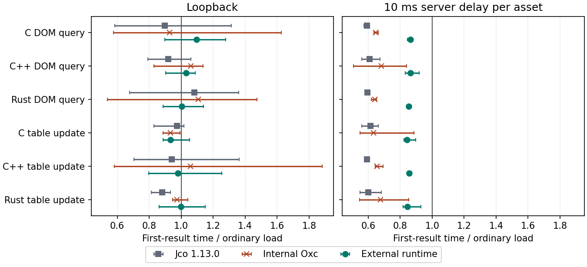

Use Jco at `ee0d0ff26` and the benchmark setup above to reproduce the comparison.

```sh
CHROME_BIN=/path/to/chrome ROUNDS=18 node web/bench/core-startup.mjs /path/to/built/jco /tmp/wasm-preload.json.gz --wasm-preload
python3 web/bench/modulepreload-report.py /tmp/wasm-preload.json.gz --plot /tmp/wasm-preload.png
```

## Repeat visits and HTTP caching

On the full demo matrix at `0c3d12ad0`, import took longer than 1.13.0 in all 21 cases. Across cases, the median paired excess was 4.65 ms for internal Oxc and 16.68 ms for the external runtime. Once import finished, the first guest invocation took a median 1.65 ms less than release internally and 0.21 ms less externally. These comparisons pair each build and release within the same workload, language and round. [Full-size measurements](web/bench/results/review-matrix-minified-0c3d12ad0.json.gz)

To isolate module loading, six small DOM workloads ran in a fresh document on a first visit and again on the next navigation. The server varied the HTTP cache policy separately for generated JavaScript (including external runtime modules) and Wasm. On repeat visits, caching JS alone brought external first result from 27.27 ms to 10.22 ms. Caching the Wasm alone brought it to 26.98 ms. [Per-document timings, server requests and browser transfer counts](web/bench/results/repeat-navigation-0c3d12ad0.json.gz)

| Build | First visit, no-store (ms) | Repeat, no-store (ms) | Repeat, JS cached (ms) | Repeat, Wasm cached (ms) | Repeat, both cached (ms) | Both / no-store on repeat (95% interval) |
| --- | ---: | ---: | ---: | ---: | ---: | ---: |
| Jco 1.13.0 | 8.74 | 6.67 | 4.50 | 6.51 | 4.27 | 0.643× (0.624–0.682) |
| Upstream main | 28.21 | 16.12 | 11.63 | 16.51 | 12.02 | 0.749× (0.708–0.774) |
| Internal Oxc | 17.51 | 10.35 | 6.02 | 10.14 | 6.15 | 0.591× (0.540–0.648) |
| External checked | 33.67 | 27.27 | 10.22 | 26.98 | 10.20 | 0.369× (0.352–0.387) |

All 384 fully cached repeat visits ran the guest with **zero JS or Wasm asset responses** from the server. The timing starts after the page loads the demo host and ends when the guest returns its first result. Even with all component assets cached, paired first-result times were **1.43× release internally and 2.44× externally**. This measures consecutive navigations in one Chromium process on loopback. A first visit, a browser restart or another engine can have different costs.


For a versioned deployment, the timed cacheable responses used `Cache-Control: public, max-age=31536000, immutable`. Changing an asset requires publishing it under a new URL with this policy. Versioning the directory containing the generated bindings and Wasm files preserves their relative imports.

<details><summary>Experimental controls, runtime packaging trial and reproduction</summary>

Sixteen Chromium processes each ran C, C++ and Rust DOM queries (8 elements, 2 iterations) and table updates (8 rows). Each build and cache policy occupied each timing position once and followed each other treatment once per workload across the processes. Each treatment had its own asset URLs and two consecutive documents. Both the first and repeat no-store controls fetched all component assets. Resource Timing and server logs agreed on the transferred assets in every document. Times use one median across the six workloads per browser. Ratios pair runs by browser and workload before computing the median and its individual interval. The two visits share the same URLs and bytes, and the DevTools client disconnects before timing.

A separate packaging trial compared Rolldown 1.2.13's strict entry signatures with `allow-extension`. The strict build reproduced every shipped checked JS module byte for byte. Allowing additional exports reduced the external runtime graph from 18 modules (101,365 bytes) to 14 (100,006 bytes) on every demo. It also exposed 21 extra names across the public conversion, core and JS-helper modules. The trial measures asset graphs only. Reviewers can reproduce the namespace changes with the command below. [Packaging check](web/bench/runtime-entry-signatures.mjs)

Use the benchmark setup above with the built Jco checkout at `0c3d12ad0` and the upstream build at `326f52ab4`.

```sh
matrix=web/bench/results/review-matrix-minified-0c3d12ad0.json.gz
CHROME_BIN=/path/to/chrome node web/bench/repeat-navigation.mjs "$jco" "$stage" "$matrix" /tmp/visits.json.gz
python3 web/bench/repeat-navigation-report.py /tmp/visits.json.gz "$matrix" --plot /tmp/visits.png
node web/bench/runtime-entry-signatures.mjs "$jco" "$matrix"
```

</details>

## Serving the browser bindings with HTTP gzip

Across six small DOM workloads, gzip reduced the median JS and Wasm response bodies from **141.52 to 46.70 KiB** for the internal Oxc bundle and **193.73 to 68.18 KiB** for the external runtime. On HTTP/1.1 loopback, time to first result with gzip was **8.25 ms** on Jco 1.13.0, **15.09 ms** internally and **29.36 ms** externally. Smaller transfers alone did not close the startup gap on this connection. [Samples, asset hashes and browser-reported transfer sizes](web/bench/results/http-gzip.json.gz)

| Build | Import ms, plain → gzip | First result ms, plain → gzip | Paired first result | JS + Wasm body KiB, plain → gzip |
| --- | ---: | ---: | ---: | ---: |
| Jco 1.13.0 | 5.58 → 5.83 | 7.96 → 8.25 | 1.010× | 78.91 → 30.48 |
| Internal Oxc | 10.36 → 10.56 | 14.22 → 15.09 | 1.056× | 141.52 → 46.70 |
| External runtime | 24.70 → 25.39 | 28.46 → 29.36 | 1.027× | 193.73 → 68.18 |

The browser fetched one JS entry and one Wasm file on release and internal builds. The external build also fetched 18 runtime modules. Each gzip response contained the same decoded bytes as its plain counterpart. Seventeen of the 18 individual 95% intervals for gzip relative to plain included parity. Rust table update on the external runtime took 1.20× as long with gzip (1.02–1.37×). The trial used a loopback connection with no bandwidth cap or injected latency.


<details><summary>Per-workload paired first-result ratios and reproduction</summary>

| Guest and workload | 1.13.0 | Internal Oxc | External runtime |
| --- | ---: | ---: | ---: |
| C DOM query | 0.99× (0.69–1.44) | 1.04× (0.74–1.61) | 1.01× (0.81–1.31) |
| C++ DOM query | 1.12× (0.74–1.45) | 1.08× (0.61–1.64) | 1.04× (0.80–1.17) |
| Rust DOM query | 1.03× (0.73–1.59) | 1.12× (0.62–1.78) | 0.95× (0.81–1.26) |
| C table update | 0.99× (0.75–1.40) | 1.00× (0.68–1.72) | 1.04× (0.85–1.21) |
| C++ table update | 0.98× (0.78–1.34) | 1.09× (0.63–1.78) | 0.93× (0.85–1.13) |
| Rust table update | 1.14× (0.69–1.52) | 1.03× (0.62–1.54) | 1.20× (1.02–1.37) |

The 18 balanced rounds covered 648 fresh Chromium documents, with caching disabled and DevTools disconnected. Each document imported the common host before timing, loaded one minified component, and ran a small DOM query or table update. Responses were precompressed at gzip level 9. The runner checked decoded and encoded body lengths on each timed request. The table summarizes medians across six workload medians. Paired ratios compare times within the same guest, workload and round. [Runner](web/bench/core-startup.mjs) · [Verifier and interval calculation](web/bench/core-startup-report.py)

Use the [benchmark setup](#reproduce-the-comparison) with Jco at [the measured revision](https://github.com/vados-cosmonic/jco/commit/5e5b156066a4eb3a793404ee85a64b6a6e3fe9bd) and run from this checkout.

```sh
CHROME_BIN=/path/to/chrome ROUNDS=18 node web/bench/core-startup.mjs /path/to/built/jco /tmp/http-gzip.json.gz --gzip
python3 web/bench/core-startup-report.py /tmp/http-gzip.json.gz --plot /tmp/http-gzip.png
```

</details>

## Bundling the component entries as one browser application

Building the six external component entries together with Rolldown reduced cold first-result time from **30.88 to 16.91 ms** across small C, C++ and Rust DOM workloads. Each fresh page fetched the component entry and one shared JS chunk, down from 19 JS requests. Median JS bodies fell from **124.30 to 71.16 KiB**. All six individual 95% intervals favored the application build. The internal Oxc and release builds already delivered a single JS file per component. Passing those through the same application build added a shared chunk and increased median first-result time. [Sizes, chunk graph, request traces and timings](web/bench/results/app-bundle.json.gz)

| Build | Import ms, original → app | First result ms, original → app | Paired first result | JS requests, original → app | JS KiB, original → app |
| --- | ---: | ---: | ---: | ---: | ---: |
| Jco 1.13.0 | 5.66 → 7.41 | 8.83 → 10.64 | 1.171× | 1.00 → 2.00 | 9.71 → 9.91 |
| Internal Oxc | 11.14 → 12.88 | 17.76 → 18.91 | 1.063× | 1.00 → 2.00 | 72.03 → 72.54 |
| External runtime | 25.11 → 11.62 | 30.88 → 16.91 | 0.545× | 19.00 → 2.00 | 124.30 → 71.16 |

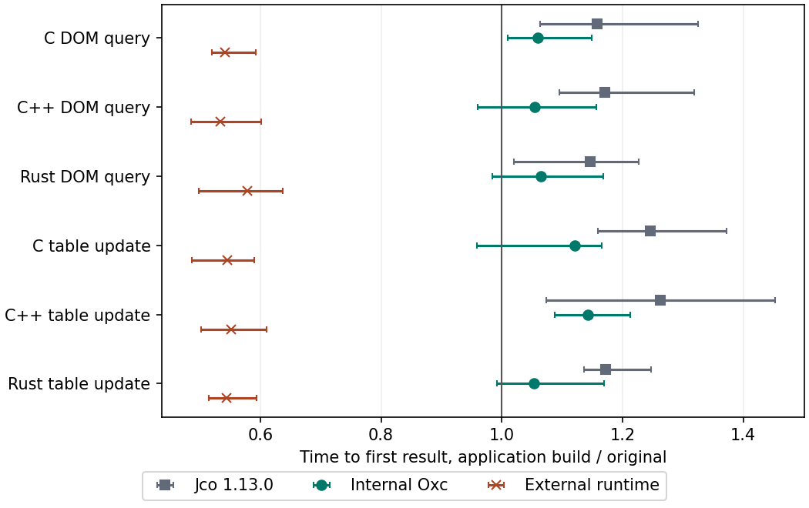

<details><summary>Per-workload intervals and reproduction</summary>

| Guest and workload | 1.13.0 | Internal Oxc | External runtime |
| --- | ---: | ---: | ---: |
| C DOM query | 1.16× (1.06–1.32) | 1.06× (1.01–1.15) | 0.54× (0.52–0.59) |
| C++ DOM query | 1.17× (1.10–1.32) | 1.05× (0.96–1.16) | 0.53× (0.49–0.60) |
| Rust DOM query | 1.15× (1.02–1.23) | 1.07× (0.98–1.17) | 0.58× (0.50–0.64) |
| C table update | 1.25× (1.16–1.37) | 1.12× (0.96–1.17) | 0.55× (0.49–0.59) |
| C++ table update | 1.26× (1.07–1.45) | 1.14× (1.09–1.21) | 0.55× (0.50–0.61) |
| Rust table update | 1.17× (1.14–1.25) | 1.05× (0.99–1.17) | 0.54× (0.51–0.59) |

Each binding configuration supplied six minified entry points to Rolldown 1.2.13. The application build preserved entry paths and published the original Wasm cores alongside them. The demo host stayed external and loaded before timing in both treatments. The runner checked every requested file against the emitted chunk graph and validated the guest report on each page. Each of the 648 fresh documents loaded one component on uncompressed HTTP/1.1 loopback. The first table summarizes six workload medians. Paired ratios compare the two treatments within the same round and workload. [Application build](web/bench/app-bundle.mjs) · [Timing runner](web/bench/core-startup.mjs)

Use the [benchmark setup](#reproduce-the-comparison) with the Jco checkout at `5e5b15606` and run from this fork.

```sh
CHROME_BIN=/path/to/chrome ROUNDS=18 node web/bench/core-startup.mjs /path/to/built/jco /tmp/app-bundle.json.gz --app-bundle
python3 web/bench/core-startup-report.py /tmp/app-bundle.json.gz --plot /tmp/app-bundle.png
```

</details>

### Bundling one component per page

For a page that loads one component, building its external bindings and checked runtime together reduced the median cold first result from **31.00 to 17.73 ms**. Chromium fetched one JavaScript file totaling 70.02 KiB at the median, down from 19 files totaling 124.30 KiB. The internal Oxc bundle already used one file. The repeat bundle step had a paired first-result ratio of 0.998× for internal Oxc and 1.002× for Jco 1.13.0. [Raw timings, request sizes and build hashes](web/bench/results/single-entry.json.gz)

| Build | Cold first result (ms), original → single-entry build | Paired time ratio | JS for all six components built individually (KiB) | JS for all six in one multi-entry build (KiB) |
| --- | ---: | ---: | ---: | ---: |
| Jco 1.13.0 | 8.75 → 8.97 | 1.002× | 58.32 | 58.75 |
| Internal Oxc | 17.27 → 17.22 | 0.998× | 434.66 | 435.08 |
| External runtime | 31.00 → 17.73 | 0.574× | 420.50 | 191.04 |

The last two columns count the uncompressed bytes at each distinct JS URL once across all six components. The external multi-entry build shares runtime code across those URLs and saves **229.46 KiB** if the application uses every component. Each timing used a fresh document loading one guest. The experiment covered 648 Chromium documents on HTTP/1.1 loopback and checked each guest report, Wasm hash and set of network responses. All six external workloads had individual 95% paired intervals below parity. All 12 internal and release intervals included parity. [Multi-entry assets and request traces](web/bench/results/app-bundle.json.gz)

Use the setup above with Jco at `ee0d0ff26` and run the single-entry comparison and verifier.

```sh
CHROME_BIN=/path/to/chrome ROUNDS=18 node web/bench/core-startup.mjs /path/to/built/jco /tmp/single-entry.json.gz --single-entry
python3 web/bench/core-startup-report.py /tmp/single-entry.json.gz
```

## Packaging the external runtime for browsers

The checked external bindings at PR revision `eaca992c8` used 59 runtime exports across 15 small browser workloads. Packing those exports into one shared ES module reduced median first-result time from **31.48 to 17.67 ms** and total JavaScript from **161.5 to 111.0 KiB**. The same guests took **17.91 ms** with the internal Oxc bundle and **9.10 ms** with Jco 1.13.0. The first result includes importing the component and running its small workload. [Runner](web/bench/provider-startup.mjs) · [Named exports and import map builder](web/bench/shared-provider.mjs)

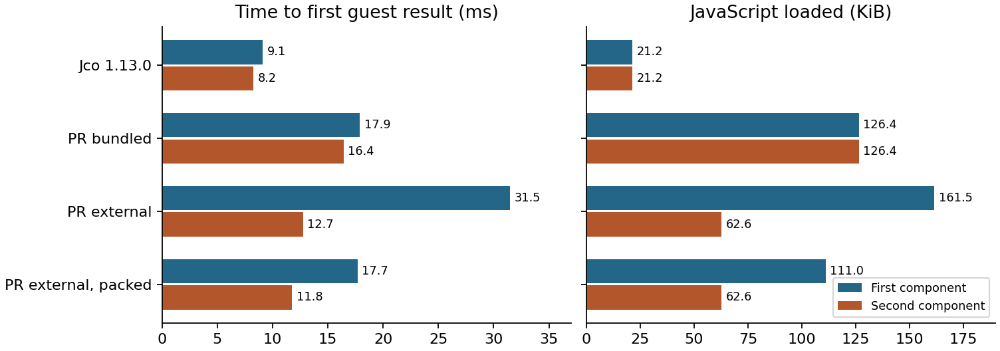

| Packed exports | JS requests, ordinary → packed | First-load JS, KiB | First-load JS gzip, KiB | First result, ms | Second component’s first result, ms | Paired first-result time, packed / ordinary |
| --- | ---: | ---: | ---: | ---: | ---: | ---: |
| 59 used by these components | 19 → 2 | 161.5 → 111.0 | 42.5 → 23.0 | 31.48 → 17.67 | 12.74 → 11.78 | 0.563× |
| All 318 checked exports | 19 → 2 | 161.5 → 289.4 | 42.5 → 65.5 | 30.54 → 24.62 | 12.44 → 11.36 | 0.791× |

The all-exports build can be prepared before the application knows which components it will load. It fetched more bytes than the shipped provider. Each row compares its packed configuration to the ordinary external runtime **within the same run**. Each run covered 720 fresh Chromium documents over 12 balanced rounds, with five small workloads in C, C++ and Rust. Each document imported and ran two identical guests under different module URLs. The second component could reuse the runtime from the first. The generated bindings and guest Wasm were byte-identical across external layouts. Responses were uncompressed on loopback. The gzip column gives calculated file sizes. [Used-export samples and hashes](web/bench/results/provider-startup-used-eaca992c8.json.gz) · [All-export samples and hashes](web/bench/results/provider-startup-all-eaca992c8.json.gz)

Each paired ratio is the median of the 15 per-case medians over 12 rounds. All 15 individual 95% sign-test intervals favored packing the used exports for the first component. Fourteen favored packing the complete runtime. For the used-export build against the internal Oxc bundle, all 15 intervals included parity. [Analysis script](web/bench/provider-startup-report.py)

To reproduce, build the transpiler and checked runtime at the measured [Jco revision](https://github.com/vados-cosmonic/jco/commit/eaca992c895fbf08bdd7f0968e0e5e4e0fc8643e), then prepare the 1.13.0 baseline files as described in [Reproduce the comparison](#reproduce-the-comparison). Run each configuration with the same Chrome executable.

```sh
jco_checkout=/path/to/built/jco
transpiler="$jco_checkout/packages/jco-transpile/dist/transpile.js"
export CHROME_BIN=/path/to/chrome
node web/bench/provider-startup.mjs "$jco_checkout" "$transpiler" /tmp/used.json.gz
node web/bench/provider-startup.mjs "$jco_checkout" "$transpiler" /tmp/all.json.gz --all-exports
python3 web/bench/provider-startup-report.py /tmp/used.json.gz
python3 web/bench/provider-startup-report.py /tmp/all.json.gz
```

## Materializing bulk DOM query results

The original bulk-query benchmark compares a WIT `list<element>` result with an Embind shim that discards a live collection. Here each renderer and the direct shim run the same guest core, return the host’s array to Wasm as a list of handles, and run the guest’s drop loop. At the original size of 2,000 handles per query, the internal Oxc bundle took **1.50–1.57×** the direct shim’s time across C, C++ and Rust. The external checked runtime took **1.53–1.60×**. Against Jco 1.13.0, the two PR renderers took **0.71–0.74×** as long. [Jco revision `eaca992c8`](https://github.com/vados-cosmonic/jco/commit/eaca992c895fbf08bdd7f0968e0e5e4e0fc8643e) · [Original shim comparison](#default-browser-bindings-at-revision-b731ebc91)

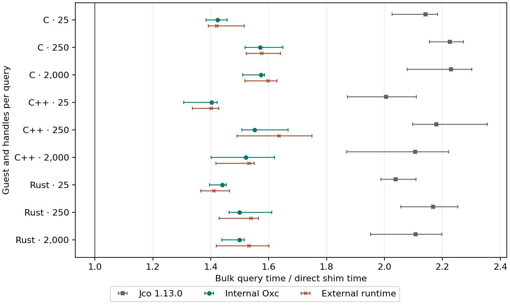

Each guest run returned 20,000 element handles in total. The experiment varied the batch size using 800 queries of 25 elements, 80 queries of 250, or 10 queries of 2,000. Every configuration used the same browser host method, which materializes the live collection with `Array.from`. Before timing, the runner checked the number of host calls and the length of every returned list for all four configurations. It restored the original method for warmup and timing. The direct shim’s counters also confirmed zero live handles after each pass. The direct shim implements the operations needed by these trusted fixtures. [Direct host implementation](web/bench/dom-core-shim.mjs) · [Per-page counts, timings and asset hashes](web/bench/results/bulk-dom.json.gz)

The table reports the guest’s bulk-phase time. Each of 108 fresh Chromium pages ran one language and batch size, with four warmups and four measured passes per configuration. The runner balanced order within each block of four passes. Ratios use same-pass timings, reduced to one median per page and then one median over 12 pages. Parentheses give individual two-sided 95% sign-test intervals for the median. The direct column gives the median time to process all 20,000 handles.

| Guest | Handles per query | Direct (ms) | 1.13.0 / direct | Bundled / direct | External / direct | Bundled / 1.13.0 | External / 1.13.0 |
| --- | ---: | ---: | ---: | ---: | ---: | ---: | ---: |
| C | 25 | 6.94 | 2.14× (2.03–2.18) | 1.42× (1.38–1.46) | 1.42× (1.39–1.52) | 0.68× (0.67–0.69) | 0.68× (0.66–0.71) |
| C | 250 | 5.75 | 2.23× (2.16–2.27) | 1.57× (1.52–1.65) | 1.58× (1.52–1.64) | 0.72× (0.68–0.77) | 0.71× (0.67–0.73) |
| C | 2000 | 5.76 | 2.23× (2.08–2.30) | 1.57× (1.51–1.59) | 1.60× (1.52–1.63) | 0.71× (0.67–0.75) | 0.74× (0.70–0.77) |
| C++ | 25 | 6.68 | 2.01× (1.87–2.11) | 1.40× (1.31–1.42) | 1.40× (1.34–1.43) | 0.69× (0.68–0.71) | 0.69× (0.68–0.71) |
| C++ | 250 | 5.81 | 2.18× (2.10–2.36) | 1.55× (1.51–1.67) | 1.63× (1.49–1.75) | 0.70× (0.69–0.75) | 0.71× (0.69–0.75) |
| C++ | 2000 | 6.20 | 2.11× (1.87–2.22) | 1.52× (1.40–1.62) | 1.53× (1.42–1.55) | 0.73× (0.69–0.79) | 0.72× (0.69–0.76) |
| Rust | 25 | 7.02 | 2.04× (1.99–2.11) | 1.44× (1.40–1.45) | 1.41× (1.37–1.46) | 0.69× (0.68–0.71) | 0.70× (0.66–0.73) |
| Rust | 250 | 5.92 | 2.17× (2.06–2.25) | 1.50× (1.46–1.61) | 1.54× (1.43–1.56) | 0.70× (0.67–0.73) | 0.70× (0.69–0.71) |
| Rust | 2000 | 6.03 | 2.11× (1.95–2.20) | 1.50× (1.44–1.52) | 1.53× (1.42–1.60) | 0.71× (0.68–0.77) | 0.73× (0.68–0.79) |

Use a built Jco checkout at `eaca992c8` with both the transpiler and checked runtime packages. Prepare the release demo assets as described in [Reproduce the comparison](#reproduce-the-comparison), then run the following from this fork. The optional figure requires Matplotlib.

```sh
CHROME_BIN=/path/to/chrome ROUNDS=12 node web/bench/bulk-dom.mjs \
  /path/to/built/jco /tmp/bulk-dom.json.gz
python3 web/bench/bulk-dom-report.py /tmp/bulk-dom.json.gz --plot /tmp/bulk-dom.png
```

## Minified browser bindings

With minification, all 21 warm headline operations stayed within **5.51×** of the fastest compiled shim in the internal bundle and **5.39×** in the external runtime. Both renderers matched or beat minified Jco 1.13.0 on **14/21** warm cases. The largest warm slowdown against 1.13.0 was **6.2% bundled** and **22.0% external**. First-result time still favored 1.13.0 in most cases.

This run uses each Jco build’s own `--minify` option on the same 21 workloads. The internal Oxc bundle and external checked package both run the PR at `eaca992c8`. The comparison includes Jco 1.13.0 and the PR’s exact upstream base, `83e25bb19`. Chromium fetched the standalone external runtime as ES modules. [Jco fork PR](https://github.com/vados-cosmonic/jco/pull/62) · [Raw timings, sizes and request lists](web/bench/results/review-matrix-minified-eaca992c8.json.gz)

| Median across 21 workload and language pairs | Jco 1.13.0 | Upstream main | Internal Oxc | External runtime |
| --- | ---: | ---: | ---: | ---: |
| Default JS entry (KiB) | 21.23 | 191.50 | 126.43 | 62.58 |
| Minified JS entry (KiB) | 9.58 | 111.34 | 71.71 | 29.68 |
| Total JS with minification (KiB) | 9.58 | 111.34 | 71.71 | 128.60 |
| Total JS with minification, gzip estimate (KiB) | 3.01 | 25.42 | 19.01 | 41.07 |
| Minified import (ms) | 5.14 | 12.34 | 9.62 | 22.40 |
| First full result with minification (ms) | 59.83 | 196.54 | 65.46 | 77.74 |

| Comparison with all four Jco builds minified | Internal Oxc | External runtime |
| --- | ---: | ---: |
| Warm headline cases within 10× of the fastest compiled shim | 21/21 | 21/21 |
| Warm subphases within 10× of the fastest compiled shim | 81/84 | 81/84 |
| Warm headline cases at or faster than upstream main | 20/21 | 21/21 |
| Warm headline cases at or faster than Jco 1.13.0 | 14/21 | 14/21 |
| First full results at or faster than Jco 1.13.0 | 7/21 | 6/21 |

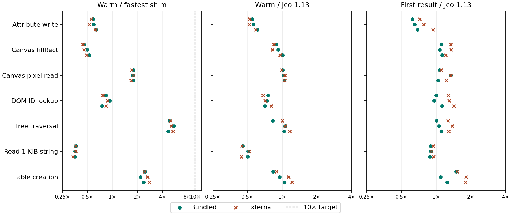

Eight balanced browser rounds ran 776 fresh documents. Each Jco variant used identical guest cores. Release assets matched the archived 1.13.0 minified hashes. The default and minified byte counts compare exact files at each revision. Gzip estimates sum compressed file lengths. The browser served uncompressed responses. The wall times above compare minified builds within this run. The earlier default-build timings came from a separate run. [Release size inventory](web/bench/results/minified-sizes.json) · [Default entry measurements](web/bench/results/resource-drop-sizes.json)

<details><summary>All 21 minified headline comparisons and reproduction</summary>

| Operation | Guest | Bundled / shim | External / shim | Bundled / 1.13 warm | External / 1.13 warm | Bundled / 1.13 first result | External / 1.13 first result |
| --- | --- | ---: | ---: | ---: | ---: | ---: | ---: |
| Attribute write | C | 0.58× | 0.56× | 0.55× | 0.52× | 0.62× | 0.72× |
| Attribute write | C++ | 0.59× | 0.53× | 0.56× | 0.52× | 0.65× | 0.78× |
| Attribute write | Rust | 0.64× | 0.62× | 0.61× | 0.59× | 0.69× | 0.94× |
| Canvas fillRect | C | 0.45× | 0.44× | 0.89× | 0.85× | 1.12× | 1.34× |
| Canvas fillRect | C++ | 0.50× | 0.45× | 0.92× | 0.82× | 1.08× | 1.35× |
| Canvas fillRect | Rust | 0.53× | 0.49× | 1.01× | 0.96× | 1.13× | 1.21× |
| Canvas pixel read | C | 1.79× | 1.71× | 1.01× | 0.99× | 1.07× | 1.11× |
| Canvas pixel read | C++ | 1.75× | 1.80× | 1.02× | 1.06× | 1.34× | 1.34× |
| Canvas pixel read | Rust | 1.79× | 1.69× | 1.04× | 1.05× | 1.04× | 1.23× |
| DOM ID lookup | C | 0.84× | 0.77× | 0.75× | 0.68× | 1.00× | 1.27× |
| DOM ID lookup | C++ | 0.93× | 0.87× | 0.74× | 0.71× | 0.96× | 1.30× |
| DOM ID lookup | Rust | 0.75× | 0.84× | 0.71× | 0.80× | 1.13× | 1.43× |
| Tree traversal | C | 4.88× | 5.04× | 0.83× | 1.01× | 1.01× | 1.27× |
| Tree traversal | C++ | 5.51× | 5.13× | 1.06× | 1.06× | 1.06× | 1.38× |
| Tree traversal | Rust | 4.73× | 5.39× | 1.04× | 1.16× | 1.12× | 1.28× |
| Read 1 KiB string | C | 0.36× | 0.36× | 0.46× | 0.45× | 0.89× | 0.95× |
| Read 1 KiB string | C++ | 0.36× | 0.36× | 0.51× | 0.52× | 0.90× | 0.91× |
| Read 1 KiB string | Rust | 0.35× | 0.33× | 0.50× | 0.44× | 0.88× | 0.95× |
| Table creation | C | 2.47× | 2.45× | 0.84× | 0.89× | 1.50× | 1.53× |
| Table creation | C++ | 2.19× | 2.66× | 0.95× | 1.14× | 1.09× | 1.82× |
| Table creation | Rust | 2.39× | 2.78× | 1.05× | 1.22× | 1.25× | 1.80× |

Follow the [full-matrix setup](#full-demo-matrix-on-the-merged-pr) with Jco revision `eaca992c8` for the PR checkout. Pass the final `--minify` argument to the runner. The installed Jco 1.13.0 in this fork creates the release entries during the run.

```sh
CHROME_BIN=/path/to/chrome ROUNDS=8 node web/bench/review-matrix.mjs \
  "$jco" "$stage" /tmp/review-matrix-minified.json.gz --minify
python3 web/bench/review-matrix-report.py /tmp/review-matrix-minified.json.gz \
  --plot /tmp/review-matrix-minified.png
```

</details>

## Generated size after resource destructors

Jco revision `eaca992c8` puts the closing braces of each resource destructor on separate lines. The generator tracks one indentation change per line. Previously, each imported resource could add two spaces to every later line, including the following functions and the module initializer. For the C table-update demo, the external checked entry fell from **69,179 to 64,090 bytes**, or **8,750 to 8,417 bytes** with gzip. [Generator fix and regression tests](https://github.com/vados-cosmonic/jco/commit/eaca992c895fbf08bdd7f0968e0e5e4e0fc8643e)

| Bindings | Entries changed | Median bytes saved per changed entry | Median gzip bytes saved | Median reduction in entry size |
| --- | ---: | ---: | ---: | ---: |
| Internal Oxc bundle | 0/34 | — | — | — |
| External, checked sync imports | 28/34 | 4,359 | 402 | 6.4% |
| External, original API-v1 contract | 28/34 | 6,530 | 637 | 6.7% |

Every emitted Wasm file and internal Oxc entry matched the previous build byte for byte. Acorn parsed each changed external entry to the same JavaScript syntax tree, including literal values and raw spellings. Applying the new entry sizes to the 21 full-matrix request lists lowers median uncompressed external JS from 165.94 to 161.51 KiB. The external runtime package itself is identical. [Per-input sizes and hashes](web/bench/results/resource-drop-sizes.json) · [Verifier](web/bench/resource-drop-sizes.mjs)

To reproduce, prepare the demo inputs and build the native `transpile` example with the `embedded-cm-runtime` feature in separate Jco checkouts at `b731ebc91` and `eaca992c8`. Install this fork’s web dependencies with `npm ci --prefix web`, then run the verifier from the fork.

```sh
node web/bench/resource-drop-sizes.mjs \
  /path/to/before/target/debug/examples/transpile \
  /path/to/after/target/debug/examples/transpile /tmp/resource-drop-sizes.json
```

### Unused task and resource imports

At `95e8ae0d8`, bindgen selects thread metadata when it emits a task-managed call and resource removal when it emits a finalizer or explicit drop. Constructing an async thread class also uses its state and registers directly. Across 34 demo inputs this removed 107 bytes from four unminified external entries and 158 bytes from 28 more. Gzip savings ranged from 7 to 17 bytes per affected entry. The internal Oxc bundle already eliminated these dependencies in all 34 demos. All emitted Wasm files matched the preceding build. For the 21 headline workloads, the minified entries on both renderers also matched their published hashes. [Jco change and regression coverage](https://github.com/vados-cosmonic/jco/commit/95e8ae0d8a92f84d83c7075e28047119a5eec805) · [Default entry sizes and hashes](web/bench/results/unused-intrinsic-sizes.json) · [Minified matrix](#minified-browser-bindings)

The original API-v1 provider configuration dropped 107 bytes on three inputs. Sixteen other entries moved a lookup declaration to its first consumer with the same uncompressed size. For a separate component that retains an imported handle and has no drop trampoline, the checked external entry fell from 15,044 to 14,709 bytes and the internal bundle from 82,481 to 82,455 bytes. The guest retained the resource until shutdown, which disposed it exactly once in both renderers and in the original provider configuration.

To reproduce the demo size comparison, build the native `transpile` example with `embedded-cm-runtime` at `c5870ab66` and `95e8ae0d8`. The verifier checks the Wasm hashes and the permitted declaration and import edits in the generated JavaScript.

```sh
node web/bench/resource-drop-sizes.mjs /path/to/before/transpile /path/to/after/transpile \
  /tmp/unused-intrinsic-sizes.json --unused-intrinsics
```

## Loading the UTF-8 decoder for synchronous imports

Synchronous host calls can decode a string without loading the general lifting module and its stream, future and error-context dependencies. The checked runtime now exposes the same decoder through the synchronous entry that these components already import. In six small DOM workloads, the external bindings fetched **19 JavaScript files instead of 23** and transferred **27.26 KiB less JavaScript** per component at the median. [Jco implementation](https://github.com/vados-cosmonic/jco/commit/36875ba1a) · [Measured PR head](https://github.com/vados-cosmonic/jco/commit/b731ebc9160203466a5c2bf5bc2debb6a77d28e0)

| Median across six workload and language pairs | Jco 1.13.0 | External before | External after | Internal Oxc after |
| --- | ---: | ---: | ---: | ---: |
| JavaScript requests | 1 | 23 | 19 | 1 |
| JavaScript transferred (KiB) | 21.49 | 193.48 | 166.21 | 127.00 |
| Import (ms) | 12.50 | 65.84 | 59.87 | 28.19 |
| First guest result (ms) | 21.31 | 81.62 | 75.16 | 44.75 |

Each of 16 Chromium processes ran C, C++ and Rust guests for a DOM query (8 elements, 2 iterations) and a table update (8 rows). Each configuration ran in a fresh document with DevTools disconnected. The 384 documents used identical guest cores, verified response sizes and checked the first guest result. All six cases had lower median first-result time with the new external bindings. Pairing within each case and round, then taking one median per browser, gave a first-result ratio of **0.925×**, with an individual 95% sign-test interval of **0.851–1.020×**. The request and byte savings are exact for these assets. The timing interval includes parity. [Per-document times, requests and compiler hashes](web/bench/results/decoder-startup.json.gz) · [Report and per-case intervals](web/bench/decoder-report.py)

Across all 34 demo inputs, the change moved the decoder import in 28 external entries and saved 42 bytes in each. The other six external entries stayed byte-identical. All original API-v1 external entries remained byte-identical. In internal Oxc output, only the location of a single decoder alias declaration changed in the 28 affected entries. Every emitted Wasm file matched byte for byte. [All generated-asset comparisons](web/bench/results/decoder-assets.json)

Use clean Jco checkouts at `ad2aacc9b` and `b731ebc91`. Build the checked runtime in each with `pnpm --filter @bytecodealliance/jco-cm-runtime build` and the native example with `cargo build -p js-component-bindgen --features embedded-cm-runtime --example transpile`, using separate target directories. Prepare the 1.13.0 demo files as described in [Reproduce the comparison](#reproduce-the-comparison). From this benchmark checkout, run the following.

```bash
before=/path/to/previous-jco
after=/path/to/updated-jco
old_bin="$before/target/debug/examples/transpile"
new_bin="$after/target/debug/examples/transpile"
CHROME_BIN=/path/to/chrome ROUNDS=16 node web/bench/decoder-startup.mjs \
  "$before" "$old_bin" "$after" "$new_bin" /tmp/decoder-startup.json.gz
python3 web/bench/decoder-report.py /tmp/decoder-startup.json.gz
python3 web/bench/decoder-assets.py "$old_bin" "$new_bin" /tmp/decoder-assets.json
```

## PR head against upstream main

The PR incorporates upstream main at `83e25bb19`. In the same seven Chromium pages, both PR renderers recovered most of main’s scalar host-call overhead, and both beat 1.13.0 for resource handles and short string returns. The scalar call still cost 4.6 ns more than 1.13.0 with the internal bundle and 7.6 ns more with the external runtime. [PR head `ad2aacc9b`](https://github.com/vados-cosmonic/jco/commit/ad2aacc9be6fe35c02ae91d9c8c5cde3693e722d) · [Upstream revision](https://github.com/bytecodealliance/jco/commit/83e25bb19bc45c8a346e4ecdd19b4a1541700fe7)

| Warm operation, ns per guest iteration | Jco 1.13.0 | Upstream main | PR, internal Oxc | PR, external runtime |
| --- | ---: | ---: | ---: | ---: |
| Scalar host call | 16.8 | 2,378.8 | 21.4 | 24.4 |
| Acquire, borrow and drop a resource | 329.6 | 5,218.5 | 152.6 | 148.0 |
| Return a 16-byte ASCII string | 2,307.1 | 5,369.6 | 762.9 | 843.8 |

The generated JavaScript entry for this fixture was 9.6 KiB with 1.13.0, 182.4 KiB with upstream main and 118.5 KiB with the PR’s internal bundle. The external entry was 55.5 KiB plus its separately loaded runtime. Every mode ran identical Wasm cores. Each cell is the median of seven page medians, with two warmups, five measured passes and a checksum on every pass. The next section measures the complete demo suite on these revisions. [Runner](web/bench/provider-loop.mjs) · [All 420 timed passes, generator hashes and entry sizes](web/bench/results/provider-loop-83e25bb19.json)

Build the native `transpile` example with `--features embedded-cm-runtime` in each checkout, using separate Cargo target directories. Build the PR runtime with `pnpm --filter @bytecodealliance/jco-cm-runtime build` and install this fork’s web dependencies with `npm ci --prefix web`.

```sh
CHROME_BIN=/path/to/chrome node web/bench/provider-loop.mjs \
  /path/to/pr /path/to/pr/target/debug/examples/transpile /tmp/upstream-comparison.json \
  /path/to/upstream /path/to/upstream/target/debug/examples/transpile
```

## Full demo matrix on the merged PR

Both PR renderers beat upstream main and stayed within 10× of the fastest compiled shim in **all 21 warmed headline comparisons**. Rust tree traversal had the largest shim ratio for each renderer. The internal bundle took **7.58×** the fastest shim’s time and the external runtime took **6.95×**. Among the ten workload and guest pairs with a same-language shim, the largest ratios to the fastest such shim were **4.52×** and **4.63×**. [PR head `ad2aacc9b`](https://github.com/vados-cosmonic/jco/commit/ad2aacc9be6fe35c02ae91d9c8c5cde3693e722d) · [Upstream build at `83e25bb19`](https://github.com/bytecodealliance/jco/actions/runs/45785466713)

| Across 21 workload and language pairs | Jco 1.13.0 | Upstream main | PR, internal Oxc | PR, external |
| --- | ---: | ---: | ---: | ---: |
| Warm headline at or faster than 1.13.0 | — | — | 16/21 | 14/21 |
| First full result at or faster than 1.13.0 | — | — | 7/21 | 6/21 |
| Median import (ms) | 9.43 | 20.17 | 15.16 | 43.65 |
| Median time from import to first full result (ms) | 76.12 | 268.91 | 84.68 | 113.45 |
| Median generated JS entry (KiB) | 21.23 | 191.50 | 126.43 | 67.05 |
| Median total JS transferred during import and execution (KiB) | 21.23 | 191.50 | 126.43 | 193.20 |
| Median JS requests during import and execution | 1 | 1 | 1 | 23 |

Each of eight Chromium 156 processes ran 97 fresh documents with DevTools disconnected. Every document preloaded the shared benchmark host, imported one implementation, and ran the same full workload twice. The first call supplied the time to first result and the second supplied the warmed phase timings. Both calls had to produce a complete, finite guest report. Each four-round block balanced the order of the four Jco configurations within each guest and workload. Every Jco configuration used byte-identical external Wasm cores for that guest. Responses were uncompressed and served on loopback with caching disabled. The external column uses the checked package as individual ES modules. [Runner](web/bench/review-matrix.mjs) · [Raw timings, asset sizes, compiler hashes and requests](web/bench/results/review-matrix.json.gz)

The release comparisons divide times within each round before taking the median. Shim ratios compare the median warmed phase time with the lowest compiled-shim median for that phase. Import time, first result, bytes and request counts summarize the 21 workload medians. In the external renderer, C table creation was slower than 1.13.0 in all eight rounds (median paired ratio **1.14×**). For the internal bundle, every warm case had at least one round at or faster than 1.13.0. Both renderers exceeded 10× in three of the 84 comparable subphases. All three were bulk DOM queries, where the WIT interface materializes a list of handles and Embind discards a live collection. [Equal-work bulk query comparison](#dom-bindings-with-identical-guest-code)


<details><summary>All 21 headline comparisons</summary>

| Operation | Guest | Bundled / shim | External / shim | Bundled / 1.13 warm | External / 1.13 warm | Bundled / 1.13 first result | External / 1.13 first result |
| --- | --- | ---: | ---: | ---: | ---: | ---: | ---: |
| Attribute write | C | 0.59× | 0.45× | 0.55× | 0.53× | 0.67× | 0.88× |
| Attribute write | C++ | 0.38× | 0.36× | 0.55× | 0.51× | 0.64× | 0.86× |
| Attribute write | Rust | 1.01× | 1.00× | 0.61× | 0.62× | 0.76× | 0.88× |
| Canvas fillRect | C | 0.59× | 0.61× | 0.89× | 0.84× | 1.08× | 1.51× |
| Canvas fillRect | C++ | 0.90× | 0.92× | 0.95× | 0.95× | 1.12× | 1.44× |
| Canvas fillRect | Rust | 0.66× | 0.70× | 0.89× | 1.02× | 1.05× | 1.45× |
| Canvas pixel read | C | 2.22× | 1.70× | 0.98× | 1.06× | 1.38× | 1.68× |
| Canvas pixel read | C++ | 2.58× | 2.96× | 0.94× | 0.98× | 1.20× | 1.61× |
| Canvas pixel read | Rust | 1.90× | 1.99× | 1.07× | 1.04× | 1.14× | 1.81× |
| DOM ID lookup | C | 0.90× | 0.73× | 0.69× | 0.73× | 0.95× | 1.29× |
| DOM ID lookup | C++ | 0.76× | 0.69× | 0.74× | 0.73× | 1.03× | 1.35× |
| DOM ID lookup | Rust | 0.64× | 0.63× | 0.71× | 0.72× | 1.13× | 1.49× |
| Tree traversal | C | 4.77× | 4.42× | 1.10× | 0.95× | 1.17× | 1.46× |
| Tree traversal | C++ | 4.39× | 4.63× | 1.04× | 1.04× | 1.18× | 1.46× |
| Tree traversal | Rust | 7.58× | 6.95× | 1.19× | 0.99× | 1.12× | 1.44× |
| Read 1 KiB string | C | 0.72× | 0.73× | 0.50× | 0.49× | 0.89× | 0.98× |
| Read 1 KiB string | C++ | 0.44× | 0.46× | 0.34× | 0.30× | 0.88× | 0.97× |
| Read 1 KiB string | Rust | 0.50× | 0.52× | 0.48× | 0.51× | 0.88× | 0.96× |
| Table creation | C | 3.22× | 3.96× | 1.04× | 1.14× | 1.28× | 1.78× |
| Table creation | C++ | 2.12× | 2.69× | 0.84× | 1.07× | 1.14× | 1.87× |
| Table creation | Rust | 2.78× | 3.83× | 0.98× | 1.06× | 1.14× | 1.85× |

</details>

<details><summary>Reproduce the merged-head comparison</summary>

Prepare the 1.13.0 demo files using the setup and size commands in [Reproduce the comparison](#reproduce-the-comparison). In a Jco checkout at `ad2aacc9b`, install dependencies and build both `@bytecodealliance/jco-cm-runtime` and `@bytecodealliance/jco-transpile` with their package build scripts. The commands below run from the benchmark fork. The upstream compiler uses the pinned dependencies in `web/bench/main`.

```bash
jco=/path/to/built/jco-pr
stage=$(mktemp -d web/bench/main/build.XXXXXX)
run=45785466713
commit=$(gh run view "$run" --repo bytecodealliance/jco --json headSha --jq .headSha)
test "$commit" = 83e25bb19bc45c8a346e4ecdd19b4a1541700fe7
gh run download "$run" --repo bytecodealliance/jco \
  --name jco-transpile-dist --name jco-transpile-vendor --dir "$stage"
mv "$stage/jco-transpile-dist" "$stage/dist"
mv "$stage/jco-transpile-vendor" "$stage/vendor"
echo "$commit" > "$stage/commit"
CHROME_BIN=/path/to/chrome ROUNDS=8 node web/bench/review-matrix.mjs \
  "$jco" "$stage" /tmp/review-matrix.json.gz
python3 web/bench/review-matrix-report.py /tmp/review-matrix.json.gz
```

The report can regenerate the figure with `--plot /tmp/review-matrix.png` and Matplotlib installed.

</details>

### Repeated DOM workloads on one page

The merged-head matrix found that external C table creation took 1.14× the 1.13.0 time after one warmup in separate documents. With the four builds interleaved on one page, external C table creation took **0.99×** the release time after four warmups, with an individual 95% median interval of **0.94–1.04×**. In this same-page run, even the second guest call had a median ratio of 0.99×. The two studies change both page isolation and execution order, so the difference cannot be attributed to warmup alone. [Fresh-document results](#full-demo-matrix-on-the-merged-pr) · [All paired samples](web/bench/results/paired-dom-review.json.gz)

| Workload phase | Internal / 1.13.0 | External / 1.13.0 | Packed / external |
| --- | ---: | ---: | ---: |
| C table creation | 0.99× (0.91–1.04) | 0.99× (0.94–1.04) | 0.98× (0.94–1.08) |
| C selected-row update | 0.85× (0.83–0.88) | 0.87× (0.81–0.93) | 0.98× (0.96–1.06) |
| C unselected-row removal | 0.72× (0.71–0.75) | 0.75× (0.71–0.78) | 1.01× (0.97–1.05) |
| Rust tree construction | 0.80× (0.73–0.88) | 0.83× (0.70–1.07) | 0.96× (0.88–0.99) |
| Rust tree traversal | 0.87× (0.71–0.94) | 0.88× (0.84–0.92) | 0.98× (0.92–1.03) |

Each workload ran on 16 fresh Chromium pages. Each page loaded all four implementations, ran four warmups and measured four passes. Every build occupied each position once in those four passes. The denominator for each ratio ran on the same page in the same pass. Each page contributed its median ratio, and the reported intervals use the order statistics of the 16 page medians. Each row uses the same Wasm cores and host functions across renderers. For the packed comparison, a scoped import map served the exact same external entry against one application-bundled runtime module. The runner verified both provider layouts, the table report, and all 19,531 visited tree nodes per traversal.

With the built PR checkout used above, run the following from the benchmark fork. The report prints the table and the external-to-release ratio on each of the eight guest invocations. [Runner](web/bench/paired-dom-review.mjs) · [Report](web/bench/paired-dom-report.py)

```sh
CHROME_BIN=/path/to/chrome ROUNDS=16 node web/bench/paired-dom-review.mjs \
  /path/to/built/jco-pr /tmp/paired-dom-review.json.gz
python3 web/bench/paired-dom-report.py /tmp/paired-dom-review.json.gz
```

## Bundled and external runtime on the review branch

The review branch uses the same checked operations for synchronous calls in both renderers. This run compares them directly against a custom provider using the original API-v1 contract. All three used the same runtime source and the same two Wasm core binaries. The external modes differ only in whether the provider opts into the synchronous operations. [Jco PR #62](https://github.com/vados-cosmonic/jco/pull/62) · [Measured Jco revision](https://github.com/vados-cosmonic/jco/commit/275c3071a3760180de923cda62388fc08d34f7cf)

| Warm operation, ns per guest iteration | Bundled | External | External API-v1 compatibility |
| --- | ---: | ---: | ---: |
| Scalar host call | 42.7 | 54.9 | 6,485.0 |
| Acquire, borrow and drop a resource | 337.2 | 437.9 | 13,841.2 |
| Return a 16-byte ASCII string | 1,376.3 | 1,327.5 | 10,458.4 |

Each entry is the median of seven Chromium 156 page medians. Each page ran two warmups and five timed passes of 65,536 iterations per operation and mode, rotating execution order and checking every result. Compare columns within this run. The full demo matrix below used a separate run and workload. [Runner](web/bench/provider-loop.mjs) · [Raw samples and core hashes](web/bench/results/provider-loop.json)

To reproduce, build the review checkout with `cargo build -p js-component-bindgen --example transpile --features embedded-cm-runtime` and build its runtime with `pnpm --filter @bytecodealliance/jco-cm-runtime build`. From this benchmark checkout, after `npm ci --prefix web`, run the following with `wasm-tools` on the path.

```sh
CHROME_BIN=/path/to/chrome node web/bench/provider-loop.mjs /path/to/jco \
  /path/to/jco/target/debug/examples/transpile /tmp/provider-loop.json
```

### Loading one component and then a second

On the review branch, the first component fetched a median of 23 JavaScript files with the checked external provider. Packing the runtime exports used by these demos into one shared ES module cut that to two files. The median time to the first guest result fell from **50.36 ms to 23.28 ms**, alongside **23.13 ms** for the internal Oxc bundle and **11.26 ms** for Jco 1.13.0. With the shared module already loaded, the second component returned its first result in **15.42 ms**, compared with **21.24 ms** for the internal bundle and **10.45 ms** for 1.13.0. [Measured Jco revision](https://github.com/vados-cosmonic/jco/commit/dc366893262deb4605c5ca7fb35da3f1fe587357)


| Build | Component | Import (ms) | First result (ms) | JS requests | JS (KiB) | JS gzip (KiB) |
| --- | --- | ---: | ---: | ---: | ---: | ---: |
| Jco 1.13.0 | First | 7.45 | 11.26 | 1 | 21.2 | 3.4 |
| Jco 1.13.0 | Second | 7.39 | 10.45 | 1 | 21.2 | 3.4 |
| PR bundled | First | 15.34 | 23.13 | 1 | 126.4 | 23.6 |
| PR bundled | Second | 14.29 | 21.24 | 1 | 126.4 | 23.6 |
| PR external | First | 41.59 | 50.36 | 23 | 193.2 | 50.8 |
| PR external | Second | 9.73 | 15.93 | 1 | 67.1 | 8.4 |
| PR external, packed provider | First | 15.67 | 23.28 | 2 | 115.5 | 23.4 |
| PR external, packed provider | Second | 9.40 | 15.42 | 1 | 67.1 | 8.4 |

The packed configuration is an application build experiment. Rolldown bundles the named exports that the 15 generated entries import from the checked runtime. A browser import map directs those specifiers to the same file. The generated external bindings and guest Wasm are byte-identical with either provider layout. In all 15 workload and guest pairs, the packed provider returned the first result sooner than the ordinary external package. For the second component, it also beat the internal bundle in all 15 pairs. Every per-case 95% sign-test interval favored packing in those two comparisons. [Shared provider build](web/bench/shared-provider.mjs)

Twelve rounds used 720 fresh Chromium 156 documents with DevTools disconnected. Each document loaded the common host, then imported and ran the same compiled guest twice under distinct entry and Wasm URLs. Both imports transferred their own generated files. The second reused the external runtime by URL. The runner checked all transfer sizes and guest reports and balanced the four build orders within each workload and language. Guests used small fixed workloads for attribute writes, canvas draws, DOM queries, tree traversal and table creation. Each table cell is the median of 15 workload and guest medians. The server served uncompressed responses over loopback. The gzip column sums each requested JS file compressed separately at level 9. [Browser runner](web/bench/provider-startup.mjs) · [Raw samples and asset hashes (gzip)](web/bench/results/provider-startup.json.gz)

To repeat this comparison, use the review checkout and native generator from the preceding commands. Generate the 1.13.0 baseline files using the size comparison setup below. The report can also regenerate the chart with Matplotlib and `--plot web/bench/results/provider-startup.png`.

```sh
CHROME_BIN=/path/to/chrome node web/bench/provider-startup.mjs /path/to/jco \
  /path/to/jco/target/debug/examples/transpile web/bench/results/provider-startup.json.gz
python3 web/bench/provider-startup-report.py
```

### Allocations before the first result

The checked runtime now allocates a resource map when it first needs to look up a representation and creates a promise when code actually waits for a synchronous import to finish. Across the 15 small workload and guest pairs, the change saved **7–8 Map constructions and one call to `Promise.withResolvers` per component instance** by the first guest result. The median Map count dropped from **14 to 7** for the internal bundle, external runtime and packed external runtime. Jco 1.13.0 also constructed a median of 7 Maps. [Source change](https://github.com/vados-cosmonic/jco/commit/d840e94f7)

The allocation study used 480 documents and 960 instantiations across the two revisions. It counted JavaScript `Map` constructions and calls to `Promise.withResolvers`, including the returned promise and resolver pair as a single call. The counters were installed after host setup and restored after each guest result. Run the provider startup command with `ROUNDS=4` and the final argument `--allocations` at each revision. The report accepts the earlier run with `--allocations-before`. [Before samples](web/bench/results/allocations-before.json.gz) · [After samples](web/bench/results/allocations-after.json.gz)

### Calling a scalar Wasm export from JavaScript

The optimized bindings skip creating a task and thread when JavaScript calls an isolated numeric Wasm export. Across a scalar increment fixture and the demos’ three calculators, median same-page speedups over the previous PR head ranged from **43× to 66×**. Both renderers took **0.91–1.06×** the time of Jco 1.13.0 on that paired measure. [Jco change](https://github.com/vados-cosmonic/jco/commit/af9f314c7a1e4d6869c3c80afa24d1cd45686d4f) · [Previous head](https://github.com/vados-cosmonic/jco/commit/86d339dd0d3dce2700d3f0f143824cb52b2b5832)

| Export (ns/call) | Direct Wasm | Jco 1.13.0 | Main | Bundled before | Bundled after | External before | External after |
| --- | ---: | ---: | ---: | ---: | ---: | ---: | ---: |
| Scalar increment | 61.8 | 66.4 | 3,740.7 | 3,649.1 | 62.6 | 3,904.7 | 64.1 |
| C calculator | 96.1 | 77.8 | 3,771.2 | 3,876.5 | 93.1 | 4,170.2 | 100.7 |
| Rust calculator | 80.9 | 77.8 | 3,891.8 | 3,951.3 | 73.2 | 3,939.8 | 80.9 |
| Rust raw calculator | 64.1 | 65.6 | 3,674.3 | 3,922.3 | 61.0 | 3,933.7 | 67.1 |


Each page interleaved seven implementations of the same guest core. Each timed pass made 65,536 calls to `increment(n)` or `add(n, 1)` and checked the sum. The table reports the median of ten page medians, with two warm-ups and five timed passes per page. The chart takes the ratio on each page first and then the median of those ratios. These summaries can differ when page timings vary. [Runner](web/bench/scalar-export.mjs) · [Calculation](web/bench/scalar-export-report.py) · Raw results for [increment](web/bench/results/numeric-export-increment.json), [C](web/bench/results/numeric-export-c-calculator.json), [Rust](web/bench/results/numeric-export-rust-calculator.json), and [raw Rust](web/bench/results/numeric-export-rust-calculator-raw.json)

For each two-export calculator, the bundled JS entry grew by 913 bytes (85 gzip bytes) and the external entry by 1,769 bytes (168 gzip bytes). Both carry the ordinary task path for coercions, reentry, or custom instantiation. Across all 34 demo components, these three calculators were the only generated outputs that changed in either mode. An [earlier run on the preceding PR head](web/bench/results/scalar-export.json) measured the scalar cost that prompted this change.

To reproduce the paired comparison, use two clean Jco checkouts at the linked revisions. Build `cargo build -p js-component-bindgen --example transpile --features embedded-cm-runtime` in each, and build the checked runtime in the newer checkout as described above. Run the following from the demo repository after preparing the pinned main and 1.13.0 benchmark dependencies.

```bash
export CHROME_BIN=/path/to/chrome
jco=/path/to/optimized-jco
before=/path/to/previous-jco
results=web/bench/results
runner=(node web/bench/scalar-export.mjs "$jco" "$jco/target/debug/examples/transpile")
previous=(86d339dd0 "$before/target/debug/examples/transpile")
"${runner[@]}" "$results/numeric-export-increment.json" "${previous[@]}"
for fixture in c/calculator rust/calculator rust/calculator-raw; do
  "${runner[@]}" "$results/numeric-export-${fixture//\//-}.json" "${previous[@]}" \
    --calculator "$fixture/native/calculator.wasm"
done
python3 web/bench/scalar-export-report.py --plot "$results/numeric-export.png"
```

### Returning a byte list from JavaScript to Wasm

After calling the guest allocator, bindgen reads the current memory limit once and checks that the list fits. For one-byte elements the remaining byte count is also the element limit, and every address meets the alignment requirement. This change applies to both renderers. In Chromium, paired median time for 16-byte to 4-KiB returns fell by **8–9% bundled and 8–12% external**. At the canvas readback size of 123,904 bytes the paired medians were 0.99× and 1.00× the preceding PR head. Jco 1.13.0 still had the lowest Jco median at all four sizes. [Jco implementation](https://github.com/vados-cosmonic/jco/commit/3fdabd849e833bd878e9bf3abc6358d45735a152)

Each cell is nanoseconds per guest iteration, including the host call, guest allocation, copy, and endpoint checks. The two Wasm cores were byte-identical across all seven configurations. The host alternated two preallocated views with nonzero byte offsets. The guest checked the full payload digest outside each timer. The table summarizes 12 page medians after two warm-ups and five timed passes per size and build. [Fixture](web/bench/byte-transfer.wat) · [Runner](web/bench/byte-transfer.mjs) · [Raw samples and generated sizes (gzip)](web/bench/results/list-allocation-transfer.json.gz)

| Result bytes | Direct Wasm | 1.13.0 | Main | Bundled before | Bundled after | External before | External after |
| ---: | ---: | ---: | ---: | ---: | ---: | ---: | ---: |
| 16 | 174 | 363 | 3,748 | 459 | 443 | 516 | 426 |
| 256 | 175 | 346 | 3,867 | 494 | 470 | 540 | 438 |
| 4,096 | 354 | 482 | 4,639 | 714 | 641 | 659 | 653 |
| 123,904 | 9,473 | 9,277 | 16,699 | 9,668 | 9,668 | 9,668 | 9,863 |

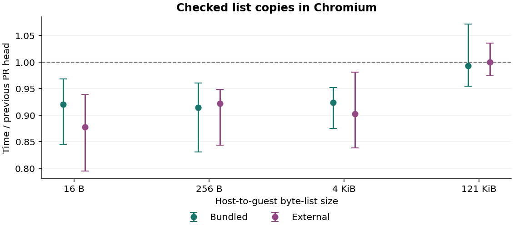

The chart divides times on each page before taking a median. Each error bar is a two-sided sign-test interval with at least 95% coverage for that comparison. For this fixture the bundled JS entry shrank by 90 bytes (26 gzip bytes) and the external entry by 116 bytes (30 gzip bytes).

#### Does this improve C canvas readback?

The original 9-round, same-page comparison measured a 14% slowdown. Two further same-page comparisons ran the old code twice under separate module URLs and rotated all three builds. Both put the new code at 1.00× the previous head. In the instrumented run, the old code spent a median 805 µs inside the canvas host method out of 844 µs per read. These measurements establish the gain for small byte lists and leave the C canvas headline unresolved. Each timed workload checked every RGBA channel on the source and destination canvases. [Canvas runner](web/bench/canvas-host-bench.mjs) · [Host observer](web/bench/canvas-readback.mjs)

| C canvas readback | Rounds | After / before | 95% interval | Duplicate / before |
| --- | ---: | ---: | --- | ---: |
| Original host, 10 ms | 9 | 1.14× | 1.06–1.78× | — |
| Pixel-view host, 10 ms | 9 | 1.01× | 0.92–1.06× | — |
| Original host, isolated pages, 10 ms | 24 | 1.11× | 0.81–1.29× | 0.99× |
| Original host, duplicate control, 10 ms | 30 | 1.00× | 0.95–1.04× | 0.99× |
| Original host, timed host method, 50 ms | 18 | 0.99× | 0.95–1.01× | 1.00× |
| ↳ Inside host read | 18 | 0.98× | 0.95–1.02× | 0.99× |
| ↳ Outside host read | 18 | 0.99× | 0.91–1.09× | 1.08× |
| Original host, 50 ms | 30 | 1.00× | 0.98–1.03× | 0.99× |

The durations name the guest’s minimum timing window. Each guest doubles its iteration count until it reaches that window. Each interval applies to the paired median for that row. The isolated comparison loaded one binding per page, with all three page positions balanced across six-round blocks. [9-round comparison](web/bench/results/list-allocation-canvas.json.gz) · [Isolated pages](web/bench/results/list-allocation-isolated.json.gz) · [Short duplicate control](web/bench/results/list-allocation-short-control.json.gz) · [Host timing](web/bench/results/list-allocation-observed.json.gz) · [Long duplicate control](web/bench/results/list-allocation-long.json.gz)

Use the compiler setup above with the byte-list change and its parent `af9f314c7`. These commands run the transfer benchmark and the original-host control, then regenerate the tables and chart from the archived samples.

```bash
export CHROME_BIN=/path/to/chrome
jco=/path/to/jco-with-list-change
before=/path/to/previous-jco
bin="$jco/target/debug/examples/transpile"
previous=(af9f314c7 "$before/target/debug/examples/transpile")
node web/bench/byte-transfer.mjs "$jco" "$bin" /tmp/byte-transfer.json "${previous[@]}"
ROUNDS=30 MIN_MS=10 node web/bench/canvas-host-bench.mjs --control \
  "$jco" "$bin" "${previous[@]}" /tmp/canvas-control.json
python3 web/bench/byte-transfer-report.py --plot web/bench/results/list-allocation-transfer.png
```

<!-- candidate:start -->

## Optimized browser bindings

The branch uses js-component-bindgen’s internal Oxc bundler and the checked jco-cm-runtime. [Measured Jco commit `900def079`](https://github.com/vados-cosmonic/jco/commit/900def079675eaa44479b686670ff6f3c5749093) · [Canvas host comparison](#canvas-pixel-transfers-with-the-same-guest-binary) · [Payload and startup](#payload-and-startup) · [First guest result](#time-to-the-first-guest-result) · [Wasm startup timing](#where-startup-time-goes) · [Startup by revision](#startup-against-the-previous-branch) · [Eager compilation](#eager-javascript-compilation) · [Reproduction commands](#reproduce-the-candidate-run)

All Jco builds used the same guest binaries. Each value is the median of 7 fresh-page samples with one warm-up per page. The run collected 728 samples on 2026-11-26 with HeadlessChrome/156.0.8078.47 on Intel(R) Xeon(R) Processor @ 2.60GHz.

Stock main is pinned to `fdbf1ae2d`. [Upstream source](https://github.com/bytecodealliance/jco/commit/fdbf1ae2dbc9469b5c275b5686d8a4c43681618f) · [Transpiler CI build](https://github.com/bytecodealliance/jco/actions/runs/45736422241)

The candidate finished within **10× of the fastest available compiled shim in 21/21** headline comparisons. The largest ratio was **4.72×**. On separate fresh pages it matched or beat **1.13.0 in 15/21** and **stock main in 21/21**. On the same warmed page it matched or beat **1.13.0 in 20/21** headline cases and 82/84 across all phases. The shim comparison selects the lowest median among Embind, EM_JS and wasm-bindgen for each operation, including shims written in a different guest language. The phase tables in the original comparison describe workload differences and include raw JavaScript.

On a fresh page with DevTools disconnected, median time from import to the first full workload result was **81.29 ms** on the branch, **74.43 ms** on 1.13.0 and **272.18 ms** on stock main. The branch reached the first result at or before 1.13.0 in 7/21 paired cases. [Startup measurements](#time-to-the-first-guest-result)


| Operation | Guest | Unit | 1.13.0 | Stock main | Candidate | Candidate / 1.13.0 | Fastest shim | Shim time | Candidate / shim |
| --- | --- | --- | --- | --- | --- | --- | --- | --- | --- |
| Attribute write | C | µs | 1.54 | 4.95 | 0.77 | 0.50× | Embind | 1.33 | 0.58× |
| Attribute write | C++ | µs | 1.24 | 4.38 | 0.63 | 0.51× | Embind | 1.33 | 0.48× |
| Attribute write | Rust | µs | 1.32 | 3.98 | 0.86 | 0.65× | Embind | 1.33 | 0.65× |
| Canvas fillRect | C | µs | 1.09 | 4.29 | 1.09 | 1.00× | Embind | 1.80 | 0.61× |
| Canvas fillRect | C++ | µs | 1.29 | 4.14 | 1.10 | 0.85× | Embind | 1.80 | 0.61× |
| Canvas fillRect | Rust | µs | 0.99 | 3.84 | 0.91 | 0.92× | Embind | 1.80 | 0.50× |
| Canvas pixel read | C | µs | 347.50 | 363.70 | 353.60 | 1.02× | Embind | 224.00 | 1.58× |
| Canvas pixel read | C++ | µs | 317.10 | 368.30 | 323.80 | 1.02× | Embind | 224.00 | 1.45× |
| Canvas pixel read | Rust | µs | 355.80 | 370.20 | 365.30 | 1.03× | Embind | 224.00 | 1.63× |
| DOM ID lookup | C | µs | 1.36 | 6.06 | 0.87 | 0.64× | Embind | 1.45 | 0.60× |
| DOM ID lookup | C++ | µs | 1.30 | 5.32 | 1.16 | 0.89× | Embind | 1.45 | 0.80× |
| DOM ID lookup | Rust | µs | 1.27 | 5.45 | 1.02 | 0.80× | Embind | 1.45 | 0.70× |
| Tree traversal | C | ms | 15.16 | 114.53 | 15.95 | 1.05× | EM_JS | 4.22 | 3.78× |
| Tree traversal | C++ | ms | 13.94 | 101.42 | 13.50 | 0.97× | EM_JS | 4.22 | 3.20× |
| Tree traversal | Rust | ms | 18.09 | 125.85 | 19.93 | 1.10× | EM_JS | 4.22 | 4.72× |
| Read 1 KiB string | C | µs | 4.73 | 7.69 | 2.14 | 0.45× | wasm-bindgen | 5.79 | 0.37× |
| Read 1 KiB string | C++ | µs | 5.17 | 7.92 | 2.07 | 0.40× | wasm-bindgen | 5.79 | 0.36× |
| Read 1 KiB string | Rust | µs | 4.89 | 7.27 | 2.12 | 0.43× | wasm-bindgen | 5.79 | 0.37× |
| Table creation | C | ms | 14.46 | 71.05 | 13.92 | 0.96× | EM_JS | 5.79 | 2.41× |
| Table creation | C++ | ms | 15.97 | 75.37 | 13.22 | 0.83× | EM_JS | 5.79 | 2.29× |
| Table creation | Rust | ms | 15.73 | 68.00 | 14.65 | 0.93× | EM_JS | 5.79 | 2.53× |

Comparing implementations in the same language, the branch stayed within 10× in **13/13** available headline comparisons. Each cell divides the branch’s median by that shim’s median. A dash means the demo has no implementation for that binding. The demos supply compiled shims for C++ and Rust.

| Operation | C++ / Embind | C++ / EM_JS | Rust / wasm-bindgen |
| --- | --- | --- | --- |
| Attribute write | 0.48× | — | — |
| Canvas fillRect | 0.61× | — | — |
| Canvas pixel read | 1.45× | — | — |
| DOM ID lookup | 0.80× | — | — |
| Tree traversal | 0.54× | 3.20× | 2.72× |
| Read 1 KiB string | 0.17× | 0.20× | 0.37× |
| Table creation | 0.87× | 2.29× | 1.38× |

<details><summary>How the synchronous bindings work</summary>

Eligible single-instance, synchronous components reuse the caller’s task for host imports. The adapter keeps direct references to its task stack and instance flags and checks for store interruptions. Oxc removes the asynchronous import fallback and the subtask, waitable, and future constructors. The shutdown path skips creating the two empty stream and future tables. The generator skips asynchronous wrappers for synchronous allocators and post-return hooks. Standalone modules also omit suspension markers on core imports.

In checked standalone bindings, the Oxc linker can put a runtime initializer’s value directly where the module first declares its state. Each declaration still allocates its own maps, arrays or objects in the original order. Calls with arguments, calls inside functions and factories with more complex bodies keep their original implementation.

During a guest allocation, the checked runtime clears the instance’s may-leave flag and restores it on return or throw. Allocators in components with context-slot operations use the general guard to supply fresh slots for each call. The adapter lifts short ASCII strings four bytes at a time. Synchronous UTF-8 results of 256 to 262,144 code units can reuse a per-instance byte buffer capped at 256 KiB. The runtime encodes there before requesting the exact guest allocation. Nested calls and larger results use the ordinary encoder.

Resource drops check the instance flag and record traps. When lifting a borrowed host resource, the adapter validates the handle and reads its 32-bit representation directly. Imported host resources with automatically assigned representations use their guest handle as an array index. Explicit host representations and shared tables use a representation map. Components with async operations, cross-component resource transfers or call tracking use the general adapter.

Earlier runs measured how the linker handles runtime dependencies and initializes module state. [Subtask constructors](https://github.com/vados-cosmonic/component-demos/blob/255eca61b14b5ab63567da558b5f561149cc5163/README.md#change-from-the-previous-branch-revision) · [Future and waitable constructors](https://github.com/vados-cosmonic/component-demos/blob/c25f90d93af43e9261dff31b186d5b01115e8a0f/README.md#change-from-the-previous-branch-revision) · [Direct module initialization](https://github.com/vados-cosmonic/component-demos/blob/bd6eb358c6c106711f5e75022a1498d1051f8989/README.md#direct-module-initialization) · [Runtime namespace](https://github.com/vados-cosmonic/component-demos/blob/53a0057e71d25b91dcb0f9c475762140765078c8/README.md#shorter-private-runtime-names)

</details>

### Change from the previous branch revision

Both revisions ran on the same guest binaries in the same browser session. Each cell divides the candidate median by the previous revision’s median. Parentheses count the rounds in which the candidate finished faster. [Compare `5c6ddda44` and `900def079`](https://github.com/vados-cosmonic/jco/compare/5c6ddda44bce1730a61a69f2d48db94e3065ca31...900def079675eaa44479b686670ff6f3c5749093)

External core Wasm files matched byte for byte for 32/32 inputs that emitted them. Across the 21 timed guest and workload combinations, the median ratio of candidate to previous startup time was 0.98×.

| Payload | Smallest saving (bytes) | Median saving (bytes) | Largest saving (bytes) | Smaller outputs |
| --- | --- | --- | --- | --- |
| JavaScript | 5,029 | 5,044 | 5,044 | 34/34 |
| Total gzip | 365 | 386 | 399 | 34/34 |
| Total Brotli | 233 | 304 | 359 | 34/34 |

Both branch revisions also ran with their default output and caching disabled. The change column takes the difference for each guest and workload first, then the median of those differences.

| Startup interval | Previous (ms) | Candidate (ms) | Median change (ms) | Faster workloads |
| --- | --- | --- | --- | --- |
| Import to ready | 21.12 | 20.61 | -0.53 | 16/21 |
| Import to JS response end | 2.52 | 2.47 | -0.02 | 12/21 |
| JS end to first Wasm request | 12.35 | 11.62 | -0.36 | 13/21 |
| First Wasm request to last Wasm response | 2.48 | 2.34 | -0.08 | 13/21 |
| Last Wasm response to ready | 4.30 | 4.11 | -0.14 | 14/21 |

| Operation | C | C++ | Rust |
| --- | --- | --- | --- |
| Attribute write | 1.26× (3/7) | 0.83× (7/7) | 1.12× (3/7) |
| Canvas fillRect | 0.90× (4/7) | 1.03× (3/7) | 0.97× (5/7) |
| Canvas pixel read | 1.05× (4/7) | 0.87× (4/7) | 1.04× (4/7) |
| DOM ID lookup | 0.79× (5/7) | 0.94× (4/7) | 1.05× (2/7) |
| Tree traversal | 0.93× (5/7) | 0.78× (5/7) | 1.12× (1/7) |
| Read 1 KiB string | 0.96× (4/7) | 0.95× (4/7) | 1.01× (4/7) |
| Table creation | 0.91× (3/7) | 1.02× (4/7) | 1.00× (3/7) |
| Bulk DOM query | 0.95× (4/7) | 0.89× (5/7) | 0.96× (3/7) |
| Tree construction | 0.95× (4/7) | 0.78× (5/7) | 1.02× (1/7) |
| set 8 B | 1.04× (5/7) | 0.94× (3/7) | 0.96× (3/7) |
| get 8 B | 1.07× (3/7) | 1.11× (3/7) | 1.06× (3/7) |
| get 128 B | 0.98× (5/7) | 0.91× (5/7) | 0.95× (5/7) |
| get 16384 B | 0.96× (4/7) | 0.95× (3/7) | 1.00× (3/7) |
| get 262144 B | 1.00× (4/7) | 0.98× (3/7) | 1.02× (2/7) |

### Warm 1.13.0 comparison on the same page

For each guest and workload, both builds run once to warm up, then 4 times each on the same page. Each pair alternates which build runs first. The runner clears the DOM and performance entries before every call. It repeats this on 9 fresh pages. Each page contributes the median of its candidate / 1.13.0 ratios. The median across pages was at or below 1× for **20/21** headline cases. [Raw paired timings](web/bench/results/paired-browser.json)


The middle 50% describes variation between pages. The median interval uses a two-sided sign test over independent page medians at the 95% level for each phase individually. Measurements on this CPU and browser can share machine load across pages.

| Operation | Guest | Candidate / 1.13.0 | Middle 50% of page ratios | 95% median interval | Pages at or below 1× |
| --- | --- | --- | --- | --- | --- |
| Attribute write | C | 0.49× | 0.49–0.51× | 0.472–0.519× | 9/9 |
| Attribute write | C++ | 0.51× | 0.48–0.52× | 0.482–0.522× | 9/9 |
| Attribute write | Rust | 0.56× | 0.56–0.57× | 0.551–0.578× | 9/9 |
| Canvas fillRect | C | 0.91× | 0.90–0.94× | 0.902–0.952× | 9/9 |
| Canvas fillRect | C++ | 0.92× | 0.90–0.99× | 0.874–1.014× | 7/9 |
| Canvas fillRect | Rust | 0.94× | 0.94–0.98× | 0.912–1.023× | 7/9 |
| Canvas pixel read | C | 1.10× | 1.00–1.16× | 0.953–1.656× | 2/9 |
| Canvas pixel read | C++ | 0.96× | 0.91–1.00× | 0.901–1.091× | 6/9 |
| Canvas pixel read | Rust | 0.90× | 0.84–1.14× | 0.840–1.159× | 6/9 |
| DOM ID lookup | C | 0.64× | 0.58–0.72× | 0.538–0.730× | 9/9 |
| DOM ID lookup | C++ | 0.61× | 0.58–0.71× | 0.562–0.715× | 9/9 |
| DOM ID lookup | Rust | 0.60× | 0.58–0.73× | 0.551–0.763× | 9/9 |
| Tree traversal | C | 0.79× | 0.77–0.83× | 0.664–0.913× | 9/9 |
| Tree traversal | C++ | 0.79× | 0.77–0.80× | 0.704–0.866× | 9/9 |
| Tree traversal | Rust | 0.65× | 0.61–0.92× | 0.576–0.993× | 8/9 |
| Read 1 KiB string | C | 0.47× | 0.42–0.48× | 0.423–0.512× | 9/9 |
| Read 1 KiB string | C++ | 0.45× | 0.40–0.46× | 0.363–0.464× | 9/9 |
| Read 1 KiB string | Rust | 0.44× | 0.39–0.47× | 0.374–0.499× | 9/9 |
| Table creation | C | 0.94× | 0.82–1.01× | 0.806–1.029× | 6/9 |
| Table creation | C++ | 0.93× | 0.88–1.02× | 0.821–1.031× | 5/9 |
| Table creation | Rust | 0.95× | 0.93–0.96× | 0.905–0.969× | 8/9 |

Across all 84 reported phases and string lengths, the same-page comparison matched or beat 1.13.0 in **82/84** cases. The median interval lay entirely above 1× in **0/84** cases. Totals and subphases overlap.

| Slower paired phase | Guest | Metric | Candidate / 1.13.0 | 95% median interval | Pages at or below 1× |
| --- | --- | --- | --- | --- | --- |
| canvas-pixels | C | getImageData(): µs/call | 1.102× | 0.953–1.656× | 2/9 |
| string-marshalling | C++ | set 16384 B | 1.020× | 0.954–1.039× | 3/9 |

Across all reported phases and string lengths, 81/84 comparable candidate medians were within 10× of the fastest compiled shim and 71/84 matched or beat 1.13.0. Totals and their subphases overlap. Each ratio compares the same phase on both sides.

| Phases above 10× | Phase | Guest | Shim | Candidate / shim |
| --- | --- | --- | --- | --- |
| dom-query | bulk: total ms | C | Embind | 468.25× |
| dom-query | bulk: total ms | C++ | Embind | 611.25× |
| dom-query | bulk: total ms | Rust | Embind | 568.75× |

The bulk DOM query returns a live collection to Embind, which discards it. The component host materializes the collection with `Array.from`, then the bindings lower every element into a WIT resource handle. The ratio includes that difference in work. [Embind loop](cpp/dom-query/emscripten/main.cpp) · [Component host](web/host/web-host.js) · [C guest loop](c/dom-query/main.c)

### DOM bindings with identical guest code

These 216 fresh-page samples compare each language’s exact core Wasm binary with each set of bindings in the table. The direct JS shim calls the same DOM host, puts owned handles in guest memory and recycles them on guest drops. It implements the synchronous imports used by these guests. Jco also provides Canonical ABI checks, task tracking and instance shutdown. [Direct shim](web/bench/dom-core-shim.mjs) · [Raw timings and correctness checks](web/bench/results/dom-control-browser.json)

The bulk query copies 2,000 handles per call, 10 times. Each traversal visits 19,531 nodes. The runner checks the rendered fixture or node count for each guest and verifies list counts and handle release for the direct shim after warm-up and measurement.

With list materialization on both sides, the candidate took **1.30–1.72×** the direct shim’s bulk-query time across the three guests. Times below are per measured workload, after warm-up.

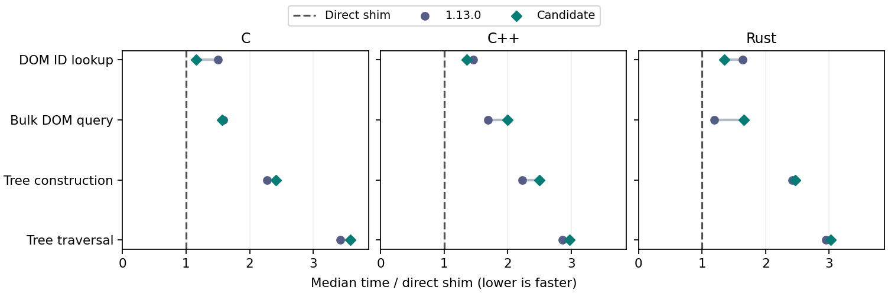

| Phase | Guest | Direct (ms) | 1.13.0 (ms) | Candidate (ms) | Candidate / direct | Candidate / 1.13.0 | Rounds at or below 1.13.0 | Candidate / previous | Rounds at or below previous |
| --- | --- | --- | --- | --- | --- | --- | --- | --- | --- |
| DOM ID lookup | C | 16.73 | 28.63 | 18.20 | 1.09× | 0.64× | 9/9 | 0.94× | 7/9 |
| DOM ID lookup | C++ | 16.19 | 28.45 | 19.18 | 1.18× | 0.67× | 9/9 | 0.87× | 7/9 |
| DOM ID lookup | Rust | 13.12 | 23.89 | 17.16 | 1.31× | 0.72× | 9/9 | 0.95× | 6/9 |
| Bulk DOM query | C | 7.52 | 12.15 | 9.80 | 1.30× | 0.81× | 8/9 | 0.91× | 5/9 |
| Bulk DOM query | C++ | 7.00 | 12.21 | 11.45 | 1.64× | 0.94× | 5/9 | 0.92× | 7/9 |
| Bulk DOM query | Rust | 6.34 | 11.97 | 10.94 | 1.72× | 0.91× | 6/9 | 1.01× | 5/9 |
| Tree construction | C | 25.19 | 52.06 | 45.73 | 1.82× | 0.88× | 5/9 | 0.84× | 6/9 |
| Tree construction | C++ | 22.77 | 54.58 | 53.16 | 2.33× | 0.97× | 3/9 | 0.95× | 6/9 |
| Tree construction | Rust | 26.52 | 44.25 | 48.42 | 1.83× | 1.09× | 2/9 | 0.98× | 5/9 |
| Tree traversal | C | 6.69 | 13.94 | 13.88 | 2.07× | 1.00× | 3/9 | 0.85× | 7/9 |
| Tree traversal | C++ | 5.50 | 15.27 | 16.38 | 2.98× | 1.07× | 3/9 | 1.02× | 4/9 |
| Tree traversal | Rust | 7.61 | 14.32 | 17.38 | 2.28× | 1.21× | 2/9 | 1.00× | 4/9 |

On the same guest binaries, initialization took the following times before the first guest call. Each median covers 9 fresh pages and includes importing the binding module, fetching the guest and instantiating it. The direct shim uses `WebAssembly.instantiateStreaming`.

| Workload | Guest | Direct startup (ms) | 1.13.0 (ms) | Candidate (ms) | Candidate / direct | Candidate / 1.13.0 |
| --- | --- | --- | --- | --- | --- | --- |
| ID and bulk query | C | 8.88 | 11.75 | 21.45 | 2.42× | 1.83× |
| ID and bulk query | C++ | 9.34 | 11.32 | 21.43 | 2.30× | 1.89× |
| ID and bulk query | Rust | 9.19 | 11.64 | 20.85 | 2.27× | 1.79× |
| Tree traversal | C | 8.61 | 11.49 | 22.08 | 2.56× | 1.92× |
| Tree traversal | C++ | 8.27 | 10.99 | 20.63 | 2.49× | 1.88× |
| Tree traversal | Rust | 9.09 | 10.81 | 22.67 | 2.49× | 2.10× |

### Cost of a synchronous host import

The scalar, string and resource loops run 131,072 iterations per pass. The string loop changes the first byte before each call. The resource loop acquires a host object, borrows it to read its value, and drops it. The optional-resource loop checks the discriminant in guest memory every time and reads and drops each present handle. Each pass checks its checksum. All four adapters use byte-identical core modules. The direct shim keeps the fixture’s single live handle in one slot.

The byte-list loops copy a 176 × 176 RGBA region (123,904 bytes) 2,048 times per pass in each direction. The host-to-guest case uses a reusable host view and a fixed guest allocation. In the reverse direction the host keeps the final snapshot while the guest changes the source in Wasm. Both cases sum the changing first byte during the loop and verify the whole payload afterward. The canvas demo also measures browser readback, host allocation and guest allocation.

The string-return loops make 32,768 calls per pass for 16-byte results and 1,024 for 16 KiB results. One host returns a repeated ASCII string. The other rotates four strings containing two-, three-, and four-byte UTF-8 sequences. The guest checks each byte length, sums the first bytes, and hashes every distinct result outside the timer.

Times are nanoseconds per guest iteration, including the loop and host work. Each cell is the median of 7 fresh-page medians, with 2 warm-ups and 5 timed passes per page. The runner interleaves the four builds. [Raw timings and digests](web/bench/results/import-loop.json)

| Operation | Direct | 1.13.0 | Stock main | Candidate | Candidate / 1.13.0 | Candidate / direct |
| --- | --- | --- | --- | --- | --- | --- |
| u32 | 14.5 | 12.2 | 1,899.7 | 16.8 | 1.37× | 1.16× |
| 2-byte string | 460.8 | 422.7 | 2,523.0 | 121.3 | 0.29× | 0.26× |
| 9-byte string | 404.4 | 405.1 | 2,542.1 | 178.5 | 0.44× | 0.44× |
| 32-byte string | 410.5 | 409.7 | 2,360.5 | 415.8 | 1.01× | 1.01× |
| Acquire, borrow, drop | 42.0 | 265.5 | 4,620.4 | 122.1 | 0.46× | 2.91× |
| Optional resource, half present | 30.5 | 174.0 | 3,311.2 | 129.7 | 0.75× | 4.25× |
| 121 KiB host-to-guest byte list | 4,931.6 | 4,931.6 | 8,886.7 | 5,175.8 | 1.05× | 1.05× |
| 121 KiB guest-to-host byte list | 95,019.5 | 95,800.8 | 99,853.5 | 95,019.5 | 0.99× | 1.00× |
| 16-byte UTF-8 result, repeated ASCII | 1,629.6 | 1,834.1 | 4,074.1 | 344.8 | 0.19× | 0.21× |
| 16-byte UTF-8 result, rotating Unicode | 1,538.1 | 1,770.0 | 4,165.6 | 909.4 | 0.51× | 0.59× |
| 16 KiB UTF-8 result, repeated ASCII | 35,351.6 | 34,375.0 | 51,953.1 | 18,359.4 | 0.53× | 0.52× |
| 16 KiB UTF-8 result, rotating Unicode | 44,628.9 | 45,214.8 | 74,902.3 | 31,152.3 | 0.69× | 0.70× |


### Where the canvas read spends its time

The same-page comparison was repeated with a clock around the demo’s host method. That method reads 176 × 176 pixels from Chromium and creates a JavaScript byte array. The remainder includes guest allocation and freeing, the copy into Wasm, binding checks, the loop and observer overhead. Each cell is a median across 9 page medians. Columns are summarized independently. [Raw instrumented samples](web/bench/results/canvas-control-browser.json)

| Guest | Bindings | Full read (µs) | Inside host (µs) | Remainder (µs) | Inside host (%) |
| --- | --- | --- | --- | --- | --- |
| C | 1.13.0 | 352.5 | 339.4 | 13.7 | 96.1% |
| C | Candidate | 349.5 | 334.8 | 14.5 | 95.8% |
| C++ | 1.13.0 | 339.0 | 322.9 | 14.5 | 96.0% |
| C++ | Candidate | 352.6 | 338.6 | 14.8 | 95.9% |
| Rust | 1.13.0 | 339.1 | 326.1 | 13.8 | 95.9% |
| Rust | Candidate | 344.5 | 329.8 | 14.7 | 95.8% |

The host accounted for 95.8–96.1% of the full read across these builds. The candidate spent 14.5–14.8 µs per read outside the host, compared with 13.7–14.5 µs for 1.13.0.

### Canvas pixel transfers with the same guest binary

Each call transfers a 176 × 176 RGBA region (123,904 bytes). The original browser host copies the pixel array on both read and write. The alternate host creates a typed-array view over the browser’s readback or the binding’s write snapshot, preserving its offset and length. All four implementations still copy the bytes across the Wasm boundary. [View adapter](web/bench/canvas-host.mjs) · [Direct shim](web/bench/dom-core-shim.mjs)

For each guest, all four bindings use identical core Wasm. Each table cell is the median of 9 page medians, with one warm-up and 4 measured passes per page. The runner rotates the four bindings on each page, alternates the host order and checks every pixel on both canvases after each invocation. [Raw timings and pixel checks](web/bench/results/canvas-host.json)

Changing the host reduced the candidate’s read time by **43–52%** and write time by **58–60%**. With the view adapter, its six timings were **0.92–1.07×** the corresponding direct shim times. The headline benchmarks use the original host.


| Guest | Bindings | Original read (µs) | View read (µs) | Original write (µs) | View write (µs) |
| --- | --- | --- | --- | --- | --- |
| C | Direct shim | 341.8 | 179.9 | 256.1 | 108.1 |
| C | 1.13.0 | 340.4 | 180.7 | 254.3 | 139.1 |
| C | Stock main | 374.6 | 218.8 | 318.0 | 122.2 |
| C | Candidate | 367.4 | 177.6 | 261.3 | 107.2 |
| C++ | Direct shim | 346.1 | 181.4 | 245.3 | 113.0 |
| C++ | 1.13.0 | 341.3 | 184.9 | 257.2 | 117.1 |
| C++ | Stock main | 347.4 | 219.0 | 306.8 | 139.3 |
| C++ | Candidate | 335.5 | 190.8 | 258.6 | 108.0 |
| Rust | Direct shim | 350.0 | 204.3 | 265.6 | 104.2 |
| Rust | 1.13.0 | 350.5 | 189.8 | 259.7 | 115.6 |
| Rust | Stock main | 356.8 | 212.4 | 390.9 | 166.9 |
| Rust | Candidate | 356.4 | 187.6 | 275.8 | 111.5 |

<details><summary>All timed phases and string lengths</summary>

| Demo | Phase | Guest | Candidate time | Fresh-page / 1.13.0 | Same-page / 1.13.0 | Candidate / main | Fastest shim | Candidate / shim |
| --- | --- | --- | --- | --- | --- | --- | --- | --- |
| attribute-churn | total time | C | 61.27 ms | 0.50× | 0.49× | 0.15× | Embind | 0.58× |
| attribute-churn | total time | C++ | 50.55 ms | 0.51× | 0.51× | 0.14× | Embind | 0.47× |
| attribute-churn | total time | Rust | 68.61 ms | 0.65× | 0.56× | 0.22× | Embind | 0.64× |
| attribute-churn | per setAttribute() | C | 0.77 µs | 0.50× | 0.49× | 0.15× | Embind | 0.58× |
| attribute-churn | per setAttribute() | C++ | 0.63 µs | 0.51× | 0.51× | 0.14× | Embind | 0.48× |
| attribute-churn | per setAttribute() | Rust | 0.86 µs | 0.65× | 0.56× | 0.22× | Embind | 0.65× |
| canvas-draw | total | C | 54.66 ms | 1.00× | 0.91× | 0.25× | Embind | 0.61× |
| canvas-draw | total | C++ | 55.09 ms | 0.85× | 0.92× | 0.27× | Embind | 0.61× |
| canvas-draw | total | Rust | 45.53 ms | 0.92× | 0.94× | 0.24× | Embind | 0.50× |
| canvas-draw | per fill_rect() | C | 1.09 µs | 1.00× | 0.91× | 0.25× | Embind | 0.61× |
| canvas-draw | per fill_rect() | C++ | 1.10 µs | 0.85× | 0.92× | 0.27× | Embind | 0.61× |
| canvas-draw | per fill_rect() | Rust | 0.91 µs | 0.92× | 0.94× | 0.24× | Embind | 0.50× |
| canvas-pixels | getImageData(): µs/call | C | 353.60 µs | 1.02× | 1.10× | 0.97× | Embind | 1.58× |
| canvas-pixels | getImageData(): µs/call | C++ | 323.80 µs | 1.02× | 0.96× | 0.88× | Embind | 1.45× |
| canvas-pixels | getImageData(): µs/call | Rust | 365.30 µs | 1.03× | 0.90× | 0.99× | Embind | 1.63× |
| canvas-pixels | putImageData(): µs/call | C | 295.80 µs | 1.02× | 0.87× | 0.95× | Embind | 1.26× |
| canvas-pixels | putImageData(): µs/call | C++ | 276.10 µs | 0.97× | 0.98× | 0.86× | Embind | 1.18× |
| canvas-pixels | putImageData(): µs/call | Rust | 259.50 µs | 0.49× | 0.93× | 0.75× | Embind | 1.11× |
| dom-query | individual: total ms | C | 17.47 ms | 0.64× | 0.64× | 0.14× | Embind | 0.60× |
| dom-query | individual: total ms | C++ | 23.13 ms | 0.89× | 0.61× | 0.22× | Embind | 0.80× |
| dom-query | individual: total ms | Rust | 20.34 ms | 0.80× | 0.60× | 0.19× | Embind | 0.70× |
| dom-query | bulk: total ms | C | 9.37 ms | 0.71× | 0.76× | 0.49× | Embind | 468.25× |
| dom-query | bulk: total ms | C++ | 12.22 ms | 1.09× | 0.80× | 0.61× | Embind | 611.25× |
| dom-query | bulk: total ms | Rust | 11.38 ms | 1.01× | 0.72× | 0.64× | Embind | 568.75× |
| dom-query | individual: µs/element | C | 0.87 µs | 0.64× | 0.64× | 0.14× | Embind | 0.60× |
| dom-query | individual: µs/element | C++ | 1.16 µs | 0.89× | 0.61× | 0.22× | Embind | 0.80× |
| dom-query | individual: µs/element | Rust | 1.02 µs | 0.80× | 0.60× | 0.19× | Embind | 0.70× |
| dom-traversal | build | C | 52.76 ms | 0.97× | 0.76× | 0.24× | EM_JS | 2.74× |
| dom-traversal | build | C++ | 43.06 ms | 0.84× | 0.77× | 0.20× | EM_JS | 2.24× |
| dom-traversal | build | Rust | 53.43 ms | 0.93× | 0.82× | 0.27× | EM_JS | 2.78× |
| dom-traversal | traverse (total) | C | 15.95 ms | 1.05× | 0.79× | 0.14× | EM_JS | 3.78× |
| dom-traversal | traverse (total) | C++ | 13.50 ms | 0.97× | 0.79× | 0.13× | EM_JS | 3.20× |
| dom-traversal | traverse (total) | Rust | 19.93 ms | 1.10× | 0.65× | 0.16× | EM_JS | 4.72× |
| dom-traversal | traverse (per node) | C | 0.82 µs | 1.05× | 0.79× | 0.14× | EM_JS | 3.78× |
| dom-traversal | traverse (per node) | C++ | 0.69 µs | 0.97× | 0.79× | 0.13× | EM_JS | 3.20× |
| dom-traversal | traverse (per node) | Rust | 1.02 µs | 1.10× | 0.65× | 0.16× | EM_JS | 4.72× |
| string-marshalling | set 8 B | C | 0.46 µs | 0.53× | 0.65× | 0.13× | EM_JS | 1.36× |
| string-marshalling | set 8 B | C++ | 0.45 µs | 0.52× | 0.66× | 0.14× | EM_JS | 1.34× |
| string-marshalling | set 8 B | Rust | 0.43 µs | 0.47× | 0.77× | 0.14× | EM_JS | 1.27× |
| string-marshalling | get 8 B | C | 0.56 µs | 0.24× | 0.25× | 0.11× | EM_JS | 2.77× |
| string-marshalling | get 8 B | C++ | 0.62 µs | 0.27× | 0.24× | 0.12× | EM_JS | 3.07× |
| string-marshalling | get 8 B | Rust | 0.57 µs | 0.26× | 0.25× | 0.11× | EM_JS | 2.84× |
| string-marshalling | set 128 B | C | 0.68 µs | 0.61× | 0.93× | 0.16× | wasm-bindgen | 1.17× |
| string-marshalling | set 128 B | C++ | 0.68 µs | 0.64× | 0.88× | 0.16× | wasm-bindgen | 1.16× |
| string-marshalling | set 128 B | Rust | 0.68 µs | 0.64× | 0.96× | 0.15× | wasm-bindgen | 1.16× |
| string-marshalling | get 128 B | C | 1.95 µs | 0.71× | 0.76× | 0.30× | wasm-bindgen | 2.19× |
| string-marshalling | get 128 B | C++ | 1.92 µs | 0.80× | 0.71× | 0.32× | wasm-bindgen | 2.15× |
| string-marshalling | get 128 B | Rust | 1.84 µs | 0.55× | 0.72× | 0.36× | wasm-bindgen | 2.07× |
| string-marshalling | set 1024 B | C | 1.01 µs | 0.85× | 0.86× | 0.25× | wasm-bindgen | 1.10× |
| string-marshalling | set 1024 B | C++ | 1.10 µs | 0.90× | 0.89× | 0.27× | wasm-bindgen | 1.19× |
| string-marshalling | set 1024 B | Rust | 1.05 µs | 0.83× | 0.98× | 0.28× | wasm-bindgen | 1.15× |
| string-marshalling | get 1024 B | C | 2.14 µs | 0.45× | 0.47× | 0.28× | wasm-bindgen | 0.37× |
| string-marshalling | get 1024 B | C++ | 2.07 µs | 0.40× | 0.45× | 0.26× | wasm-bindgen | 0.36× |
| string-marshalling | get 1024 B | Rust | 2.12 µs | 0.43× | 0.44× | 0.29× | wasm-bindgen | 0.37× |
| string-marshalling | set 16384 B | C | 7.52 µs | 0.94× | 1.00× | 0.68× | wasm-bindgen | 1.06× |
| string-marshalling | set 16384 B | C++ | 7.75 µs | 1.04× | 1.02× | 0.70× | wasm-bindgen | 1.09× |
| string-marshalling | set 16384 B | Rust | 7.44 µs | 1.00× | 0.99× | 0.68× | wasm-bindgen | 1.05× |
| string-marshalling | get 16384 B | C | 19.96 µs | 0.36× | 0.49× | 0.35× | wasm-bindgen | 0.23× |
| string-marshalling | get 16384 B | C++ | 19.24 µs | 0.38× | 0.55× | 0.32× | wasm-bindgen | 0.22× |
| string-marshalling | get 16384 B | Rust | 19.35 µs | 0.49× | 0.54× | 0.36× | wasm-bindgen | 0.22× |
| string-marshalling | set 262144 B | C | 121.50 µs | 0.45× | 0.76× | 0.42× | Embind | 1.05× |
| string-marshalling | set 262144 B | C++ | 115.40 µs | 0.43× | 0.76× | 0.40× | Embind | 1.00× |
| string-marshalling | set 262144 B | Rust | 116.10 µs | 0.43× | 0.93× | 0.43× | Embind | 1.00× |
| string-marshalling | get 262144 B | C | 308.05 µs | 0.30× | 0.29× | 0.38× | wasm-bindgen | 0.22× |
| string-marshalling | get 262144 B | C++ | 296.65 µs | 0.31× | 0.30× | 0.36× | wasm-bindgen | 0.21× |
| string-marshalling | get 262144 B | Rust | 292.55 µs | 0.30× | 0.29× | 0.38× | wasm-bindgen | 0.21× |
| table-update | create: total ms | C | 13.92 ms | 0.96× | 0.94× | 0.20× | EM_JS | 2.41× |
| table-update | create: total ms | C++ | 13.22 ms | 0.83× | 0.93× | 0.18× | EM_JS | 2.29× |
| table-update | create: total ms | Rust | 14.65 ms | 0.93× | 0.95× | 0.22× | EM_JS | 2.53× |
| table-update | create: µs/row | C | 6.96 µs | 0.96× | 0.94× | 0.20× | EM_JS | 2.41× |
| table-update | create: µs/row | C++ | 6.61 µs | 0.83× | 0.93× | 0.18× | EM_JS | 2.28× |
| table-update | create: µs/row | Rust | 7.33 µs | 0.93× | 0.95× | 0.22× | EM_JS | 2.53× |
| table-update | update (selected): total ms | C | 1.10 ms | 1.00× | 0.80× | 0.30× | wasm-bindgen | 1.13× |
| table-update | update (selected): total ms | C++ | 1.13 ms | 0.82× | 0.78× | 0.29× | wasm-bindgen | 1.16× |
| table-update | update (selected): total ms | Rust | 1.03 ms | 0.97× | 0.97× | 0.34× | wasm-bindgen | 1.06× |
| table-update | update (selected): µs/row | C | 0.55 µs | 0.99× | 0.81× | 0.30× | wasm-bindgen | 1.13× |
| table-update | update (selected): µs/row | C++ | 0.56 µs | 0.82× | 0.78× | 0.29× | wasm-bindgen | 1.16× |
| table-update | update (selected): µs/row | Rust | 0.52 µs | 0.97× | 0.97× | 0.34× | wasm-bindgen | 1.06× |
| table-update | clear (unselected): total ms | C | 3.65 ms | 0.85× | 0.77× | 0.22× | wasm-bindgen | 1.29× |
| table-update | clear (unselected): total ms | C++ | 3.87 ms | 0.75× | 0.74× | 0.19× | wasm-bindgen | 1.37× |
| table-update | clear (unselected): total ms | Rust | 3.77 ms | 0.91× | 0.77× | 0.25× | wasm-bindgen | 1.33× |
| table-update | clear (unselected): µs/row | C | 1.82 µs | 0.85× | 0.77× | 0.22× | wasm-bindgen | 1.29× |
| table-update | clear (unselected): µs/row | C++ | 1.93 µs | 0.76× | 0.74× | 0.19× | wasm-bindgen | 1.37× |
| table-update | clear (unselected): µs/row | Rust | 1.88 µs | 0.91× | 0.77× | 0.25× | wasm-bindgen | 1.33× |

</details>

### Payload and startup

Payload medians cover 34 component inputs. Compression is per file. Startup is the median of the 21 per-workload and guest medians, from dynamic import through initialization, with browser caching disabled.

| Build | JS (KiB) | Core Wasm (KiB) | Total (KiB) | Gzip (KiB) | Brotli (KiB) | Startup (ms) |
| --- | --- | --- | --- | --- | --- | --- |
| 1.13.0 | 19.4 | 64.4 | 85.4 | 29.3 | 24.1 | 11.17 |
| Stock main | 183.9 | 64.4 | 255.2 | 58.2 | 48.3 | 25.63 |
| Candidate | 122.5 | 64.4 | 190.0 | 49.8 | 41.5 | 20.61 |

### What ships with `--minify`

Each Jco build generated its default and minified distribution from the same 34 components. Jco 1.13.0 uses Terser for its minify option. Stock main and the branch use Oxc. All external Wasm files matched byte for byte across formats. Payloads include JavaScript and external Wasm, compressed per file. Chromium interleaved the six distributions across 630 fresh pages, with 5 rounds for each of the 21 guest and workload combinations. The two ratio columns compare each format to that build’s default for the same guest and workload, then take the median of the 21 ratios. The final column compares workload times to the same format of 1.13.0. [Distribution sizes](web/bench/results/minified-sizes.json) · [Timings and resource requests](web/bench/results/minified-browser.json)

| Distribution | JS (KiB) | Total gzip (KiB) | Total Brotli (KiB) | Startup (ms) | Startup / default | Runtime / default | At or below 1.13.0 |
| --- | --- | --- | --- | --- | --- | --- | --- |
| 1.13.0 default | 19.4 | 29.3 | 24.1 | 11.03 | 1.00× | 1.00× | 21/21 |
| 1.13.0 minified | 8.7 | 28.8 | 23.7 | 10.93 | 0.97× | 1.02× | 21/21 |
| Stock main default | 183.9 | 58.2 | 48.3 | 26.08 | 1.00× | 1.00× | 1/21 |
| Stock main minified | 106.9 | 51.2 | 43.2 | 23.37 | 0.92× | 1.02× | 2/21 |
| Candidate default | 122.5 | 49.8 | 41.5 | 21.20 | 1.00× | 1.00× | 17/21 |
| Candidate minified | 69.8 | 44.7 | 37.9 | 18.91 | 0.90× | 0.99× | 19/21 |

Chromium’s Resource Timing entries give four consecutive intervals from the start of dynamic import until the module is ready. The gap before the first Wasm request includes resolving dependencies and executing JavaScript. The local server served uncompressed assets with caching disabled. Browser response-body sizes were checked against the generated file sizes. Each column reports its own median over workload medians.

| Distribution | Import to JS response end (ms) | JS response end to first Wasm request (ms) | First Wasm request to last Wasm response (ms) | Last Wasm response to ready (ms) |
| --- | --- | --- | --- | --- |
| 1.13.0 default | 2.27 | 3.24 | 2.41 | 3.08 |
| 1.13.0 minified | 2.33 | 2.96 | 2.47 | 2.98 |
| Stock main default | 2.50 | 16.72 | 2.50 | 4.22 |
| Stock main minified | 2.54 | 14.43 | 2.44 | 4.07 |
| Candidate default | 2.48 | 11.91 | 2.27 | 4.21 |
| Candidate minified | 2.31 | 10.21 | 2.44 | 3.96 |

Minifying the branch reduced startup by 10% on the median same-workload comparison. Its median import-to-ready time was 18.91 ms, compared with 10.93 ms for minified 1.13.0. Between the end of the entry JavaScript response and the first Wasm request, the corresponding medians were 10.21 and 2.96 ms.


### Startup with DevTools disconnected

In 1,470 fresh documents, the page timed its own dynamic import, ran the guest and sent the result to a local server. One browser kept the Puppeteer DevTools connection open. The other disconnected before the first measured navigation. Both navigated the same tab, with matching Chrome flags, no-store responses and verified network transfers. The order of the two browsers alternated over 5 rounds. Each table cell is the median of the 21 workload medians. [Observer timings](web/bench/results/startup-observer.json)

| Distribution | Attached startup (ms) | Detached startup (ms) | Attached JS end to Wasm request (ms) | Detached JS end to Wasm request (ms) |
| --- | --- | --- | --- | --- |
| 1.13.0 default | 9.69 | 7.43 | 3.34 | 1.98 |
| 1.13.0 minified | 9.20 | 7.29 | 2.90 | 1.91 |
| Stock main default | 25.42 | 16.60 | 17.29 | 9.69 |
| Stock main minified | 22.23 | 15.71 | 14.62 | 8.99 |
| Candidate default | 19.96 | 13.01 | 11.94 | 6.91 |
| Candidate minified | 17.73 | 12.95 | 10.58 | 6.47 |
| Previous branch default | 20.45 | 13.41 | 12.34 | 6.98 |

With DevTools disconnected, default-output startup took **0.99×** the previous revision’s time. The candidate was faster in 13/21 workloads. Each workload contributes its median within-round time ratio.

### Where startup time goes

Across 9 rounds, 1,134 fresh pages imported a default module and checked its first guest result with DevTools disconnected. Half recorded when the browser’s asynchronous WebAssembly compile and instantiate calls began and when their promises settled. Each instrumented page had an ordinary control with the same build, workload and round. The last column gives the median paired import-time ratio.

| Build | Import (ms) | Through JS response (ms) | JS end to first Wasm call (ms) | Compile only (ms) | Instantiate only (ms) | Both pending (ms) | Between calls (ms) | Last settlement to ready (ms) | Traced / ordinary |
| --- | --- | --- | --- | --- | --- | --- | --- | --- | --- |
| 1.13.0 | 6.47 | 1.70 | 2.00 | 1.03 | 0.15 | 0.05 | 1.35 | 0.14 | 0.98× |
| Stock main | 13.81 | 2.00 | 8.44 | 1.43 | 0.16 | 0.05 | 1.07 | 0.32 | 0.94× |
| Candidate | 11.60 | 1.89 | 6.17 | 1.58 | 0.19 | 0.00 | 1.16 | 0.26 | 1.00× |

Compared with 1.13.0, the candidate’s median paired difference was **+4.94 ms** for import and **+4.01 ms** between the JavaScript response and the first Wasm call. These differences pair the two traced pages within each round before taking the median per workload and across workloads.

Each instant on a page counts once, including when several compile calls overlap. Pending calls measure elapsed wall time and can include fetching a module, scheduling and JavaScript running on the same page. The time from the entry script’s response to the first Wasm call also includes loading its dependencies. Instrumented pages copy the interval records after import readiness and before calling the guest. Columns are medians across workload medians and can sum to a different value from the median import. [Call intervals and ordinary control samples](web/bench/results/wasm-startup.json)


The C and C++ guests also instantiate a 24-byte Wasm module whose start function calls the guest initializer. Across all 126 candidate traces for these 14 workloads, that module’s compilation had already settled when the preceding instance finished. The median duration of its final instantiation, including the guest initializer, was 0.025 ms for the candidate and 0.015 ms for 1.13.0. Both figures summarize workload medians. This accounts for little of the measured import gap. The trace records this adapter as the third inline compile and the fourth instantiation. [Raw Wasm call intervals](web/bench/results/wasm-startup.json)

#### When the binding module starts executing

In 1,800 fresh documents, five small workloads ran in each of three guest languages. Each build ran once with a performance mark as its first executable statement and once with its ordinary source per round. The browser had already loaded the shared host. Time from the JavaScript response to the mark includes module loading, linking, compilation and browser scheduling. Each cell summarizes the 15 workload medians.

| Build | JS response to module body (ms) | Module body to first Wasm request (ms) | Ordinary import (ms) | Ordinary first result (ms) | Marked / ordinary import |
| --- | --- | --- | --- | --- | --- |
| 1.13.0 | 3.23 | 0.95 | 16.41 | 25.65 | 0.93× |
| Stock main | 15.49 | 6.70 | 38.34 | 72.62 | 0.97× |
| Candidate | 11.31 | 4.34 | 31.08 | 46.79 | 0.96× |
| Previous branch | 11.58 | 4.45 | 30.43 | 46.10 | 0.94× |

On ordinary pages, the median within-round ratio for candidate / previous time to first result was **0.986×**. The candidate finished sooner in 9/15 workload and language pairs. Against 1.13.0 the median ratio was 1.77×. Each pair contributes one median across rounds. [Page timings and marked module hashes](web/bench/results/module-body.json)

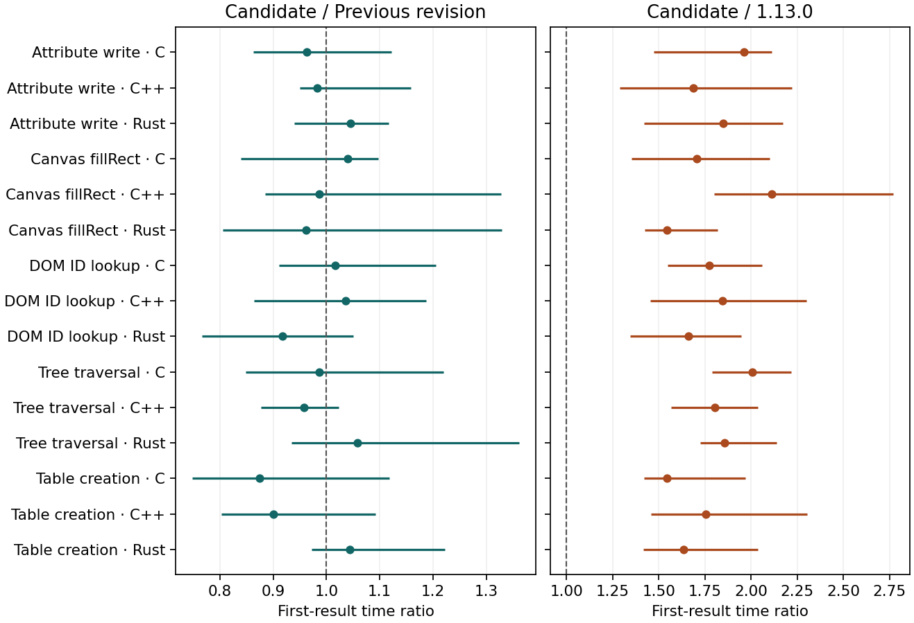

### Time to the first guest result

Each fresh page called the guest immediately after import, using the same workload arguments across builds. The first call includes the complete guest workload and its browser API calls. The final column times both import and execution on one clock. Each column reports the median of the 21 workload medians with DevTools disconnected.

| Distribution | Import (ms) | First guest call (ms) | Time to first result (ms) |
| --- | --- | --- | --- |
| 1.13.0 default | 7.43 | 66.34 | 74.43 |
| 1.13.0 minified | 7.29 | 61.46 | 68.29 |
| Stock main default | 16.60 | 253.46 | 272.18 |
| Stock main minified | 15.71 | 233.18 | 250.75 |
| Candidate default | 13.01 | 66.45 | 81.29 |
| Candidate minified | 12.95 | 63.17 | 76.11 |
| Previous branch default | 13.41 | 62.93 | 80.63 |

The following ratios compare default builds within each round. Each row summarizes the three language medians. A ratio below 1 means the candidate returned the guest result sooner.

| Workload | Candidate / 1.13.0 | Candidate / stock main |
| --- | --- | --- |
| Attribute write | 0.66× | 0.21× |
| Canvas fillRect | 1.16× | 0.31× |
| Canvas pixel read | 1.01× | 0.87× |
| DOM ID lookup | 1.00× | 0.27× |
| Tree traversal | 1.13× | 0.20× |
| Read 1 KiB string | 0.95× | 0.79× |
| Table creation | 1.21× | 0.29× |

The candidate reached the first result at or before 1.13.0 in **7/21** language/workload pairs and at or before stock main in **21/21**.


### Eager JavaScript compilation

The branch exposes `jco transpile --eager-compile` and the JS API option `eagerCompile: true`. The option reproduced all 21 hinted candidate modules served in these trials. Verification also checked 68 ordinary and minified JS outputs after removing the hint, and all 64 accompanying Wasm outputs against their original hashes. [Jco transpile options at the verified revision](https://github.com/vados-cosmonic/jco/blob/900def079675eaa44479b686670ff6f3c5749093/docs/src/transpiling.md) · [Verification](web/bench/verify-compile-hint.mjs)

The server prepended `//# allFunctionsCalledOnLoad` and a newline to each ordinary entry module. Chromium can use these 29 bytes to compile functions while the module loads. Each guest used identical Wasm and the same browser host. DevTools was disconnected. The full run used the headline workloads. A second run measured a first call that writes attributes on eight elements twice, draws 16 rectangles, queries eight elements twice, traverses a seven-node tree, or creates and updates eight table rows. [V8 compile hints](https://v8.dev/blog/explicit-compile-hints) · [Full workload timings](web/bench/results/compile-hint.json) · [Small workload timings](web/bench/results/compile-hint-small.json)

Each cell summarizes the median hinted / ordinary ratio within rounds, then takes the median across language/workload pairs. A ratio below 1 favors eager compilation. The last column counts pairs for which the guest returned its first result sooner.

| Workload | Build | Rounds | Import | First guest call | Time to first result | Pairs with earlier first result |
| --- | --- | --- | --- | --- | --- | --- |
| Full | 1.13.0 | 9 | 1.07× | 0.96× | 0.95× | 16/21 |
| Full | Stock main | 9 | 1.30× | 0.97× | 0.98× | 13/21 |
| Full | Candidate | 9 | 1.28× | 0.90× | 0.98× | 13/21 |
| Small | 1.13.0 | 15 | 1.07× | 0.36× | 0.81× | 15/15 |
| Small | Stock main | 15 | 1.30× | 0.49× | 0.92× | 14/15 |
| Small | Candidate | 15 | 1.28× | 0.28× | 0.96× | 14/15 |

For applications that import the component ahead of an interaction, the first-call column measures the remaining wait. Applications that import on demand also pay the import time. The absolute times below are candidate medians across workload medians, with each column summarized independently.

| Workload | Candidate output | Import (ms) | First guest call (ms) | Time to first result (ms) |
| --- | --- | --- | --- | --- |
| Full | Ordinary | 19.00 | 85.00 | 104.08 |
| Full | Eager | 25.92 | 81.20 | 104.82 |
| Small | Ordinary | 23.88 | 12.20 | 37.91 |
| Small | Eager | 31.15 | 3.79 | 35.87 |

| Eager candidate first result at or before release | Ordinary 1.13.0 | Eager 1.13.0 |
| --- | --- | --- |
| Full | 10/21 | 7/21 |
| Small | 0/15 | 0/15 |

Each pair also has a two-sided 95% sign-test interval for its median first-result ratio across fresh-browser rounds. The counts below show how often the interval establishes a direction on this machine. Coverage applies to each comparison individually.

| Candidate workload | Interval favors eager | Interval includes 1 | Interval favors ordinary |
| --- | --- | --- | --- |
| Full | 0 | 21 | 0 |
| Small | 0 | 15 | 0 |

| Candidate first result | Small workload | Full workload |
| --- | --- | --- |
| Attribute write | 0.94× | 0.98× |
| Canvas fillRect | 0.98× | 1.06× |
| Canvas pixel read | — | 0.91× |
| DOM ID lookup | 0.97× | 0.95× |
| Tree traversal | 0.96× | 1.00× |
| Read 1 KiB string | — | 0.96× |
| Table creation | 0.97× | 1.02× |

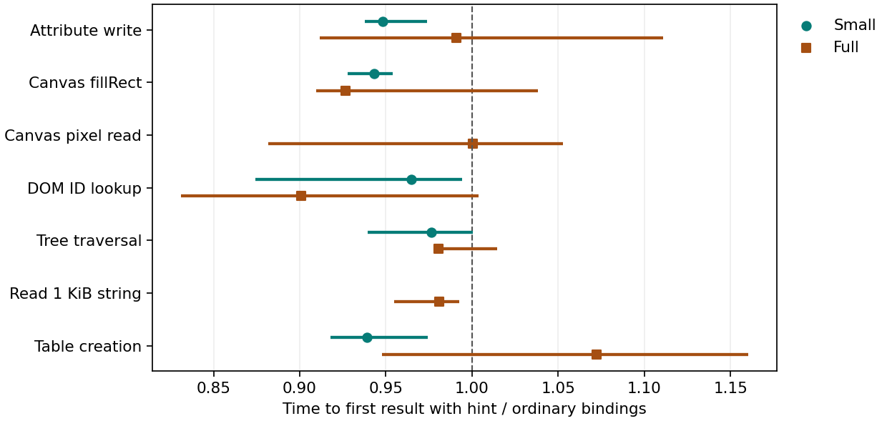

### Private data fields in the checked runtime

The bundled checked runtime uses short names for private data fields. Acorn resolved 21,758 renamed declarations and uses across 34 modules. The verifier checked lexical ownership, a one-to-one name mapping in every class, and every byte outside the private identifiers. All 32 external core Wasm files and all 66 packaged minified outputs matched the previous build byte for byte.

| JS size reduction per component (bytes) | Median | Range |
| --- | --- | --- |
| Uncompressed | 5044 | 5029–5044 |
| gzip -9 | 386 | 365–399 |
| Brotli 11 | 303.5 | 233–359 |

Private methods, accessors and fields that supply a function or class name keep their spellings. Debug runtime builds retain the source names. [Per-component verification](web/bench/results/runtime-fields.json) · [Verifier](web/bench/verify-runtime-fields.mjs)

### Time to generate the bindings

Each of 126 timed native processes read one component, prepared the checked runtime and wrote its bindings to a fresh directory. The runner randomized build and input order within each round, warmed the filesystem cache before timing and verified each output after stopping the timer. Both transpilers used the Cargo dev profile and rustc 1.99.1 (58cf8f9c3 2026-10-13). The CPU measurement counts user and system time in the child process.

| Input | Previous (ms) | Candidate (ms) | Paired wall time | 95% median interval | Paired CPU time |
| --- | --- | --- | --- | --- | --- |
| c/dom-query | 239.9 | 223.4 | 1.042× | 0.829–1.158× | 1.037× |
| rust/canvas-draw | 257.0 | 275.2 | 0.993× | 0.897–1.204× | 0.989× |
| cpp/table-update | 227.0 | 211.2 | 0.968× | 0.869–1.113× | 0.971× |

The intervals are per-input sign-test intervals for the median paired ratio. [Timings and executable hashes](web/bench/results/transpile-time.json)

### Startup against the previous branch

The same detached runs included ordinary output from the previous generator `5c6ddda44`. The table compares the two default builds, using the same component binaries and workload arguments in each round. For each language/workload pair, it divides candidate time by previous time and takes the median across rounds. Each timing column summarizes those pair medians. The last columns count the two-sided 95% sign-test intervals for time to first result that lie wholly below or above parity.

| Workload | Rounds | Import | First call | Time to first result | Pairs with earlier first result | Interval favors candidate | Interval favors previous |
| --- | --- | --- | --- | --- | --- | --- | --- |
| Full | 9 | 0.95× | 0.98× | 0.97× | 15/21 | 2 | 0 |
| Small | 15 | 0.98× | 0.90× | 0.93× | 12/15 | 1 | 0 |

### Generated JavaScript reached by each demo

Chromium recorded block coverage on 126 fresh pages in a separate run. One page imported each module and finished initialization. A second also ran the demo once and checked its output. The table reports medians over the 21 guest and workload combinations. Sizes count UTF-8 bytes in V8’s covered source ranges. A demo can leave error handling, shutdown or other supported operations unexercised. [Per-module coverage and hashes](web/bench/results/js-coverage.json)

| Build | Reached at init (KiB) | Reached through first run (KiB) | Share through first run | Unreached through first run (KiB) |
| --- | --- | --- | --- | --- |
| 1.13.0 | 4.8 | 16.3 | 76.6% | 5.0 |
| Stock main | 54.6 | 97.4 | 50.9% | 93.3 |
| Candidate | 31.4 | 54.9 | 44.3% | 69.5 |

V8 also identified the functions that define the candidate’s shared runtime classes. Each row counts the function and its nested methods in the generated JavaScript. Reached bytes come from V8 block coverage on the same pages. The values are medians across modules containing that function.

| Runtime class | Modules | Emitted (KiB) | Reached at init (KiB) | Through first run (KiB) | Unreached through first run (KiB) |
| --- | --- | --- | --- | --- | --- |
| `AsyncTask` | 21 | 22.4 | 4.6 | 6.0 | 16.5 |
| `ComponentAsyncState` | 21 | 16.2 | 1.4 | 2.3 | 13.8 |
| `AsyncThread` | 21 | 3.2 | 0.7 | 0.7 | 2.5 |
| `RepTable` | 21 | 2.9 | 1.0 | 1.3 | 1.6 |

<details><summary>Candidate startup, variation and paired comparison to 1.13.0</summary>

The paired ratio divides the candidate time by the 1.13.0 time within each round, then takes the median. The final column counts rounds where the candidate was at least as fast.

| Operation | Guest | Startup median (ms) | Warm phase p25 | Warm phase p50 | Warm phase p75 | Phase unit | Paired ratio to 1.13.0 | Rounds at or below 1.13.0 |
| --- | --- | --- | --- | --- | --- | --- | --- | --- |
| Attribute write | C | 20.87 | 0.70 | 0.77 | 0.81 | µs | 0.51× | 7/7 |
| Attribute write | C++ | 21.08 | 0.60 | 0.63 | 0.66 | µs | 0.49× | 7/7 |
| Attribute write | Rust | 20.41 | 0.72 | 0.86 | 0.91 | µs | 0.60× | 7/7 |
| Canvas fillRect | C | 18.92 | 0.93 | 1.09 | 1.17 | µs | 0.92× | 4/7 |
| Canvas fillRect | C++ | 20.13 | 0.95 | 1.10 | 1.18 | µs | 0.92× | 4/7 |
| Canvas fillRect | Rust | 19.78 | 0.87 | 0.91 | 1.05 | µs | 0.94× | 4/7 |
| Canvas pixel read | C | 23.29 | 346.55 | 353.60 | 401.95 | µs | 1.09× | 2/7 |
| Canvas pixel read | C++ | 21.30 | 317.10 | 323.80 | 368.45 | µs | 1.21× | 3/7 |
| Canvas pixel read | Rust | 20.69 | 331.10 | 365.30 | 371.25 | µs | 0.93× | 4/7 |
| DOM ID lookup | C | 19.74 | 0.74 | 0.87 | 0.97 | µs | 0.70× | 7/7 |
| DOM ID lookup | C++ | 21.53 | 1.06 | 1.16 | 1.35 | µs | 0.99× | 5/7 |
| DOM ID lookup | Rust | 21.13 | 0.87 | 1.02 | 1.17 | µs | 1.03× | 3/7 |
| Tree traversal | C | 20.61 | 15.37 | 15.95 | 17.25 | ms | 1.02× | 3/7 |
| Tree traversal | C++ | 21.57 | 11.99 | 13.50 | 16.43 | ms | 1.12× | 3/7 |
| Tree traversal | Rust | 19.98 | 18.92 | 19.93 | 20.37 | ms | 1.15× | 2/7 |
| Read 1 KiB string | C | 19.70 | 1.82 | 2.14 | 2.27 | µs | 0.38× | 7/7 |
| Read 1 KiB string | C++ | 20.05 | 2.05 | 2.07 | 2.14 | µs | 0.42× | 7/7 |
| Read 1 KiB string | Rust | 18.08 | 1.90 | 2.12 | 2.15 | µs | 0.39× | 7/7 |
| Table creation | C | 20.59 | 11.94 | 13.92 | 17.34 | ms | 0.96× | 5/7 |
| Table creation | C++ | 22.62 | 11.92 | 13.22 | 14.42 | ms | 0.88× | 7/7 |
| Table creation | Rust | 21.01 | 13.29 | 14.65 | 15.53 | ms | 0.90× | 5/7 |

</details>

[Raw browser timings](web/bench/results/candidate-browser.json) · [File sizes, digests and generator revision](web/bench/results/candidate-sizes.json)

### Reproduce the candidate run

Run the dependency installation, main setup and size commands in [Reproduce the comparison](#reproduce-the-comparison), then run the following from the repository root. Cargo uses the Jco checkout’s pinned toolchain and lockfile.

```sh
git clone https://github.com/vados-cosmonic/jco ../jco-candidate
git -C ../jco-candidate checkout 900def079675eaa44479b686670ff6f3c5749093
node web/bench/candidate.mjs ../jco-candidate
git -C ../jco-candidate worktree add --detach ../jco-reference 5c6ddda44bce1730a61a69f2d48db94e3065ca31
node web/bench/candidate.mjs --reference ../jco-reference
CHROME_BIN=/path/to/chrome BENCH_CANDIDATE=1 ROUNDS=7 node web/bench/browser.mjs
CHROME_BIN=/path/to/chrome BENCH_DOM_CONTROL=1 ROUNDS=9 node web/bench/browser.mjs
CHROME_BIN=/path/to/chrome BENCH_PAIRED=1 ROUNDS=9 node web/bench/browser.mjs
CHROME_BIN=/path/to/chrome BENCH_CANVAS_CONTROL=1 ROUNDS=9 node web/bench/browser.mjs
CHROME_BIN=/path/to/chrome ROUNDS=9 node web/bench/canvas-host-bench.mjs
CHROME_BIN=/path/to/chrome ROUNDS=7 node web/bench/import-loop.mjs ../jco-candidate
CHROME_BIN=/path/to/chrome node web/bench/coverage.mjs
pnpm -C ../jco-candidate install --frozen-lockfile
pnpm -C ../jco-candidate --filter @bytecodealliance/jco-transpile run build
node web/bench/candidate.mjs --verify-wasm ../jco-candidate
node web/bench/minified.mjs ../jco-candidate
node web/bench/verify-runtime-fields.mjs 53a0057e71d25b91dcb0f9c475762140765078c8
python3 web/bench/transpile-time.py ../jco-reference/target/debug/examples/transpile ../jco-candidate/target/debug/examples/transpile --rounds 21 --build-profile dev
CHROME_BIN=/path/to/chrome BENCH_MINIFIED=1 ROUNDS=5 node web/bench/browser.mjs
CHROME_BIN=/path/to/chrome ROUNDS=5 node web/bench/startup-observer.mjs
CHROME_BIN=/path/to/chrome ROUNDS=9 node web/bench/startup-observer.mjs --wasm-timing
CHROME_BIN=/path/to/chrome ROUNDS=15 node web/bench/startup-observer.mjs --module-body
CHROME_BIN=/path/to/chrome ROUNDS=9 node web/bench/startup-observer.mjs --compile-hint
CHROME_BIN=/path/to/chrome ROUNDS=15 node web/bench/startup-observer.mjs --compile-hint --small
node web/bench/verify-compile-hint.mjs ../jco-candidate
python3 web/bench/report.py --from-candidate
python3 web/bench/candidate-report.py
```

The minification comparison uses each version’s packaged transpiler. The verification command compares the packaged candidate’s default JavaScript and core Wasm to the native generator’s measured output for every input.

<details><summary>Run the Jco binding correctness checks</summary>

After building the candidate above, these tests exercise the inline and bundled generators, both runtime profiles, synchronous imports and the async operations that share their runtime. The integration tests use the guest fixtures from the pinned upstream build.

```sh
cd ../jco-candidate
cargo test --locked -p js-component-bindgen --lib
cargo test --locked -p js-component-bindgen --lib --features embedded-cm-runtime
pnpm --filter @bytecodealliance/jco-cm-runtime test
pnpm --filter @bytecodealliance/jco-cm-runtime test:checked
gh run download 45736422241 --repo bytecodealliance/jco --name js-generated-tests --dir packages/jco-transpile/test/fixtures/generated
cd packages/jco-transpile
node node_modules/vitest/vitest.mjs run -c test/vitest.ts \
  test/eager-compile.ts test/external-runtime/codegen.ts test/sync-host-import.ts test/p3/canonical-abi-traps.ts test/p3/task-return-memory.ts \
  test/p3/sync-call-block-trap.ts test/p3/async-export-future-result.ts \
  test/p3/future-lifts.ts test/p3/future-lowers.ts test/p3/future-drop.ts test/p3/future-transfer-g2g.ts \
  test/p3/stream-lifts.ts test/p3/stream-lowers.ts test/p3/stream-pass-through.ts test/p3/sync-stream-copy.ts
```

</details>

<!-- candidate:end -->

<!-- benchmark:start -->

## Browser performance

**jco 1.13.0 vs. main at `fdbf1ae2`** · 2026-11-26 · HeadlessChrome/156.0.8078.47 · Intel(R) Xeon(R) Processor @ 2.60GHz · linux 6.12.111 x64 · Node v26.13.0. [Upstream commit](https://github.com/bytecodealliance/jco/commit/fdbf1ae2dbc9469b5c275b5686d8a4c43681618f) · [Transpiler build](https://github.com/bytecodealliance/jco/actions/runs/45736422241)

These stock and shim timings come from the same interleaved fresh-page trial as the performance branch. [Full trial](web/bench/results/candidate-browser.json) · [Stock and shim samples](web/bench/results/browser.json)

Across the seven operations below and three guest languages, main took longer in **21 of 21** median comparisons. The highest ratio was **7.55×** for the C guest in `dom-traversal`.

For 256 KiB string reads, the median time on main changed by -22% to -13% across the three guest languages. The phase tables below include every tested string size.

Each cell is the median of 7 fresh-page samples. The chart divides main’s median time by 1.13.0’s for the same guest and operation. A value below 1× means main finished faster.


| Operation | JS | Embind | EM_JS | wasm-bindgen | C 1.13.0 | C main | C++ 1.13.0 | C++ main | Rust 1.13.0 | Rust main |
| --- | ---: | ---: | ---: | ---: | ---: | ---: | ---: | ---: | ---: | ---: |
| Attribute write (µs) | 0.265 | 1.33 | — | — | 1.54 | 4.95 | 1.24 | 4.38 | 1.32 | 3.98 |
| Canvas fillRect (µs) | 0.917 | 1.80 | — | — | 1.09 | 4.29 | 1.29 | 4.14 | 0.988 | 3.84 |
| Canvas pixel read (µs) | 165.20 | 224.00 | — | — | 347.50 | 363.70 | 317.10 | 368.30 | 355.80 | 370.20 |
| DOM ID lookup (µs) | 0.288 | 1.45 | — | — | 1.36 | 6.06 | 1.30 | 5.32 | 1.27 | 5.45 |
| Tree traversal (ms) | 0.96 | 24.90 | 4.22 | 7.32 | 15.16 | 114.53 | 13.94 | 101.42 | 18.09 | 125.85 |
| Read 1 KiB string (µs) | 0.099 | 12.03 | 10.41 | 5.79 | 4.73 | 7.69 | 5.17 | 7.92 | 4.89 | 7.27 |
| Table creation (ms) | 4.22 | 15.15 | 5.79 | 10.59 | 14.46 | 71.05 | 15.97 | 75.37 | 15.73 | 68.00 |

Embind and EM_JS are the C++ Emscripten variants. An em dash marks an unavailable combination. Across toolchains, the upstream implementations can do different amounts of work. For example, the JavaScript bulk DOM query obtains a live collection while the component host materializes a list.

<details><summary>Run-to-run variation for the two jco versions</summary>

Each cell spans the 25th to 75th percentile of measured times, using linear interpolation between sorted samples.

| Operation | C 1.13.0 | C main | C++ 1.13.0 | C++ main | Rust 1.13.0 | Rust main |
| --- | ---: | ---: | ---: | ---: | ---: | ---: |
| Attribute write (µs) | 1.26–1.58 | 4.67–5.23 | 1.14–1.26 | 4.00–4.48 | 1.28–1.65 | 3.80–4.26 |
| Canvas fillRect (µs) | 1.01–1.18 | 4.12–4.46 | 1.06–1.31 | 4.01–4.32 | 0.864–1.21 | 3.62–4.18 |
| Canvas pixel read (µs) | 316.10–398.90 | 325.10–399.95 | 265.00–353.55 | 333.05–391.75 | 342.15–403.05 | 337.40–389.25 |
| DOM ID lookup (µs) | 1.18–1.48 | 5.80–6.73 | 1.16–1.34 | 4.88–5.66 | 1.02–1.38 | 4.99–5.68 |
| Tree traversal (ms) | 14.41–19.01 | 109.26–122.19 | 13.04–14.56 | 96.24–111.13 | 14.90–19.72 | 119.91–130.77 |
| Read 1 KiB string (µs) | 4.27–5.05 | 7.33–8.53 | 4.44–5.92 | 7.05–7.97 | 4.52–15.96 | 7.14–7.52 |
| Table creation (ms) | 12.52–16.00 | 64.14–85.00 | 14.94–16.93 | 71.75–80.57 | 13.57–16.27 | 63.74–74.58 |

</details>

<details><summary>All workload phases, per-call timings, and string transfer rates</summary>

Times come from the tables rendered by the demos and retain their original reporting precision. Effective string throughput uses the ASCII payload length divided by median call time (decimal MB/s).

**attribute-churn**

| Operation | JS | Embind | EM_JS | wasm-bindgen | C 1.13.0 | C main | C++ 1.13.0 | C++ main | Rust 1.13.0 | Rust main |
| --- | ---: | ---: | ---: | ---: | ---: | ---: | ---: | ---: | ---: | ---: |
| total time (ms) | 21.21 | 106.42 | — | — | 122.94 | 395.57 | 98.77 | 350.26 | 105.37 | 318.34 |
| per setAttribute() (µs) | 0.265 | 1.33 | — | — | 1.54 | 4.95 | 1.24 | 4.38 | 1.32 | 3.98 |

**canvas-draw**

| Operation | JS | Embind | EM_JS | wasm-bindgen | C 1.13.0 | C main | C++ 1.13.0 | C++ main | Rust 1.13.0 | Rust main |
| --- | ---: | ---: | ---: | ---: | ---: | ---: | ---: | ---: | ---: | ---: |
| total (ms) | 45.86 | 90.25 | — | — | 54.39 | 214.71 | 64.56 | 207.26 | 49.40 | 192.01 |
| per fill_rect() (µs) | 0.917 | 1.80 | — | — | 1.09 | 4.29 | 1.29 | 4.14 | 0.988 | 3.84 |

**canvas-pixels**

| Operation | JS | Embind | EM_JS | wasm-bindgen | C 1.13.0 | C main | C++ 1.13.0 | C++ main | Rust 1.13.0 | Rust main |
| --- | ---: | ---: | ---: | ---: | ---: | ---: | ---: | ---: | ---: | ---: |
| getImageData() (µs) | 165.20 | 224.00 | — | — | 347.50 | 363.70 | 317.10 | 368.30 | 355.80 | 370.20 |
| putImageData() (µs) | 14.00 | 234.50 | — | — | 291.20 | 312.20 | 283.20 | 319.40 | 528.80 | 344.00 |

**dom-query**

| Operation | JS | Embind | EM_JS | wasm-bindgen | C 1.13.0 | C main | C++ 1.13.0 | C++ main | Rust 1.13.0 | Rust main |
| --- | ---: | ---: | ---: | ---: | ---: | ---: | ---: | ---: | ---: | ---: |
| individual, total (ms) | 5.76 | 28.93 | — | — | 27.20 | 121.25 | 26.04 | 106.38 | 25.46 | 108.91 |
| bulk, total (ms) | 0.01 | 0.02 | — | — | 13.18 | 19.12 | 11.24 | 19.96 | 11.24 | 17.75 |
| individual: µs/element (µs) | 0.288 | 1.45 | — | — | 1.36 | 6.06 | 1.30 | 5.32 | 1.27 | 5.45 |

**dom-traversal**

| Operation | JS | Embind | EM_JS | wasm-bindgen | C 1.13.0 | C main | C++ 1.13.0 | C++ main | Rust 1.13.0 | Rust main |
| --- | ---: | ---: | ---: | ---: | ---: | ---: | ---: | ---: | ---: | ---: |
| build (ms) | 11.64 | 37.26 | 19.24 | 29.50 | 54.66 | 222.49 | 51.26 | 217.28 | 57.46 | 200.64 |
| traverse (total) (ms) | 0.96 | 24.90 | 4.22 | 7.32 | 15.16 | 114.53 | 13.94 | 101.42 | 18.09 | 125.85 |
| traverse (per node) (µs) | 0.049 | 1.27 | 0.216 | 0.375 | 0.776 | 5.86 | 0.713 | 5.19 | 0.926 | 6.44 |

**string-marshalling**


| Operation | JS | Embind | EM_JS | wasm-bindgen | C 1.13.0 | C main | C++ 1.13.0 | C++ main | Rust 1.13.0 | Rust main |
| --- | ---: | ---: | ---: | ---: | ---: | ---: | ---: | ---: | ---: | ---: |
| set 8 B (µs) | 0.18 | 0.787 | 0.337 | 0.547 | 0.868 | 3.44 | 0.873 | 3.16 | 0.915 | 3.18 |
| set 8 B (MB/s) | 44.44 | 10.17 | 23.74 | 14.63 | 9.22 | 2.33 | 9.16 | 2.53 | 8.74 | 2.52 |
| get 8 B (µs) | 0.084 | 0.969 | 0.202 | 0.229 | 2.33 | 5.03 | 2.29 | 5.11 | 2.24 | 5.08 |
| get 8 B (MB/s) | 95.24 | 8.26 | 39.60 | 34.93 | 3.43 | 1.59 | 3.49 | 1.57 | 3.57 | 1.58 |
| set 128 B (µs) | 0.293 | 1.11 | 0.841 | 0.587 | 1.11 | 4.16 | 1.06 | 4.34 | 1.07 | 4.41 |
| set 128 B (MB/s) | 436.86 | 115.00 | 152.20 | 218.06 | 115.00 | 30.78 | 120.87 | 29.50 | 120.08 | 29.05 |
| get 128 B (µs) | 0.082 | 2.30 | 1.46 | 0.893 | 2.75 | 6.50 | 2.40 | 5.93 | 3.38 | 5.17 |
| get 128 B (MB/s) | 1,560.98 | 55.75 | 87.73 | 143.34 | 46.53 | 19.68 | 53.24 | 21.57 | 37.83 | 24.77 |
| set 1024 B (µs) | 1.01 | 1.55 | 2.68 | 0.921 | 1.19 | 4.09 | 1.22 | 4.05 | 1.28 | 3.71 |
| set 1024 B (MB/s) | 1,017.89 | 662.35 | 381.80 | 1,111.83 | 862.68 | 250.61 | 837.29 | 252.71 | 802.51 | 275.94 |
| get 1024 B (µs) | 0.099 | 12.03 | 10.41 | 5.79 | 4.73 | 7.69 | 5.17 | 7.92 | 4.89 | 7.27 |
| get 1024 B (MB/s) | 10,343.43 | 85.09 | 98.34 | 176.80 | 216.35 | 133.14 | 198.22 | 129.21 | 209.54 | 140.87 |
| set 16384 B (µs) | 13.16 | 8.32 | 33.52 | 7.12 | 8.03 | 10.98 | 7.45 | 11.03 | 7.47 | 11.01 |
| set 16384 B (MB/s) | 1,244.61 | 1,968.76 | 488.71 | 2,301.45 | 2,040.09 | 1,491.62 | 2,200.08 | 1,485.67 | 2,194.48 | 1,488.24 |
| get 16384 B (µs) | 0.472 | 164.05 | 156.40 | 88.50 | 55.51 | 57.75 | 50.48 | 60.38 | 39.84 | 54.25 |
| get 16384 B (MB/s) | 34,711.86 | 99.87 | 104.76 | 185.13 | 295.14 | 283.71 | 324.60 | 271.37 | 411.27 | 302.01 |
| set 262144 B (µs) | 182.97 | 115.60 | 531.75 | 252.90 | 270.00 | 286.50 | 270.75 | 288.20 | 270.05 | 269.45 |
| set 262144 B (MB/s) | 1,432.72 | 2,267.68 | 492.98 | 1,036.55 | 970.90 | 914.99 | 968.21 | 909.59 | 970.72 | 972.89 |
| get 262144 B (µs) | 11.88 | 2,505.90 | 2,621.65 | 1,385.35 | 1,025.70 | 802.70 | 944.00 | 818.45 | 961.00 | 777.35 |
| get 262144 B (MB/s) | 22,056.71 | 104.61 | 99.99 | 189.23 | 255.58 | 326.58 | 277.69 | 320.29 | 272.78 | 337.23 |

**table-update**

| Operation | JS | Embind | EM_JS | wasm-bindgen | C 1.13.0 | C main | C++ 1.13.0 | C++ main | Rust 1.13.0 | Rust main |
| --- | ---: | ---: | ---: | ---: | ---: | ---: | ---: | ---: | ---: | ---: |
| create, total (ms) | 4.22 | 15.15 | 5.79 | 10.59 | 14.46 | 71.05 | 15.97 | 75.37 | 15.73 | 68.00 |
| create, per row (µs) | 2.11 | 7.58 | 2.89 | 5.29 | 7.23 | 35.52 | 7.99 | 37.69 | 7.87 | 34.00 |
| update (selected), total (ms) | 0.44 | 1.23 | 1.07 | 0.975 | 1.10 | 3.70 | 1.37 | 3.88 | 1.06 | 3.04 |
| update (selected), per row (µs) | 0.22 | 0.615 | 0.537 | 0.488 | 0.553 | 1.85 | 0.685 | 1.94 | 0.532 | 1.52 |
| clear (unselected), total (ms) | 2.16 | 3.81 | 3.23 | 2.83 | 4.28 | 16.31 | 5.12 | 20.64 | 4.12 | 14.99 |
| clear (unselected), per row (µs) | 1.08 | 1.91 | 1.62 | 1.41 | 2.14 | 8.15 | 2.56 | 10.32 | 2.06 | 7.50 |

</details>

<details><summary>Module load and initialization, median milliseconds</summary>

Elapsed browser time for dynamic import through instantiation, with the shared demo host already loaded. The browser process is reused, each page has HTTP caching disabled, and assets are served uncompressed over loopback. These timings include scheduling and local requests. JS is already loaded by the harness.

| Workload | Embind | EM_JS | wasm-bindgen | C 1.13.0 | C main | C++ 1.13.0 | C++ main | Rust 1.13.0 | Rust main |
| --- | ---: | ---: | ---: | ---: | ---: | ---: | ---: | ---: | ---: |
| attribute-churn | 14.79 | — | — | 13.69 | 23.69 | 12.52 | 23.80 | 11.14 | 25.47 |
| canvas-draw | 14.34 | — | — | 10.53 | 26.48 | 11.13 | 25.63 | 10.85 | 23.18 |
| canvas-pixels | 14.77 | — | — | 13.47 | 31.19 | 12.20 | 27.76 | 11.17 | 29.09 |
| dom-query | 14.47 | — | — | 11.53 | 29.31 | 11.33 | 25.58 | 11.32 | 24.28 |
| dom-traversal | 13.37 | 8.88 | 8.71 | 10.68 | 25.19 | 10.02 | 26.21 | 11.00 | 25.41 |
| string-marshalling | 12.92 | 8.92 | 7.67 | 10.10 | 24.23 | 9.50 | 26.00 | 10.56 | 22.72 |
| table-update | 14.78 | 10.61 | 9.01 | 11.68 | 28.26 | 12.02 | 27.43 | 12.10 | 27.93 |

</details>

<details><summary>Workload parameters and sampling</summary>

| Workload | Arguments |
| --- | ---: |
| attribute-churn | `elements=2000`, `iters=10` |
| canvas-draw | `rects=50000` |
| canvas-pixels | `size=256`, `minMs=10` |
| dom-query | `numElements=2000`, `iters=10` |
| dom-traversal | `depth=6`, `numChildren=5` |
| string-marshalling | `minMs=10` |
| table-update | `rows=2000` |

The regenerated 1.13.0 runtime assets match the checked-in jco output byte for byte for 21 of the 21 timed components.

Each page runs one warm-up, clears the document and performance entries, and runs the same workload again on the initialized module. The runner rotates the implementation order each round and reverses traversal on alternating rounds. Browser timings cover the work instrumented inside the demos. Canvas timings measure the API calls, which can finish before painting. Native Firefox execution was outside this Chromium run. [Individual samples in seconds and load times in milliseconds](web/bench/results/browser.json)

</details>

## Module size

Across 34 component inputs, the median change in gzip payload on main was **+27.8 KiB** per component (range +20.2 to +31.0 KiB). The payload sums the emitted JavaScript and external core Wasm files, including any Wasm inlined into JavaScript. Gzip level 9 and Brotli quality 11 are applied per file. Shared host code, HTML, type declarations and HTTP headers are excluded. The raw JavaScript reference lives in the demo page controller.

All external core Wasm files match byte for byte between the two generators. The size differences come entirely from the emitted JavaScript.


**DOM traversal download size** in KiB, gzip. Each row compares implementations from one guest language.

| Guest | Native component | jco 1.13.0 | jco main | Embind | EM_JS | wasm-bindgen |
| --- | ---: | ---: | ---: | ---: | ---: | ---: |
| C | 26.4 | 28.5 | 56.2 | — | — | — |
| C++ | 26.9 | 29.0 | 56.7 | 21.4 | 14.2 | — |
| Rust | 50.6 | 52.7 | 80.3 | — | — | 27.0 |

<details><summary>All component sizes, in KiB</summary>

Paired columns list **1.13.0 / main**. Native is the original component binary. Core Wasm counts only separate .wasm files.

| Component | Native | Files | JS | Core Wasm | Raw total | Gzip | Brotli |
| --- | ---: | ---: | ---: | ---: | ---: | ---: | ---: |
| C attribute-churn | 65.1 | 2 / 2 | 19.0 / 177.9 | 61.4 / 61.4 | 80.5 / 239.3 | 28.4 / 56.0 | 23.3 / 46.4 |
| C calculator | 0.9 | 1 / 1 | 2.3 / 101.4 | 0.0 / 0.0 | 2.3 / 101.4 | 1.3 / 21.6 | 1.2 / 18.5 |
| C canvas-draw | 66.5 | 2 / 2 | 22.6 / 192.3 | 61.9 / 61.9 | 84.6 / 254.2 | 28.6 / 56.7 | 23.6 / 46.9 |
| C canvas-pixels | 70.1 | 2 / 2 | 24.2 / 210.8 | 64.7 / 64.7 | 88.9 / 275.5 | 29.7 / 60.7 | 24.5 / 50.2 |
| C dom-query | 68.0 | 2 / 2 | 22.0 / 194.1 | 63.7 / 63.7 | 85.6 / 257.8 | 29.2 / 58.5 | 24.0 / 48.5 |
| C dom-traversal | 66.0 | 2 / 2 | 21.1 / 185.3 | 62.0 / 62.0 | 83.1 / 247.3 | 28.5 / 56.2 | 23.4 / 46.5 |
| C greet-bindgen | 56.3 | 2 / 2 | 2.6 / 108.8 | 55.9 / 55.9 | 58.5 / 164.8 | 24.3 / 46.3 | 20.0 / 38.8 |
| C greet-freestanding | 0.9 | 1 / 1 | 3.0 / 105.9 | 0.0 / 0.0 | 3.0 / 105.9 | 1.6 / 23.2 | 1.5 / 19.9 |
| C greet-libc | 54.9 | 2 / 2 | 2.6 / 108.8 | 54.5 / 54.5 | 57.1 / 163.3 | 23.8 / 45.8 | 19.5 / 38.4 |
| C hello-world | 60.4 | 2 / 2 | 13.8 / 164.1 | 57.8 / 57.8 | 71.6 / 222.0 | 26.7 / 54.6 | 22.0 / 45.5 |
| C string-marshalling | 66.2 | 2 / 2 | 19.4 / 184.9 | 62.6 / 62.6 | 82.0 / 247.5 | 28.9 / 57.9 | 23.9 / 48.2 |
| C table-update | 70.7 | 2 / 2 | 21.2 / 192.3 | 66.6 / 66.6 | 87.8 / 258.9 | 29.3 / 58.5 | 24.2 / 48.6 |
| C++ attribute-churn | 68.9 | 2 / 2 | 19.0 / 177.9 | 65.3 / 65.3 | 84.3 / 243.2 | 29.7 / 57.2 | 24.4 / 47.4 |
| C++ canvas-draw | 68.5 | 2 / 2 | 22.6 / 192.3 | 63.9 / 63.9 | 86.6 / 256.2 | 29.1 / 57.2 | 24.0 / 47.3 |
| C++ canvas-pixels | 73.1 | 2 / 2 | 24.2 / 210.8 | 67.8 / 67.8 | 91.9 / 278.5 | 30.6 / 61.6 | 25.1 / 50.7 |
| C++ dom-query | 71.7 | 2 / 2 | 22.0 / 194.1 | 67.4 / 67.4 | 89.4 / 261.5 | 30.7 / 60.0 | 25.1 / 49.6 |
| C++ dom-traversal | 68.0 | 2 / 2 | 21.1 / 185.3 | 64.0 / 64.0 | 85.1 / 249.3 | 29.0 / 56.7 | 23.8 / 47.0 |
| C++ hello-world | 60.4 | 2 / 2 | 13.8 / 164.1 | 57.8 / 57.8 | 71.6 / 221.9 | 26.6 / 54.5 | 21.9 / 45.4 |
| C++ string-marshalling | 68.3 | 2 / 2 | 19.4 / 184.9 | 64.8 / 64.8 | 84.1 / 249.6 | 29.5 / 58.5 | 24.3 / 48.5 |
| C++ table-update | 74.9 | 2 / 2 | 21.2 / 192.3 | 70.9 / 70.9 | 92.1 / 263.2 | 31.2 / 60.3 | 25.4 / 49.8 |
| Rust attribute-churn | 152.0 | 2 / 2 | 18.8 / 176.5 | 148.5 / 148.5 | 167.3 / 325.0 | 55.8 / 83.2 | 45.9 / 68.8 |
| Rust calculator-raw | 258.7 | 2 / 2 | 1.4 / 101.0 | 258.4 / 258.4 | 259.8 / 359.3 | 85.4 / 105.6 | 72.3 / 89.6 |
| Rust calculator | 258.0 | 2 / 2 | 1.4 / 101.0 | 257.7 / 257.7 | 259.1 / 358.7 | 85.1 / 105.4 | 72.1 / 89.4 |
| Rust canvas-draw | 140.9 | 2 / 2 | 22.4 / 190.9 | 136.4 / 136.4 | 158.8 / 327.3 | 53.0 / 80.9 | 43.8 / 67.1 |
| Rust canvas-pixels | 142.9 | 2 / 2 | 24.0 / 209.4 | 137.7 / 137.7 | 161.6 / 347.0 | 53.7 / 84.4 | 44.2 / 69.7 |
| Rust dom-query | 148.8 | 2 / 2 | 21.7 / 192.7 | 144.7 / 144.7 | 166.4 / 337.4 | 55.9 / 85.1 | 46.0 / 70.4 |
| Rust dom-traversal (dom_traversal.my.component) | 138.7 | 2 / 2 | 20.2 / 183.9 | 135.7 / 135.7 | 155.9 / 319.6 | 52.7 / 80.3 | 43.5 / 66.6 |
| Rust dom-traversal | 138.7 | 2 / 2 | 20.2 / 183.9 | 135.7 / 135.7 | 155.9 / 319.6 | 52.7 / 80.3 | 43.5 / 66.6 |
| Rust hello-world | 17.4 | 2 / 2 | 13.6 / 162.8 | 14.9 / 14.9 | 28.5 / 177.7 | 8.9 / 36.6 | 7.4 / 30.8 |
| Rust string-marshalling | 146.9 | 2 / 2 | 19.1 / 183.5 | 143.4 / 143.4 | 162.5 / 326.9 | 55.2 / 84.0 | 45.6 / 69.7 |
| Rust table-rows | 33.3 | 2 / 2 | 13.1 / 160.2 | 31.1 / 31.1 | 44.2 / 191.3 | 16.2 / 43.1 | 14.0 / 36.7 |
| Rust table-update | 149.5 | 2 / 2 | 20.6 / 191.5 | 146.2 / 146.2 | 166.8 / 337.7 | 56.1 / 85.2 | 46.3 / 70.7 |
| Rust todomvc | 14.4 | 2 / 2 | 15.3 / 164.7 | 11.6 / 11.6 | 26.8 / 176.3 | 7.6 / 34.6 | 6.5 / 29.2 |
| Rust vdom-diff | 40.9 | 2 / 2 | 14.8 / 164.6 | 38.5 / 38.5 | 53.3 / 203.1 | 19.7 / 46.7 | 17.0 / 39.8 |

</details>

<details><summary>Emscripten and wasm-bindgen payloads, in KiB</summary>

| Artifact directory | Files | Raw total | Gzip | Brotli |
| --- | ---: | ---: | ---: | ---: |
| cpp/attribute-churn/emscripten | 2 | 58.7 | 22.1 | 19.5 |
| cpp/canvas-draw/emscripten | 2 | 57.7 | 21.3 | 18.7 |
| cpp/canvas-pixels/emscripten | 2 | 63.8 | 23.4 | 20.4 |
| cpp/dom-query/emscripten | 2 | 60.0 | 22.3 | 19.6 |
| cpp/dom-traversal/em-js | 2 | 31.9 | 14.2 | 12.4 |
| cpp/dom-traversal/emscripten | 2 | 57.4 | 21.4 | 18.8 |
| cpp/string-marshalling/em-js | 2 | 33.4 | 14.8 | 13.0 |
| cpp/string-marshalling/emscripten | 2 | 58.4 | 21.8 | 19.2 |
| cpp/table-update/em-js | 2 | 35.6 | 15.5 | 13.6 |
| cpp/table-update/emscripten | 2 | 63.7 | 23.1 | 20.2 |
| rust/dom-traversal-wasm-bindgen | 2 | 72.0 | 27.0 | 22.6 |
| rust/string-marshalling-wasm-bindgen | 2 | 72.6 | 27.1 | 22.5 |
| rust/table-update-wasm-bindgen | 2 | 77.3 | 28.1 | 23.5 |

</details>

[Per-file byte counts and SHA-256 digests](web/bench/results/sizes.json)

<!-- benchmark:end -->

<details><summary>Earlier UTF-8 measurements</summary>

The performance branch also specializes UTF-8 conversion in both directions. For strings of up to 32 ASCII bytes, the bindings read or write the bytes directly. Non-ASCII text uses the checked codec, including its malformed-input traps. [Short-string changes](https://github.com/vados-cosmonic/jco/compare/ac28d5d481f3cfca94bc4c62f3571511c19386d9...9eeb7f0b9ab82a982810af5cdd1d9035b302aa39)

For longer host-returned strings, the runtime can encode into a reusable buffer before allocating guest memory. On the preceding upstream revision, a 16 KiB read took 26–28 µs across C, C++, and Rust, or 46–50% of the time for 1.13.0. The archived run compares the bindings immediately before and after this change. [UTF-8 benchmark and raw measurements](https://github.com/vados-cosmonic/component-demos/blob/7550fa7523931f918b6bd599174af07e6537961b/README.md#optimized-browser-bindings)

</details>

## Reproduce the comparison

From the repository root, use Node 24 or newer, npm, an authenticated GitHub CLI, Chrome or Chromium, and Python with Matplotlib 3.10.8 for the graphs.

```sh
npm ci --prefix web
web/bench/setup-main.sh
npm run --prefix web bench:sizes
CHROME_BIN=/path/to/chrome npm run --prefix web bench:browser
python3 web/bench/report.py
```

The setup script verifies the upstream CI run against the Git SHA in [pin.json](web/bench/pin.json) before downloading its transpiler. If the artifacts have expired, run `web/bench/setup-main.sh --source` with Git, pnpm 11, and the upstream Rust toolchain available. To measure a newer main, update the SHA and matching Linux test run in the pin, check the transpiler dependencies in `web/bench/main/package.json` against that checkout’s lockfile, and rerun the commands. Set `ROUNDS` to change the sample count.

The size pass reads the committed `web/{c,cpp,rust}/*/native/*.wasm` inputs and emits both browser variants in sibling `jco-baseline/` and `jco-main/` directories. They share the demo’s host mappings, disable Node compatibility, and use each generator’s default browser output. Each asset has a SHA-256 digest and separate raw, gzip, and Brotli byte counts. Generated bindings are local build products.

To run the original interactive demos, use `npm run --prefix web dev` after installing web dependencies. Their native mode requires a Firefox build with experimental WebAssembly Component Model support. The guest sources and their original build scripts remain in `c/`, `cpp/`, and `rust/`.
