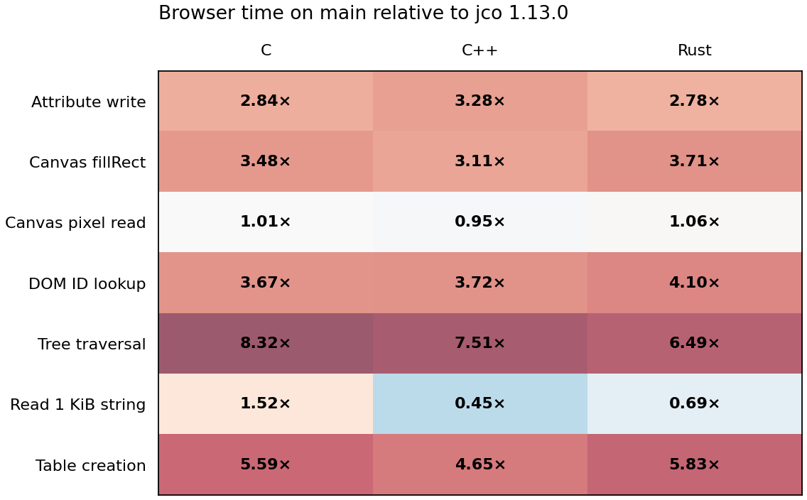
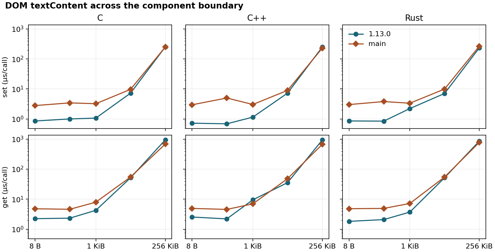

# Original browser baseline

[Benchmark overview](../README.md)

<!-- benchmark:start -->

## Browser performance

**jco 1.13.0 vs. main at `fdbf1ae2`** · 2026-11-26 · HeadlessChrome/156.0.8078.47 · Intel(R) Xeon(R) Processor @ 2.60GHz · linux 6.12.111 x64 · Node v26.13.0. [Upstream commit](https://github.com/bytecodealliance/jco/commit/fdbf1ae2dbc9469b5c275b5686d8a4c43681618f) · [Transpiler build](https://github.com/bytecodealliance/jco/actions/runs/45736422241)

These stock and shim timings come from the same interleaved fresh-page trial as the performance branch. [Full trial](../web/bench/results/candidate-browser.json) · [Stock and shim samples](../web/bench/results/browser.json)

Across the seven operations below and three guest languages, main took longer in **21 of 21** median comparisons. The highest ratio was **7.55×** for the C guest in `dom-traversal`.

For 256 KiB string reads, the median time on main changed by -22% to -13% across the three guest languages. The phase tables below include every tested string size.

Each cell is the median of 7 fresh-page samples. The chart divides main’s median time by 1.13.0’s for the same guest and operation. A value below 1× means main finished faster.

| Operation | JS | Embind | EM_JS | wasm-bindgen | C 1.13.0 | C main | C++ 1.13.0 | C++ main | Rust 1.13.0 | Rust main |
| --- | ---: | ---: | ---: | ---: | ---: | ---: | ---: | ---: | ---: | ---: |
| Attribute write (µs) | 0.265 | 1.33 | — | — | 1.54 | 4.95 | 1.24 | 4.38 | 1.32 | 3.98 |
| Canvas fillRect (µs) | 0.917 | 1.80 | — | — | 1.09 | 4.29 | 1.29 | 4.14 | 0.988 | 3.84 |
| Canvas pixel read (µs) | 165.20 | 224.00 | — | — | 347.50 | 363.70 | 317.10 | 368.30 | 355.80 | 370.20 |
| DOM ID lookup (µs) | 0.288 | 1.45 | — | — | 1.36 | 6.06 | 1.30 | 5.32 | 1.27 | 5.45 |
| Tree traversal (ms) | 0.96 | 24.90 | 4.22 | 7.32 | 15.16 | 114.53 | 13.94 | 101.42 | 18.09 | 125.85 |
| Read 1 KiB string (µs) | 0.099 | 12.03 | 10.41 | 5.79 | 4.73 | 7.69 | 5.17 | 7.92 | 4.89 | 7.27 |
| Table creation (ms) | 4.22 | 15.15 | 5.79 | 10.59 | 14.46 | 71.05 | 15.97 | 75.37 | 15.73 | 68.00 |

Embind and EM_JS are the C++ Emscripten variants. An em dash marks an unavailable combination. Across toolchains, the upstream implementations can do different amounts of work. For example, the JavaScript bulk DOM query obtains a live collection while the component host materializes a list.

Run-to-run variation for the two jco versions

Each cell spans the 25th to 75th percentile of measured times, using linear interpolation between sorted samples.

| Operation | C 1.13.0 | C main | C++ 1.13.0 | C++ main | Rust 1.13.0 | Rust main |
| --- | ---: | ---: | ---: | ---: | ---: | ---: |
| Attribute write (µs) | 1.26–1.58 | 4.67–5.23 | 1.14–1.26 | 4.00–4.48 | 1.28–1.65 | 3.80–4.26 |
| Canvas fillRect (µs) | 1.01–1.18 | 4.12–4.46 | 1.06–1.31 | 4.01–4.32 | 0.864–1.21 | 3.62–4.18 |
| Canvas pixel read (µs) | 316.10–398.90 | 325.10–399.95 | 265.00–353.55 | 333.05–391.75 | 342.15–403.05 | 337.40–389.25 |
| DOM ID lookup (µs) | 1.18–1.48 | 5.80–6.73 | 1.16–1.34 | 4.88–5.66 | 1.02–1.38 | 4.99–5.68 |
| Tree traversal (ms) | 14.41–19.01 | 109.26–122.19 | 13.04–14.56 | 96.24–111.13 | 14.90–19.72 | 119.91–130.77 |
| Read 1 KiB string (µs) | 4.27–5.05 | 7.33–8.53 | 4.44–5.92 | 7.05–7.97 | 4.52–15.96 | 7.14–7.52 |
| Table creation (ms) | 12.52–16.00 | 64.14–85.00 | 14.94–16.93 | 71.75–80.57 | 13.57–16.27 | 63.74–74.58 |

All workload phases, per-call timings, and string transfer rates

Times come from the tables rendered by the demos and retain their original reporting precision. Effective string throughput uses the ASCII payload length divided by median call time (decimal MB/s).

**attribute-churn**

| Operation | JS | Embind | EM_JS | wasm-bindgen | C 1.13.0 | C main | C++ 1.13.0 | C++ main | Rust 1.13.0 | Rust main |
| --- | ---: | ---: | ---: | ---: | ---: | ---: | ---: | ---: | ---: | ---: |
| total time (ms) | 21.21 | 106.42 | — | — | 122.94 | 395.57 | 98.77 | 350.26 | 105.37 | 318.34 |
| per setAttribute() (µs) | 0.265 | 1.33 | — | — | 1.54 | 4.95 | 1.24 | 4.38 | 1.32 | 3.98 |

**canvas-draw**

| Operation | JS | Embind | EM_JS | wasm-bindgen | C 1.13.0 | C main | C++ 1.13.0 | C++ main | Rust 1.13.0 | Rust main |
| --- | ---: | ---: | ---: | ---: | ---: | ---: | ---: | ---: | ---: | ---: |
| total (ms) | 45.86 | 90.25 | — | — | 54.39 | 214.71 | 64.56 | 207.26 | 49.40 | 192.01 |
| per fill_rect() (µs) | 0.917 | 1.80 | — | — | 1.09 | 4.29 | 1.29 | 4.14 | 0.988 | 3.84 |

**canvas-pixels**

| Operation | JS | Embind | EM_JS | wasm-bindgen | C 1.13.0 | C main | C++ 1.13.0 | C++ main | Rust 1.13.0 | Rust main |
| --- | ---: | ---: | ---: | ---: | ---: | ---: | ---: | ---: | ---: | ---: |
| getImageData() (µs) | 165.20 | 224.00 | — | — | 347.50 | 363.70 | 317.10 | 368.30 | 355.80 | 370.20 |
| putImageData() (µs) | 14.00 | 234.50 | — | — | 291.20 | 312.20 | 283.20 | 319.40 | 528.80 | 344.00 |

**dom-query**

| Operation | JS | Embind | EM_JS | wasm-bindgen | C 1.13.0 | C main | C++ 1.13.0 | C++ main | Rust 1.13.0 | Rust main |
| --- | ---: | ---: | ---: | ---: | ---: | ---: | ---: | ---: | ---: | ---: |
| individual, total (ms) | 5.76 | 28.93 | — | — | 27.20 | 121.25 | 26.04 | 106.38 | 25.46 | 108.91 |
| bulk, total (ms) | 0.01 | 0.02 | — | — | 13.18 | 19.12 | 11.24 | 19.96 | 11.24 | 17.75 |
| individual: µs/element (µs) | 0.288 | 1.45 | — | — | 1.36 | 6.06 | 1.30 | 5.32 | 1.27 | 5.45 |

**dom-traversal**

| Operation | JS | Embind | EM_JS | wasm-bindgen | C 1.13.0 | C main | C++ 1.13.0 | C++ main | Rust 1.13.0 | Rust main |
| --- | ---: | ---: | ---: | ---: | ---: | ---: | ---: | ---: | ---: | ---: |
| build (ms) | 11.64 | 37.26 | 19.24 | 29.50 | 54.66 | 222.49 | 51.26 | 217.28 | 57.46 | 200.64 |
| traverse (total) (ms) | 0.96 | 24.90 | 4.22 | 7.32 | 15.16 | 114.53 | 13.94 | 101.42 | 18.09 | 125.85 |
| traverse (per node) (µs) | 0.049 | 1.27 | 0.216 | 0.375 | 0.776 | 5.86 | 0.713 | 5.19 | 0.926 | 6.44 |

**string-marshalling**

| Operation | JS | Embind | EM_JS | wasm-bindgen | C 1.13.0 | C main | C++ 1.13.0 | C++ main | Rust 1.13.0 | Rust main |
| --- | ---: | ---: | ---: | ---: | ---: | ---: | ---: | ---: | ---: | ---: |
| set 8 B (µs) | 0.18 | 0.787 | 0.337 | 0.547 | 0.868 | 3.44 | 0.873 | 3.16 | 0.915 | 3.18 |
| set 8 B (MB/s) | 44.44 | 10.17 | 23.74 | 14.63 | 9.22 | 2.33 | 9.16 | 2.53 | 8.74 | 2.52 |
| get 8 B (µs) | 0.084 | 0.969 | 0.202 | 0.229 | 2.33 | 5.03 | 2.29 | 5.11 | 2.24 | 5.08 |
| get 8 B (MB/s) | 95.24 | 8.26 | 39.60 | 34.93 | 3.43 | 1.59 | 3.49 | 1.57 | 3.57 | 1.58 |
| set 128 B (µs) | 0.293 | 1.11 | 0.841 | 0.587 | 1.11 | 4.16 | 1.06 | 4.34 | 1.07 | 4.41 |
| set 128 B (MB/s) | 436.86 | 115.00 | 152.20 | 218.06 | 115.00 | 30.78 | 120.87 | 29.50 | 120.08 | 29.05 |
| get 128 B (µs) | 0.082 | 2.30 | 1.46 | 0.893 | 2.75 | 6.50 | 2.40 | 5.93 | 3.38 | 5.17 |
| get 128 B (MB/s) | 1,560.98 | 55.75 | 87.73 | 143.34 | 46.53 | 19.68 | 53.24 | 21.57 | 37.83 | 24.77 |
| set 1024 B (µs) | 1.01 | 1.55 | 2.68 | 0.921 | 1.19 | 4.09 | 1.22 | 4.05 | 1.28 | 3.71 |
| set 1024 B (MB/s) | 1,017.89 | 662.35 | 381.80 | 1,111.83 | 862.68 | 250.61 | 837.29 | 252.71 | 802.51 | 275.94 |
| get 1024 B (µs) | 0.099 | 12.03 | 10.41 | 5.79 | 4.73 | 7.69 | 5.17 | 7.92 | 4.89 | 7.27 |
| get 1024 B (MB/s) | 10,343.43 | 85.09 | 98.34 | 176.80 | 216.35 | 133.14 | 198.22 | 129.21 | 209.54 | 140.87 |
| set 16384 B (µs) | 13.16 | 8.32 | 33.52 | 7.12 | 8.03 | 10.98 | 7.45 | 11.03 | 7.47 | 11.01 |
| set 16384 B (MB/s) | 1,244.61 | 1,968.76 | 488.71 | 2,301.45 | 2,040.09 | 1,491.62 | 2,200.08 | 1,485.67 | 2,194.48 | 1,488.24 |
| get 16384 B (µs) | 0.472 | 164.05 | 156.40 | 88.50 | 55.51 | 57.75 | 50.48 | 60.38 | 39.84 | 54.25 |
| get 16384 B (MB/s) | 34,711.86 | 99.87 | 104.76 | 185.13 | 295.14 | 283.71 | 324.60 | 271.37 | 411.27 | 302.01 |
| set 262144 B (µs) | 182.97 | 115.60 | 531.75 | 252.90 | 270.00 | 286.50 | 270.75 | 288.20 | 270.05 | 269.45 |
| set 262144 B (MB/s) | 1,432.72 | 2,267.68 | 492.98 | 1,036.55 | 970.90 | 914.99 | 968.21 | 909.59 | 970.72 | 972.89 |
| get 262144 B (µs) | 11.88 | 2,505.90 | 2,621.65 | 1,385.35 | 1,025.70 | 802.70 | 944.00 | 818.45 | 961.00 | 777.35 |
| get 262144 B (MB/s) | 22,056.71 | 104.61 | 99.99 | 189.23 | 255.58 | 326.58 | 277.69 | 320.29 | 272.78 | 337.23 |

**table-update**

| Operation | JS | Embind | EM_JS | wasm-bindgen | C 1.13.0 | C main | C++ 1.13.0 | C++ main | Rust 1.13.0 | Rust main |
| --- | ---: | ---: | ---: | ---: | ---: | ---: | ---: | ---: | ---: | ---: |
| create, total (ms) | 4.22 | 15.15 | 5.79 | 10.59 | 14.46 | 71.05 | 15.97 | 75.37 | 15.73 | 68.00 |
| create, per row (µs) | 2.11 | 7.58 | 2.89 | 5.29 | 7.23 | 35.52 | 7.99 | 37.69 | 7.87 | 34.00 |
| update (selected), total (ms) | 0.44 | 1.23 | 1.07 | 0.975 | 1.10 | 3.70 | 1.37 | 3.88 | 1.06 | 3.04 |
| update (selected), per row (µs) | 0.22 | 0.615 | 0.537 | 0.488 | 0.553 | 1.85 | 0.685 | 1.94 | 0.532 | 1.52 |
| clear (unselected), total (ms) | 2.16 | 3.81 | 3.23 | 2.83 | 4.28 | 16.31 | 5.12 | 20.64 | 4.12 | 14.99 |
| clear (unselected), per row (µs) | 1.08 | 1.91 | 1.62 | 1.41 | 2.14 | 8.15 | 2.56 | 10.32 | 2.06 | 7.50 |

Module load and initialization, median milliseconds

Elapsed browser time for dynamic import through instantiation, with the shared demo host already loaded. The browser process is reused, each page has HTTP caching disabled, and assets are served uncompressed over loopback. These timings include scheduling and local requests. JS is already loaded by the harness.

| Workload | Embind | EM_JS | wasm-bindgen | C 1.13.0 | C main | C++ 1.13.0 | C++ main | Rust 1.13.0 | Rust main |
| --- | ---: | ---: | ---: | ---: | ---: | ---: | ---: | ---: | ---: |
| attribute-churn | 14.79 | — | — | 13.69 | 23.69 | 12.52 | 23.80 | 11.14 | 25.47 |
| canvas-draw | 14.34 | — | — | 10.53 | 26.48 | 11.13 | 25.63 | 10.85 | 23.18 |
| canvas-pixels | 14.77 | — | — | 13.47 | 31.19 | 12.20 | 27.76 | 11.17 | 29.09 |
| dom-query | 14.47 | — | — | 11.53 | 29.31 | 11.33 | 25.58 | 11.32 | 24.28 |
| dom-traversal | 13.37 | 8.88 | 8.71 | 10.68 | 25.19 | 10.02 | 26.21 | 11.00 | 25.41 |
| string-marshalling | 12.92 | 8.92 | 7.67 | 10.10 | 24.23 | 9.50 | 26.00 | 10.56 | 22.72 |
| table-update | 14.78 | 10.61 | 9.01 | 11.68 | 28.26 | 12.02 | 27.43 | 12.10 | 27.93 |

Workload parameters and sampling

| Workload | Arguments |
| --- | ---: |
| attribute-churn | `elements=2000`, `iters=10` |
| canvas-draw | `rects=50000` |
| canvas-pixels | `size=256`, `minMs=10` |
| dom-query | `numElements=2000`, `iters=10` |
| dom-traversal | `depth=6`, `numChildren=5` |
| string-marshalling | `minMs=10` |
| table-update | `rows=2000` |

The regenerated 1.13.0 runtime assets match the checked-in jco output byte for byte for 21 of the 21 timed components.

Each page runs one warm-up, clears the document and performance entries, and runs the same workload again on the initialized module. The runner rotates the implementation order each round and reverses traversal on alternating rounds. Browser timings cover the work instrumented inside the demos. Canvas timings measure the API calls, which can finish before painting. Native Firefox execution was outside this Chromium run. [Individual samples in seconds and load times in milliseconds](../web/bench/results/browser.json)

<!-- benchmark:end -->
