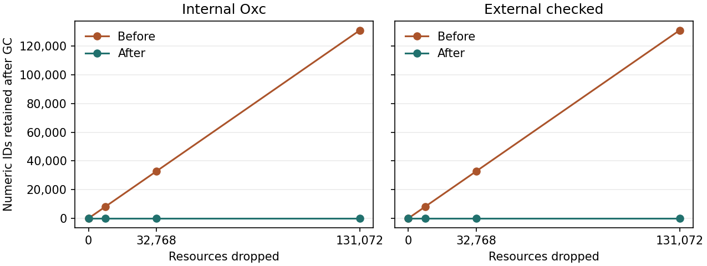
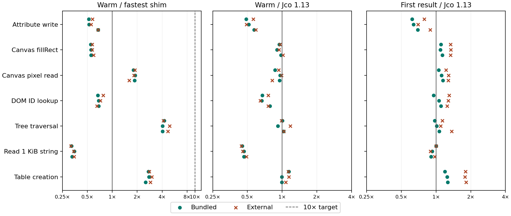
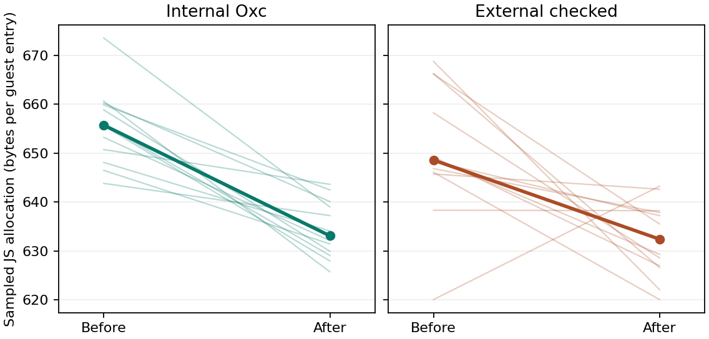
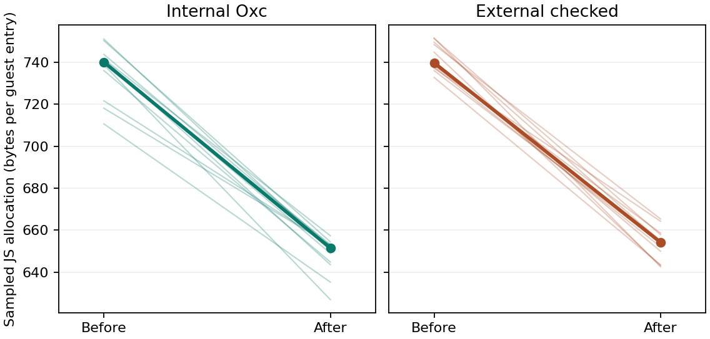
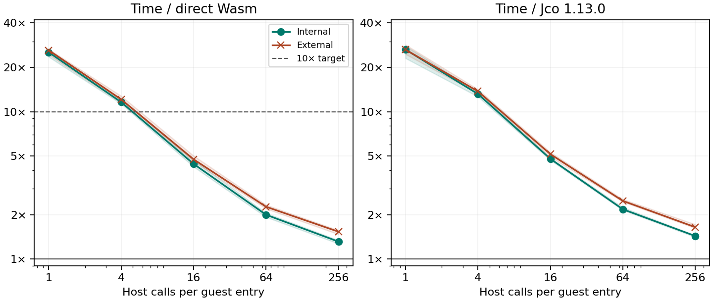
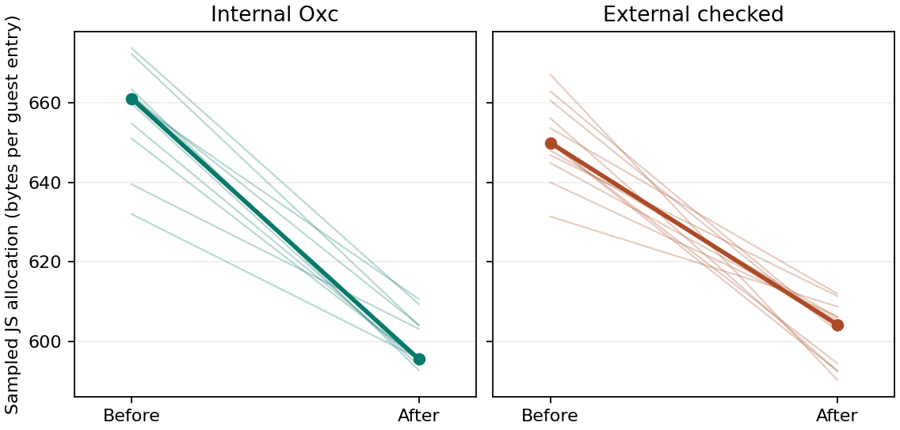
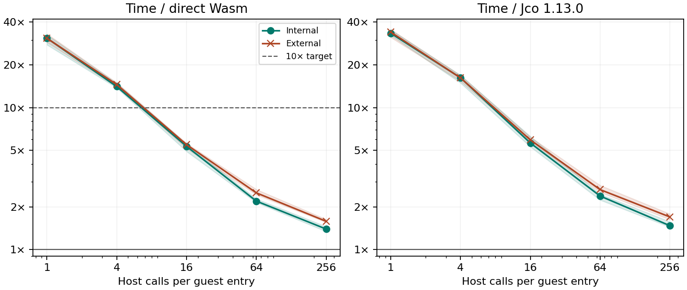
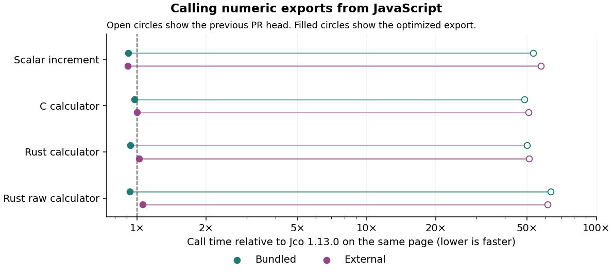
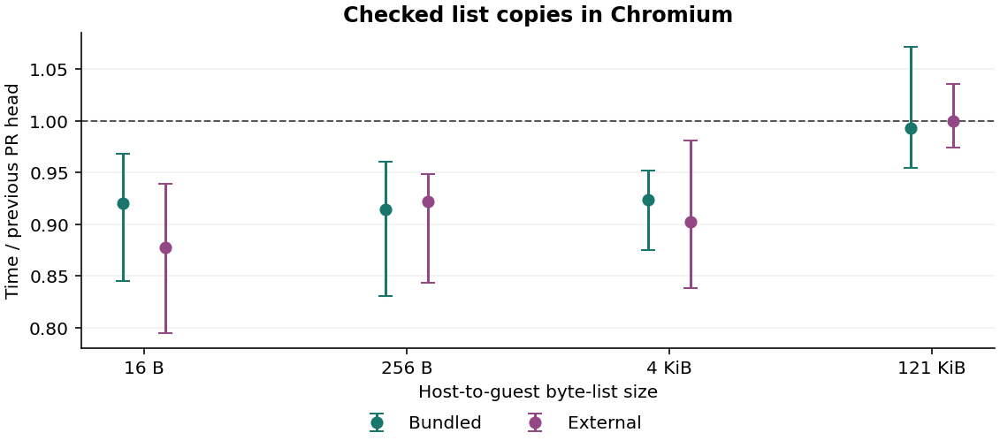

# Binding operations and guest calls

[Benchmark overview](../README.md)

## Owned resource arguments in synchronous exports

A host can pass a new resource to a guest export that immediately drops it. Both modes ran the destructor on every call, but kept a numeric ID for every resource in a set used for borrowing across component instances. Bindgen now skips that insertion when it can prove the component has one synchronous instance and cannot transfer resources. After 131,072 calls, the set held zero IDs in both modes. The measurements count numeric IDs, not heap bytes. [Compiler change, runtime comments and regression test](https://github.com/vados-cosmonic/jco/commit/1919c56ed6450890eddafc1431d368956b2e3f66)

| Chromium metric | Jco 1.13.0 | Internal Oxc, before → after | External checked, before → after |
| --- | ---: | ---: | ---: |
| Numeric IDs retained after 131,072 drops and garbage collection | 0 | 131,072 → 0 | 131,072 → 0 |
| Disposal callbacks | 131,072 | 131,072 → 131,072 | 131,072 → 131,072 |
| Time per call (µs) | 0.356 | 2.683 → 2.407 | 2.627 → 2.589 |
| Paired time ratio, after / before (95% interval) | — | 0.943× (0.882–1.007) | 0.918× (0.851–0.982) |
| Minified fixture entry (bytes) | 2,606 | 56,638 → 56,647 | 9,705 → 9,714 |
| Gzipped fixture entry (bytes) | 1,074 | 16,027 → 16,027 | 3,318 → 3,317 |



Five Chromium documents measured retention, one per treatment. Twenty separate documents measured timing with ordinary, uninstrumented sets and balanced execution order. Each timing document warmed every treatment, then ran three batches of 8,192 calls per treatment. The absolute times are medians of document medians. The paired ratios compare treatments within each batch before taking the document median. External calls took 8.2% less time in the paired comparison. The internal timing interval included parity. All five treatments ran identical guest Wasm. The 42 adapters from the full demo matrix also matched the preceding revision byte for byte. [Samples, browser version and asset hashes](../web/bench/results/owned-resource-history.json.gz)

<details><summary>Reproduce the owned-resource comparison</summary>

Build Jco at `578b213ef` and `1919c56ed` in the directories named by `before` and `after`. Install the pinned web benchmark dependencies and set `CHROME_BIN` to the Chromium executable. The report can also regenerate the chart with `--plot /tmp/owned-resource-history.png` when Matplotlib is installed.

```sh
node web/bench/owned-resource-history.mjs "$after" "$before/packages/jco-transpile" "$after/packages/jco-transpile" /tmp/owned-resource-history.json.gz
python3 web/bench/owned-resource-history-report.py /tmp/owned-resource-history.json.gz
node web/bench/verify-matrix-adapters.mjs "$after" web/bench/results/review-matrix-init-ae16355e9.json.gz
```

</details>

## Smaller synchronous import adapters at 084063ed1

A general host import copies the adapter’s diagnostic name onto its subtask. The standard checked synchronous lower returns its result directly and never constructs a subtask, including when it must create a task for a detached call. Bindgen now skips that private name assignment on this path. Both internal Oxc and the external checked package benefit. The comparison found 297 assignments across the 21 demos (12–17 per entry). The unminified external adapters differed only in those assignments and whitespace. The checked runtime, guest Wasm and exported interface are shared with the control. [Jco compiler change and regression test](https://github.com/vados-cosmonic/jco/commit/084063ed1)

| Minified JS per entry, paired across 21 workloads | Internal Oxc | External checked |
| --- | ---: | ---: |
| Median reduction | 941 bytes (1.31%) | 941 bytes (3.71%) |
| Range of reductions | 799–1,282 bytes | 799–1,282 bytes |
| Median gzip reduction | 178 bytes (0.95%) | 183 bytes (2.99%) |
| Range of gzip reductions | 148–217 bytes | 150–223 bytes |

Every entry became smaller. Gzip measures the entry compressed alone at level 9. The comparison also checked the general lowering path, tracked calls, debug mode and an opted-in custom provider on the same fixture. All four controls produced byte-identical output before and after the change. [Sizes, diagnostic counts, and asset hashes](../web/bench/results/sync-import-names-084063ed1.json.gz) · [Source comparison](../web/bench/sync-import-names.mjs)

The full comparison used 12 rounds and 1,164 fresh Chromium documents. Each value below summarizes the 21 workload medians. Both modes were within 10× of the fastest compiled shim in 21/21 warm workloads internally and 21/21 externally. The worst ratios were 4.24× and 4.94× respectively. Both builds matched or beat pinned main on 21/21 warm medians, and met the shim target in 81/84 individual phases. Against Jco 1.13.0 the internal and external builds matched or beat release in 18/21 and 15/21 warm workloads and 8/21 and 5/21 first results. These end-to-end comparisons use all PR changes. The controlled size comparison above isolates the removed labels. [Full browser matrix](../web/bench/results/review-matrix-minified-084063ed1.json.gz)

| Metric | Jco 1.13.0 | Upstream main at `326f52ab4` | Internal Oxc | External checked |
| --- | ---: | ---: | ---: | ---: |
| Import (ms) | 5.13 | 12.04 | 9.46 | 19.44 |
| Time to first guest result (ms) | 60.55 | 205.03 | 63.03 | 74.29 |
| Minified JS entry (KiB) | 9.58 | 111.34 | 70.56 | 24.08 |
| Total JS (KiB) | 9.58 | 111.34 | 70.56 | 122.85 |
| Total gzipped JS (KiB) | 3.01 | 25.42 | 18.78 | 39.54 |
| JS requests | 1 | 1 | 1 | 16 |



<details><summary>Reproduce the adapter-size and full browser comparisons</summary>

Use built Jco checkouts at `427b9c0d7` (before) and `084063ed1` (after). Prepare the release assets and pinned upstream compiler using the [full matrix setup](revision-comparisons.md#full-demo-matrix-on-the-merged-pr). Run these commands from the benchmark fork.

```sh
old=web/bench/results/review-matrix-minified-427b9c0d7.json.gz
ROUNDS=12 node web/bench/review-matrix.mjs "$after" "$stage" /tmp/names-matrix.json.gz --minify-checked
python3 web/bench/review-matrix-report.py /tmp/names-matrix.json.gz --release-intervals --plot /tmp/names-matrix.png
node web/bench/sync-import-names.mjs "$before/packages/jco-transpile" "$after/packages/jco-transpile" "$old" /tmp/names-matrix.json.gz /tmp/names.json.gz
```

</details>

### Does deferring task completion state speed up guest entry?

A synchronous guest that returns to JavaScript normally never uses its task's completion promise. We built a variant of `427b9c0d7` that puts the promise, its resolvers and its settlement state in a single record allocated on first use. The experiment uses the same TypeScript implementation for the checked external package and the runtime embedded by internal Oxc. The change is available as a [standalone experimental patch](../web/bench/experiments/task-completion-state.patch).

| One host call per guest entry | Internal Oxc | External checked |
| --- | ---: | ---: |
| Sampled allocation, current → experiment (bytes/entry) | 655.7 → 633.1 | 648.6 → 632.4 |
| Paired allocation ratio, experiment / current | 0.969× (0.956–0.978) | 0.968× (0.954–0.995) |
| Paired elapsed time, first run | 0.989× (0.975–1.019) | 0.990× (0.966–1.012) |
| Paired elapsed time, independent run | 0.982× (0.972–1.005) | 0.996× (0.976–1.014) |

The allocation trial used 12 fresh Chromium pages. Each timing run used 18 fresh pages with sampling disabled. Each page ran the same core Wasm in six configurations and checked the result of every batch. Parentheses give individual 95% intervals for the paired median. All browser assets matched by SHA-256 across the three runs. No timing interval favored the experiment in both runs at any tested batch size (1, 4, 16, 64 or 256 host calls). At one host call the experiment still took 25–28× the release time. The approximately 3% allocation saving leaves the latency gap open, so the Jco PR retains its current task representation. [Allocation profiles](../web/bench/results/task-completion-heap-427b9c0d7.json.gz) · [First timing run](../web/bench/results/task-completion-time-427b9c0d7.json.gz) · [Independent timing run](../web/bench/results/task-completion-repeat-427b9c0d7.json.gz)



<details><summary>Reproduce the task completion experiment</summary>

Use two Jco checkouts at `427b9c0d7` with dependencies installed. Set `before` and `after` to their absolute paths, and run these commands from the benchmark fork. The component produced by each compiler contains the same guest Wasm. Its external adapter also matches across both builds.

```sh
git -C "$after" apply "$PWD/web/bench/experiments/task-completion-state.patch"
for checkout in "$before" "$after"; do
  pnpm --dir "$checkout" --filter @bytecodealliance/jco-transpile run build:embedded-runtime
  pnpm --dir "$checkout" --filter @bytecodealliance/jco-transpile run build
done

export CHROME_BIN=/path/to/chrome
run_batch() {
  node web/bench/export-host-batch.mjs \
    "$before/packages/jco-transpile" "$before/packages/jco-cm-runtime/dist" \
    "$after/packages/jco-transpile" "$after/packages/jco-cm-runtime/dist" "$@"
}
run_batch /tmp/time.json.gz
run_batch /tmp/repeat.json.gz
run_batch /tmp/heap.json.gz --heap
python3 web/bench/export-host-batch-report.py /tmp/time.json.gz
python3 web/bench/export-host-batch-report.py /tmp/repeat.json.gz
python3 web/bench/export-host-batch-report.py /tmp/heap.json.gz --plot /tmp/heap.png
```

</details>

### Allocation and timing of a single export

An export task stores its first implicit thread directly. It allocates an ordered array when a second thread joins. The runtime comment explains why the oldest live thread must remain the default, and the regression test removes siblings out of order. The external checked package and internal Oxc bundle share this implementation. [Runtime change and test](https://github.com/vados-cosmonic/jco/commit/3ffabc739b72a4a8afdcfdd3051d50d5dd1d379f)

| One host call per guest entry | Internal Oxc | External checked |
| --- | ---: | ---: |
| Sampled JS bytes per entry, before → after | 740.0 → 651.5 | 739.7 → 654.2 |
| Paired allocation reduction (individual 95% interval) | 12.3% (10.6–13.2%) | 11.9% (11.1–12.7%) |
| Elapsed time before → after (ns) | 828.9 → 780.7 | 833.4 → 808.4 |
| Paired elapsed time after / before (individual 95% interval) | 0.956× (0.928–0.972) | 0.984× (0.954–1.003) |
| Paired elapsed time after / Jco 1.13.0 | 26.39× | 26.33× |

Each of 12 fresh Chromium pages ran six builds with identical Wasm. The allocation sampler included objects collected by minor or major GC and estimated JS bytes allocated over 262,144 checksum-verified entries per build. The figures measure allocation traffic. The direct Wasm and 1.13.0 controls both registered 0.0 sampled bytes per entry at the 32 KiB sampling interval. [Allocation profiles, compiler hashes and browser version](../web/bench/results/export-host-heap-47f6dc0c1.json.gz)



Elapsed time was measured separately with profiling off. At 16 host calls per entry, internal Oxc took 1,042 ns and the external runtime took 1,121 ns. The paired improvements were 4.5% and 4.1%, respectively. With one host call per entry, Jco 1.13.0 took 29.7 ns and direct Wasm took 31.5 ns. Larger batches spread the cost of entering the guest across multiple host calls. At 256 calls per entry, the paired ratios to Jco 1.13.0 were 1.43× and 1.65×. [18-page timing samples](../web/bench/results/export-host-batch-47f6dc0c1.json.gz)



<details><summary>Reproduce the allocation, timing and demo comparisons</summary>

Build Jco at `f2c5ef195` (before) and `47f6dc0c1` (after). Use the compiler and checked package from the same checkout for each pair. The upstream compiler was built from `326f52ab4`. Use the demo guest assets from the benchmark setup below.

```sh
export CHROME_BIN=/path/to/chrome
node web/bench/export-host-batch.mjs \
  "$before/packages/jco-transpile" "$before/packages/jco-cm-runtime/dist" \
  "$after/packages/jco-transpile" "$after/packages/jco-cm-runtime/dist" /tmp/heap.json.gz --heap
python3 web/bench/export-host-batch-report.py /tmp/heap.json.gz --plot /tmp/heap.png
node web/bench/export-host-batch.mjs \
  "$before/packages/jco-transpile" "$before/packages/jco-cm-runtime/dist" \
  "$after/packages/jco-transpile" "$after/packages/jco-cm-runtime/dist" /tmp/timing.json.gz
python3 web/bench/export-host-batch-report.py /tmp/timing.json.gz --plot /tmp/timing.png
ROUNDS=12 node web/bench/review-matrix.mjs "$after" "$stage" /tmp/matrix.json.gz --minify-checked
python3 web/bench/review-matrix-report.py /tmp/matrix.json.gz --release-intervals --plot /tmp/matrix.png
```

</details>

### Sharing constant task options across guest entries

The one-host-call fixture constructs a task-options object on each entry. All ten properties are constants for that export. This experiment moves the literal just before the exported function declaration, so the object lives for the lifetime of the component instance. Each invocation still creates its own task and thread. Both treatments use compiler `47f6dc0c1`. The runner checks for byte-identical entries before moving the literal, verifies identical core Wasm, and records both runtime inventories. This is a benchmark-only edit to the generated adapters.

| One host call per guest entry | Internal Oxc | External checked |
| --- | ---: | ---: |
| Sampled JS bytes per entry, current → shared | 661.2 → 595.6 | 650.0 → 604.3 |
| Paired bytes, shared / current | 0.907× (0.899–0.924) | 0.925× (0.910–0.945) |
| Paired elapsed time, first run | 0.996× (0.973–1.004) | 0.974× (0.943–0.992) |
| Paired elapsed time, second run | 0.988× (0.976–1.012) | 1.001× (0.977–1.016) |

The allocation trial sampled 12 pages. Each timing run used 18 fresh pages in a separate browser process with allocation profiling off. Parentheses give individual 95% intervals across paired pages. The external single-call timing improvement in the first run did not reproduce in the second. At 16 host calls per guest entry the internal intervals favored sharing in both runs, by 2.6% and 1.3%. With the shared literal, one host call per entry still took 26–28× the time of Jco 1.13.0 across both runs and renderers. The allocation saving is measurable, but these timings give little reason to broaden the compiler change for latency. [Allocation profiles](../web/bench/results/shared-task-options-heap-47f6dc0c1.json.gz) · [First timing run](../web/bench/results/shared-task-options-timing-47f6dc0c1.json.gz) · [Independent timing run](../web/bench/results/shared-task-options-repeat-47f6dc0c1.json.gz)



<details><summary>Reproduce the task-options experiment</summary>

Use the same built compiler and checked runtime for both inputs. Each timing command launches a fresh Chromium process.

```sh
export CHROME_BIN=/path/to/chrome
compiler="$after/packages/jco-transpile"
runtime="$after/packages/jco-cm-runtime/dist"
for trial in first second; do
  node web/bench/export-host-batch.mjs "$compiler" "$runtime" "$compiler" "$runtime" "/tmp/$trial.json.gz" --share-task-options
  python3 web/bench/export-host-batch-report.py "/tmp/$trial.json.gz"
done
node web/bench/export-host-batch.mjs "$compiler" "$runtime" "$compiler" "$runtime" /tmp/shared-heap.json.gz --share-task-options --heap
python3 web/bench/export-host-batch-report.py /tmp/shared-heap.json.gz --plot /tmp/shared-heap.png
```

</details>

### Host calls per guest export

Returning from a synchronous export previously allocated an array to remove a single active call, then looked for runnable threads even when the suspension table was empty. The shared runtime now pops a lone matching call and skips the empty thread scan. Nested or suspended calls still resolve by task identity. A test covers an unknown task and two calls finishing out of order. [Runtime change and regression test](https://github.com/vados-cosmonic/jco/commit/070c350c7606b5badcdaf41e2bd94a5886d8ab21) · [Embedded Oxc snapshot](https://github.com/vados-cosmonic/jco/commit/0c3d12ad0d8d9dc2b0f9be3c7b51aa1223189041)

One JS invocation enters the guest, which calls a host increment function the indicated number of times before returning. With one host call, the reduction in elapsed time was **9.1% (95% interval 6.7–10.4%) internally** and **10.2% (95% interval 7.2–12.6%) externally**. Each row pairs all six builds on the same pages. The denominator for “before” is PR revision `e12260509`. [Raw timings and asset hashes](../web/bench/results/export-host-batch-0c3d12ad0.json.gz)

| Host calls per export | Internal after / before | External after / before | Internal / direct Wasm | External / direct Wasm | Internal / 1.13.0 | External / 1.13.0 |
| ---: | ---: | ---: | ---: | ---: | ---: | ---: |
| 1 | 0.909× (0.896–0.933) | 0.898× (0.874–0.928) | 30.81× | 30.75× | 33.39× | 34.01× |
| 4 | 0.922× (0.864–0.939) | 0.911× (0.882–0.940) | 14.06× | 14.52× | 16.22× | 16.19× |
| 16 | 0.925× (0.886–0.956) | 0.910× (0.854–0.941) | 5.33× | 5.48× | 5.64× | 5.92× |
| 64 | 0.932× (0.902–1.000) | 0.951× (0.918–0.992) | 2.20× | 2.51× | 2.38× | 2.65× |
| 256 | 1.001× (0.975–1.021) | 0.968× (0.940–0.986) | 1.40× | 1.58× | 1.47× | 1.70× |



In the demo matrix, the external entry JS and separately served Wasm cores matched the preceding revision byte for byte. Each internal JS entry grew by 66 bytes. The external renderer fetched the updated shared runtime, increasing the total JavaScript by 66 bytes per demo.

<details><summary>Reproduce these measurements</summary>

Build `js-component-bindgen-component`, `@bytecodealliance/jco-transpile` and `@bytecodealliance/jco-cm-runtime` from both Jco revisions. The [matrix setup](revision-comparisons.md#full-demo-matrix-on-the-merged-pr) describes the guest assets and the upstream CI staging directory. Use run `45795485943` and verify its SHA is `326f52ab4403466b21b989c995f9bb97b2b9e038`. Run the commands from the benchmark fork.

```sh
export CHROME_BIN=/path/to/chrome
node web/bench/export-host-batch.mjs \
  "$before/packages/jco-transpile" "$before/packages/jco-cm-runtime/dist" \
  "$after/packages/jco-transpile" "$after/packages/jco-cm-runtime/dist" /tmp/batch.json.gz
python3 web/bench/export-host-batch-report.py /tmp/batch.json.gz --plot /tmp/batch.png
ROUNDS=12 node web/bench/review-matrix.mjs "$after" "$stage" /tmp/full.json.gz --minify-checked
python3 web/bench/review-matrix-report.py /tmp/full.json.gz --release-intervals --plot /tmp/full.png
```

For each batch size, each of 18 fresh pages ran six warmup passes and six measured passes. Each build occupied every timing position once and immediately followed every other build once over the measured passes. All builds ran identical core Wasm and verified the expected checksum. Each individual interval is an order-statistic interval for the median of the within-page ratios.

</details>

## Browser bindings at e12260509

Both renderers met the 10× shim target on all 21 warm demo cases at this revision. Each matched or beat Jco 1.13.0 in 16/21. [Full comparison and graph](https://github.com/vados-cosmonic/component-demos/blob/3af35212fd1332204e24942081cd7cff0094396b/README.md#browser-bindings-at-e12260509)

### Cost of one synchronous export that calls back into the host

The latest change removes a mutable Wasm global used by suspending adapters. Bindgen already knows when a single-instance component has only synchronous calls. In that case there is no reader for the register, so bindgen can omit the allocation and the write on every export call. The ordinary task still handles entry, traps and exit. A custom runtime can observe task operations and keeps the full path. [Code, eligibility check and tests](https://github.com/vados-cosmonic/jco/commit/e12260509a95f602a8a62399c973954c3993360a)

Compared with the earlier minified matrix at `db4a3aca0`, all 21 internal entries shrank by 309–314 bytes and all 21 external entries by 121–124 bytes. Every separately served Wasm core matched the earlier hash.

A small guest export takes an integer, calls a JS host function once and returns its result. Each of 18 fresh Chromium pages ran all six configurations on identical core Wasm. A separate instantiation on each page counted allocations. Each timing comes from an instance created with the native global constructor. Individual timing intervals use one paired median ratio per page. [Raw samples](../web/bench/results/export-task-register-e12260509.json.gz) · [Measured runner](https://github.com/vados-cosmonic/component-demos/blob/76a0fd0/web/bench/export-task-register.mjs)

| Renderer | Wasm globals allocated before → after | Minified entry bytes saved (gzip) | Time after / before (95% interval) | Time after / 1.13.0 | Time after / direct Wasm |
| --- | ---: | ---: | ---: | ---: | ---: |
| Internal Oxc | 1 → 0 | 286 (90) | 1.053× (0.834–1.194) | 37.31× | 44.61× |
| External checked | 1 → 0 | 98 (43) | 0.974× (0.917–1.162) | 37.10× | 43.64× |

Both timing intervals include parity. The measured gain from removing the register is in allocations and bytes. This round trip still cost about 2.33 µs in both renderers, versus 62.9 ns on 1.13.0 and 50.0 ns calling direct Wasm. A demo that makes many host calls inside one guest invocation amortizes the export task over the loop. A small export called repeatedly from JS pays for a task on every invocation.

<details><summary>Reproduce the PR-head measurements</summary>

Follow the [matrix setup](revision-comparisons.md#full-demo-matrix-on-the-merged-pr) to prepare the component binaries and install the benchmark dependencies. Build the PR at `e12260509` and its parent at `ee0d0ff26`, including the bindgen compiler used by the transpiler. Stage the upstream artifacts using CI run `45795485943` and verify its head SHA is `326f52ab4403466b21b989c995f9bb97b2b9e038`. The runner records the common Git base, compiler artifact hashes and the SHA-256 of each served asset.

```sh
export CHROME_BIN=/path/to/chrome
ROUNDS=12 node web/bench/review-matrix.mjs "$jco" "$stage" /tmp/matrix.json.gz --minify-checked
python3 web/bench/review-matrix-report.py /tmp/matrix.json.gz --release-intervals --plot /tmp/matrix.png
node web/bench/export-task-register.mjs "$parent/packages/jco-transpile" \
  "$jco/packages/jco-transpile" "$jco/packages/jco-cm-runtime/dist" /tmp/register.json.gz
python3 web/bench/export-task-register-report.py /tmp/register.json.gz
```

</details>

<a id="minified-bindings-at-the-pr-head"></a>

### Calling a scalar Wasm export from JavaScript

The optimized bindings skip creating a task and thread when JavaScript calls an isolated numeric Wasm export. Across a scalar increment fixture and the demos’ three calculators, median same-page speedups over the previous PR head ranged from **43× to 66×**. Both renderers took **0.91–1.06×** the time of Jco 1.13.0 on that paired measure. [Jco change](https://github.com/vados-cosmonic/jco/commit/af9f314c7a1e4d6869c3c80afa24d1cd45686d4f) · [Previous head](https://github.com/vados-cosmonic/jco/commit/86d339dd0d3dce2700d3f0f143824cb52b2b5832)

| Export (ns/call) | Direct Wasm | Jco 1.13.0 | Main | Bundled before | Bundled after | External before | External after |
| --- | ---: | ---: | ---: | ---: | ---: | ---: | ---: |
| Scalar increment | 61.8 | 66.4 | 3,740.7 | 3,649.1 | 62.6 | 3,904.7 | 64.1 |
| C calculator | 96.1 | 77.8 | 3,771.2 | 3,876.5 | 93.1 | 4,170.2 | 100.7 |
| Rust calculator | 80.9 | 77.8 | 3,891.8 | 3,951.3 | 73.2 | 3,939.8 | 80.9 |
| Rust raw calculator | 64.1 | 65.6 | 3,674.3 | 3,922.3 | 61.0 | 3,933.7 | 67.1 |



Each page interleaved seven implementations of the same guest core. Each timed pass made 65,536 calls to `increment(n)` or `add(n, 1)` and checked the sum. The table reports the median of ten page medians, with two warm-ups and five timed passes per page. The chart takes the ratio on each page first and then the median of those ratios. These summaries can differ when page timings vary. [Runner](../web/bench/scalar-export.mjs) · [Calculation](../web/bench/scalar-export-report.py) · Raw results for [increment](../web/bench/results/numeric-export-increment.json), [C](../web/bench/results/numeric-export-c-calculator.json), [Rust](../web/bench/results/numeric-export-rust-calculator.json), and [raw Rust](../web/bench/results/numeric-export-rust-calculator-raw.json)

For each two-export calculator, the bundled JS entry grew by 913 bytes (85 gzip bytes) and the external entry by 1,769 bytes (168 gzip bytes). Both carry the ordinary task path for coercions, reentry, or custom instantiation. Across all 34 demo components, these three calculators were the only generated outputs that changed in either mode. An [earlier run on the preceding PR head](../web/bench/results/scalar-export.json) measured the scalar cost that prompted this change.

To reproduce the paired comparison, use two clean Jco checkouts at the linked revisions. Build `cargo build -p js-component-bindgen --example transpile --features embedded-cm-runtime` in each, and build the checked runtime in the newer checkout as described above. Run the following from the demo repository after preparing the pinned main and 1.13.0 benchmark dependencies.

```bash
export CHROME_BIN=/path/to/chrome
jco=/path/to/optimized-jco
before=/path/to/previous-jco
results=web/bench/results
runner=(node web/bench/scalar-export.mjs "$jco" "$jco/target/debug/examples/transpile")
previous=(86d339dd0 "$before/target/debug/examples/transpile")
"${runner[@]}" "$results/numeric-export-increment.json" "${previous[@]}"
for fixture in c/calculator rust/calculator rust/calculator-raw; do
  "${runner[@]}" "$results/numeric-export-${fixture//\//-}.json" "${previous[@]}" \
    --calculator "$fixture/native/calculator.wasm"
done
python3 web/bench/scalar-export-report.py --plot "$results/numeric-export.png"
```

### Returning a byte list from JavaScript to Wasm

After calling the guest allocator, bindgen reads the current memory limit once and checks that the list fits. For one-byte elements the remaining byte count is also the element limit, and every address meets the alignment requirement. This change applies to both renderers. In Chromium, paired median time for 16-byte to 4-KiB returns fell by **8–9% bundled and 8–12% external**. At the canvas readback size of 123,904 bytes the paired medians were 0.99× and 1.00× the preceding PR head. Jco 1.13.0 still had the lowest Jco median at all four sizes. [Jco implementation](https://github.com/vados-cosmonic/jco/commit/3fdabd849e833bd878e9bf3abc6358d45735a152)

Each cell is nanoseconds per guest iteration, including the host call, guest allocation, copy, and endpoint checks. The two Wasm cores were byte-identical across all seven configurations. The host alternated two preallocated views with nonzero byte offsets. The guest checked the full payload digest outside each timer. The table summarizes 12 page medians after two warm-ups and five timed passes per size and build. [Fixture](../web/bench/byte-transfer.wat) · [Runner](../web/bench/byte-transfer.mjs) · [Raw samples and generated sizes (gzip)](../web/bench/results/list-allocation-transfer.json.gz)

| Result bytes | Direct Wasm | 1.13.0 | Main | Bundled before | Bundled after | External before | External after |
| ---: | ---: | ---: | ---: | ---: | ---: | ---: | ---: |
| 16 | 174 | 363 | 3,748 | 459 | 443 | 516 | 426 |
| 256 | 175 | 346 | 3,867 | 494 | 470 | 540 | 438 |
| 4,096 | 354 | 482 | 4,639 | 714 | 641 | 659 | 653 |
| 123,904 | 9,473 | 9,277 | 16,699 | 9,668 | 9,668 | 9,668 | 9,863 |



The chart divides times on each page before taking a median. Each error bar is a two-sided sign-test interval with at least 95% coverage for that comparison. For this fixture the bundled JS entry shrank by 90 bytes (26 gzip bytes) and the external entry by 116 bytes (30 gzip bytes).

#### Does this improve C canvas readback?

The original 9-round, same-page comparison measured a 14% slowdown. Two further same-page comparisons ran the old code twice under separate module URLs and rotated all three builds. Both put the new code at 1.00× the previous head. In the instrumented run, the old code spent a median 805 µs inside the canvas host method out of 844 µs per read. These measurements establish the gain for small byte lists and leave the C canvas headline unresolved. Each timed workload checked every RGBA channel on the source and destination canvases. [Canvas runner](../web/bench/canvas-host-bench.mjs) · [Host observer](../web/bench/canvas-readback.mjs)

| C canvas readback | Rounds | After / before | 95% interval | Duplicate / before |
| --- | ---: | ---: | --- | ---: |
| Original host, 10 ms | 9 | 1.14× | 1.06–1.78× | — |
| Pixel-view host, 10 ms | 9 | 1.01× | 0.92–1.06× | — |
| Original host, isolated pages, 10 ms | 24 | 1.11× | 0.81–1.29× | 0.99× |
| Original host, duplicate control, 10 ms | 30 | 1.00× | 0.95–1.04× | 0.99× |
| Original host, timed host method, 50 ms | 18 | 0.99× | 0.95–1.01× | 1.00× |
| ↳ Inside host read | 18 | 0.98× | 0.95–1.02× | 0.99× |
| ↳ Outside host read | 18 | 0.99× | 0.91–1.09× | 1.08× |
| Original host, 50 ms | 30 | 1.00× | 0.98–1.03× | 0.99× |

The durations name the guest’s minimum timing window. Each guest doubles its iteration count until it reaches that window. Each interval applies to the paired median for that row. The isolated comparison loaded one binding per page, with all three page positions balanced across six-round blocks. [9-round comparison](../web/bench/results/list-allocation-canvas.json.gz) · [Isolated pages](../web/bench/results/list-allocation-isolated.json.gz) · [Short duplicate control](../web/bench/results/list-allocation-short-control.json.gz) · [Host timing](../web/bench/results/list-allocation-observed.json.gz) · [Long duplicate control](../web/bench/results/list-allocation-long.json.gz)

Use the compiler setup above with the byte-list change and its parent `af9f314c7`. These commands run the transfer benchmark and the original-host control, then regenerate the tables and chart from the archived samples.

```bash
export CHROME_BIN=/path/to/chrome
jco=/path/to/jco-with-list-change
before=/path/to/previous-jco
bin="$jco/target/debug/examples/transpile"
previous=(af9f314c7 "$before/target/debug/examples/transpile")
node web/bench/byte-transfer.mjs "$jco" "$bin" /tmp/byte-transfer.json "${previous[@]}"
ROUNDS=30 MIN_MS=10 node web/bench/canvas-host-bench.mjs --control \
  "$jco" "$bin" "${previous[@]}" /tmp/canvas-control.json
python3 web/bench/byte-transfer-report.py --plot web/bench/results/list-allocation-transfer.png
```
