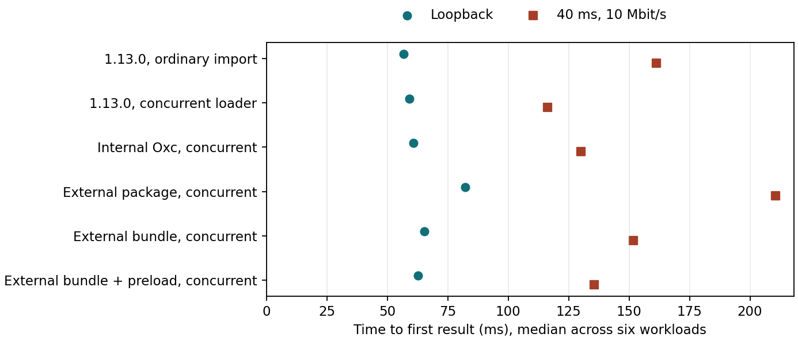
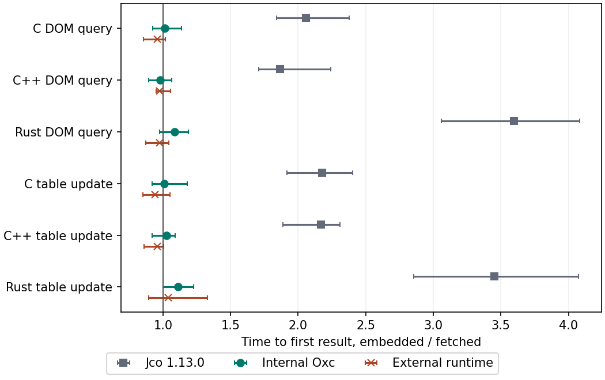
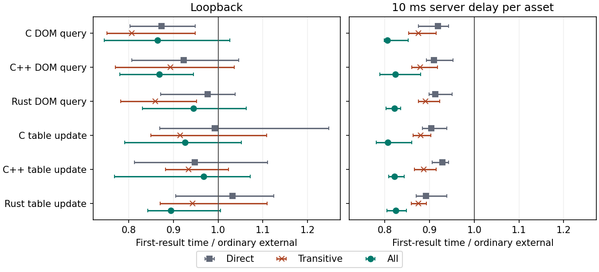
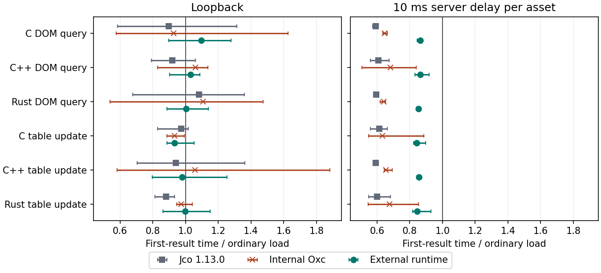
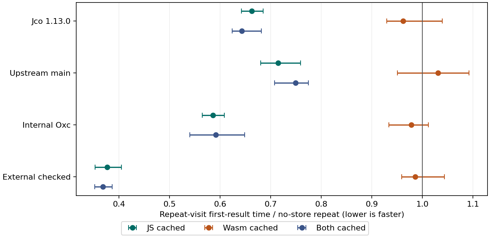
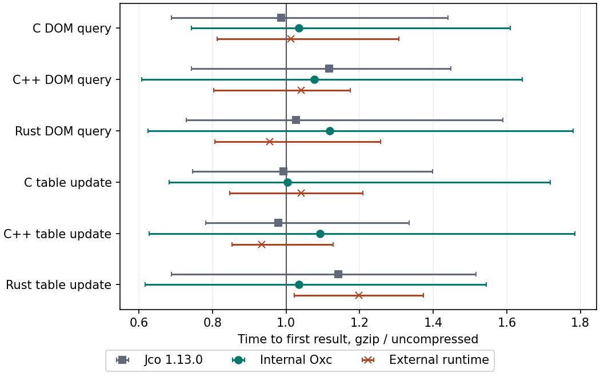
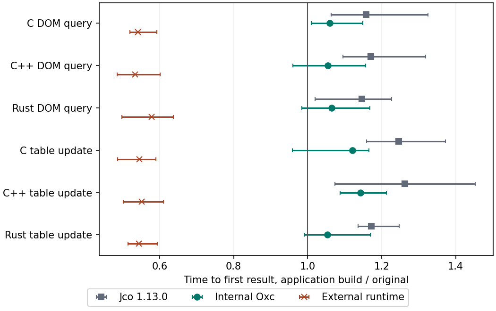

# Browser loading and HTTP delivery

[Benchmark overview](../README.md)

### Loading the guest Wasm alongside the bindings

Across the last two full matrices, the external C, C++ and Rust table components took about 14–16 ms longer to import than Jco 1.13.0 on loopback (median across languages of paired differences). For a direct external module, Chromium discovers the guest Wasm after loading and evaluating the JS dependencies. We compared two ways of starting compilation earlier.

#### Source-phase Wasm imports

Each trial adapter statically imports the primary Wasm as a compiled `WebAssembly.Module` and passes it to the usual Jco instantiation code. The controls use the ordinary loader. All six adapters (DOM query and table update in C, C++ and Rust) loaded the same runtime modules and guest Wasm as the matrix. Each guest Wasm transferred exactly once. The trial changed one compilation expression and added one import. [TC39 source-phase import proposal](https://github.com/tc39/proposal-source-phase-imports) · [Experimental adapter changes](../web/bench/experiments/source-phase-import.patch)

| Transport | Build | Wasm request started earlier | Import time, trial / control | First result, trial / control |
| --- | --- | ---: | ---: | ---: |
| HTTP/2 loopback | Jco 1.13.0 | 1.3 ms | 1.015× (0.960–1.097) | 1.001× (0.942–1.039) |
| | Internal Oxc | 4.5 ms | 0.873× (0.831–0.939) | 0.961× (0.880–1.019) |
| | External runtime | 24.6 ms | 0.955× (0.914–1.024) | 1.009× (0.954–1.057) |
| HTTP/2, 40 ms, 10 Mbit/s | Jco 1.13.0 | 0.9 ms | 1.001× (0.990–1.013) | 0.994× (0.983–1.000) |
| | Internal Oxc | 3.6 ms | 0.979× (0.974–0.991) | 0.974× (0.955–1.006) |
| | External runtime | 113.3 ms | 0.722× (0.715–0.726) | 0.759× (0.747–0.770) |

On the limited connection, the external first result arrived 24.1% sooner and still took 1.33× the ordinary 1.13.0 time. Chromium 156.0.8078.47 required `--enable-features=JavaScriptSourcePhaseImports` to parse and load the Wasm import. Both the trial and its controls used that flag. The experiment ran 12 balanced rounds in 864 documents. Each round contributes the median paired ratio across its six workloads. Parentheses give individual 95% sign intervals. [Request traces, file sizes and per-document timings](../web/bench/results/source-phase-4b9682bfe.json.gz)

#### Compiling cores through the public instantiation API

With `--instantiation async`, a browser application can use standard `fetch` and `WebAssembly.compileStreaming` while it imports the generated JS. In this C table workload the explicit instantiation build emits the guest and three small adapter cores as separate Wasm files. We verified their bytes against the guest and three embedded helpers in the ordinary direct module. The serial and concurrent loaders fetched exactly the same URLs once per document. All treatments completed the full 2,000-row guest call in Chromium with its default Wasm features.

| First result in the full C table workload (ms) | Ordinary direct module | Explicit loader, serial | Explicit loader, concurrent | Concurrent / serial (paired 95% interval) |
| --- | ---: | ---: | ---: | ---: |
| Loopback, internal Oxc | 50.33 | 51.40 | 48.68 | 0.916× (0.864–1.037) |
| Loopback, external runtime | 68.77 | 76.23 | 71.29 | 0.928× (0.845–1.078) |
| 40 ms, 10 Mbit/s, internal Oxc | 153.18 | 156.43 | 110.66 | 0.719× (0.683–0.728) |
| 40 ms, 10 Mbit/s, external runtime | 252.52 | 255.48 | 198.50 | 0.770× (0.758–0.790) |

On the limited connection, the concurrent loader delivered its first result **28.0% sooner internally and 21.5% sooner externally** against the ordinary direct modules. Ordinary Jco 1.13.0 took 136.87 ms. Internal Oxc took 0.810× the release time (0.781–0.851) and the external runtime took 1.453× (1.410–1.504). On loopback the concurrent and ordinary direct module first-result intervals included parity in both modes. The trial ran seven treatments on each of two transports across 14 balanced rounds, for 196 fresh documents. The runtime guide includes an executable two-mode example using the existing API. [Browser loading recipe](https://github.com/vados-cosmonic/jco/blob/c7b54f851/packages/jco-cm-runtime/docs/runtime.md#loading-explicit-instantiation-bindings-in-a-browser) · [Exact requests and timing samples](../web/bench/results/parallel-loader-4b9682bfe.json.gz)

<details><summary>Reproduce the two loading studies</summary>

Use a built Jco checkout at `4b9682bfe` as `$after` and point `CHROME_BIN` at the Chromium executable. These experiments apply to separate copies of the HTTP/2 package-layout harness.

```sh
matrix=web/bench/results/review-matrix-history-4b9682bfe.json.gz
runner=web/bench/source-phase-trial.mjs
patch -o "$runner" web/bench/runtime-chunks.mjs web/bench/experiments/source-phase-import.patch
node "$runner" "$after" "$matrix" /tmp/source-phase.json.gz --source-import
python3 web/bench/source-phase-report.py /tmp/source-phase.json.gz "$matrix" "$runner"

runner=web/bench/parallel-loader-trial.mjs
patch -o "$runner" web/bench/runtime-chunks.mjs web/bench/experiments/parallel-loader.patch
node "$runner" "$after" "$matrix" /tmp/parallel-loader.json.gz --parallel-loader
python3 web/bench/parallel-loader-report.py /tmp/parallel-loader.json.gz "$matrix" "$runner"
```

</details>

#### Sharing runtime code with the concurrent loader

We bundled the six external explicit-instantiation entries as one application and started core compilation together with each JS import. Each component retained its own entry and guest cores. Rolldown emitted one shared JS chunk. The preloaded treatment also requested that chunk when the page selected the component. A separate same-document check instantiated all six components before running any of them. Each returned its expected guest report and the server received exactly one request for the shared chunk. [Loader and package experiment](../web/bench/experiments/packed-loader.patch) · [Same-document check](../web/bench/experiments/packed-loader-reuse.patch)

| First result across six workloads | HTTP/2 loopback (ms) | HTTP/2, 40 ms, 10 Mbit/s (ms) | Median JS requests | Unique Brotli JS across six (bytes) |
| --- | ---: | ---: | ---: | ---: |
| Jco 1.13.0, ordinary import | 56.85 | 161.38 | 1 | 15,483 |
| Jco 1.13.0, concurrent loader | 59.27 | 116.22 | 1 | 12,508 |
| Internal Oxc, concurrent loader | 60.75 | 130.07 | 1 | 103,033 |
| External package, concurrent loader | 82.24 | 210.55 | 16 | 60,691 |
| External application bundle, concurrent loader | 65.47 | 151.74 | 2 | 41,022 |
| Same application bundle with shared chunk preloaded | 62.71 | 135.48 | 2 | 41,022 |

On the limited connection, bundling and preloading reduced first-result time by **37.1%** versus the external package (paired ratio 0.629×, individual 95% interval 0.611–0.642). Preloading alone saved 13.7% versus the same bundle (0.848–0.903×). The resulting time was **1.020× internal Oxc** (1.006–1.032), **0.831× ordinary 1.13.0** (0.823–0.847), and **1.154× 1.13.0 using the same concurrent loader** (1.143–1.188). On loopback, preloading the application chunk had no clear additional effect. [Raw browser results and asset inventory](../web/bench/results/packed-loader-4b9682bfe.json.gz)

Most of the remaining difference against concurrent 1.13.0 occurred before the final network response. On the limited connection the last response finished 13.13 ms later for the preloaded external bundle (12.57–13.30). From that point to guest readiness, the difference was another 2.82 ms (2.64–2.85). For internal Oxc those differences were 11.40 ms and 2.71 ms. Across the 864 fresh documents, the server log and Chromium agreed on every transferred file and the checked guest Wasm matched the matrix. Each of 12 browser rounds supplied one paired median across the six workloads. The absolute times above summarize workload medians independently. [Browser deployment guide](https://github.com/vados-cosmonic/jco/blob/b7edbf6bf/packages/jco-cm-runtime/docs/runtime.md#loading-explicit-instantiation-bindings-in-a-browser)



<details><summary>Reproduce the shared application loader and six live instances</summary>

Use the built compiler from `4b9682bfe` and the normal Chromium executable from the preceding study. The timing data records the documentation-only checkout at `c7b54f851`. The harness checks ordinary entry bytes against the matrix, each explicit entry's cores against the direct module, and the application bundle's cores against the standalone external build.

```sh
matrix=web/bench/results/review-matrix-history-4b9682bfe.json.gz
runner=web/bench/packed-loader-trial.mjs
patch -o "$runner" web/bench/runtime-chunks.mjs web/bench/experiments/packed-loader.patch
node "$runner" "$after" "$matrix" /tmp/packed-loader.json.gz --packed-loader
python3 web/bench/packed-loader-report.py /tmp/packed-loader.json.gz "$matrix" "$runner" --plot /tmp/packed-loader.png
check=web/bench/packed-reuse-trial.mjs
patch -o "$check" "$runner" web/bench/experiments/packed-loader-reuse.patch
JCO_VERIFY_REUSE=/tmp/packed-loader.json.gz node "$check" "$after" "$matrix" /tmp/unused --packed-loader
```

</details>

## Fetching or embedding the primary Wasm core

Raising `base64Cutoff` from 5,000 to 262,144 bytes moved the primary Wasm core into the JavaScript entry for all six DOM query and table workloads. This saved one request per document. Median paired time to the first guest result was **1.02×** the ordinary layout for internal Oxc, **0.97×** for the external runtime, and **2.17×** for Jco 1.13.0. Every build transferred more bytes with the core embedded. [Timings, request sizes and hashes](../web/bench/results/core-startup.json.gz)

| Build | Import ms, fetched → embedded | First result ms, fetched → embedded | Paired first result | All JS + Wasm KiB, fetched → embedded | Gzip estimate KiB, fetched → embedded |
| --- | ---: | ---: | ---: | ---: | ---: |
| Jco 1.13.0 | 5.52 → 15.17 | 8.54 → 18.32 | 2.174× | 78.91 → 101.85 | 30.48 → 39.37 |
| Internal Oxc | 11.08 → 11.12 | 17.14 → 17.40 | 1.021× | 141.52 → 163.92 | 46.70 → 55.95 |
| External runtime | 24.28 → 24.04 | 30.52 → 29.84 | 0.967× | 198.31 → 221.21 | 68.60 → 77.91 |



<details><summary>Individual median intervals and reproduction</summary>

| Guest and workload | 1.13.0 | Internal Oxc | External runtime |
| --- | ---: | ---: | ---: |
| C DOM query | 2.06× (1.84–2.38) | 1.01× (0.92–1.14) | 0.96× (0.86–1.02) |
| C++ DOM query | 1.87× (1.71–2.24) | 0.98× (0.89–1.06) | 0.97× (0.95–1.06) |
| Rust DOM query | 3.60× (3.06–4.08) | 1.09× (0.98–1.19) | 0.98× (0.87–1.04) |
| C table update | 2.18× (1.92–2.40) | 1.01× (0.92–1.18) | 0.94× (0.85–1.05) |
| C++ table update | 2.17× (1.89–2.31) | 1.03× (0.92–1.09) | 0.96× (0.86–1.00) |
| Rust table update | 3.45× (2.86–4.08) | 1.11× (1.00–1.22) | 1.04× (0.89–1.33) |

Each of 18 rounds used 36 fresh Chromium documents with DevTools disconnected. All builds ran the same C, C++ and Rust guest cores. The runner matched the fetched layouts to the full minified matrix and decoded and hashed the embedded modules to verify identical Wasm. The two DOM workloads used small inputs so the first result includes import and a short guest call. The primary cores ranged from 65,203 to 149,690 bytes. Embedding cut release and bundled requests from two to one and external requests from 20 to 19. The common demo host was loaded before timing.

The first table summarizes six workload medians. The paired column divides first-result times within each workload and round before taking medians. The per-workload table and chart show individual two-sided median intervals with at least 95% coverage. Eleven of the twelve PR intervals included parity. Internal Rust table creation was slower with embedding (unrounded interval 1.001–1.225×). Responses were served uncompressed on loopback with caching disabled. The gzip estimates compress the requested assets individually. [Runner](../web/bench/core-startup.mjs) · [Verifier and plot](../web/bench/core-startup-report.py)

Build the PR at `95e8ae0d8` and install the demo’s pinned web dependencies, then run these commands in the fork.

```sh
CHROME_BIN=/path/to/chrome ROUNDS=18 node web/bench/core-startup.mjs \
  /path/to/built/jco /tmp/core-startup.json.gz
python3 web/bench/core-startup-report.py /tmp/core-startup.json.gz --plot /tmp/core-startup.png
```

</details>

## Preloading external runtime modules

When the browser loaded the checked runtime as separate ES modules, starting all 18 runtime fetches alongside the component import reduced median first-result time from **28.80 to 25.29 ms** on loopback. With the server delaying each JS and Wasm response by 10 ms, first result fell from **76.34 to 62.41 ms**. The last runtime fetch began at **1.55 ms**, down from **49.17 ms** in the delayed run. Each page still fetched the same entry, 18 runtime modules and one Wasm core exactly once. [Request timings, sizes and asset hashes](../web/bench/results/modulepreload.json.gz)

| Asset delay | Build and hints | Import (ms) | First result (ms) | Last runtime fetch initiated (ms) | Paired first result / ordinary external |
| --- | --- | ---: | ---: | ---: | ---: |
| 0 ms | Jco 1.13.0 | 5.63 | 8.01 | — | 0.289× |
| 0 ms | Internal Oxc | 9.91 | 14.65 | — | 0.508× |
| 0 ms | External, ordinary import | 26.33 | 28.80 | 19.34 | 1.000× |
| 0 ms | External, direct imports hinted | 24.81 | 26.85 | 19.12 | 0.962× |
| 0 ms | External, indirect imports hinted | 24.00 | 25.70 | 11.82 | 0.904× |
| 0 ms | External, all runtime modules hinted | 23.16 | 25.29 | 1.92 | 0.910× |
| 10 ms | Jco 1.13.0 | 25.57 | 27.34 | — | 0.359× |
| 10 ms | Internal Oxc | 29.53 | 32.73 | — | 0.425× |
| 10 ms | External, ordinary import | 74.63 | 76.34 | 49.17 | 1.000× |
| 10 ms | External, direct imports hinted | 67.92 | 69.66 | 42.95 | 0.912× |
| 10 ms | External, indirect imports hinted | 66.27 | 68.04 | 27.97 | 0.879× |
| 10 ms | External, all runtime modules hinted | 60.78 | 62.41 | 1.55 | 0.822× |

Each guest's generated adapter directly imports nine runtime modules. Those import another nine modules. The runner derives both sets from the installed files, then adds `<link rel="modulepreload">` elements for one or both sets immediately before importing the adapter. The clock starts before the first link is created. This measures the deployable startup improvement, including the time Chromium spends scheduling and processing the requests. [HTML modulepreload processing](https://html.spec.whatwg.org/multipage/links.html#link-type-modulepreload) · [Runner](../web/bench/core-startup.mjs)



<details><summary>Paired intervals and reproduction</summary>

| Case | Delay | Direct hints / external | Indirect hints / external | All hints / external |
| --- | ---: | ---: | ---: | ---: |
| /c/dom-query | 0 ms | 0.873× (0.802–0.949) | 0.807× (0.751–0.949) | 0.864× (0.746–1.026) |
| /c/dom-query | 10 ms | 0.919× (0.875–0.943) | 0.875× (0.853–0.914) | 0.806× (0.799–0.852) |
| /cpp/dom-query | 0 ms | 0.923× (0.807–1.046) | 0.893× (0.770–1.036) | 0.868× (0.780–0.944) |
| /cpp/dom-query | 10 ms | 0.910× (0.893–0.952) | 0.879× (0.860–0.918) | 0.823× (0.788–0.880) |
| /rust/dom-query | 0 ms | 0.977× (0.871–1.038) | 0.860× (0.782–0.952) | 0.945× (0.831–1.063) |
| /rust/dom-query | 10 ms | 0.913× (0.899–0.951) | 0.890× (0.875–0.923) | 0.822× (0.803–0.835) |
| /c/table-update | 0 ms | 0.992× (0.870–1.248) | 0.915× (0.850–1.109) | 0.926× (0.791–1.052) |
| /c/table-update | 10 ms | 0.904× (0.884–0.939) | 0.880× (0.864–0.903) | 0.806× (0.780–0.860) |
| /cpp/table-update | 0 ms | 0.947× (0.813–1.111) | 0.934× (0.882–1.023) | 0.968× (0.768–1.072) |
| /cpp/table-update | 10 ms | 0.929× (0.906–0.942) | 0.887× (0.866–0.915) | 0.822× (0.809–0.843) |
| /rust/table-update | 0 ms | 1.032× (0.905–1.125) | 0.942× (0.870–1.110) | 0.894× (0.843–1.005) |
| /rust/table-update | 10 ms | 0.892× (0.870–0.939) | 0.875× (0.859–0.893) | 0.825× (0.805–0.848) |

The study ran two small workloads in C, C++ and Rust across 18 balanced rounds and 1,296 fresh Chromium 156 documents with DevTools disconnected. Every guest produced its expected result table. Timed responses were uncompressed over HTTP/1.1 with caching disabled. The fixed 10 ms server wait models a cost at each request and excludes the common demo host, which loads before timing. Network protocols, caching and bandwidth can change these results.

Each duration summarizes six workload medians. Ratios pair first-result times within workload, round and delay before taking the medians. The intervals are individual two-sided median intervals with at least 95% coverage. All six intervals favored hinting every runtime module under the added delay. Five of the six loopback intervals included parity. [Verifier and chart](../web/bench/modulepreload-report.py)

Build Jco at `db4a3aca0`, install the fork's pinned web dependencies and prepare the [full-matrix demo inputs](revision-comparisons.md#full-demo-matrix-on-the-merged-pr). The runner verifies the generated bindings, Wasm cores and runtime modules against the published minified matrix.

```sh
CHROME_BIN=/path/to/chrome ROUNDS=18 node web/bench/core-startup.mjs \
  /path/to/built/jco /tmp/modulepreload.json.gz --modulepreload
python3 web/bench/modulepreload-report.py /tmp/modulepreload.json.gz --plot /tmp/modulepreload.png
```

</details>

### Preloading the guest Wasm

A page that knows the URL of its generated `.core.wasm` file can start the fetch alongside the bindings. With a 10 ms server delay per asset, this saved about **11 ms to the first guest result** on all three builds. The external runtime still took 66.11 ms with the hint, compared with 21.12 ms for internal Oxc and 16.29 ms for Jco 1.13.0. The external-to-release gap was about 50 ms with either layout. Without the added delay, the paired ratios for the PR builds were close to one. [Request timings, server counts and asset hashes](../web/bench/results/wasm-preload.json.gz)

| Delay | Build | Wasm request start (ms), ordinary → hinted | First result (ms), ordinary → hinted | Paired first result |
| --- | --- | ---: | ---: | ---: |
| 0 ms | Jco 1.13.0 | 3.21 → 0.24 | 7.66 → 7.04 | 0.931× |
| 0 ms | Internal Oxc | 6.79 → 0.25 | 12.47 → 12.04 | 1.016× |
| 0 ms | External runtime | 22.42 → 0.25 | 27.64 → 28.41 | 1.001× |
| 10 ms | Jco 1.13.0 | 13.00 → 0.22 | 27.02 → 16.29 | 0.598× |
| 10 ms | Internal Oxc | 16.32 → 0.22 | 31.98 → 21.12 | 0.651× |
| 10 ms | External runtime | 62.25 → 0.23 | 76.73 → 66.11 | 0.856× |

The timed page inserted one link immediately before importing the component entry. The browser reused the response when the generated bindings called `fetch` for streaming compilation. Both the server request count and the browser timing entries showed one Wasm transfer in every one of the 1,296 fresh Chromium documents. All 18 individual paired intervals favored preloading with the simulated delay. The table summarizes six workload medians. Ratios pair the two layouts within each round and workload before aggregation.

```html
<link rel="preload" as="fetch" type="application/wasm" crossorigin="anonymous" href="/app/dom_query.core.wasm">
```



Use Jco at `ee0d0ff26` and the benchmark setup above to reproduce the comparison.

```sh
CHROME_BIN=/path/to/chrome ROUNDS=18 node web/bench/core-startup.mjs /path/to/built/jco /tmp/wasm-preload.json.gz --wasm-preload
python3 web/bench/modulepreload-report.py /tmp/wasm-preload.json.gz --plot /tmp/wasm-preload.png
```

## Repeat visits and HTTP caching

On the full demo matrix at `0c3d12ad0`, import took longer than 1.13.0 in all 21 cases. Across cases, the median paired excess was 4.65 ms for internal Oxc and 16.68 ms for the external runtime. Once import finished, the first guest invocation took a median 1.65 ms less than release internally and 0.21 ms less externally. These comparisons pair each build and release within the same workload, language and round. [Full-size measurements](../web/bench/results/review-matrix-minified-0c3d12ad0.json.gz)

To isolate module loading, six small DOM workloads ran in a fresh document on a first visit and again on the next navigation. The server varied the HTTP cache policy separately for generated JavaScript (including external runtime modules) and Wasm. On repeat visits, caching JS alone brought external first result from 27.27 ms to 10.22 ms. Caching the Wasm alone brought it to 26.98 ms. [Per-document timings, server requests and browser transfer counts](../web/bench/results/repeat-navigation-0c3d12ad0.json.gz)

| Build | First visit, no-store (ms) | Repeat, no-store (ms) | Repeat, JS cached (ms) | Repeat, Wasm cached (ms) | Repeat, both cached (ms) | Both / no-store on repeat (95% interval) |
| --- | ---: | ---: | ---: | ---: | ---: | ---: |
| Jco 1.13.0 | 8.74 | 6.67 | 4.50 | 6.51 | 4.27 | 0.643× (0.624–0.682) |
| Upstream main | 28.21 | 16.12 | 11.63 | 16.51 | 12.02 | 0.749× (0.708–0.774) |
| Internal Oxc | 17.51 | 10.35 | 6.02 | 10.14 | 6.15 | 0.591× (0.540–0.648) |
| External checked | 33.67 | 27.27 | 10.22 | 26.98 | 10.20 | 0.369× (0.352–0.387) |

All 384 fully cached repeat visits ran the guest with **zero JS or Wasm asset responses** from the server. The timing starts after the page loads the demo host and ends when the guest returns its first result. Even with all component assets cached, paired first-result times were **1.43× release internally and 2.44× externally**. This measures consecutive navigations in one Chromium process on loopback. A first visit, a browser restart or another engine can have different costs.



For a versioned deployment, the timed cacheable responses used `Cache-Control: public, max-age=31536000, immutable`. Changing an asset requires publishing it under a new URL with this policy. Versioning the directory containing the generated bindings and Wasm files preserves their relative imports.

<details><summary>Experimental controls, runtime packaging trial and reproduction</summary>

Sixteen Chromium processes each ran C, C++ and Rust DOM queries (8 elements, 2 iterations) and table updates (8 rows). Each build and cache policy occupied each timing position once and followed each other treatment once per workload across the processes. Each treatment had its own asset URLs and two consecutive documents. Both the first and repeat no-store controls fetched all component assets. Resource Timing and server logs agreed on the transferred assets in every document. Times use one median across the six workloads per browser. Ratios pair runs by browser and workload before computing the median and its individual interval. The two visits share the same URLs and bytes, and the DevTools client disconnects before timing.

A separate packaging trial compared Rolldown 1.2.13's strict entry signatures with `allow-extension`. The strict build reproduced every shipped checked JS module byte for byte. Allowing additional exports reduced the external runtime graph from 18 modules (101,365 bytes) to 14 (100,006 bytes) on every demo. It also exposed 21 extra names across the public conversion, core and JS-helper modules. The trial measures asset graphs only. Reviewers can reproduce the namespace changes with the command below. [Packaging check](../web/bench/runtime-entry-signatures.mjs)

Use the benchmark setup above with the built Jco checkout at `0c3d12ad0` and the upstream build at `326f52ab4`.

```sh
matrix=web/bench/results/review-matrix-minified-0c3d12ad0.json.gz
CHROME_BIN=/path/to/chrome node web/bench/repeat-navigation.mjs "$jco" "$stage" "$matrix" /tmp/visits.json.gz
python3 web/bench/repeat-navigation-report.py /tmp/visits.json.gz "$matrix" --plot /tmp/visits.png
node web/bench/runtime-entry-signatures.mjs "$jco" "$matrix"
```

</details>

## Serving the browser bindings with HTTP gzip

Across six small DOM workloads, gzip reduced the median JS and Wasm response bodies from **141.52 to 46.70 KiB** for the internal Oxc bundle and **193.73 to 68.18 KiB** for the external runtime. On HTTP/1.1 loopback, time to first result with gzip was **8.25 ms** on Jco 1.13.0, **15.09 ms** internally and **29.36 ms** externally. Smaller transfers alone did not close the startup gap on this connection. [Samples, asset hashes and browser-reported transfer sizes](../web/bench/results/http-gzip.json.gz)

| Build | Import ms, plain → gzip | First result ms, plain → gzip | Paired first result | JS + Wasm body KiB, plain → gzip |
| --- | ---: | ---: | ---: | ---: |
| Jco 1.13.0 | 5.58 → 5.83 | 7.96 → 8.25 | 1.010× | 78.91 → 30.48 |
| Internal Oxc | 10.36 → 10.56 | 14.22 → 15.09 | 1.056× | 141.52 → 46.70 |
| External runtime | 24.70 → 25.39 | 28.46 → 29.36 | 1.027× | 193.73 → 68.18 |

The browser fetched one JS entry and one Wasm file on release and internal builds. The external build also fetched 18 runtime modules. Each gzip response contained the same decoded bytes as its plain counterpart. Seventeen of the 18 individual 95% intervals for gzip relative to plain included parity. Rust table update on the external runtime took 1.20× as long with gzip (1.02–1.37×). The trial used a loopback connection with no bandwidth cap or injected latency.



<details><summary>Per-workload paired first-result ratios and reproduction</summary>

| Guest and workload | 1.13.0 | Internal Oxc | External runtime |
| --- | ---: | ---: | ---: |
| C DOM query | 0.99× (0.69–1.44) | 1.04× (0.74–1.61) | 1.01× (0.81–1.31) |
| C++ DOM query | 1.12× (0.74–1.45) | 1.08× (0.61–1.64) | 1.04× (0.80–1.17) |
| Rust DOM query | 1.03× (0.73–1.59) | 1.12× (0.62–1.78) | 0.95× (0.81–1.26) |
| C table update | 0.99× (0.75–1.40) | 1.00× (0.68–1.72) | 1.04× (0.85–1.21) |
| C++ table update | 0.98× (0.78–1.34) | 1.09× (0.63–1.78) | 0.93× (0.85–1.13) |
| Rust table update | 1.14× (0.69–1.52) | 1.03× (0.62–1.54) | 1.20× (1.02–1.37) |

The 18 balanced rounds covered 648 fresh Chromium documents, with caching disabled and DevTools disconnected. Each document imported the common host before timing, loaded one minified component, and ran a small DOM query or table update. Responses were precompressed at gzip level 9. The runner checked decoded and encoded body lengths on each timed request. The table summarizes medians across six workload medians. Paired ratios compare times within the same guest, workload and round. [Runner](../web/bench/core-startup.mjs) · [Verifier and interval calculation](../web/bench/core-startup-report.py)

Use the [benchmark setup](reproduce.md#reproduce-the-comparison) with Jco at [the measured revision](https://github.com/vados-cosmonic/jco/commit/5e5b156066a4eb3a793404ee85a64b6a6e3fe9bd) and run from this checkout.

```sh
CHROME_BIN=/path/to/chrome ROUNDS=18 node web/bench/core-startup.mjs /path/to/built/jco /tmp/http-gzip.json.gz --gzip
python3 web/bench/core-startup-report.py /tmp/http-gzip.json.gz --plot /tmp/http-gzip.png
```

</details>

## Bundling the component entries as one browser application

Building the six external component entries together with Rolldown reduced cold first-result time from **30.88 to 16.91 ms** across small C, C++ and Rust DOM workloads. Each fresh page fetched the component entry and one shared JS chunk, down from 19 JS requests. Median JS bodies fell from **124.30 to 71.16 KiB**. All six individual 95% intervals favored the application build. The internal Oxc and release builds already delivered a single JS file per component. Passing those through the same application build added a shared chunk and increased median first-result time. [Sizes, chunk graph, request traces and timings](../web/bench/results/app-bundle.json.gz)

| Build | Import ms, original → app | First result ms, original → app | Paired first result | JS requests, original → app | JS KiB, original → app |
| --- | ---: | ---: | ---: | ---: | ---: |
| Jco 1.13.0 | 5.66 → 7.41 | 8.83 → 10.64 | 1.171× | 1.00 → 2.00 | 9.71 → 9.91 |
| Internal Oxc | 11.14 → 12.88 | 17.76 → 18.91 | 1.063× | 1.00 → 2.00 | 72.03 → 72.54 |
| External runtime | 25.11 → 11.62 | 30.88 → 16.91 | 0.545× | 19.00 → 2.00 | 124.30 → 71.16 |



<details><summary>Per-workload intervals and reproduction</summary>

| Guest and workload | 1.13.0 | Internal Oxc | External runtime |
| --- | ---: | ---: | ---: |
| C DOM query | 1.16× (1.06–1.32) | 1.06× (1.01–1.15) | 0.54× (0.52–0.59) |
| C++ DOM query | 1.17× (1.10–1.32) | 1.05× (0.96–1.16) | 0.53× (0.49–0.60) |
| Rust DOM query | 1.15× (1.02–1.23) | 1.07× (0.98–1.17) | 0.58× (0.50–0.64) |
| C table update | 1.25× (1.16–1.37) | 1.12× (0.96–1.17) | 0.55× (0.49–0.59) |
| C++ table update | 1.26× (1.07–1.45) | 1.14× (1.09–1.21) | 0.55× (0.50–0.61) |
| Rust table update | 1.17× (1.14–1.25) | 1.05× (0.99–1.17) | 0.54× (0.51–0.59) |

Each binding configuration supplied six minified entry points to Rolldown 1.2.13. The application build preserved entry paths and published the original Wasm cores alongside them. The demo host stayed external and loaded before timing in both treatments. The runner checked every requested file against the emitted chunk graph and validated the guest report on each page. Each of the 648 fresh documents loaded one component on uncompressed HTTP/1.1 loopback. The first table summarizes six workload medians. Paired ratios compare the two treatments within the same round and workload. [Application build](../web/bench/app-bundle.mjs) · [Timing runner](../web/bench/core-startup.mjs)

Use the [benchmark setup](reproduce.md#reproduce-the-comparison) with the Jco checkout at `5e5b15606` and run from this fork.

```sh
CHROME_BIN=/path/to/chrome ROUNDS=18 node web/bench/core-startup.mjs /path/to/built/jco /tmp/app-bundle.json.gz --app-bundle
python3 web/bench/core-startup-report.py /tmp/app-bundle.json.gz --plot /tmp/app-bundle.png
```

</details>

### Bundling one component per page

For a page that loads one component, building its external bindings and checked runtime together reduced the median cold first result from **31.00 to 17.73 ms**. Chromium fetched one JavaScript file totaling 70.02 KiB at the median, down from 19 files totaling 124.30 KiB. The internal Oxc bundle already used one file. The repeat bundle step had a paired first-result ratio of 0.998× for internal Oxc and 1.002× for Jco 1.13.0. [Raw timings, request sizes and build hashes](../web/bench/results/single-entry.json.gz)

| Build | Cold first result (ms), original → single-entry build | Paired time ratio | JS for all six components built individually (KiB) | JS for all six in one multi-entry build (KiB) |
| --- | ---: | ---: | ---: | ---: |
| Jco 1.13.0 | 8.75 → 8.97 | 1.002× | 58.32 | 58.75 |
| Internal Oxc | 17.27 → 17.22 | 0.998× | 434.66 | 435.08 |
| External runtime | 31.00 → 17.73 | 0.574× | 420.50 | 191.04 |

The last two columns count the uncompressed bytes at each distinct JS URL once across all six components. The external multi-entry build shares runtime code across those URLs and saves **229.46 KiB** if the application uses every component. Each timing used a fresh document loading one guest. The experiment covered 648 Chromium documents on HTTP/1.1 loopback and checked each guest report, Wasm hash and set of network responses. All six external workloads had individual 95% paired intervals below parity. All 12 internal and release intervals included parity. [Multi-entry assets and request traces](../web/bench/results/app-bundle.json.gz)

Use the setup above with Jco at `ee0d0ff26` and run the single-entry comparison and verifier.

```sh
CHROME_BIN=/path/to/chrome ROUNDS=18 node web/bench/core-startup.mjs /path/to/built/jco /tmp/single-entry.json.gz --single-entry
python3 web/bench/core-startup-report.py /tmp/single-entry.json.gz
```
