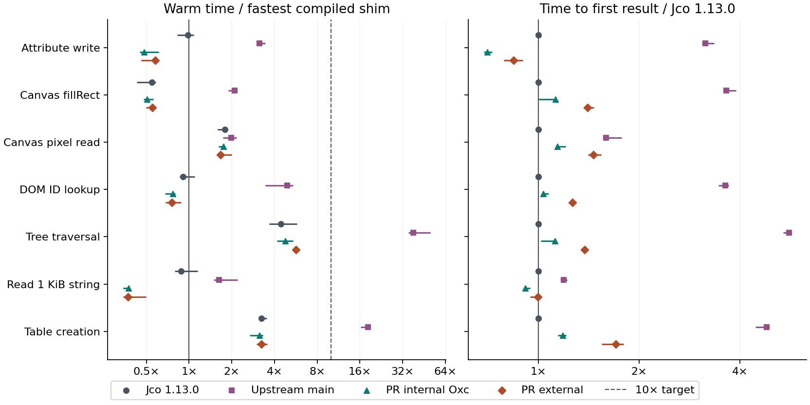

# Browser benchmark results

[Benchmark overview](../README.md)

## FIFO follow-up on PR 65

The exact FIFO head at `81c0d5d61` completed 12 balanced Chromium rounds, including all six Jco builds and the compiled shims, with 1,668 fresh documents and zero discarded rounds in the completed run. The preceding compiler and package matched the archived integration assets. Each workload served the same guest core across Jco builds. Compare revisions using measurements paired within this run. The release first-result median was 118.75 ms here and 63.33 ms in the earlier run. [Raw matrix](../web/bench/results/review-matrix-fifo-81c0d5d61.json.gz) · [FIFO PR](https://github.com/vados-cosmonic/jco/pull/65)

| FIFO matrix, medians across 21 workloads | Jco 1.13.0 | Upstream main | Internal Oxc | External runtime |
| --- | ---: | ---: | ---: | ---: |
| Import and initialization (ms) | 11.27 | 27.68 | 20.88 | 44.95 |
| First result (ms) | 118.75 | 425.23 | 122.40 | 154.38 |
| Complete JS, gzip (KiB) | 3.01 | 25.42 | 18.61 | 34.71 |

Relative to the preceding compiler in the same rounds, FIFO's overall paired warm ratios were **0.981×** (0.930–1.035) internally and **0.986×** (0.956–1.027) externally. First-result ratios were **1.006×** (0.956–1.040) and **1.015×** (0.998–1.036). Each interval summarizes the 12 round-level medians across workloads. Two internal workload import intervals and one external first-result interval were wholly slower. The fix adds 109 raw JS bytes in each mode and a median of 47 gzip bytes internally or 45 externally. [Correctness and isolated cost of callbacks](lock-release.md)

Both modes met the warm 10× shim target on all 21 headlines and 81 of 84 individual phases. Median import time exceeded 1.13.0 on all 21 workloads in each mode, with every individual interval wholly slower. No warm headline had an interval wholly slower than release. The largest warm shim gaps for the two modes were 5.40× and 5.82×, both on Rust tree traversal.



<details><summary>All 21 workloads at the FIFO revision</summary>

| Operation | Guest | Bundled / shim | External / shim | Bundled / 1.13 warm | External / 1.13 warm | Bundled / 1.13 first result | External / 1.13 first result |
| --- | --- | ---: | ---: | ---: | ---: | ---: | ---: |
| Attribute write | C | 0.48× | 0.46× | 0.51× | 0.55× | 0.69× | 0.79× |
| Attribute write | C++ | 0.45× | 0.58× | 0.47× | 0.47× | 0.70× | 0.90× |
| Attribute write | Rust | 0.61× | 0.59× | 0.58× | 0.59× | 0.73× | 0.84× |
| Canvas fillRect | C | 0.48× | 0.55× | 0.93× | 0.98× | 1.12× | 1.47× |
| Canvas fillRect | C++ | 0.56× | 0.58× | 0.94× | 1.00× | 1.00× | 1.38× |
| Canvas fillRect | Rust | 0.51× | 0.50× | 0.88× | 0.90× | 1.13× | 1.40× |
| Canvas pixel read | C | 1.77× | 1.60× | 1.06× | 1.06× | 1.14× | 1.54× |
| Canvas pixel read | C++ | 1.61× | 2.00× | 1.01× | 1.06× | 1.13× | 1.46× |
| Canvas pixel read | Rust | 1.75× | 1.67× | 1.02× | 0.99× | 1.21× | 1.41× |
| DOM ID lookup | C | 0.80× | 0.88× | 0.80× | 0.76× | 1.03× | 1.30× |
| DOM ID lookup | C++ | 0.77× | 0.68× | 0.70× | 0.75× | 1.03× | 1.26× |
| DOM ID lookup | Rust | 0.68× | 0.76× | 0.77× | 0.84× | 1.07× | 1.26× |
| Tree traversal | C | 4.75× | 5.68× | 1.02× | 1.00× | 1.02× | 1.38× |
| Tree traversal | C++ | 4.18× | 5.45× | 0.90× | 1.22× | 1.12× | 1.35× |
| Tree traversal | Rust | 5.40× | 5.82× | 1.04× | 1.11× | 1.13× | 1.37× |
| Read 1 KiB string | C | 0.34× | 0.50× | 0.42× | 0.57× | 0.91× | 1.00× |
| Read 1 KiB string | C++ | 0.38× | 0.34× | 0.40× | 0.36× | 0.94× | 1.02× |
| Read 1 KiB string | Rust | 0.37× | 0.37× | 0.39× | 0.41× | 0.90× | 0.94× |
| Table creation | C | 3.13× | 2.99× | 1.00× | 1.07× | 1.21× | 1.80× |
| Table creation | C++ | 3.32× | 3.24× | 1.07× | 1.20× | 1.14× | 1.70× |
| Table creation | Rust | 2.68× | 3.56× | 0.92× | 1.16× | 1.18× | 1.55× |

</details>

To verify the same generated assets and regenerate the tables and chart, run from the repository root.

```sh
python3 web/bench/review-matrix-report.py web/bench/results/review-matrix-fifo-81c0d5d61.json.gz \
  --compare-entries web/bench/results/review-matrix-sync-task-3e25d8d82.json.gz \
  --release-intervals --plot-builds /tmp/fifo-overview.png
```

## Browser performance on the Jco review branch

The review branch beat upstream main on all 21 warm headline workloads. Across C, C++ and Rust, tree traversal ran **8.4–9.2× faster internally** and **7.8–7.9× faster externally** than main. For warm table creation the ranges were **4.9–5.5×** and **4.5–5.5×**. These are within-round comparisons against main at `326f52ab4`. [Jco performance PR](https://github.com/vados-cosmonic/jco/pull/62) · [Pinned upstream revision](https://github.com/bytecodealliance/jco/commit/326f52ab4403466b21b989c995f9bb97b2b9e038)

| Median across the 21 workloads | Jco 1.13.0 | Upstream main at `326f52ab4` | Internal Oxc | External runtime |
| --- | ---: | ---: | ---: | ---: |
| Import and initialization (ms) | 5.19 | 11.94 | 9.47 | 18.38 |
| Time to first result (ms) | 63.33 | 207.45 | 62.06 | 76.78 |
| Complete JavaScript, raw (KiB) | 9.58 | 111.34 | 69.75 | 106.75 |
| Complete JavaScript, gzip (KiB) | 3.01 | 25.42 | 18.57 | 34.67 |
| JavaScript requests | 1 | 1 | 1 | 15 |

The two PR modes met the 10× shim target on 21/21 warm headline operations. C++ tree traversal had the largest gap at 4.93× internally and 4.98× externally. Against Jco 1.13.0, the internal and external modes matched or beat 16/21 and 13/21 warm medians and 9/21 and 5/21 first-result medians. Four internal and fourteen external first-result intervals were wholly slower than release. The only warm interval wholly slower than release was external C++ tree traversal (1.103×, individual 95% interval 1.001–1.404). [1,668 Chromium documents, module hashes and timings](../web/bench/results/review-matrix-sync-task-3e25d8d82.json.gz)

A second 12-round matrix used byte-identical shipping assets, the same Chromium and the same pinned main. Across the two runs, first result was measurably slower than 1.13.0 in both runs on three internal workloads (all three table guests) and thirteen external workloads. Import and initialization were slower in both runs on 20/21 internal and 21/21 external workloads. No warm headline or first guest call in isolation had an interval wholly slower than release in both runs. [Repeat timings and hashes](../web/bench/results/class-definitions-matrix-3e25d8d82.json.gz)

In each row, a marker shows the median across the three guest languages and a line spans their range. Lower ratios mean less time. The left panel compares warm execution against the fastest compiled shim for that operation. The right compares time from module import to the first completed guest result against Jco 1.13.0 within the same language and browser round.


## Results by guest and workload on PR 62

Each warm shim ratio uses the fastest compiled shim measured for that operation across the guest languages. Ratios against release pair the same language, workload and browser round. A ratio below 1 means Jco took less time. [Measured rounds and asset digests](../web/bench/results/review-matrix-sync-task-3e25d8d82.json.gz)

| Operation | Guest | Bundled / shim | External / shim | Bundled / 1.13 warm | External / 1.13 warm | Bundled / 1.13 first result | External / 1.13 first result |
| --- | --- | ---: | ---: | ---: | ---: | ---: | ---: |
| Attribute write | C | 0.55× | 0.56× | 0.56× | 0.56× | 0.71× | 0.76× |
| Attribute write | C++ | 0.52× | 0.52× | 0.49× | 0.51× | 0.66× | 0.74× |
| Attribute write | Rust | 0.67× | 0.68× | 0.56× | 0.58× | 0.69× | 0.78× |
| Canvas fillRect | C | 0.56× | 0.62× | 0.94× | 1.05× | 1.10× | 1.39× |
| Canvas fillRect | C++ | 0.53× | 0.52× | 0.89× | 0.93× | 1.04× | 1.28× |
| Canvas fillRect | Rust | 0.58× | 0.54× | 0.90× | 0.94× | 1.04× | 1.23× |
| Canvas pixel read | C | 1.82× | 1.73× | 1.10× | 1.00× | 1.12× | 1.33× |
| Canvas pixel read | C++ | 1.78× | 1.87× | 0.98× | 1.03× | 1.17× | 1.32× |
| Canvas pixel read | Rust | 1.77× | 1.78× | 0.90× | 0.99× | 1.18× | 1.17× |
| DOM ID lookup | C | 0.94× | 0.92× | 0.77× | 0.77× | 1.02× | 1.34× |
| DOM ID lookup | C++ | 0.88× | 0.85× | 0.78× | 0.76× | 1.08× | 1.30× |
| DOM ID lookup | Rust | 0.82× | 0.75× | 0.72× | 0.67× | 1.01× | 1.17× |
| Tree traversal | C | 4.45× | 4.57× | 0.98× | 1.04× | 0.94× | 1.21× |
| Tree traversal | C++ | 4.93× | 4.98× | 1.03× | 1.10× | 0.93× | 1.25× |
| Tree traversal | Rust | 4.05× | 4.56× | 0.94× | 1.07× | 0.96× | 1.18× |
| Read 1 KiB string | C | 0.37× | 0.36× | 0.47× | 0.49× | 0.92× | 1.00× |
| Read 1 KiB string | C++ | 0.37× | 0.38× | 0.47× | 0.47× | 0.97× | 1.04× |
| Read 1 KiB string | Rust | 0.36× | 0.38× | 0.46× | 0.49× | 0.98× | 0.97× |
| Table creation | C | 2.91× | 2.80× | 1.08× | 1.11× | 1.15× | 1.62× |
| Table creation | C++ | 2.56× | 2.60× | 1.06× | 0.98× | 1.13× | 1.54× |
| Table creation | Rust | 2.37× | 2.77× | 1.05× | 1.05× | 1.27× | 1.51× |
