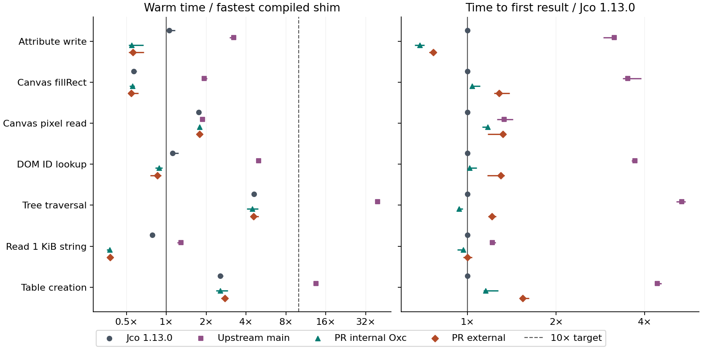

# Browser benchmark results

[Benchmark overview](../README.md)

## Browser performance on the Jco review branch

The review branch beat upstream main on all 21 warm headline workloads. Across C, C++ and Rust, tree traversal ran **8.4–9.2× faster internally** and **7.8–7.9× faster externally** than main. For warm table creation the ranges were **4.9–5.5×** and **4.5–5.5×**. These are within-round comparisons against main at `326f52ab4`. [Jco performance PR](https://github.com/vados-cosmonic/jco/pull/62) · [Pinned upstream revision](https://github.com/bytecodealliance/jco/commit/326f52ab4403466b21b989c995f9bb97b2b9e038)

| Median across the 21 workloads | Jco 1.13.0 | Upstream main at `326f52ab4` | Internal Oxc | External runtime |
| --- | ---: | ---: | ---: | ---: |
| Import and initialization (ms) | 5.19 | 11.94 | 9.47 | 18.38 |
| Time to first result (ms) | 63.33 | 207.45 | 62.06 | 76.78 |
| Complete JavaScript, raw (KiB) | 9.58 | 111.34 | 69.75 | 106.75 |
| Complete JavaScript, gzip (KiB) | 3.01 | 25.42 | 18.57 | 34.67 |
| JavaScript requests | 1 | 1 | 1 | 15 |

The two PR modes met the 10× shim target on 21/21 warm headline operations. C++ tree traversal had the largest gap at 4.93× internally and 4.98× externally. Against Jco 1.13.0, the internal and external modes matched or beat 16/21 and 13/21 warm medians and 9/21 and 5/21 first-result medians. Four internal and fourteen external first-result intervals were wholly slower than release. The only warm interval wholly slower than release was external C++ tree traversal (1.103×, individual 95% interval 1.001–1.404). [1,668 Chromium documents, module hashes and timings](../web/bench/results/review-matrix-sync-task-3e25d8d82.json.gz)

A second 12-round matrix used byte-identical shipping assets, the same Chromium and the same pinned main. Across the two runs, first result was measurably slower than 1.13.0 in both runs on three internal workloads (all three table guests) and thirteen external workloads. Import and initialization were slower in both runs on 20/21 internal and 21/21 external workloads. No warm headline or first guest call in isolation had an interval wholly slower than release in both runs. [Repeat timings and hashes](../web/bench/results/class-definitions-matrix-3e25d8d82.json.gz)

In each row, a marker shows the median across the three guest languages and a line spans their range. Lower ratios mean less time. The left panel compares warm execution against the fastest compiled shim for that operation. The right compares time from module import to the first completed guest result against Jco 1.13.0 within the same language and browser round.

