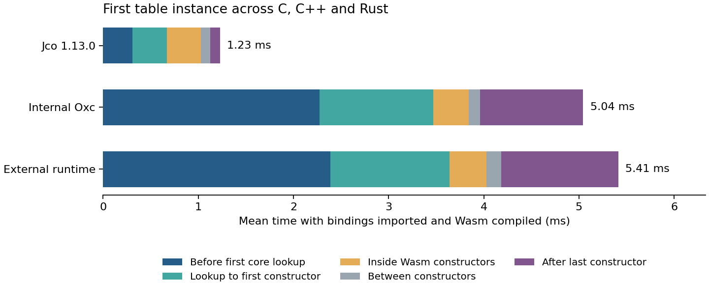
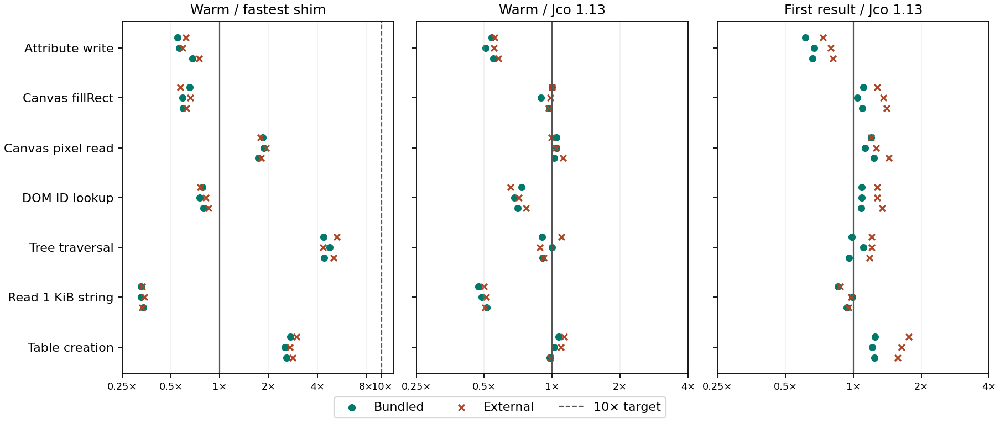
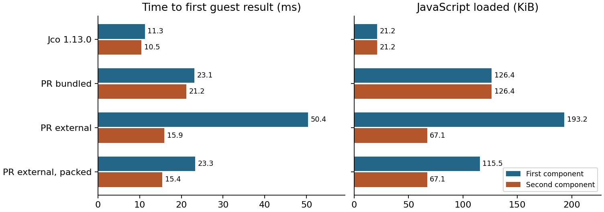

# Cold startup and instantiation

[Benchmark overview](../README.md)

## Preloading the bindings from the navigation response

A deployment that already knows the URLs can put a `Link` header on its HTML response. We tested this on the C table workload with the published PR assets, Chromium 156, Brotli responses and a fixed 10 ms server delay per asset. The header listed the generated entry and its runtime dependencies as `modulepreload` and the separately served guest core as `preload; as=fetch; crossorigin=anonymous`. Both arms loaded identical HTML and assets for each build. The timer began at navigation start, before the browser received the header. The server and browser each observed one transfer per asset. [Trial samples and requests](../web/bench/results/navigation-preload-3e25d8d82.json.gz)

| Build | Navigation to first result, ordinary / hinted | Paired hinted / ordinary time (individual 95% interval) | Hinted / hinted 1.13.0 (individual 95% interval) |
| --- | ---: | ---: | ---: |
| Jco 1.13.0 | 446.47 / 367.54 ms | 0.919× (0.771–1.039) | 1.000× |
| Internal Oxc | 436.30 / 370.45 ms | 0.854× (0.779–0.947) | 0.983× (0.766–1.118) |
| External runtime | 509.33 / 478.23 ms | 0.915× (0.846–0.989) | 1.212× (1.103–1.365) |

The internal and external first results arrived 14.6% and 8.5% sooner in the paired comparison. Applying the same hints to release and external Jco still left external Jco 21.2% slower. Internal Jco's interval included parity. Each cell used 12 fresh browser contexts across 12 balanced rounds, with all six treatments per round. The ratios pair observations within rounds, so they can differ from ratios of the displayed medians. Absolute times include loading the demo page and running the table guest. This single-workload deployment experiment leaves the default generator and the other 20 workloads open.

To repeat, use the checked runtime and internal compiler at `3e25d8d82`, set `CHROME_BIN` to Chromium, and run from the repository root.

```sh
matrix=web/bench/results/review-matrix-sync-task-3e25d8d82.json.gz
node web/bench/matrix-startup-phases.mjs "$checkout" "$matrix" c table-update /tmp/preload.json.gz --navigation-preload
python3 web/bench/navigation-preload-report.py /tmp/preload.json.gz "$matrix"
```

### When should the runtime define its shared classes?

The runtime shares the implementation of `RepTable`, `ComponentAsyncState`, `AsyncTask` and `AsyncThread` across instances. Each store still has its own subclass, state and constructor identity. We tried defining the four implementation classes when their modules load. The standard package currently defines each one on first use. The trial rebuilt both the external runtime and the internal Oxc compiler from the same four source changes. The previous first-instance trace measured 0.15–0.37 ms in each external factory, including the work to construct the store-specific subclass. [Exact runtime patch](../web/bench/experiments/eager-class-definitions.patch) · [First-instance trace](../web/bench/results/init-task-trace-3e25d8d82.json.gz)

Across the full 21-workload, 1,668-document matrix, the paired first-result ratio (trial / shipping) was **0.999× internally** (individual 95% interval 0.943–1.027) and **0.992× externally** (0.963–1.021). The warm ratios were 1.013× (0.994–1.032) and 1.017× (0.971–1.065). Median complete gzip JS shrank by four bytes internally and grew by 18 bytes externally. The trial passed 525 checked-runtime tests and 71 integration tests covering synchronous host imports, numeric exports, resources and shutdown. The PR retains first-use class definitions. [Full paired matrix](../web/bench/results/class-definitions-matrix-3e25d8d82.json.gz)

In a second trial, each page compiled the table guest’s Wasm before importing its bindings, constructed its first instance and ran eight rows. Moving the class definitions saved **0.65 ms** at instantiation internally and **0.82 ms** externally. The internal import took 0.56 ms longer (0.06–1.06 ms). From starting the import to the completed guest result, the ratios were 0.989× (0.929–1.064) and 0.969× (0.925–1.090). Each estimate pairs treatments in the same process and summarizes the C, C++ and Rust guests. [Phase timings and module digests](../web/bench/results/class-definitions-startup-3e25d8d82.json.gz)

The same 20-round trial included fresh pages that imported a public entry for one lightweight operation. The table shows the increase in live V8 JS heap after forced GC, relative to the pre-import measurement in each page. Eager class definitions increased every entry’s retained heap, even though none of these calls needed a class instance.

| Standalone operation | Shipping heap delta | Trial heap delta | Paired extra bytes |
| --- | ---: | ---: | ---: |
| Read the disposal symbol from `core` | 56,056 B | 75,684 B | 19,628 B |
| Create the instance flag map from `component` | 37,392 B | 54,088 B | 16,696 B |
| Create the current task ID list from `sync-task` | 56,208 B | 103,120 B | 46,912 B |

<details><summary>Reproduce the class-definition trials</summary>

Build the shipping Jco checkout at `3e25d8d82` in `$stock`. In a second checkout of the same revision at `$trial`, apply the patch before building the runtime package, regenerating the embedded runtime and building the transpiler. Set `$stage` to the staged upstream compiler and `CHROME_BIN` to Chromium. Run from this repository. The matrix uses the shipping PR checkout as its primary build. Its two archive labels beginning with `previous-` hold the experimental compilers. The report prints experimental / shipping timing ratios.

```sh
set -e
git -C "$trial" apply "$PWD/web/bench/experiments/eager-class-definitions.patch"
# Build the trial checkout and embedded compiler after applying the patch.
control=web/bench/results/review-matrix-sync-task-3e25d8d82.json.gz
reference=web/bench/results/precompiled-confirm-3e25d8d82.json.gz
ROUNDS=12 node web/bench/review-matrix.mjs "$stock" "$stage" /tmp/classes.json.gz --compare-compilers "$trial/packages/jco-transpile" "$trial/packages/jco-cm-runtime/dist"
node web/bench/class-definition-startup.mjs "$stock" "$trial" /tmp/classes.json.gz "$reference" /tmp/classes-startup.json.gz
python3 web/bench/review-matrix-report.py /tmp/classes.json.gz --release-intervals
python3 web/bench/class-definition-report.py "$control" /tmp/classes.json.gz "$reference" /tmp/classes-startup.json.gz
```

</details>

### Where first instantiation spends time after compilation

The C, C++ and Rust table workloads still take longer to instantiate on the PR when the browser has already imported the bindings and compiled every Wasm core. Each timing run used 432 fresh Chromium documents over 12 balanced rounds. Each document timed its first call to the public async `instantiate` API, ran the guest and checked all six table measurements. It then timed six batches of eight instances reusing the compiled modules. The repeated figure uses the last five batches. Timings include Wasm start functions and exclude download, compilation, the benchmark guest call and explicit shutdown. [First timing run](../web/bench/results/precompiled-repeat-3e25d8d82.json.gz) · [Independent repeat](../web/bench/results/precompiled-confirm-3e25d8d82.json.gz)

| Default instantiation | Jco 1.13.0 | Internal Oxc | External runtime |
| --- | ---: | ---: | ---: |
| First instance, run 1 | 1.05 ms | 4.62 ms | 5.27 ms |
| First instance, run 2 | 1.04 ms | 4.78 ms | 5.19 ms |
| Repeated instance, run 1 | 0.093 ms | 0.404 ms | 0.434 ms |
| Repeated instance, run 2 | 0.096 ms | 0.392 ms | 0.443 ms |

A separate 108-document trace used the same JS and Wasm bytes and timestamped core lookups and calls to the asynchronous Wasm constructor. Before the first core lookup, internal Oxc spent an additional **1.93 ms** versus 1.13.0 and the external runtime **1.94 ms**. From the lookup to invoking the first constructor, the additional time was **0.80 ms** and **0.85 ms**. After the last Wasm constructor returned, the additional time was **1.04 ms** and **1.12 ms**. All adapter constructors together added just **0.015 ms** and **0.025 ms** versus release. Each difference is the median of the three language-paired differences per round, then the median across rounds. The boundaries include JS execution and scheduling and do not attribute the time to individual runtime functions. [Core order, timestamps, asset hashes and guest sizes](../web/bench/results/precompiled-trace-3e25d8d82.json.gz)



We also tried passing a callback that uses `new WebAssembly.Instance` for the 24–276-byte adapter cores and retains `WebAssembly.instantiate` for the main guest. Against an explicit all-async callback, the first-instance ratios were 1.041× internally and 1.071× externally in run 1, and 0.999× and 1.006× in run 2. All four individual 95% intervals included parity. Synchronous construction of every core also had intervals including parity for both PR builds in both runs. The measurements point to the binding setup and completion paths as the larger opportunity.

<details><summary>Reproduce the precompiled-core measurements</summary>

Use the Jco checkout and Chromium binary from the 21-workload matrix above. Install the benchmark fork's locked web dependencies, which pin Jco 1.13.0. Run from the repository root.

```sh
set -e
matrix=web/bench/results/review-matrix-sync-task-3e25d8d82.json.gz
compiler="$after/packages/jco-transpile"
runtime="$after/packages/jco-cm-runtime/dist"
node web/bench/precompiled-instances.mjs "$compiler" "$runtime" "$matrix" /tmp/timing.json.gz
node web/bench/precompiled-instances.mjs "$compiler" "$runtime" "$matrix" /tmp/repeat.json.gz
node web/bench/precompiled-instances.mjs "$compiler" "$runtime" "$matrix" /tmp/trace.json.gz --trace
python3 web/bench/precompiled-instances-report.py /tmp/timing.json.gz "$matrix" --trace /tmp/trace.json.gz --plot /tmp/trace.png
python3 web/bench/precompiled-instances-report.py /tmp/repeat.json.gz "$matrix"
```

</details>

#### Cost of building the trap-message table

Both binding modes build a nine-entry map at instantiation to translate engine errors into Component Model trap messages. A trial moved the same factory call into the first read of the instance’s normalization context. Across 480 fresh Chromium documents, both modes preserved the original error object, its normalized message and the single `onTrap` notification. The deferred bindings built zero maps during the checked instantiation and exactly one by the time the host-induced trap was reported. [Timing samples](../web/bench/results/trap-map-timing-3e25d8d82.json.gz) · [Repeat and heap samples](../web/bench/results/trap-map-heap-3e25d8d82.json.gz)

| Binding mode | First instantiation, trial / shipping (95% interval) | Independent repeat | Retained JS heap saved per live instance |
| --- | ---: | ---: | ---: |
| Internal Oxc | 0.950× (0.907–1.046) | 0.978× (0.952–1.027) | 96 B |
| External runtime | 0.980× (0.942–1.053) | 0.987× (0.886–1.030) | 96 B |

Each run used 20 browser processes and paired the three table guests within each process, with the binding already imported and the guest cores compiled. The repeated-instantiation intervals also included parity in both runs. The heap trial measured the increase from eight to 32 live guests after forced garbage collection in each page. The 96-byte saving was about 0.6% of the shipping JS heap increase per instance. The Jco PR keeps the eager table.

<details><summary>Reproduce the trap-map trials</summary>

Use the built compiler, runtime distribution, benchmark matrix and Chromium from the precompiled-core comparison above.

```sh
reference=web/bench/results/precompiled-confirm-3e25d8d82.json.gz
trial=web/bench/trap-map-trial.mjs
heap=web/bench/trap-map-heap.mjs
patch -o "$trial" web/bench/precompiled-instances.mjs web/bench/experiments/trap-map-trial.patch
patch -o "$heap" "$trial" web/bench/experiments/trap-map-heap.patch
node "$trial" "$compiler" "$runtime" "$matrix" /tmp/trap-timing.json.gz
node "$heap" "$compiler" "$runtime" "$matrix" /tmp/trap-heap.json.gz
python3 web/bench/trap-map-report.py "$matrix" "$reference" /tmp/trap-timing.json.gz "$trial" /tmp/trap-heap.json.gz "$heap"
```

</details>

#### Does skipping the initialization task improve time to first result?

The initialization task gives a Wasm start function a current task and implicit thread if it calls a component import. In these three table guests, the C and C++ initializers call only local Wasm routines, and the Rust start function fills memory. We compared the shipped bindings with experimental copies that omit task creation, register selection and task cleanup for these exact guest binaries. Both builds still instantiate every core and execute every Wasm start function. The harness checks the reachable startup instructions and the C/C++ start-module import against the measured guest before running. This experiment uses the original cores and ordinary browser constructors. Other components can call the host during startup, and the public instantiation API can receive replacement cores. [Guest checks and experimental edits](../web/bench/init-task-probe.mjs)

| Workload and binding | Time saved constructing the instance | Extra time on the first guest call | Time to first result, experiment / shipped (95% interval) |
| --- | ---: | ---: | ---: |
| 8 rows, internal Oxc | 2.04 ms | 1.46 ms | 0.947× (0.907–0.997) |
| 8 rows, external runtime | 2.07 ms | 2.06 ms | 0.991× (0.963–1.048) |
| 2,000 rows, internal Oxc | 1.94 ms | 2.05 ms | 0.996× (0.945–1.086) |
| 2,000 rows, external runtime | 2.19 ms | 3.58 ms | 1.026× (0.971–1.117) |

Each workload ran in 300 fresh Chromium documents across 20 balanced rounds. The bindings were imported and Wasm compiled before the clock started. The first-result clock stopped when the guest returned its completed table report. Each column summarizes per-round, language-paired measurements independently. Skipping the task improved the 8-row internal first result by 5.3%. Neither full-workload interval established an improvement. The fork PR keeps the existing initialization behavior. [8-row samples](../web/bench/results/init-task-small-3e25d8d82.json.gz) · [2,000-row samples](../web/bench/results/init-task-full-3e25d8d82.json.gz)

In a separate 108-document trace, creating the task and selecting its registers took **0.92 ms internally and 1.01 ms externally**. After the last core returned, resolving the task took **0.30 / 0.33 ms**, exiting it took **0.65 / 0.70 ms**, and clearing its registers took about **0.08 ms** in each mode. Before the first lookup, the four named external class factories each took 0.15–0.37 ms. A further 0.83 / 0.98 ms elapsed between starting the timer and the first marker in the generated internal / external function. These instrumented spans include first-use engine costs. The table above uses separate, uninstrumented pages. [Phase timings and served file hashes](../web/bench/results/init-task-trace-3e25d8d82.json.gz)

<details><summary>Reproduce the initialization task comparison</summary>

Use the same compiler, runtime and browser as the precompiled-core study above. Put `wasm-tools` on `PATH` so the harness can inspect the original guest functions.

```sh
set -e
matrix=web/bench/results/review-matrix-sync-task-3e25d8d82.json.gz
reference=web/bench/results/precompiled-confirm-3e25d8d82.json.gz
trial=web/bench/init-task-trial.mjs
patch -o "$trial" web/bench/precompiled-instances.mjs web/bench/experiments/init-task-trial.patch
for study in trace small full; do
  node "$trial" "$compiler" "$runtime" "$matrix" "/tmp/init-$study.json.gz" "$study" "$reference"
done
python3 web/bench/init-task-report.py "$matrix" "$reference" "$trial" /tmp/init-trace.json.gz /tmp/init-small.json.gz /tmp/init-full.json.gz
```

</details>

The loader and task experiments above and below use two-sided sign intervals over independent browser rounds. Earlier versions of several secondary reports used bounds one observation too far toward the center. Recomputing the intervals widened those bounds. For example, the shipped task-entry improvement on the limited HTTP/2 connection is 1.2% with a corrected 95% interval of 0.7–2.2%. The primary 21-workload matrix already used the inclusive binomial tail. [Interval calculation and examples](../web/bench/sign_interval.py)

### Where C table startup spends time

The external entry finished downloading in a median of 1.52 ms. The last of its JavaScript dependencies finished another **16.60 ms** later (95% interval 13.85–18.81 ms across rounds). Internal Oxc and release each served one JavaScript module. Between the final JavaScript response and the start of the guest Wasm request, internal Oxc took a paired **6.42 ms more** than release (5.43–6.55 ms). That interval can include linking, parsing, running module code and browser scheduling. [Per-request timings and V8 coverage](../web/bench/results/c-table-registry-startup-eda794c50.json.gz)

| C table, fresh document | Jco 1.13.0 | Internal Oxc | External checked |
| --- | ---: | ---: | ---: |
| Final JS response to guest Wasm request (ms) | 2.81 | 9.16 | 7.34 |
| Guest Wasm request to response end (ms) | 1.64 | 1.43 | 1.56 |
| Guest Wasm response end to import ready (ms) | 2.77 | 2.92 | 3.37 |
| Total import (ms) | 8.78 | 15.24 | 30.55 |
| JS served (bytes) | 9,809 | 73,079 | 125,332 |
| JS reached by import readiness (bytes) | 2,799 | 17,343 | 26,328 |
| JS reached by the first guest result (bytes) | 6,983 | 28,184 | 36,811 |

The timing probe used 18 balanced rounds on uncompressed loopback, with a fresh browser context per build and the shared host already loaded. It used the same JS and Wasm bytes as the full matrix. Six separate documents collected V8 block coverage at readiness or after the complete guest result. Coverage counts UTF-8 source bytes in reached ranges. Error handling, shutdown and other workloads can reach additional code.

#### How much does the asynchronous driver cost synchronous demos?

The six C, C++ and Rust DOM-query and table-update adapters import seven task operations. An experimental package entry re-exports those operations from their implementations, letting a synchronous page skip the asynchronous driver. A document import map selects that entry for this benchmark. Both treatments run the same generated JavaScript and guest Wasm. The general task entry still exports its original API and costs 193 additional raw bytes when imported alone. No other existing public entry grew. [Runtime package experiment](../web/bench/experiments/sync-task-entry.patch)

| External checked runtime, six workloads | Shipped | Narrow task entry |
| --- | ---: | ---: |
| Runtime JS requests per workload | 15 | 14 |
| Runtime JS, uncompressed bytes | 101,147 | 85,602 |
| Runtime JS, Brotli bytes | 31,045 | 26,833 |

| HTTP/2 transport | Import time, trial / shipped | Time to first result, trial / shipped |
| --- | ---: | ---: |
| Loopback | 0.961× (0.912–0.997) | 0.974× (0.954–0.997) |
| 40 ms latency, 10 Mbit/s | 0.986× (0.980–0.991) | 0.990× (0.984–0.995) |

Across the six workloads, removing 4,212 Brotli bytes cut first-result time by 2.6% on loopback and 1.0% on the limited connection in this run. Each of 16 fresh Chromium processes ran all four treatments for every workload in a balanced order, for 384 documents. The table gives medians and individual 95% sign intervals across rounds, using the geometric mean of the six paired ratios within each round. The experiment exercises external package delivery. The internal Oxc bundle and the public runtime contract on the Jco PR are unchanged. [Per-document timings, request traces and public-entry sizes](../web/bench/results/sync-task-entry-eda794c50.json.gz)

<details><summary>Reproduce the narrow runtime entry comparison</summary>

Use a built Jco checkout at `eda794c50` as `$after` and set `CHROME_BIN` to a Chromium executable. From the demo checkout, apply the experimental patch to a copy of the package-layout runner and run the paired comparison.

```sh
matrix=web/bench/results/review-matrix-registry-eda794c50.json.gz
runner=web/bench/sync-task-trial.mjs
patch -o "$runner" web/bench/runtime-chunks.mjs web/bench/experiments/sync-task-entry.patch
node "$runner" "$after" "$matrix" /tmp/sync-task-entry.json.gz --sync-task-entry
python3 web/bench/sync-task-entry-report.py /tmp/sync-task-entry.json.gz "$matrix" "$runner"
```

</details>

#### Does earlier discovery of the last two runtime chunks help?

The checked external runtime's `async-task.js` entry already depends indirectly on the core and numeric-conversion chunks. A benchmark variant appended direct imports for those two files after its existing imports. This added 80 bytes (41 Brotli) to one module. Every document still fetched the same 16 JavaScript URLs and one guest Wasm URL exactly once and completed the 2,000-row C table workload.

| Transport | Last of the two chunks discovered earlier, trial 1 / repeat | Paired first-result ratio, trial 1 (95% interval) | Paired first-result ratio, repeat (95% interval) |
| --- | ---: | ---: | ---: |
| HTTP/1.1, uncompressed loopback | 3.91 / 4.21 ms | 1.011× (0.963–1.167) | 0.972× (0.935–1.031) |
| HTTP/2, Brotli loopback | 2.75 / 1.99 ms | 0.940× (0.890–1.100) | 1.032× (0.964–1.120) |
| HTTP/2, Brotli, 40 ms and 10 Mbit/s | 3.43 / 3.14 ms | 1.009× (0.996–1.018) | 0.992× (0.978–1.015) |

The first-result ratios compare the added imports with the shipped package. On the limited connection, the paired median time saved at the **last JS response** was only 0.05 ms in trial 1 (−0.92 to 1.55) and 0.10 ms in the repeat (−1.45 to 1.58). Earlier discovery did not produce a repeatable import or first-result improvement on any transport. The extra imports remain a benchmark experiment. Each trial ran 18 balanced rounds in a new Chromium process with 108 fresh browser contexts. The raw samples distinguish when Chromium scheduled the fetch, sent its request, received its first byte and finished the response. [First trial](../web/bench/results/task-import-order-eda794c50.json.gz) · [Independent repeat](../web/bench/results/task-import-order-repeat-eda794c50.json.gz)

```sh
matrix=web/bench/results/review-matrix-registry-eda794c50.json.gz
node web/bench/task-import-order.mjs "$after" "$matrix" /tmp/task-order.json.gz
python3 web/bench/task-import-order-report.py /tmp/task-order.json.gz "$matrix"
```

<details><summary>Reproduce the size, timing and startup comparisons</summary>

Build `1919c56ed` in `before` and `eda794c50` in `after`. Install the benchmark dependencies, prepare the upstream distribution using the full matrix setup and point `CHROME_BIN` at Chromium. The first command checks the staged upstream revision used in this comparison.

```sh
set -e
test "$(cat "$stage/commit")" = 326f52ab4403466b21b989c995f9bb97b2b9e038
previous=web/bench/results/review-matrix-init-ae16355e9.json.gz
node web/bench/resource-table-registry.mjs "$before/packages/jco-transpile" "$after/packages/jco-transpile" "$previous" /tmp/registry-sizes.json.gz
ROUNDS=12 node web/bench/review-matrix.mjs "$after" "$stage" /tmp/registry-matrix.json.gz --compare-compilers "$before/packages/jco-transpile"
python3 web/bench/review-matrix-report.py /tmp/registry-matrix.json.gz --release-intervals --plot /tmp/registry-matrix.png
node web/bench/matrix-startup-phases.mjs "$after" /tmp/registry-matrix.json.gz c table-update /tmp/registry-startup.json.gz
python3 web/bench/matrix-startup-phases-report.py /tmp/registry-startup.json.gz /tmp/registry-matrix.json.gz
```

</details>

## Native await in browser module initialization

A direct ES module already waits for core Wasm compilation and instantiation. Jco now emits native `await` for the internal Oxc bundle and the standard checked external runtime. This removes the per-module generator and its promise driver from all 42 measured entries. A custom instantiator or a `--tla-compat` caller can observe synchronous completion, so these modes still use the driver. [Compiler change](https://github.com/vados-cosmonic/jco/commit/ae16355e9)

The remaining driver now returns as soon as its generator finishes. Previously it resolved the initialization promise, tried to call `.then` on the generator’s final `undefined` value and caught the resulting `TypeError`. An ordinary import appeared to succeed either way. A Node inspector check recorded one caught exception on the old compiler and zero on the final compiler, in both binding modes with and without `--tla-compat`. The loader tests also exercise host errors and JSPI suspension during a core start. [Driver fix and regression test](https://github.com/vados-cosmonic/jco/commit/578b213ef)

| Change from the preceding PR compiler | Internal Oxc | External checked |
| --- | ---: | ---: |
| Median reduction per minified JS entry | 362 bytes | 365 bytes |
| Median reduction per gzipped JS entry | 148 bytes | 158 bytes |
| Import and initialization time, new / previous | 0.999× (0.964–1.011) | 0.950× (0.926–0.977) |
| First-result time, new / previous | 0.999× (0.966–1.014) | 1.004× (0.994–1.024) |
| Warm operation time, new / previous | 1.026× (0.967–1.052) | 1.026× (0.976–1.049) |

External import and initialization took 5.0% less time in the paired comparison (95% interval 2.3–7.4% less). The intervals for internal import, first result and warm execution included parity. Some earlier rounds shared the machine with compiler checks. In the final six-round scheduling block the paired median import ratios were 1.002× internally and 0.960× externally.

Each of 18 Chromium processes ran the previous and new compilers in both modes, Jco 1.13.0, pinned upstream main and the available compiled shims. The 2,502 fresh documents each executed a full first call and a second call. The timing ratios above use one median across the 21 paired workloads within each browser process, then an individual 95% sign interval across processes. Every treatment occupied every position and followed every other treatment equally within each workload. The separately served Wasm and external runtime bytes matched across both compilers. [Raw samples, assets and compiler hashes](../web/bench/results/review-matrix-init-ae16355e9.json.gz)

| Browser metric | Jco 1.13.0 | Upstream main at `326f52ab4` | Internal Oxc | External checked |
| --- | ---: | ---: | ---: | ---: |
| Import (ms) | 5.26 | 12.53 | 9.83 | 20.80 |
| Time to first guest result (ms) | 60.88 | 210.92 | 65.44 | 76.50 |
| Minified JS entry (KiB) | 9.58 | 111.34 | 70.21 | 23.72 |
| Total JS (KiB) | 9.58 | 111.34 | 70.21 | 122.50 |
| Total gzipped JS (KiB) | 3.01 | 25.42 | 18.63 | 39.38 |

Across the 21 warm headline workloads, internal Oxc met the 10× shim target in 21/21 and the external runtime in 21/21. The slowest ratios were 4.78× and 5.26× respectively. Internal and external matched or beat release on 16/21 and 16/21 warm workloads and 8/21 and 6/21 first results. Both modes met the 10× target on 81/84 individual phases. Absolute times and sizes in the table are medians of workload medians.



<details><summary>Reproduce the paired compiler comparison</summary>

Build Jco at `084063ed1` for `before`, at `ae16355e9` for `after`, and at `578b213ef` for `final`. Prepare `stage` using the [full matrix setup](revision-comparisons.md#full-demo-matrix-on-the-merged-pr) and set `CHROME_BIN` to Chromium. The final revision consolidates the driver used by custom instantiation and TLA compatibility. The adapter verifier checks all 42 timed default-mode entries and their guest and runtime files against the final build.

```sh
old=web/bench/results/review-matrix-minified-084063ed1.json.gz
ROUNDS=18 node web/bench/review-matrix.mjs "$after" "$stage" /tmp/init.json.gz --compare-compilers "$before/packages/jco-transpile"
python3 web/bench/review-matrix-report.py /tmp/init.json.gz --compare-entries "$old" --release-intervals --plot /tmp/init.png
node web/bench/verify-matrix-adapters.mjs "$final" /tmp/init.json.gz
```

</details>

### Loading one component and then a second

On the review branch, the first component fetched a median of 23 JavaScript files with the checked external provider. Packing the runtime exports used by these demos into one shared ES module cut that to two files. The median time to the first guest result fell from **50.36 ms to 23.28 ms**, alongside **23.13 ms** for the internal Oxc bundle and **11.26 ms** for Jco 1.13.0. With the shared module already loaded, the second component returned its first result in **15.42 ms**, compared with **21.24 ms** for the internal bundle and **10.45 ms** for 1.13.0. [Measured Jco revision](https://github.com/vados-cosmonic/jco/commit/dc366893262deb4605c5ca7fb35da3f1fe587357)



| Build | Component | Import (ms) | First result (ms) | JS requests | JS (KiB) | JS gzip (KiB) |
| --- | --- | ---: | ---: | ---: | ---: | ---: |
| Jco 1.13.0 | First | 7.45 | 11.26 | 1 | 21.2 | 3.4 |
| Jco 1.13.0 | Second | 7.39 | 10.45 | 1 | 21.2 | 3.4 |
| PR bundled | First | 15.34 | 23.13 | 1 | 126.4 | 23.6 |
| PR bundled | Second | 14.29 | 21.24 | 1 | 126.4 | 23.6 |
| PR external | First | 41.59 | 50.36 | 23 | 193.2 | 50.8 |
| PR external | Second | 9.73 | 15.93 | 1 | 67.1 | 8.4 |
| PR external, packed provider | First | 15.67 | 23.28 | 2 | 115.5 | 23.4 |
| PR external, packed provider | Second | 9.40 | 15.42 | 1 | 67.1 | 8.4 |

The packed configuration is an application build experiment. Rolldown bundles the named exports that the 15 generated entries import from the checked runtime. A browser import map directs those specifiers to the same file. The generated external bindings and guest Wasm are byte-identical with either provider layout. In all 15 workload and guest pairs, the packed provider returned the first result sooner than the ordinary external package. For the second component, it also beat the internal bundle in all 15 pairs. Every per-case 95% sign-test interval favored packing in those two comparisons. [Shared provider build](../web/bench/shared-provider.mjs)

Twelve rounds used 720 fresh Chromium 156 documents with DevTools disconnected. Each document loaded the common host, then imported and ran the same compiled guest twice under distinct entry and Wasm URLs. Both imports transferred their own generated files. The second reused the external runtime by URL. The runner checked all transfer sizes and guest reports and balanced the four build orders within each workload and language. Guests used small fixed workloads for attribute writes, canvas draws, DOM queries, tree traversal and table creation. Each table cell is the median of 15 workload and guest medians. The server served uncompressed responses over loopback. The gzip column sums each requested JS file compressed separately at level 9. [Browser runner](../web/bench/provider-startup.mjs) · [Raw samples and asset hashes (gzip)](../web/bench/results/provider-startup.json.gz)

To repeat this comparison, use the review checkout and native generator from the preceding commands. Generate the 1.13.0 baseline files using the size comparison setup below. The report can also regenerate the chart with Matplotlib and `--plot web/bench/results/provider-startup.png`.

```sh
CHROME_BIN=/path/to/chrome node web/bench/provider-startup.mjs /path/to/jco \
  /path/to/jco/target/debug/examples/transpile web/bench/results/provider-startup.json.gz
python3 web/bench/provider-startup-report.py
```

### Allocations before the first result

The checked runtime now allocates a resource map when it first needs to look up a representation and creates a promise when code actually waits for a synchronous import to finish. Across the 15 small workload and guest pairs, the change saved **7–8 Map constructions and one call to `Promise.withResolvers` per component instance** by the first guest result. The median Map count dropped from **14 to 7** for the internal bundle, external runtime and packed external runtime. Jco 1.13.0 also constructed a median of 7 Maps. [Source change](https://github.com/vados-cosmonic/jco/commit/d840e94f7)

The allocation study used 480 documents and 960 instantiations across the two revisions. It counted JavaScript `Map` constructions and calls to `Promise.withResolvers`, including the returned promise and resolver pair as a single call. The counters were installed after host setup and restored after each guest result. Run the provider startup command with `ROUNDS=4` and the final argument `--allocations` at each revision. The report accepts the earlier run with `--allocations-before`. [Before samples](../web/bench/results/allocations-before.json.gz) · [After samples](../web/bench/results/allocations-after.json.gz)
