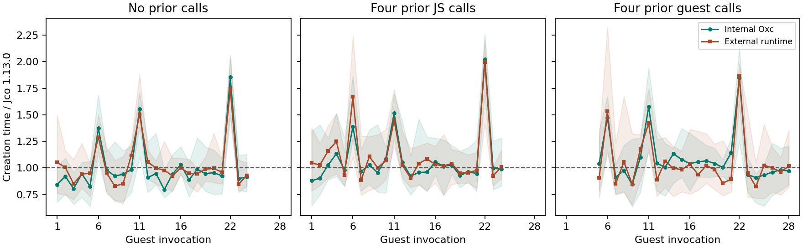
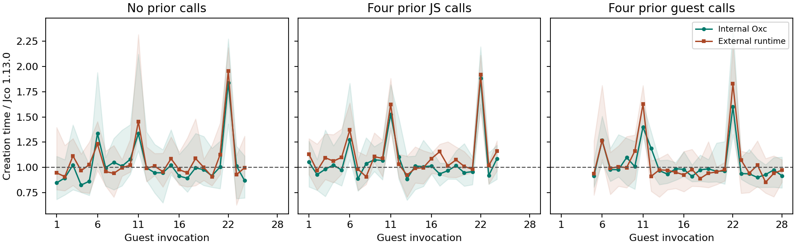
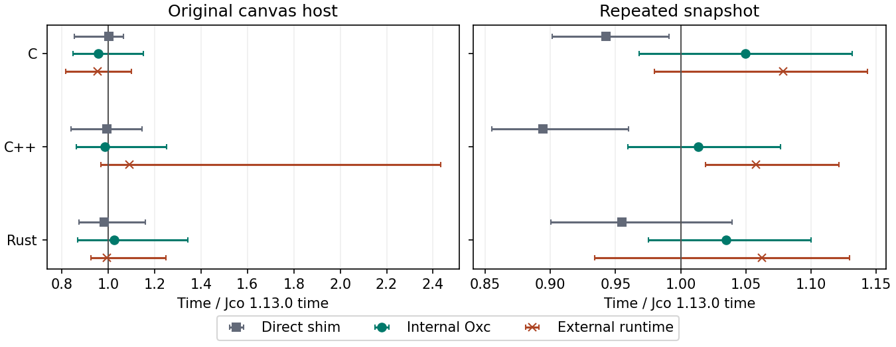
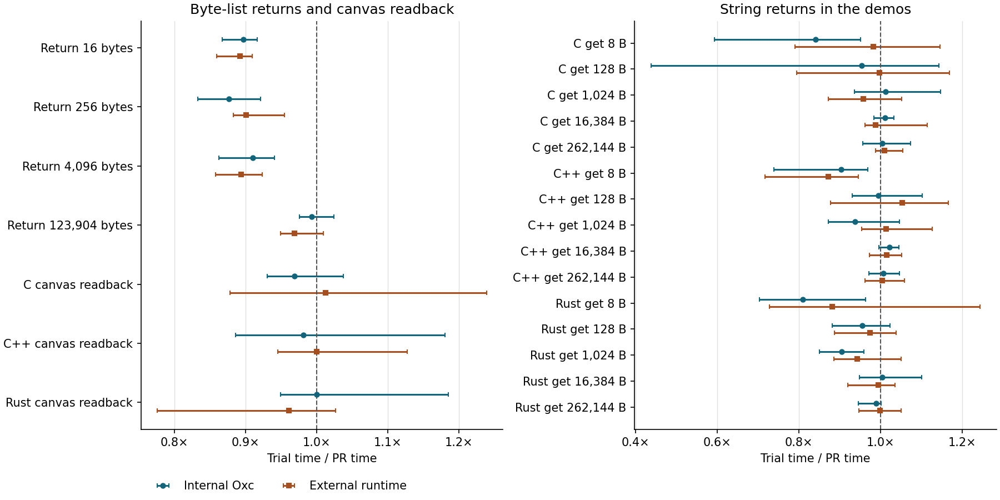
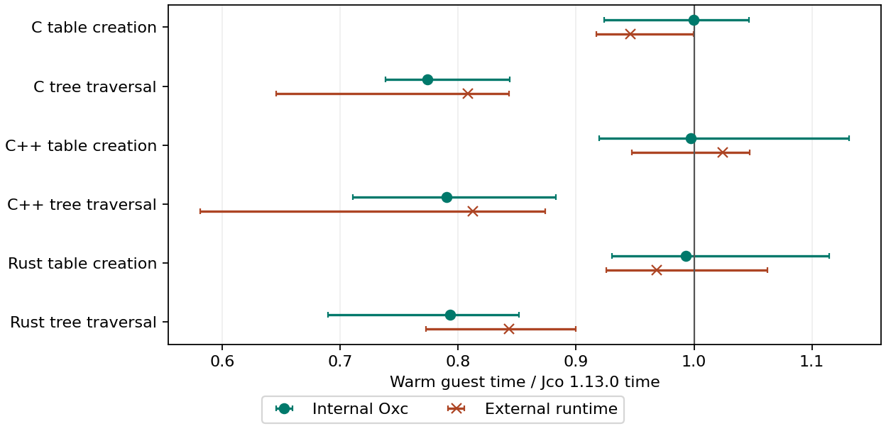
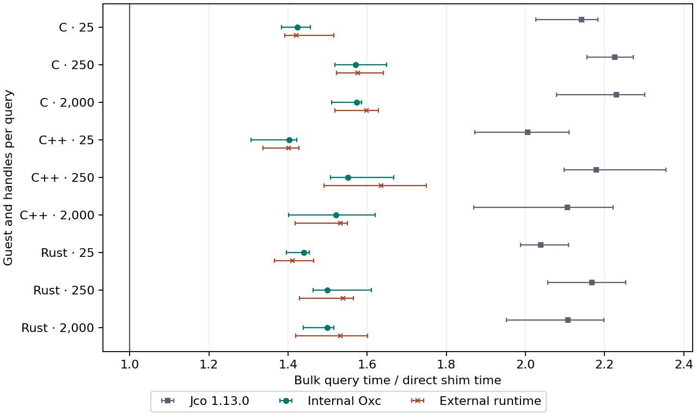

# DOM and canvas performance

[Benchmark overview](../README.md)

### Returning the bulk DOM query results on both sides

The three original subphases outside 10× are bulk DOM queries. The Embind demo discards the live collection. The WIT host materializes it as an array, passes all the handles to the guest and lets the guest drop them. The table below runs the same guest Wasm with a direct shim that performs those operations too. It uses the exact minified release, internal and external assets from the full matrix. Every pass made ten host queries and returned 20,000 elements. The direct shim ended every checked sequence with zero live handles. [Original Embind call](../cpp/dom-query/emscripten/main.cpp#L72) · [Direct shim](../web/bench/dom-core-shim.mjs) · [Paired timings and counts](../web/bench/results/bulk-dom-history-4b9682bfe.json.gz)

| Guest | Handles per query | Direct (ms) | 1.13.0 / direct | Bundled / direct | External / direct | Bundled / 1.13.0 | External / 1.13.0 |
| --- | ---: | ---: | ---: | ---: | ---: | ---: | ---: |
| C | 2000 | 5.86 | 2.15× (1.99–2.27) | 1.51× (1.39–1.56) | 1.51× (1.45–1.61) | 0.70× (0.68–0.72) | 0.71× (0.66–0.74) |
| C++ | 2000 | 5.44 | 2.25× (2.21–2.30) | 1.62× (1.51–1.71) | 1.62× (1.55–1.70) | 0.73× (0.68–0.77) | 0.74× (0.72–0.80) |
| Rust | 2000 | 5.69 | 2.27× (2.04–2.30) | 1.55× (1.44–1.60) | 1.52× (1.42–1.68) | 0.71× (0.68–0.73) | 0.72× (0.70–0.74) |

<details><summary>Reproduce the size and Chromium comparisons</summary>

Build Jco commits `eda794c50` and `4b9682bfe` in `$before` and `$after`, stage upstream main using the full matrix instructions below, and set `CHROME_BIN` to the Chromium executable. Run these commands from the benchmark checkout.

```sh
set -e
test "$(cat "$stage/commit")" = 326f52ab4403466b21b989c995f9bb97b2b9e038
previous=web/bench/results/review-matrix-registry-eda794c50.json.gz
node web/bench/resource-table-registry.mjs "$before/packages/jco-transpile" "$after/packages/jco-transpile" "$previous" /tmp/sets.json.gz --history-sets
ROUNDS=12 node web/bench/review-matrix.mjs "$after" "$stage" /tmp/matrix.json.gz --compare-compilers "$before/packages/jco-transpile"
python3 web/bench/review-matrix-report.py /tmp/matrix.json.gz --release-intervals --compare-entries "$previous" --plot /tmp/matrix.png
ROUNDS=12 node web/bench/bulk-dom.mjs "$after" /tmp/bulk.json.gz --checked-matrix /tmp/matrix.json.gz
python3 web/bench/bulk-dom-report.py /tmp/bulk.json.gz --matrix /tmp/matrix.json.gz
```

</details>

### C table creation across 24 calls

With no prior work in the document, the aggregate time to create 2,000 rows on each of 24 guest calls was **235.80 ms for release, 228.80 ms internally and 240.27 ms externally**. The paired ratios were 0.978× (0.853–1.137) and 1.031× (0.984–1.097). The aggregate covers the creation loop. The full first guest call also builds the report and releases the retained handles. All three builds created the same rows and made 10,000 audited host calls within the creation phase. [Raw measurements from 18 browser rounds](../web/bench/results/table-warmup-c-47f6dc0c1.json.gz)

| Guest call, no prior work | Jco 1.13.0 (ms) | Internal Oxc (ms) | External checked (ms) |
| ---: | ---: | ---: | ---: |
| 2 | 10.66 | 9.10 | 10.50 |
| 6 | 9.54 | 11.88 | 12.83 |
| 11 | 8.91 | 13.46 | 12.90 |
| 21 | 8.95 | 8.20 | 8.82 |
| 22 | 8.77 | 16.01 | 14.14 |
| 23 | 9.06 | 8.16 | 8.30 |

Calls 6, 11 and 22 took measurably longer than release in both modes. On call 22, the paired ratios were 1.854× (1.472–2.063) and 1.745× (1.506–2.037). The same invocation pattern appeared in the earlier Rust guest. Its instrumented run measured long insertions in the weak set used to track disposed resources. [Rust timings and insertion probe](#rust-table-creation-over-repeated-calls)



A separate 18-round run read the C guest’s existing performance marks after each call. On the first call, the time from the guest’s final mark to the export returning exceeded release by **0.62 ms internally** (0.45–0.94 ms) and **0.68 ms externally** (0.45–0.99 ms). The guest releases its 2,000 retained row handles and 2,000 cell handles in that interval. On call 22, the largest excess was within the creation loop itself, +6.17 ms internally and +6.78 ms externally. The isolated whole first call had an external difference of +1.05 ms (−1.59 to +2.31 ms), so the final cleanup accounts for a measurable cost without establishing the cause of the full first-call difference seen in the matrix. [Stage timings](../web/bench/results/table-stages-c-47f6dc0c1.json.gz) · [C guest implementation](../c/table-update/main.c)

<details><summary>Reproduce the release comparison and repeated C table calls</summary>

Build Jco at `47f6dc0c1` and stage upstream main at `326f52ab4` using the [matrix setup](revision-comparisons.md#full-demo-matrix-on-the-merged-pr). The two matrices use the same deterministic scheduling algorithm and fresh browser processes in every round. The repeat report checks the compiler hashes, all served assets, runner, browser, CPU model and workload parameters against the initial archive. It pairs each candidate with the release in its own round. Intervals are individual two-sided sign intervals for the median across rounds.

```sh
export CHROME_BIN=/path/to/chrome
initial=web/bench/results/review-matrix-minified-47f6dc0c1.json.gz
ROUNDS=24 node web/bench/review-matrix.mjs "$after" "$stage" /tmp/repeat.json.gz --minify-checked
python3 web/bench/review-matrix-report.py /tmp/repeat.json.gz --repeat-of "$initial" --release-intervals --plot /tmp/repeat.png
GUEST_LANGUAGE=c node web/bench/table-warmup.mjs "$after" "$initial" /tmp/c-table.json.gz
python3 web/bench/table-warmup-report.py /tmp/c-table.json.gz "$initial" --plot /tmp/c-table.png
GUEST_LANGUAGE=c node web/bench/table-warmup.mjs "$after" "$initial" /tmp/c-stages.json.gz --stages
python3 web/bench/table-warmup-report.py /tmp/c-stages.json.gz "$initial"
```

</details>

### Rust table creation over repeated calls

Creating 2,000 Rust table rows takes about 9 ms on most later calls. Both PR renderers slow down on guest calls 6, 11 and 22. Four prior runs of the equivalent JavaScript demo leave the spikes on those same guest calls. Four prior runs through the Rust guest move them to measured calls 2, 7 and 18. Each build created the same rows and made the same 10,000 host calls during creation. [Timings from 18 Chromium rounds](../web/bench/results/table-warmup-89d7306a9.json.gz)

| Guest call with no prior work | Jco 1.13.0 (ms) | Internal Oxc (ms) | External checked (ms) | Internal / release | External / release |
| ---: | ---: | ---: | ---: | ---: | ---: |
| 2 | 11.07 | 10.07 | 10.60 | 0.90× | 0.91× |
| 6 | 9.71 | 12.73 | 11.73 | 1.34× | 1.23× |
| 11 | 9.50 | 13.39 | 14.42 | 1.34× | 1.45× |
| 21 | 8.60 | 8.55 | 9.39 | 1.01× | 1.13× |
| 22 | 8.75 | 16.05 | 16.37 | 1.84× | 1.95× |
| 23 | 9.10 | 8.98 | 8.63 | 1.02× | 0.93× |

Times are medians. Ratios are the medians of 18 within-round pairs. On call 22 the individual 95% intervals were 1.43–2.27× internally and 1.71–2.19× externally. Both second-call intervals included parity in this isolated run. The broader demo matrix above measured a second-call slowdown for the external renderer.



In a separate run that timed each `WeakSet.add`, each PR renderer called it 4,001 times per creation phase. Jco 1.13.0 made zero calls. On guest call 22, with no prior work, the median **longest single insertion** took 7.92 ms internally and 5.89 ms externally. On calls 21 and 23 it took under 0.02 ms for both. The resource-drop trampoline records each dropped host object so that stopping the instance can skip an alias that the guest already dropped. Reading the disposal hook can itself call back into shutdown. This ordering matters to implementations of both renderers. [Insertion timings](../web/bench/results/table-warmup-weak-adds-89d7306a9.json.gz)

A third run traced foreground garbage collection and compiler activity. On call 22 the median recorded overlap of each category with creation was zero in both renderers. The trace report matches each start and end mark to the guest's own time and counts nested intervals once. [Traced timings](../web/bench/results/table-warmup-traced-89d7306a9.json.gz) · [Foreground event intervals](../web/bench/results/table-warmup-spans-89d7306a9.json.gz)

<details><summary>Reproduce the 24-call comparison and probes</summary>

Each command runs 18 fresh Chromium processes. Each process visits nine fresh documents, rotating the three builds and three prior workloads through every timing position. The runner checks served assets against the published matrix and verifies the created DOM and host call counts in separate untimed documents. The first command runs without tracing or patched built-ins. Set `CHROME_BIN` to a Chromium executable and use the built Jco checkout at `89d7306a9`.

```sh
matrix=web/bench/results/review-matrix-minified-89d7306a9.json.gz
node web/bench/table-warmup.mjs "$after" "$matrix" /tmp/table.json.gz
python3 web/bench/table-warmup-report.py /tmp/table.json.gz "$matrix" --plot /tmp/table.png
node web/bench/table-warmup.mjs "$after" "$matrix" /tmp/weak.json.gz --time-weak-adds
python3 web/bench/table-warmup-report.py /tmp/weak.json.gz "$matrix"
node web/bench/table-warmup.mjs "$after" "$matrix" /tmp/traced.json.gz /tmp/table-traces
python3 web/bench/table-warmup-trace.py /tmp/traced.json.gz /tmp/table-traces /tmp/spans.json.gz
python3 web/bench/table-warmup-report.py /tmp/traced.json.gz "$matrix" --spans /tmp/spans.json.gz
```

</details>

## Canvas readback at the PR head

For C, C++ and Rust, **95.9–96.1%** of the measured read time in both PR builds was spent inside the demo host method. It calls Chromium’s `getImageData` and copies the pixels into a fresh JavaScript byte array. With the ordinary host, the paired medians were 0.95–1.09× the time of Jco 1.13.0. All six individual intervals included parity. The widest was 0.97–2.43× for external C++. [Demo host](../web/host/web-host.js) · [Timing observer](../web/bench/canvas-readback.mjs)

The replay control returns each build’s own warm-up pixels. It still sends 123,904 bytes through the same binding and guest allocator on every read. Median replay times were 5.1–6.1 µs for the PR builds. External C++ took 1.06× the release time (individual 95% interval 1.02–1.12×). The five other PR intervals included parity. [Browser runner](../web/bench/canvas-bindings.mjs) · [Raw samples and asset hashes](../web/bench/results/canvas-bindings.json.gz)



<details><summary>Read times, paired median intervals and reproduction</summary>

| Guest | Build | Original read (µs) | Original / 1.13.0 | Inside host (%) | Outside host (µs) | Replay read (µs) | Replay / 1.13.0 |
| --- | --- | ---: | ---: | ---: | ---: | ---: | ---: |
| C | Direct shim | 338.4 | 1.00× (0.85–1.07) | 96.7 | 13.0 | 4.8 | 0.94× (0.90–0.99) |
| C | Jco 1.13.0 | 325.6 | 1.00× (1.00–1.00) | 96.2 | 13.1 | 5.1 | 1.00× (1.00–1.00) |
| C | Internal Oxc | 329.5 | 0.96× (0.85–1.15) | 96.1 | 13.4 | 5.1 | 1.05× (0.97–1.13) |
| C | External runtime | 321.7 | 0.95× (0.82–1.10) | 96.0 | 13.6 | 5.5 | 1.08× (0.98–1.14) |
| C++ | Direct shim | 314.8 | 0.99× (0.84–1.15) | 96.5 | 11.1 | 5.0 | 0.89× (0.86–0.96) |
| C++ | Jco 1.13.0 | 315.5 | 1.00× (1.00–1.00) | 96.0 | 12.8 | 5.3 | 1.00× (1.00–1.00) |
| C++ | Internal Oxc | 323.3 | 0.99× (0.86–1.25) | 95.9 | 12.9 | 5.5 | 1.01× (0.96–1.08) |
| C++ | External runtime | 339.2 | 1.09× (0.97–2.43) | 95.9 | 14.1 | 5.8 | 1.06× (1.02–1.12) |
| Rust | Direct shim | 328.4 | 0.98× (0.87–1.16) | 96.8 | 11.7 | 5.5 | 0.95× (0.90–1.04) |
| Rust | Jco 1.13.0 | 325.5 | 1.00× (1.00–1.00) | 96.1 | 13.4 | 5.8 | 1.00× (1.00–1.00) |
| Rust | Internal Oxc | 326.8 | 1.03× (0.87–1.34) | 96.0 | 14.0 | 6.1 | 1.03× (0.98–1.10) |
| Rust | External runtime | 340.7 | 0.99× (0.93–1.25) | 95.9 | 13.6 | 6.0 | 1.06× (0.93–1.13) |

In 12 rounds, each of 108 fresh Chromium documents used one language and one host treatment. The four builds used identical core Wasm and ran in balanced orders. Each had one warm-up and four timed invocations per document. Every invocation checked every RGBA channel on the source and destination canvases. The direct shim serves these trusted guests. The observer clocks the original host method in a separate set of documents. Its remainder includes allocation, copying into Wasm, guest execution and observer overhead.

Microseconds and percentages are medians of page medians. Ratios first pair each build with 1.13.0 within a pass, then summarize the page medians. Intervals are individual two-sided, distribution-free median intervals across the 12 pages for each guest and treatment. The warmed-read comparison uses the published minified JS and Wasm hashes. Build Jco at `95e8ae0d8` and prepare the [minified release assets](module-size.md#minified-browser-bindings), then run the following from this fork.

```sh
CHROME_BIN=/path/to/chrome ROUNDS=12 node web/bench/canvas-bindings.mjs \
  /path/to/built/jco /tmp/canvas-bindings.json.gz
python3 web/bench/canvas-bindings-report.py /tmp/canvas-bindings.json.gz --plot /tmp/canvas-bindings.png
```

</details>

### Sharing one memory view for a returned pointer and length

A host that returns a string or a byte list writes its length and pointer into the guest’s return area. Each write asks the runtime for the current memory view because growing Wasm memory can invalidate a view. This trial looks it up once for two adjacent stores when the return address and length are numbers. Other inputs retain both lookups so numeric conversion can run JavaScript between writes. The change was applied to generated adapters for measurement. [Compiler stores](https://github.com/vados-cosmonic/jco/blob/578b213ef/crates/js-component-bindgen/src/function_bindgen.rs#L689) · [Runtime view cache](https://github.com/vados-cosmonic/jco/blob/578b213ef/packages/jco-cm-runtime/src/intrinsics/js-helper.ts#L12)

The trial cut median time for 16-byte to 4-KiB byte-list returns by 9–12% in both modes. At the 123,904-byte canvas payload, both intervals included parity. All six real canvas readback intervals also included parity. The 8-byte string return improved for all three internal guests and for external C++ (9.7% internally and 12.7% externally for C++). Among the 24 comparisons at larger string sizes, only the internal Rust 1-KiB interval favored the trial. Eight-byte string returns are a candidate for a separate change. The current Jco PR keeps its existing stores.

| Workload | Internal PR → trial (µs) | Internal trial / PR | External PR → trial (µs) | External trial / PR |
| --- | ---: | ---: | ---: | ---: |
| Return 16 bytes | 0.273 → 0.241 | 0.897× (0.867–0.917) | 0.272 → 0.248 | 0.892× (0.860–0.910) |
| Return 256 bytes | 0.275 → 0.234 | 0.877× (0.833–0.921) | 0.276 → 0.243 | 0.900× (0.883–0.955) |
| Return 4,096 bytes | 0.330 → 0.298 | 0.910× (0.863–0.941) | 0.329 → 0.299 | 0.894× (0.857–0.924) |
| Return 123,904 bytes | 5.232 → 5.312 | 0.993× (0.976–1.024) | 5.364 → 5.173 | 0.969× (0.949–1.009) |
| C canvas readback | 310.275 → 322.575 | 0.969× (0.930–1.038) | 326.625 → 325.425 | 1.013× (0.878–1.239) |
| C get 8 B string | 0.537 → 0.442 | 0.840× (0.593–0.951) | 0.425 → 0.447 | 0.982× (0.790–1.146) |
| C get 1,024 B string | 1.827 → 1.899 | 1.012× (0.936–1.148) | 1.872 → 1.784 | 0.958× (0.873–1.052) |
| C++ canvas readback | 321.925 → 322.050 | 0.981× (0.886–1.180) | 312.850 → 311.400 | 1.000× (0.946–1.128) |
| C++ get 8 B string | 0.495 → 0.443 | 0.903× (0.738–0.969) | 0.503 → 0.428 | 0.873× (0.716–0.946) |
| C++ get 1,024 B string | 1.947 → 1.772 | 0.937× (0.872–1.047) | 1.873 → 1.943 | 1.013× (0.954–1.126) |
| Rust canvas readback | 317.075 → 331.325 | 1.000× (0.949–1.185) | 338.325 → 323.325 | 0.961× (0.776–1.027) |
| Rust get 8 B string | 0.475 → 0.416 | 0.809× (0.704–0.964) | 0.460 → 0.412 | 0.882× (0.727–1.244) |
| Rust get 1,024 B string | 1.966 → 1.800 | 0.905× (0.850–0.959) | 1.944 → 1.847 | 0.944× (0.886–1.050) |



<details><summary>Method and reproduction</summary>

Sixteen fresh documents per case ran both builds in both binding modes, in a single Chromium process. A fixture returned a nonzero-offset byte array and checked its contents after each batch. The canvas demo ran its original host method and checked every channel on both canvases. The string demo ran its original 10 ms autoranging workload at all five lengths. The benchmark checks every minified demo control against the full matrix and uses identical core Wasm within each comparison. The table shows median times and within-page trial/control ratios with individual 95% intervals. The standalone times are summarized independently of the paired ratios. [Raw samples, hashes and browser version](../web/bench/results/list-and-string-view-578b213ef.json.gz)

Build Jco at `578b213ef`, stage the demo assets as in the [full matrix setup](revision-comparisons.md#full-demo-matrix-on-the-merged-pr), and set `CHROME_BIN` to the Chromium executable. Run these commands from the benchmark fork.

```sh
node web/bench/list-result-view.mjs "$checkout/packages/jco-transpile" \
  "$checkout/packages/jco-cm-runtime/dist" /tmp/list-and-string-view.json.gz
python3 web/bench/list-result-view-report.py /tmp/list-and-string-view.json.gz --plot /tmp/list-and-string-view.png
```

</details>

## Warm table creation and tree traversal

In the full minified matrix, external Rust table creation and tree traversal took **1.22×** and **1.16×** the time of Jco 1.13.0 on the second guest call. This follow-up ran the same generated assets side by side and timed eight guest calls per build. Over calls five through eight, median table creation took **0.95–1.02×** the release time across C, C++ and Rust on the two PR renderers. Tree traversal took **0.77–0.84×**. [Full matrix](module-size.md#minified-browser-bindings) · [Timings for all eight calls](../web/bench/results/paired-dom-minified.json.gz)



| Guest phase | Internal / 1.13.0, call 2 | External / 1.13.0, call 2 | Internal / 1.13.0, calls 5–8 | External / 1.13.0, calls 5–8 |
| --- | ---: | ---: | ---: | ---: |
| Create 2,000 table rows | 0.98–1.02× | 1.01–1.05× | 0.99–1.00× | 0.95–1.02× |
| Traverse 19,531 nodes | 0.85–0.94× | 0.98–1.10× | 0.77–0.79× | 0.81–0.84× |

The ranges summarize three language medians. Each of 96 fresh Chromium documents ran the four builds on one workload and language, with balanced order and immediate predecessors in each four-call block. The runner checked the report contents, node count for traversal, and runtime requests for each provider layout. Each ratio pairs measurements within a pass, takes the median per page, and then takes the median across 16 pages per language and workload. The full-matrix run used separate documents for each implementation. Page isolation and invocation count both affect the comparison. [Browser runner](../web/bench/paired-dom-review.mjs) · [Report and chart](../web/bench/paired-dom-report.py)

<details><summary>Phase ratios, individual 95% median intervals and reproduction</summary>

| Workload phase | Internal / 1.13.0 | External / 1.13.0 | Packed / external |
| --- | ---: | ---: | ---: |
| C table creation | 1.00× (0.92–1.05) | 0.95× (0.92–1.00) | 1.02× (0.96–1.07) |
| C selected-row update | 0.81× (0.75–0.85) | 0.77× (0.73–0.84) | 0.99× (0.95–1.05) |
| C unselected-row removal | 0.74× (0.64–0.81) | 0.74× (0.64–0.79) | 0.96× (0.90–1.01) |
| C tree construction | 0.80× (0.74–0.86) | 0.81× (0.73–0.93) | 1.01× (0.86–1.08) |
| C tree traversal | 0.77× (0.74–0.84) | 0.81× (0.65–0.84) | 0.99× (0.87–1.07) |
| C++ table creation | 1.00× (0.92–1.13) | 1.02× (0.95–1.05) | 1.02× (0.90–1.09) |
| C++ selected-row update | 0.78× (0.71–0.85) | 0.82× (0.74–0.94) | 0.99× (0.82–1.04) |
| C++ unselected-row removal | 0.75× (0.63–0.89) | 0.73× (0.63–0.76) | 0.96× (0.91–0.99) |
| C++ tree construction | 0.82× (0.74–0.87) | 0.85× (0.79–0.89) | 0.96× (0.86–1.08) |
| C++ tree traversal | 0.79× (0.71–0.88) | 0.81× (0.58–0.87) | 0.99× (0.93–1.08) |
| Rust table creation | 0.99× (0.93–1.11) | 0.97× (0.93–1.06) | 1.00× (0.94–1.09) |
| Rust selected-row update | 0.84× (0.79–0.90) | 0.82× (0.78–0.85) | 1.05× (0.89–1.13) |
| Rust unselected-row removal | 0.72× (0.63–0.77) | 0.70× (0.63–0.85) | 0.98× (0.83–1.03) |
| Rust tree construction | 0.78× (0.73–0.83) | 0.82× (0.66–1.01) | 1.02× (0.85–1.10) |
| Rust tree traversal | 0.79× (0.69–0.85) | 0.84× (0.77–0.90) | 1.00× (0.97–1.05) |

Use the built Jco checkout and minified 1.13.0 files from the full matrix, then run the following in this fork. The runner verifies the JavaScript and Wasm against the archived matrix before launching Chromium. The packed configuration additionally builds a shared provider from the checked runtime.

```sh
CHROME_BIN=/path/to/chrome ROUNDS=16 node web/bench/paired-dom-review.mjs \
  /path/to/built/jco /tmp/paired-dom.json.gz --minify
python3 web/bench/paired-dom-report.py /tmp/paired-dom.json.gz --plot /tmp/paired-dom.png
```

</details>

## Materializing bulk DOM query results

The original bulk-query benchmark compares a WIT `list<element>` result with an Embind shim that discards a live collection. Here each renderer and the direct shim run the same guest core, return the host’s array to Wasm as a list of handles, and run the guest’s drop loop. At the original size of 2,000 handles per query, the internal Oxc bundle took **1.50–1.57×** the direct shim’s time across C, C++ and Rust. The external checked runtime took **1.53–1.60×**. Against Jco 1.13.0, the two PR renderers took **0.71–0.74×** as long. [Jco revision `eaca992c8`](https://github.com/vados-cosmonic/jco/commit/eaca992c895fbf08bdd7f0968e0e5e4e0fc8643e) · [Original shim comparison](revision-comparisons.md#default-browser-bindings-at-revision-b731ebc91)



Each guest run returned 20,000 element handles in total. The experiment varied the batch size using 800 queries of 25 elements, 80 queries of 250, or 10 queries of 2,000. Every configuration used the same browser host method, which materializes the live collection with `Array.from`. Before timing, the runner checked the number of host calls and the length of every returned list for all four configurations. It restored the original method for warmup and timing. The direct shim’s counters also confirmed zero live handles after each pass. The direct shim implements the operations needed by these trusted fixtures. [Direct host implementation](../web/bench/dom-core-shim.mjs) · [Per-page counts, timings and asset hashes](../web/bench/results/bulk-dom.json.gz)

The table reports the guest’s bulk-phase time. Each of 108 fresh Chromium pages ran one language and batch size, with four warmups and four measured passes per configuration. The runner balanced order within each block of four passes. Ratios use same-pass timings, reduced to one median per page and then one median over 12 pages. Parentheses give individual two-sided 95% sign-test intervals for the median. The direct column gives the median time to process all 20,000 handles.

| Guest | Handles per query | Direct (ms) | 1.13.0 / direct | Bundled / direct | External / direct | Bundled / 1.13.0 | External / 1.13.0 |
| --- | ---: | ---: | ---: | ---: | ---: | ---: | ---: |
| C | 25 | 6.94 | 2.14× (2.03–2.18) | 1.42× (1.38–1.46) | 1.42× (1.39–1.52) | 0.68× (0.67–0.69) | 0.68× (0.66–0.71) |
| C | 250 | 5.75 | 2.23× (2.16–2.27) | 1.57× (1.52–1.65) | 1.58× (1.52–1.64) | 0.72× (0.68–0.77) | 0.71× (0.67–0.73) |
| C | 2000 | 5.76 | 2.23× (2.08–2.30) | 1.57× (1.51–1.59) | 1.60× (1.52–1.63) | 0.71× (0.67–0.75) | 0.74× (0.70–0.77) |
| C++ | 25 | 6.68 | 2.01× (1.87–2.11) | 1.40× (1.31–1.42) | 1.40× (1.34–1.43) | 0.69× (0.68–0.71) | 0.69× (0.68–0.71) |
| C++ | 250 | 5.81 | 2.18× (2.10–2.36) | 1.55× (1.51–1.67) | 1.63× (1.49–1.75) | 0.70× (0.69–0.75) | 0.71× (0.69–0.75) |
| C++ | 2000 | 6.20 | 2.11× (1.87–2.22) | 1.52× (1.40–1.62) | 1.53× (1.42–1.55) | 0.73× (0.69–0.79) | 0.72× (0.69–0.76) |
| Rust | 25 | 7.02 | 2.04× (1.99–2.11) | 1.44× (1.40–1.45) | 1.41× (1.37–1.46) | 0.69× (0.68–0.71) | 0.70× (0.66–0.73) |
| Rust | 250 | 5.92 | 2.17× (2.06–2.25) | 1.50× (1.46–1.61) | 1.54× (1.43–1.56) | 0.70× (0.67–0.73) | 0.70× (0.69–0.71) |
| Rust | 2000 | 6.03 | 2.11× (1.95–2.20) | 1.50× (1.44–1.52) | 1.53× (1.42–1.60) | 0.71× (0.68–0.77) | 0.73× (0.68–0.79) |

Use a built Jco checkout at `eaca992c8` with both the transpiler and checked runtime packages. Prepare the release demo assets as described in [Reproduce the comparison](reproduce.md#reproduce-the-comparison), then run the following from this fork. The optional figure requires Matplotlib.

```sh
CHROME_BIN=/path/to/chrome ROUNDS=12 node web/bench/bulk-dom.mjs \
  /path/to/built/jco /tmp/bulk-dom.json.gz
python3 web/bench/bulk-dom-report.py /tmp/bulk-dom.json.gz --plot /tmp/bulk-dom.png
```
