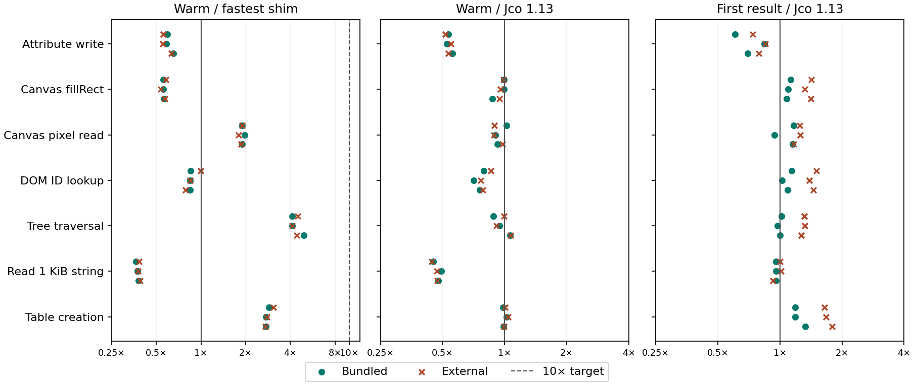
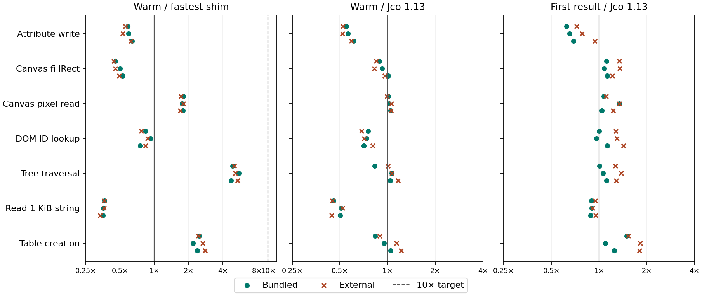
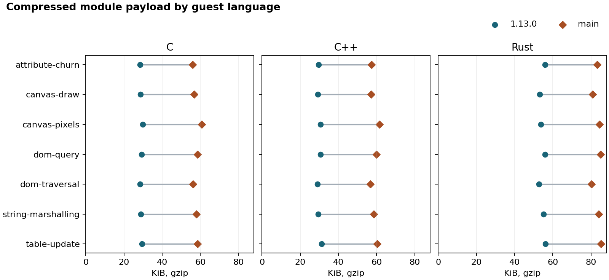

# Module sizes and transfer costs

[Benchmark overview](../README.md)

### Which runtime methods do the demos call?

Chromium recorded calls in four runtime classes while each component loaded, ran its full demo workload and shut down via `whenIdle()` and `stop()`. Each of the 42 documents loaded the same minified JS and Wasm as the timing matrix. Internal Oxc and external bindgen reached the same set of 36 named methods. A method can run in several phases. Constructors and named accessors count as methods. [Per-document V8 counts and method ranges](../web/bench/results/runtime-class-methods-4b9682bfe.json.gz)

| Runtime class | Declared | During import | During workload | During shutdown | Distinct called | Zero calls across all 21 demos |
| --- | ---: | ---: | ---: | ---: | ---: | ---: |
| ComponentAsyncState | 69 | 3 | 7 | 4 | 11 | 58 |
| AsyncTask | 88 | 14 | 18 | 0 | 18 | 70 |
| AsyncThread | 18 | 4 | 4 | 0 | 4 | 14 |
| RepTable | 8 | 3 | 3 | 0 | 3 | 5 |

All four ComponentAsyncState shutdown methods ran only at shutdown. They stop the component, record the trap and abandon waiters for entry slots and locks. Other components, traps or reentrant host calls can exercise paths these successful demos never took.

To estimate their contribution to download size, we replaced the bodies of the 147 zero-call methods with `{}` in offline copies and recompressed each JS module separately. The median difference per workload was 14,875 raw bytes and **3,007 Brotli bytes** internally, or 14,182 raw bytes and **2,999 Brotli bytes** externally. Any production change to omit such methods needs a compiler guarantee covering every legal use of the binding. These figures measure bytes only.

We also tried moving the repeated synchronous host call, exception handler and interruption check into one helper. Oxc minified each control to the exact entry hash in the timing matrix. Across 297 call sites per mode, the helper saved a median of 1,416 raw bytes internally and 1,412 externally. Median gzip savings were just 3 and 1 bytes, and median Brotli size **grew by 20 and 8 bytes**. The PR retains the existing call sites. [Per-entry sizes and hashes](../web/bench/results/host-call-shape-4b9682bfe.json.gz)

<details><summary>Reproduce the coverage and size experiments</summary>

Run from the repository root with the built Jco checkout at `4b9682bfe` in `$after` and set `CHROME_BIN` to the Chromium binary used in the matrix.

```sh
matrix=web/bench/results/review-matrix-history-4b9682bfe.json.gz
node web/bench/runtime-class-methods.mjs "$after" "$matrix" /tmp/classes.json.gz
node web/bench/host-call-shape.mjs "$after" "$matrix" /tmp/host-calls.json.gz
python3 web/bench/runtime-method-report.py "$matrix" /tmp/classes.json.gz /tmp/host-calls.json.gz
```

</details>

## Minified external diagnostics at db4a3aca0

At `db4a3aca0`, the external JavaScript entry shrank **15.0–17.9% on every workload** when generated with `--minify --cm-runtime-es-module @bytecodealliance/jco-cm-runtime`. The standard checked package exports an empty logger. Removing its labeled calls before minification also removes their message strings and argument construction. The internal Oxc bundle already removes these calls. Custom and debug provider paths keep them. [Jco implementation, runtime notes and tests](https://github.com/vados-cosmonic/jco/commit/db4a3aca05eb0745561cced24e2407713831074e) · [Fork PR](https://github.com/vados-cosmonic/jco/pull/62)

| Median across 21 workload and language pairs | Jco 1.13.0 | Upstream base | PR internal Oxc | PR external checked |
| --- | ---: | ---: | ---: | ---: |
| Minified JS entry (KiB) | 9.58 | 111.34 | 71.71 | 25.18 |
| Total JS transferred (KiB) | 9.58 | 111.34 | 71.71 | 124.10 |
| JS requests | 1 | 1 | 1 | 19 |
| Import (ms) | 5.27 | 11.94 | 10.00 | 22.77 |
| First full result including import (ms) | 61.83 | 203.50 | 62.76 | 78.30 |

Both PR renderers were within 10× of the fastest compiled shim in **21/21 warm headline cases**. The largest ratios were **4.92× internal and 4.50× external**. Each renderer matched or beat 1.13.0 on 18/21 warm headlines in this run. Each met the shim target in 81/84 comparable subphases. The three exceptions return a materialized list of DOM handles, while the original shim discards a live collection. [Paired release intervals](#paired-timing-intervals-against-jco-1130) · [Equal-work DOM queries](dom-performance.md#materializing-bulk-dom-query-results) · [Warmed tables and traversal](dom-performance.md#warm-table-creation-and-tree-traversal) · [Canvas readback](dom-performance.md#canvas-readback-at-the-pr-head) · [Wasm packaging](browser-delivery.md#fetching-or-embedding-the-primary-wasm-core) · [Preloading external runtime modules](browser-delivery.md#preloading-external-runtime-modules) · [HTTP gzip](browser-delivery.md#serving-the-browser-bindings-with-http-gzip) · [Multi-entry application build](browser-delivery.md#bundling-the-component-entries-as-one-browser-application) · [Trailing-slash fix](runtime-packaging.md#checked-runtime-package-spelling)



The paired comparison used the same standard package, import map, runtime modules and guest Wasm before and after the minifier change. The previous external entry was 29.86 KiB at the median. The new entries saved 4,175–6,333 bytes each, or 402–549 bytes with gzip. Across the 21 cases, the median paired ratio was **0.971× for first result and 0.983× for warm operation**. Twenty first-result intervals and all warm intervals included parity. This run establishes a size reduction. Cold-start parity with 1.13.0 remains open. [Raw samples and compiler hashes](../web/bench/results/review-matrix-minified-db4a3aca0.json.gz)

<details><summary>External after / before, individual 95% median intervals and reproduction</summary>

| Guest and operation | Entry bytes saved | Gzip bytes saved | Paired import | Paired first result | Paired warm operation |
| --- | ---: | ---: | ---: | ---: | ---: |
| C Attribute write | 4175 | 412 | 0.97× (0.87–1.10) | 0.95× (0.85–1.01) | 0.92× (0.79–1.06) |
| C++ Attribute write | 4175 | 416 | 1.01× (0.84–1.19) | 0.96× (0.79–1.29) | 0.98× (0.82–1.29) |
| Rust Attribute write | 4175 | 427 | 0.98× (0.82–1.05) | 0.93× (0.86–1.10) | 0.97× (0.75–1.09) |
| C Canvas fillRect | 5642 | 494 | 0.98× (0.85–1.09) | 1.06× (0.80–1.22) | 1.10× (0.92–1.29) |
| C++ Canvas fillRect | 5642 | 500 | 0.86× (0.77–0.94) | 0.90× (0.84–0.96) | 0.98× (0.81–1.06) |
| Rust Canvas fillRect | 5643 | 498 | 0.91× (0.81–1.13) | 0.90× (0.79–1.07) | 0.98× (0.92–1.27) |
| C Canvas pixel read | 6333 | 529 | 1.06× (0.84–1.32) | 1.02× (0.93–1.18) | 1.09× (0.86–1.44) |
| C++ Canvas pixel read | 6333 | 524 | 1.01× (0.78–1.28) | 0.97× (0.92–1.13) | 1.04× (0.76–1.48) |
| Rust Canvas pixel read | 6332 | 549 | 0.98× (0.88–1.23) | 0.99× (0.89–1.15) | 0.85× (0.66–1.04) |
| C DOM ID lookup | 4957 | 451 | 0.92× (0.80–1.20) | 0.95× (0.79–1.20) | 1.12× (0.93–1.35) |
| C++ DOM ID lookup | 4957 | 467 | 0.98× (0.87–1.06) | 0.97× (0.90–1.05) | 1.05× (0.78–1.24) |
| Rust DOM ID lookup | 4957 | 475 | 0.98× (0.76–1.51) | 0.98× (0.89–1.21) | 0.97× (0.74–1.43) |
| C Tree traversal | 4825 | 445 | 1.02× (0.80–1.32) | 0.92× (0.81–1.26) | 0.86× (0.72–1.22) |
| C++ Tree traversal | 4825 | 455 | 1.02× (0.85–1.56) | 1.02× (0.85–1.22) | 0.98× (0.46–1.17) |
| Rust Tree traversal | 4825 | 450 | 1.03× (0.90–1.18) | 0.97× (0.87–1.14) | 0.95× (0.73–1.74) |
| C Read 1 KiB string | 4190 | 402 | 0.93× (0.71–1.25) | 0.94× (0.89–1.04) | 1.02× (0.89–1.20) |
| C++ Read 1 KiB string | 4190 | 411 | 1.16× (0.40–1.53) | 0.97× (0.89–1.07) | 1.02× (0.90–1.09) |
| Rust Read 1 KiB string | 4190 | 428 | 1.01× (0.77–1.36) | 0.99× (0.87–1.09) | 0.99× (0.78–1.09) |
| C Table creation | 4799 | 438 | 1.11× (0.91–1.20) | 0.99× (0.88–1.28) | 1.03× (0.84–1.21) |
| C++ Table creation | 4799 | 453 | 0.94× (0.80–1.23) | 0.90× (0.78–1.11) | 0.90× (0.70–1.05) |
| Rust Table creation | 4799 | 444 | 0.98× (0.88–1.10) | 0.93× (0.85–1.08) | 1.01× (0.78–1.27) |

Each of ten rounds ran 118 fresh Chromium documents with DevTools disconnected. The five Jco configurations rotated through every timing position and immediate predecessor for each workload and language. Each page checked the first and second complete guest reports. The size comparison uses actual files. Import and first-result timing include the ordinary browser fetches over uncompressed loopback. The intervals apply individually to paired round ratios.

Follow the [full-matrix setup](revision-comparisons.md#full-demo-matrix-on-the-merged-pr). Build the PR checkout at `db4a3aca0` and the previous transpiler at `95e8ae0d8`. The runner checks that both transpilers use the same bindgen compiler artifacts. The upstream base is `83e25bb19`. Upstream main at `326f52ab4` added one Node HTTP shim change since that base. [Upstream comparison](https://github.com/bytecodealliance/jco/compare/83e25bb19...326f52ab4) · [Measured runner](https://github.com/vados-cosmonic/component-demos/blob/f2d27b218062dbbe77f2da7013f5c613ab3aef87/web/bench/review-matrix.mjs)

```sh
CHROME_BIN=/path/to/chrome ROUNDS=10 node web/bench/review-matrix.mjs \
  "$jco" "$stage" /tmp/checked-provider.json.gz --minify "$previous/packages/jco-transpile"
python3 web/bench/review-matrix-report.py /tmp/checked-provider.json.gz --plot /tmp/checked-provider.png
```

</details>

### Paired timing intervals against Jco 1.13.0

Each timing ratio compares a PR build to 1.13.0 for the same language, workload and browser round. Across ten rounds, the individual intervals show a clearer regression in time to the first result on the external runtime than on the second guest call. Rust tree traversal had the highest warm point estimates, **1.065×** internally (interval 0.780–1.595×) and **1.068×** externally (0.603–1.128×). Those ranges allow both a speedup and a slowdown. [Raw samples](../web/bench/results/review-matrix-minified-db4a3aca0.json.gz)

| Phase and build | Interval favors PR | Interval includes parity | Interval favors 1.13.0 |
| --- | ---: | ---: | ---: |
| Warm operation, internal Oxc | 8 | 13 | 0 |
| Warm operation, external runtime | 8 | 13 | 0 |
| First result, internal Oxc | 3 | 16 | 2 |
| First result, external runtime | 4 | 4 | 13 |

The bounds are distribution-free intervals for the median paired time ratio. With ten pairs, the second-lowest and second-highest observations give at least 95% coverage for each interval individually. These counts use no adjustment for testing multiple workloads. To print every interval, run `python3 web/bench/review-matrix-report.py web/bench/results/review-matrix-minified-db4a3aca0.json.gz --release-intervals`. [Report generator](../web/bench/review-matrix-report.py)

## Minified browser bindings

With minification, all 21 warm headline operations stayed within **5.51×** of the fastest compiled shim in the internal bundle and **5.39×** in the external runtime. Both renderers matched or beat minified Jco 1.13.0 on **14/21** warm cases. The largest warm slowdown against 1.13.0 was **6.2% bundled** and **22.0% external**. First-result time still favored 1.13.0 in most cases.

This run uses each Jco build’s own `--minify` option on the same 21 workloads. The internal Oxc bundle and external checked package both run the PR at `eaca992c8`. The comparison includes Jco 1.13.0 and the PR’s exact upstream base, `83e25bb19`. Chromium fetched the standalone external runtime as ES modules. [Jco fork PR](https://github.com/vados-cosmonic/jco/pull/62) · [Raw timings, sizes and request lists](../web/bench/results/review-matrix-minified-eaca992c8.json.gz)

| Median across 21 workload and language pairs | Jco 1.13.0 | Upstream main | Internal Oxc | External runtime |
| --- | ---: | ---: | ---: | ---: |
| Default JS entry (KiB) | 21.23 | 191.50 | 126.43 | 62.58 |
| Minified JS entry (KiB) | 9.58 | 111.34 | 71.71 | 29.68 |
| Total JS with minification (KiB) | 9.58 | 111.34 | 71.71 | 128.60 |
| Total JS with minification, gzip estimate (KiB) | 3.01 | 25.42 | 19.01 | 41.07 |
| Minified import (ms) | 5.14 | 12.34 | 9.62 | 22.40 |
| First full result with minification (ms) | 59.83 | 196.54 | 65.46 | 77.74 |

| Comparison with all four Jco builds minified | Internal Oxc | External runtime |
| --- | ---: | ---: |
| Warm headline cases within 10× of the fastest compiled shim | 21/21 | 21/21 |
| Warm subphases within 10× of the fastest compiled shim | 81/84 | 81/84 |
| Warm headline cases at or faster than upstream main | 20/21 | 21/21 |
| Warm headline cases at or faster than Jco 1.13.0 | 14/21 | 14/21 |
| First full results at or faster than Jco 1.13.0 | 7/21 | 6/21 |



Eight balanced browser rounds ran 776 fresh documents. Each Jco variant used identical guest cores. Release assets matched the archived 1.13.0 minified hashes. The default and minified byte counts compare exact files at each revision. Gzip estimates sum compressed file lengths. The browser served uncompressed responses. The wall times above compare minified builds within this run. The earlier default-build timings came from a separate run. [Release size inventory](../web/bench/results/minified-sizes.json) · [Default entry measurements](../web/bench/results/resource-drop-sizes.json)

<details><summary>All 21 minified headline comparisons and reproduction</summary>

| Operation | Guest | Bundled / shim | External / shim | Bundled / 1.13 warm | External / 1.13 warm | Bundled / 1.13 first result | External / 1.13 first result |
| --- | --- | ---: | ---: | ---: | ---: | ---: | ---: |
| Attribute write | C | 0.58× | 0.56× | 0.55× | 0.52× | 0.62× | 0.72× |
| Attribute write | C++ | 0.59× | 0.53× | 0.56× | 0.52× | 0.65× | 0.78× |
| Attribute write | Rust | 0.64× | 0.62× | 0.61× | 0.59× | 0.69× | 0.94× |
| Canvas fillRect | C | 0.45× | 0.44× | 0.89× | 0.85× | 1.12× | 1.34× |
| Canvas fillRect | C++ | 0.50× | 0.45× | 0.92× | 0.82× | 1.08× | 1.35× |
| Canvas fillRect | Rust | 0.53× | 0.49× | 1.01× | 0.96× | 1.13× | 1.21× |
| Canvas pixel read | C | 1.79× | 1.71× | 1.01× | 0.99× | 1.07× | 1.11× |
| Canvas pixel read | C++ | 1.75× | 1.80× | 1.02× | 1.06× | 1.34× | 1.34× |
| Canvas pixel read | Rust | 1.79× | 1.69× | 1.04× | 1.05× | 1.04× | 1.23× |
| DOM ID lookup | C | 0.84× | 0.77× | 0.75× | 0.68× | 1.00× | 1.27× |
| DOM ID lookup | C++ | 0.93× | 0.87× | 0.74× | 0.71× | 0.96× | 1.30× |
| DOM ID lookup | Rust | 0.75× | 0.84× | 0.71× | 0.80× | 1.13× | 1.43× |
| Tree traversal | C | 4.88× | 5.04× | 0.83× | 1.01× | 1.01× | 1.27× |
| Tree traversal | C++ | 5.51× | 5.13× | 1.06× | 1.06× | 1.06× | 1.38× |
| Tree traversal | Rust | 4.73× | 5.39× | 1.04× | 1.16× | 1.12× | 1.28× |
| Read 1 KiB string | C | 0.36× | 0.36× | 0.46× | 0.45× | 0.89× | 0.95× |
| Read 1 KiB string | C++ | 0.36× | 0.36× | 0.51× | 0.52× | 0.90× | 0.91× |
| Read 1 KiB string | Rust | 0.35× | 0.33× | 0.50× | 0.44× | 0.88× | 0.95× |
| Table creation | C | 2.47× | 2.45× | 0.84× | 0.89× | 1.50× | 1.53× |
| Table creation | C++ | 2.19× | 2.66× | 0.95× | 1.14× | 1.09× | 1.82× |
| Table creation | Rust | 2.39× | 2.78× | 1.05× | 1.22× | 1.25× | 1.80× |

Follow the [full-matrix setup](revision-comparisons.md#full-demo-matrix-on-the-merged-pr) with Jco revision `eaca992c8` for the PR checkout. Pass the final `--minify` argument to the runner. The installed Jco 1.13.0 in this fork creates the release entries during the run.

```sh
CHROME_BIN=/path/to/chrome ROUNDS=8 node web/bench/review-matrix.mjs \
  "$jco" "$stage" /tmp/review-matrix-minified.json.gz --minify
python3 web/bench/review-matrix-report.py /tmp/review-matrix-minified.json.gz \
  --plot /tmp/review-matrix-minified.png
```

</details>

## Generated size after resource destructors

Jco revision `eaca992c8` puts the closing braces of each resource destructor on separate lines. The generator tracks one indentation change per line. Previously, each imported resource could add two spaces to every later line, including the following functions and the module initializer. For the C table-update demo, the external checked entry fell from **69,179 to 64,090 bytes**, or **8,750 to 8,417 bytes** with gzip. [Generator fix and regression tests](https://github.com/vados-cosmonic/jco/commit/eaca992c895fbf08bdd7f0968e0e5e4e0fc8643e)

| Bindings | Entries changed | Median bytes saved per changed entry | Median gzip bytes saved | Median reduction in entry size |
| --- | ---: | ---: | ---: | ---: |
| Internal Oxc bundle | 0/34 | — | — | — |
| External, checked sync imports | 28/34 | 4,359 | 402 | 6.4% |
| External, original API-v1 contract | 28/34 | 6,530 | 637 | 6.7% |

Every emitted Wasm file and internal Oxc entry matched the previous build byte for byte. Acorn parsed each changed external entry to the same JavaScript syntax tree, including literal values and raw spellings. Applying the new entry sizes to the 21 full-matrix request lists lowers median uncompressed external JS from 165.94 to 161.51 KiB. The external runtime package itself is identical. [Per-input sizes and hashes](../web/bench/results/resource-drop-sizes.json) · [Verifier](../web/bench/resource-drop-sizes.mjs)

To reproduce, prepare the demo inputs and build the native `transpile` example with the `embedded-cm-runtime` feature in separate Jco checkouts at `b731ebc91` and `eaca992c8`. Install this fork’s web dependencies with `npm ci --prefix web`, then run the verifier from the fork.

```sh
node web/bench/resource-drop-sizes.mjs \
  /path/to/before/target/debug/examples/transpile \
  /path/to/after/target/debug/examples/transpile /tmp/resource-drop-sizes.json
```

### Unused task and resource imports

At `95e8ae0d8`, bindgen selects thread metadata when it emits a task-managed call and resource removal when it emits a finalizer or explicit drop. Constructing an async thread class also uses its state and registers directly. Across 34 demo inputs this removed 107 bytes from four unminified external entries and 158 bytes from 28 more. Gzip savings ranged from 7 to 17 bytes per affected entry. The internal Oxc bundle already eliminated these dependencies in all 34 demos. All emitted Wasm files matched the preceding build. For the 21 headline workloads, the minified entries on both renderers also matched their published hashes. [Jco change and regression coverage](https://github.com/vados-cosmonic/jco/commit/95e8ae0d8a92f84d83c7075e28047119a5eec805) · [Default entry sizes and hashes](../web/bench/results/unused-intrinsic-sizes.json) · [Minified matrix](#minified-browser-bindings)

The original API-v1 provider configuration dropped 107 bytes on three inputs. Sixteen other entries moved a lookup declaration to its first consumer with the same uncompressed size. For a separate component that retains an imported handle and has no drop trampoline, the checked external entry fell from 15,044 to 14,709 bytes and the internal bundle from 82,481 to 82,455 bytes. The guest retained the resource until shutdown, which disposed it exactly once in both renderers and in the original provider configuration.

To reproduce the demo size comparison, build the native `transpile` example with `embedded-cm-runtime` at `c5870ab66` and `95e8ae0d8`. The verifier checks the Wasm hashes and the permitted declaration and import edits in the generated JavaScript.

```sh
node web/bench/resource-drop-sizes.mjs /path/to/before/transpile /path/to/after/transpile \
  /tmp/unused-intrinsic-sizes.json --unused-intrinsics
```

<!-- size:start -->

## Module size

Across 34 component inputs, the median change in gzip payload on main was **+27.8 KiB** per component (range +20.2 to +31.0 KiB). The payload sums the emitted JavaScript and external core Wasm files, including any Wasm inlined into JavaScript. Gzip level 9 and Brotli quality 11 are applied per file. Shared host code, HTML, type declarations and HTTP headers are excluded. The raw JavaScript reference lives in the demo page controller.

All external core Wasm files match byte for byte between the two generators. The size differences come entirely from the emitted JavaScript.



**DOM traversal download size** in KiB, gzip. Each row compares implementations from one guest language.

| Guest | Native component | jco 1.13.0 | jco main | Embind | EM_JS | wasm-bindgen |
| --- | ---: | ---: | ---: | ---: | ---: | ---: |
| C | 26.4 | 28.5 | 56.2 | — | — | — |
| C++ | 26.9 | 29.0 | 56.7 | 21.4 | 14.2 | — |
| Rust | 50.6 | 52.7 | 80.3 | — | — | 27.0 |

<details><summary>All component sizes, in KiB</summary>

Paired columns list **1.13.0 / main**. Native is the original component binary. Core Wasm counts only separate .wasm files.

| Component | Native | Files | JS | Core Wasm | Raw total | Gzip | Brotli |
| --- | ---: | ---: | ---: | ---: | ---: | ---: | ---: |
| C attribute-churn | 65.1 | 2 / 2 | 19.0 / 177.9 | 61.4 / 61.4 | 80.5 / 239.3 | 28.4 / 56.0 | 23.3 / 46.4 |
| C calculator | 0.9 | 1 / 1 | 2.3 / 101.4 | 0.0 / 0.0 | 2.3 / 101.4 | 1.3 / 21.6 | 1.2 / 18.5 |
| C canvas-draw | 66.5 | 2 / 2 | 22.6 / 192.3 | 61.9 / 61.9 | 84.6 / 254.2 | 28.6 / 56.7 | 23.6 / 46.9 |
| C canvas-pixels | 70.1 | 2 / 2 | 24.2 / 210.8 | 64.7 / 64.7 | 88.9 / 275.5 | 29.7 / 60.7 | 24.5 / 50.2 |
| C dom-query | 68.0 | 2 / 2 | 22.0 / 194.1 | 63.7 / 63.7 | 85.6 / 257.8 | 29.2 / 58.5 | 24.0 / 48.5 |
| C dom-traversal | 66.0 | 2 / 2 | 21.1 / 185.3 | 62.0 / 62.0 | 83.1 / 247.3 | 28.5 / 56.2 | 23.4 / 46.5 |
| C greet-bindgen | 56.3 | 2 / 2 | 2.6 / 108.8 | 55.9 / 55.9 | 58.5 / 164.8 | 24.3 / 46.3 | 20.0 / 38.8 |
| C greet-freestanding | 0.9 | 1 / 1 | 3.0 / 105.9 | 0.0 / 0.0 | 3.0 / 105.9 | 1.6 / 23.2 | 1.5 / 19.9 |
| C greet-libc | 54.9 | 2 / 2 | 2.6 / 108.8 | 54.5 / 54.5 | 57.1 / 163.3 | 23.8 / 45.8 | 19.5 / 38.4 |
| C hello-world | 60.4 | 2 / 2 | 13.8 / 164.1 | 57.8 / 57.8 | 71.6 / 222.0 | 26.7 / 54.6 | 22.0 / 45.5 |
| C string-marshalling | 66.2 | 2 / 2 | 19.4 / 184.9 | 62.6 / 62.6 | 82.0 / 247.5 | 28.9 / 57.9 | 23.9 / 48.2 |
| C table-update | 70.7 | 2 / 2 | 21.2 / 192.3 | 66.6 / 66.6 | 87.8 / 258.9 | 29.3 / 58.5 | 24.2 / 48.6 |
| C++ attribute-churn | 68.9 | 2 / 2 | 19.0 / 177.9 | 65.3 / 65.3 | 84.3 / 243.2 | 29.7 / 57.2 | 24.4 / 47.4 |
| C++ canvas-draw | 68.5 | 2 / 2 | 22.6 / 192.3 | 63.9 / 63.9 | 86.6 / 256.2 | 29.1 / 57.2 | 24.0 / 47.3 |
| C++ canvas-pixels | 73.1 | 2 / 2 | 24.2 / 210.8 | 67.8 / 67.8 | 91.9 / 278.5 | 30.6 / 61.6 | 25.1 / 50.7 |
| C++ dom-query | 71.7 | 2 / 2 | 22.0 / 194.1 | 67.4 / 67.4 | 89.4 / 261.5 | 30.7 / 60.0 | 25.1 / 49.6 |
| C++ dom-traversal | 68.0 | 2 / 2 | 21.1 / 185.3 | 64.0 / 64.0 | 85.1 / 249.3 | 29.0 / 56.7 | 23.8 / 47.0 |
| C++ hello-world | 60.4 | 2 / 2 | 13.8 / 164.1 | 57.8 / 57.8 | 71.6 / 221.9 | 26.6 / 54.5 | 21.9 / 45.4 |
| C++ string-marshalling | 68.3 | 2 / 2 | 19.4 / 184.9 | 64.8 / 64.8 | 84.1 / 249.6 | 29.5 / 58.5 | 24.3 / 48.5 |
| C++ table-update | 74.9 | 2 / 2 | 21.2 / 192.3 | 70.9 / 70.9 | 92.1 / 263.2 | 31.2 / 60.3 | 25.4 / 49.8 |
| Rust attribute-churn | 152.0 | 2 / 2 | 18.8 / 176.5 | 148.5 / 148.5 | 167.3 / 325.0 | 55.8 / 83.2 | 45.9 / 68.8 |
| Rust calculator-raw | 258.7 | 2 / 2 | 1.4 / 101.0 | 258.4 / 258.4 | 259.8 / 359.3 | 85.4 / 105.6 | 72.3 / 89.6 |
| Rust calculator | 258.0 | 2 / 2 | 1.4 / 101.0 | 257.7 / 257.7 | 259.1 / 358.7 | 85.1 / 105.4 | 72.1 / 89.4 |
| Rust canvas-draw | 140.9 | 2 / 2 | 22.4 / 190.9 | 136.4 / 136.4 | 158.8 / 327.3 | 53.0 / 80.9 | 43.8 / 67.1 |
| Rust canvas-pixels | 142.9 | 2 / 2 | 24.0 / 209.4 | 137.7 / 137.7 | 161.6 / 347.0 | 53.7 / 84.4 | 44.2 / 69.7 |
| Rust dom-query | 148.8 | 2 / 2 | 21.7 / 192.7 | 144.7 / 144.7 | 166.4 / 337.4 | 55.9 / 85.1 | 46.0 / 70.4 |
| Rust dom-traversal (dom_traversal.my.component) | 138.7 | 2 / 2 | 20.2 / 183.9 | 135.7 / 135.7 | 155.9 / 319.6 | 52.7 / 80.3 | 43.5 / 66.6 |
| Rust dom-traversal | 138.7 | 2 / 2 | 20.2 / 183.9 | 135.7 / 135.7 | 155.9 / 319.6 | 52.7 / 80.3 | 43.5 / 66.6 |
| Rust hello-world | 17.4 | 2 / 2 | 13.6 / 162.8 | 14.9 / 14.9 | 28.5 / 177.7 | 8.9 / 36.6 | 7.4 / 30.8 |
| Rust string-marshalling | 146.9 | 2 / 2 | 19.1 / 183.5 | 143.4 / 143.4 | 162.5 / 326.9 | 55.2 / 84.0 | 45.6 / 69.7 |
| Rust table-rows | 33.3 | 2 / 2 | 13.1 / 160.2 | 31.1 / 31.1 | 44.2 / 191.3 | 16.2 / 43.1 | 14.0 / 36.7 |
| Rust table-update | 149.5 | 2 / 2 | 20.6 / 191.5 | 146.2 / 146.2 | 166.8 / 337.7 | 56.1 / 85.2 | 46.3 / 70.7 |
| Rust todomvc | 14.4 | 2 / 2 | 15.3 / 164.7 | 11.6 / 11.6 | 26.8 / 176.3 | 7.6 / 34.6 | 6.5 / 29.2 |
| Rust vdom-diff | 40.9 | 2 / 2 | 14.8 / 164.6 | 38.5 / 38.5 | 53.3 / 203.1 | 19.7 / 46.7 | 17.0 / 39.8 |

</details>

<details><summary>Emscripten and wasm-bindgen payloads, in KiB</summary>

| Artifact directory | Files | Raw total | Gzip | Brotli |
| --- | ---: | ---: | ---: | ---: |
| cpp/attribute-churn/emscripten | 2 | 58.7 | 22.1 | 19.5 |
| cpp/canvas-draw/emscripten | 2 | 57.7 | 21.3 | 18.7 |
| cpp/canvas-pixels/emscripten | 2 | 63.8 | 23.4 | 20.4 |
| cpp/dom-query/emscripten | 2 | 60.0 | 22.3 | 19.6 |
| cpp/dom-traversal/em-js | 2 | 31.9 | 14.2 | 12.4 |
| cpp/dom-traversal/emscripten | 2 | 57.4 | 21.4 | 18.8 |
| cpp/string-marshalling/em-js | 2 | 33.4 | 14.8 | 13.0 |
| cpp/string-marshalling/emscripten | 2 | 58.4 | 21.8 | 19.2 |
| cpp/table-update/em-js | 2 | 35.6 | 15.5 | 13.6 |
| cpp/table-update/emscripten | 2 | 63.7 | 23.1 | 20.2 |
| rust/dom-traversal-wasm-bindgen | 2 | 72.0 | 27.0 | 22.6 |
| rust/string-marshalling-wasm-bindgen | 2 | 72.6 | 27.1 | 22.5 |
| rust/table-update-wasm-bindgen | 2 | 77.3 | 28.1 | 23.5 |

</details>

[Per-file byte counts and SHA-256 digests](../web/bench/results/sizes.json)

<!-- size:end -->

<details><summary>Earlier UTF-8 measurements</summary>

The performance branch also specializes UTF-8 conversion in both directions. For strings of up to 32 ASCII bytes, the bindings read or write the bytes directly. Non-ASCII text uses the checked codec, including its malformed-input traps. [Short-string changes](https://github.com/vados-cosmonic/jco/compare/ac28d5d481f3cfca94bc4c62f3571511c19386d9...9eeb7f0b9ab82a982810af5cdd1d9035b302aa39)

For longer host-returned strings, the runtime can encode into a reusable buffer before allocating guest memory. On the preceding upstream revision, a 16 KiB read took 26–28 µs across C, C++, and Rust, or 46–50% of the time for 1.13.0. The archived run compares the bindings immediately before and after this change. [UTF-8 benchmark and raw measurements](https://github.com/vados-cosmonic/component-demos/blob/7550fa7523931f918b6bd599174af07e6537961b/README.md#optimized-browser-bindings)

</details>
