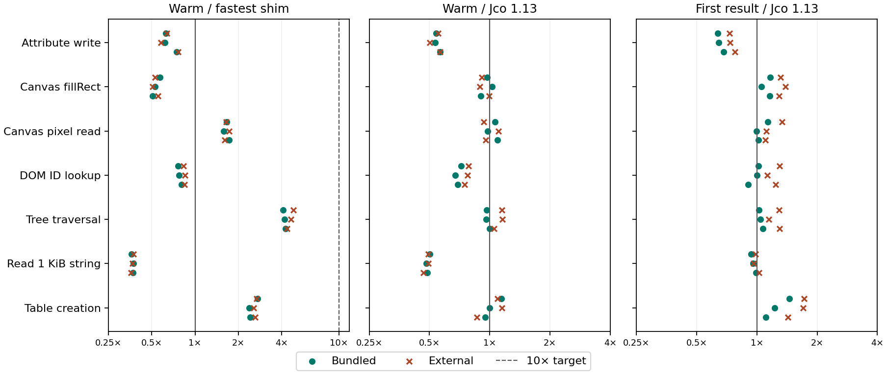
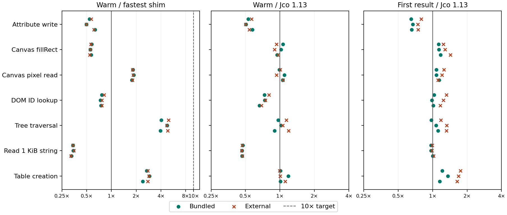
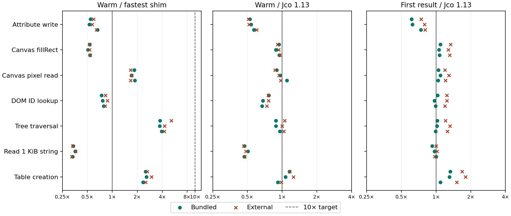
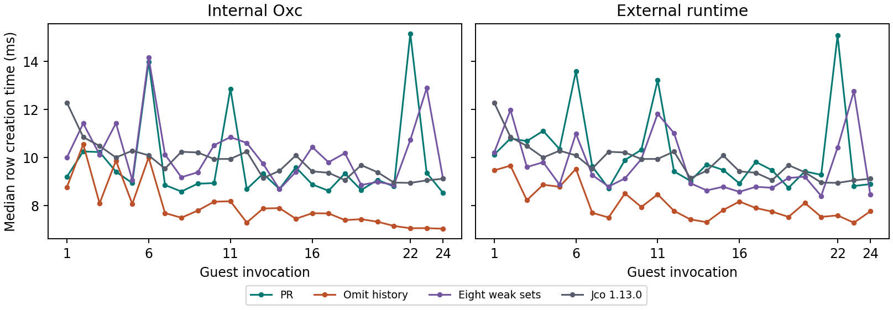

# Resource ownership and allocation

[Benchmark overview](../README.md)

## Reusing resource capture tables during startup

A component must keep enough information to dispose its live, owned host resources when it stops. The checked bindings used to allocate a record and a getter for each imported handle table. The first table for each resource can register its existing capture object instead. Its getter still waits until shutdown to resolve captures by representation. Additional tables sharing that resource still register their own handles. Existing custom providers keep their original registration format. [Bindgen and shared runtime code](https://github.com/vados-cosmonic/jco/commit/c873ff950) · [Retained-resource test](https://github.com/vados-cosmonic/jco/commit/9863264e8)

Across the 21 C, C++ and Rust demos, this eliminates 156 records and their per-record getters in each binding mode. Both compilers emitted the same guest Wasm. The checked external runtime's sync module grew by 64 raw bytes to provide the two shared getters. The complete download figures below include that cost. Gzip sizes sum the individually compressed JS files each workload requested. [Per-entry sizes and hashes](../web/bench/results/capture-registrations-6c8454da9.json.gz)

| Median change versus the preceding bindings | Internal Oxc | External runtime |
| --- | ---: | ---: |
| Entry JS saved, raw / gzip bytes | 245 / 38 | 307 / 49 |
| Complete JS saved, raw / gzip bytes | 245 / 38 | 243 / 29 |
| Paired import time, new / previous | 1.002× (0.994–1.022) | 1.014× (0.973–1.083) |
| Paired first-result time | 1.001× (0.968–1.034) | 1.010× (0.976–1.044) |
| Paired warm execution | 1.038× (0.995–1.074) | 1.007× (0.969–1.025) |

All six suite-wide timing intervals include parity. The matrix used 12 balanced rounds and 1,668 fresh Chromium documents. Each external build loaded its matching runtime package. Both modes were within 10× of the fastest compiled shim on 21/21 warm headline operations. The worst headline ratios were 4.24× internal and 4.84× external. Both modes met the target on 81/84 original subphases. Warm medians matched or beat Jco 1.13.0 on 16/21 internal and 15/21 external workloads. Internal C table creation was the only warm comparison with an interval wholly slower than release (1.144×, 1.004–1.480). For first result, two internal and thirteen external workloads had intervals wholly slower than release. Parentheses in the table give individual 95% sign intervals. [Full Chromium matrix](../web/bench/results/review-matrix-captures-6c8454da9.json.gz)

| Median across workloads | Jco 1.13.0 | Upstream main at `326f52ab4` | Internal Oxc | External runtime |
| --- | ---: | ---: | ---: | ---: |
| Module import and initialization (ms) | 5.18 | 12.06 | 9.40 | 19.12 |
| Time to first result (ms) | 57.97 | 195.94 | 62.61 | 73.82 |
| Complete JS, gzip (KiB) | 3.01 | 25.42 | 18.57 | 39.24 |

The three bulk DOM query phases materialize and return 2,000 handles per query. Against the direct shim doing that same work, the two binding modes took 1.52–1.62× the shim time across all three guest languages. [Equal-work browser timings and handle counts](../web/bench/results/bulk-dom-captures-6c8454da9.json.gz)

Within each chart row the markers show C, C++ and Rust from top to bottom. Smaller ratios indicate less time.



### Retained JavaScript heap per C table instance

In 50 fresh Chromium pages, each page compiled its guest cores once and kept 8, 40, then 72 instances alive. After forcing garbage collection at each checkpoint, we divided the increase in V8's used JS heap by the number of additional instances. Every page ran the C table workload on its last instance and checked all six reported measurements. Each number is a median over ten balanced rounds. The table measures live JS heap before running the guest and excludes the guest's linear memory. [Heap samples and module hashes](../web/bench/results/capture-instance-heap-6c8454da9.json.gz)

| Incremental live JS bytes per instance | Jco 1.13.0 | Internal before | Internal after | External before | External after |
| --- | ---: | ---: | ---: | ---: | ---: |
| Instances 9–40 | 8,963 | 21,502 | 20,062 | 21,554 | 20,114 |
| Instances 41–72 | 8,584 | 18,265 | 16,825 | 18,265 | 16,825 |

Reusing the capture objects saved **1,440 bytes per live instance** in both binding modes at both population steps. For instances 41–72 that is a **7.9% reduction** in JS heap versus the previous bindings. The new bindings still used about 1.96× the release JS heap per additional instance at that step.

<details><summary>Reproduce the capture table measurements</summary>

Build Jco at `b7edbf6bf` in `$before` and at `6c8454da9` in `$after`, including each checkout's runtime package. Use the pinned upstream compiler at `326f52ab4` in `$stage` and set `CHROME_BIN` to the Chromium executable. Run from the root of this benchmark fork.

```sh
set -e
test "$(cat "$stage/commit")" = 326f52ab4403466b21b989c995f9bb97b2b9e038
old=web/bench/results/review-matrix-history-4b9682bfe.json.gz
previous_bindgen="$before/packages/jco-transpile"
current_bindgen="$after/packages/jco-transpile"
previous_runtime="$before/packages/jco-cm-runtime/dist"
current_runtime="$after/packages/jco-cm-runtime/dist"
node web/bench/resource-table-registry.mjs "$previous_bindgen" "$current_bindgen" "$old" /tmp/entries.json.gz --capture-entries
ROUNDS=12 node web/bench/review-matrix.mjs "$after" "$stage" /tmp/matrix.json.gz --compare-compilers "$previous_bindgen" "$previous_runtime"
python3 web/bench/review-matrix-report.py /tmp/matrix.json.gz --release-intervals --compare-entries "$old" --plot /tmp/matrix.png
ROUNDS=12 node web/bench/bulk-dom.mjs "$after" /tmp/bulk.json.gz --checked-matrix /tmp/matrix.json.gz
python3 web/bench/bulk-dom-report.py /tmp/bulk.json.gz --matrix /tmp/matrix.json.gz
node web/bench/capture-instance-heap.mjs "$previous_bindgen" "$previous_runtime" "$current_bindgen" "$current_runtime" /tmp/entries.json.gz /tmp/heap.json.gz
python3 web/bench/capture-instance-report.py /tmp/heap.json.gz /tmp/entries.json.gz
```

</details>

## Empty resource sets at 4b9682bfe

Jco allocated a JavaScript `Set` per resource table to remember which representations a component had created. Only a transfer between instances queries that history. Bindgen already knew that a checked synchronous component with one instance would never insert a representation or look one up. It now skips allocating those sets in both the internal Oxc bundle and the external checked runtime. The same regression test covers these modes and custom providers that can inspect the table. [Compiler change and runtime explanation](https://github.com/vados-cosmonic/jco/commit/4b9682bfe81ca115bc498ca2ce1d1f3696f19d21)

Across 21 demo entries the compiler removed **156 empty sets per binding mode**, seven or eight per component. Every minified entry got smaller. The previous and new compilers emitted identical guest Wasm. The size check also compares the generated initialization statements with specialization disabled, call tracking enabled, and a custom provider selected. [Per-entry bytes, compiler and module hashes](../web/bench/results/resource-history-sets-4b9682bfe.json.gz)

| Compared with the previous compiler at `eda794c50` | Internal Oxc | External runtime |
| --- | ---: | ---: |
| Median entry bytes saved, raw / gzip | 169 / 35 | 166 / 42 |
| Paired import time, new / previous | 1.025× (0.966–1.063) | 0.984× (0.924–1.027) |
| Paired time to first result | 0.988× (0.971–1.019) | 0.989× (0.976–0.998) |
| Paired warm execution | 1.005× (0.972–1.039) | 0.974× (0.936–1.011) |

External time to first result improved 1.1% in this run. The other timing intervals include parity. The 12-round matrix ran 1,668 fresh Chromium documents. Each round contributes the median of the 21 within-workload ratios to each suite-wide estimate. Parentheses show individual 95% sign intervals. [Raw browser matrix](../web/bench/results/review-matrix-history-4b9682bfe.json.gz)

| Browser metric | Jco 1.13.0 | Upstream main at `326f52ab4` | Internal Oxc | External runtime |
| --- | ---: | ---: | ---: | ---: |
| Median import time (ms) | 5.13 | 11.76 | 9.43 | 19.62 |
| Median time to first result (ms) | 62.27 | 200.63 | 63.35 | 74.17 |
| Total gzipped JS (KiB) | 3.01 | 25.42 | 18.60 | 39.27 |

Both modes stayed within 10× of the fastest compiled shim on all 21 warm headline operations. The worst medians were 4.77× internal and 4.97× external. Warm medians matched or beat Jco 1.13.0 on 13/21 internal and 14/21 external workloads. No individual warm interval was wholly slower than release. For first result, five internal and thirteen external intervals were wholly slower.



## Resource table initialization at eda794c50

A resource transfer between component instances needs to find the destination table by ID. A synchronous component with one instance can use its table directly. The checked compiler now omits the array that indexed these tables and the assignments that populated it. Shutdown still uses its separate list of live tables and captures. Custom runtime providers continue to receive the registry. [Compiler change, runtime explanation and regression test](https://github.com/vados-cosmonic/jco/commit/eda794c504bb0a53ac50bf41ee1b240d3e714aab)

Across 21 external demo entries, the compiler removed 21 array initializations and 156 table assignments (7–8 per component). Removing the initializer import and those statements from the previous unminified output reproduced the new external source apart from blank lines. Internal Oxc already eliminated the registry in the 21 minified direct modules. Bindings that expose an explicit `instantiate` function were smaller in both modes. [Per-entry sizes and hashes](../web/bench/results/resource-table-registry-eda794c50.json.gz)

| Minified entry size reduction, raw / gzip bytes | Internal Oxc | External checked |
| --- | ---: | ---: |
| Direct module, median of 21 demos | 0 / 0 | 98 / 63 |
| C table, direct module | 0 / 0 | 107 / 68 |
| C table, synchronous `instantiate` | 137 / 67 | 105 / 66 |
| C table, asynchronous `instantiate` | 137 / 65 | 101 / 64 |

In the paired Chromium comparison with `1919c56ed`, the suite-wide external time ratios were 1.014× for import (95% interval 0.956–1.037), 0.996× for first result (0.970–1.016) and 0.983× for warm execution (0.926–1.050). Each interval includes parity. The measurable gain from removing the registry was in generated size and initialization work. [All 1,668 documents from 12 paired browser rounds](../web/bench/results/review-matrix-registry-eda794c50.json.gz)

| Browser metric | Jco 1.13.0 | Upstream main at `326f52ab4` | Internal Oxc | External checked |
| --- | ---: | ---: | ---: | ---: |
| Import and initialization (ms) | 5.00 | 11.97 | 9.50 | 19.36 |
| Time to first guest result (ms) | 57.59 | 201.02 | 61.77 | 72.86 |
| Minified JS entry (KiB) | 9.58 | 111.34 | 70.21 | 23.62 |
| Total gzipped JS (KiB) | 3.01 | 25.42 | 18.63 | 39.32 |

Both modes finished within 10× of the fastest compiled shim on 21/21 warm headline operations and 81/84 individual phases. The worst headline ratios were 3.96× internally and 5.15× externally. Warm medians matched or beat release on 18/21 internal and 16/21 external workloads. First result matched or beat release on 8/21 and 4/21, respectively. No individual warm interval was wholly slower than release in this run. The earlier 18-round matrix found one such case. The table summarizes medians across the 21 workload medians.



### How much does recording dropped resources cost?

Creating 2,000 C table rows makes 10,000 DOM calls. Jco also records 4,001 resource drops during creation so that shutdown can recognize a host object the guest has already dropped. Across 24 invocations, omitting those writes in a diagnostic build saved a paired median of **48.66 ms internally (20.3%)** and **44.87 ms externally (18.7%)** in row creation. In a separate correctness check, a disposal getter stopped the guest while it held another handle to the same heading. The diagnostic build disposed the heading twice. The PR disposed it once in both binding modes. [Generated drop and shutdown regression](https://github.com/vados-cosmonic/jco/commit/cbd43f45f) · [External runtime shutdown](https://github.com/vados-cosmonic/jco/blob/eade82c6c/packages/jco-cm-runtime/src/intrinsics/component/lifecycle.ts#L130)

A second experiment kept the history and distributed blocks of 1,024 insertions across eight weak sets. Shutdown searched all eight. This preserved single disposal in the reentry check and brought row creation on call 22 down by about 4.4 ms in both builds. Across all 24 calls, the intervals for aggregate creation time and for the worst creation time in each document included zero improvement in both modes. Across the **complete guest calls**, the grouped version took a paired **40.93 ms longer internally** (95% interval 8.67–64.07 ms longer). The extra bookkeeping remains a benchmark experiment. [Raw timings, asset hashes and correctness checks](../web/bench/results/table-drop-history-c-084063ed1.json.gz)

| Paired milliseconds saved by the eight-set experiment | Internal Oxc | External checked |
| --- | ---: | ---: |
| Row creation on call 22 | 4.37 (3.04 to 5.42) | 4.38 (0.42 to 6.83) |
| Sum of row creation across 24 calls | −12.99 (−34.39 to 13.50) | 4.62 (−10.24 to 23.30) |
| Worst row creation in each document | 1.31 (−1.59 to 2.68) | −0.41 (−3.64 to 3.51) |



<details><summary>Reproduce the resource-drop comparison</summary>

Use a built Jco checkout at `084063ed1` and set `CHROME_BIN` to a Chromium executable. The runner verifies the original assets against the full matrix and changes only the generated entries in the two experiments. Each of 28 fresh browser processes ran seven treatments in fresh documents, including an unchanged Jco 1.13.0 control. Every treatment occupied each timing position equally and followed every other treatment equally. The report uses individual two-sided sign intervals on within-browser differences. Separate untimed documents checked the live rows, host call counts, history insertions and reentrant shutdown.

```sh
matrix=web/bench/results/review-matrix-minified-084063ed1.json.gz
GUEST_LANGUAGE=c node web/bench/table-warmup.mjs "$after" "$matrix" /tmp/drop-history.json.gz --drop-history-control
python3 web/bench/drop-history-report.py /tmp/drop-history.json.gz "$matrix" --plot /tmp/drop-history.png
```

</details>

### Does caching the handle allocator speed up C table creation?

C table creation was the only warm headline workload whose individual 95% interval fell entirely above Jco 1.13.0 in the 18-round matrix. The external runtime took 1.129× the release time (1.011–1.249×). Both binding modes resolve a component's handle allocator on each allocation and removal. The experiment kept the allocator on each resource table after its first lookup. During creation of 2,000 rows this eliminated all **12,002 lookups**. Across two complete guest calls it reduced **32,272 lookups to seven** in both modes.

| Paired time ratio, cache / ordinary bindings | Internal Oxc, trial 1 | Internal Oxc, repeat | External checked, trial 1 | External checked, repeat |
| --- | ---: | ---: | ---: | ---: |
| Row creation on the second call | 1.024 (0.932–1.232) | 0.909 (0.822–1.018) | 0.922 (0.718–1.036) | 1.019 (0.885–1.172) |
| Row creation summed over calls 5–8 | 1.069 (0.955–1.209) | 1.018 (0.912–1.112) | 0.908 (0.778–0.968) | 1.085 (0.945–1.131) |
| Complete guest time summed over calls 1–8 | 1.073 (0.879–1.147) | 0.938 (0.902–1.050) | 0.943 (0.827–1.014) | 1.026 (0.920–1.125) |

The external late-call speedup in the first trial disappeared in the repeat. All four intervals for complete guest time include parity. The cache remains a benchmark experiment. Each trial used a fresh Chromium process, 100 timed documents with isolated browser contexts and five separate documents to count lookups and check the live table. Each round included Jco 1.13.0 and both binding modes with and without the cache. Each treatment occupied each position and followed each other treatment equally. Parentheses give individual 95% sign intervals across the 20 paired rounds. [First trial](../web/bench/results/table-handle-space-1919c56ed.json.gz) · [Independent repeat](../web/bench/results/table-handle-space-repeat-1919c56ed.json.gz)

For the same C demo, module import and initialization account for most of the **cold** gap. These are within-round differences from Jco 1.13.0 in the original 18-round matrix. Row creation is part of the first guest call. Each row is summarized independently. [Full matrix samples](../web/bench/results/review-matrix-init-ae16355e9.json.gz)

| Extra time over Jco 1.13.0, median ms (95% interval) | Internal Oxc | External checked |
| --- | ---: | ---: |
| Module import and initialization | 5.32 (4.93 to 5.69) | 16.27 (13.18 to 19.54) |
| First guest call | 2.38 (−3.44 to 5.82) | 3.02 (1.02 to 5.69) |
| Row creation inside the first call | −0.34 (−3.80 to 0.51) | −0.02 (−3.00 to 0.75) |
| Time to first result | 6.53 (1.44 to 11.19) | 19.87 (13.86 to 22.57) |

<details><summary>Reproduce the allocator trials and cold-start breakdown</summary>

Build Jco at `1919c56ed` and prepare the release assets as in the full matrix setup. Set `CHROME_BIN` to Chromium. The runner verifies every original served asset against the matrix, then patches the allocator lookup in the generated internal entry or checked external runtime chunk. Only the audit pages count lookups.

```sh
matrix=web/bench/results/review-matrix-init-ae16355e9.json.gz
for trial in first repeat; do
  node web/bench/table-handle-space.mjs "$checkout" "$matrix" "/tmp/handle-space-$trial.json.gz"
  python3 web/bench/table-handle-space-report.py "/tmp/handle-space-$trial.json.gz" "$matrix"
done
```

</details>
