# Jco revision comparisons

[Benchmark overview](../README.md)

### Full demo matrix

The head-to-head comparison used 12 rounds and 1,164 fresh Chromium documents. Times and sizes below summarize 21 workload medians. The 203 assets outside the external runtime matched their previous hashes, including every generated adapter, internal bundle and guest Wasm file. The two controlled package-layout trials above isolate the effect of the change. [Full timings and served asset hashes](../web/bench/results/review-matrix-minified-427b9c0d7.json.gz)

| Median across 21 workloads | Jco 1.13.0 | Upstream main at `326f52ab4` | Internal Oxc | External checked |
| --- | ---: | ---: | ---: | ---: |
| Import and initialization (ms) | 5.09 | 12.68 | 9.50 | 19.42 |
| Time to first guest result (ms) | 61.18 | 198.56 | 65.28 | 76.42 |
| Minified JS entry (KiB) | 9.58 | 111.34 | 71.54 | 24.99 |
| Total JS (KiB) | 9.58 | 111.34 | 71.54 | 123.76 |
| Total gzipped JS (KiB) | 3.01 | 25.42 | 18.96 | 39.74 |
| JS requests | 1 | 1 | 1 | 16 |
| Warm workloads matching or beating release | — | — | 15/21 | 15/21 |
| Warm workloads matching or beating main | — | — | 20/21 | 21/21 |
| Worst warm time / fastest compiled shim | — | — | 4.82× | 5.93× |

Both modes stayed within 10× of the fastest compiled shim on 21/21 warm headline operations and 81/84 individual phases. Against Jco 1.13.0, individual paired 95% intervals were entirely slower on 0/21 internal and 2/21 external warm operations. The two were C++ table creation (1.109×, interval 1.024–1.213) and Rust table creation (1.149×, 1.013–1.371). First result matched or beat release on 8/21 internal and 6/21 external medians. Five internal and fifteen external first-result intervals were entirely slower.

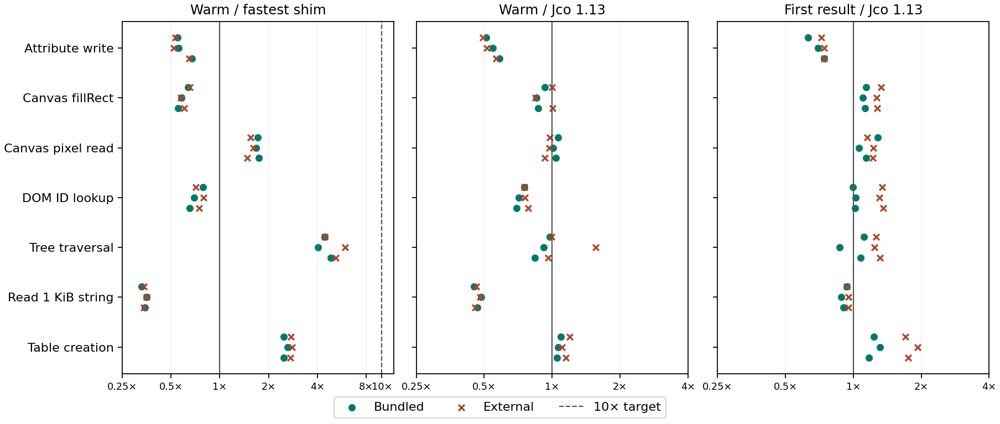

<details><summary>Reproduce the package and browser comparisons</summary>

Build the two Jco checkouts and prepare the upstream and release assets using the [matrix setup](#full-demo-matrix-on-the-merged-pr). Set `before` and `after` to their respective checkout paths and `stage` to the prepared upstream build. The two small-workload trials build the alternative and original packages at `47f6dc0c1`. The full matrix and full-workload transport trial use the built checkout at `427b9c0d7`, including its rebuilt checked runtime. The transport trial regenerates automatic splitting from the same compiled sources as its control. The runner checks requested URLs, sizes, protocol, returned measurements, and the position and immediate predecessor of each treatment.

```sh
export CHROME_BIN=/path/to/chrome
old=web/bench/results/review-matrix-minified-47f6dc0c1.json.gz
node web/bench/runtime-layouts.mjs "$before" "$old" /tmp/layouts.json.gz
node web/bench/runtime-chunks.mjs "$before" "$old" /tmp/first.json.gz --compact-helpers
node web/bench/runtime-chunks.mjs "$before" "$old" /tmp/repeat.json.gz --compact-component
python3 web/bench/runtime-chunks-report.py /tmp/repeat.json.gz "$old" --plot /tmp/repeat.png
ROUNDS=12 node web/bench/review-matrix.mjs "$after" "$stage" /tmp/full.json.gz --minify-checked
python3 web/bench/review-matrix-report.py /tmp/full.json.gz --release-intervals --plot /tmp/full.png
node web/bench/runtime-chunks.mjs "$after" /tmp/full.json.gz /tmp/network.json.gz --automatic-control
python3 web/bench/runtime-chunks-report.py /tmp/network.json.gz /tmp/full.json.gz --previous-matrix "$old" --plot /tmp/network.png
```

</details>

## Browser bindings at 47f6dc0c1

Across the branch, reusing the active export task for eligible synchronous host calls produced the largest measured gain. These controlled guest-loop measurements come from the earlier implementation at `ad2aacc9b` and its upstream base at `83e25bb19`. Each guest enters once and repeats the measured operation. [Host-loop experiment and raw data](#pr-head-against-upstream-main)

| Warm guest-loop operation (ns per iteration) | Upstream base | Jco 1.13.0 | Internal Oxc | External checked |
| --- | ---: | ---: | ---: | ---: |
| Scalar host call | 2,378.8 | 16.8 | 21.4 | 24.4 |
| Acquire, borrow and drop a resource | 5,218.5 | 329.6 | 152.6 | 148.0 |
| Return a 16-byte ASCII string | 5,369.6 | 2,307.1 | 762.9 | 843.8 |

### Demo performance and module size

The demo matrix used 12 rounds and 1,164 fresh Chromium documents. Each column below summarizes seven demos in C, C++ and Rust. Sizes and times are medians of the 21 workload medians. First result includes loading the JavaScript and completing the first guest call. [Per-workload results and asset manifest](../web/bench/results/review-matrix-minified-47f6dc0c1.json.gz)

| Demo matrix | Jco 1.13.0 | Upstream main at `326f52ab4` | Internal Oxc | External checked |
| --- | ---: | ---: | ---: | ---: |
| Minified entry (KiB) | 9.58 | 111.34 | 71.54 | 24.99 |
| Total JS (KiB) | 9.58 | 111.34 | 71.54 | 124.13 |
| Total gzipped JS (KiB) | 3.01 | 25.42 | 18.96 | 40.58 |
| JS requests | 1 | 1 | 1 | 19 |
| Import (ms) | 5.03 | 12.05 | 9.43 | 21.97 |
| First result (ms) | 59.91 | 198.72 | 63.25 | 76.15 |
| Warm workloads matching or beating 1.13.0 | — | — | 15/21 | 16/21 |
| Warm workloads matching or beating main | — | — | 20/21 | 21/21 |
| Worst warm time / fastest compiled shim | — | — | 5.29× | 5.28× |

Both builds met the 10× target in 21/21 warm headline workloads and 81/84 individual phases. Against Jco 1.13.0, individual 95% paired intervals were entirely slower for 0 internal and 2 external warm workloads, and for 4 internal and 15 external first results. The two external warm regressions in this run were C++ tree traversal (1.332× release, interval 1.147–1.595×) and C table creation (1.145×, interval 1.062–1.466×). The original bulk-query shim discards its result collection. The equal-work fixture returns and drops every handle. [Equal-work bulk queries](#browser-bindings-at-6a00c9e7d)

Compared with the previous matrix, the median total JS size changed by +97 bytes internally (+37 gzip) and +97 bytes externally (+40 gzip). Every external entry, separately served Wasm module, release asset, upstream asset and shim matched its previous hash.

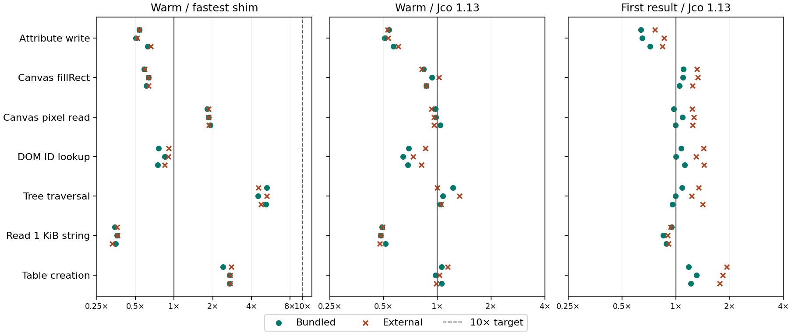

### Which differences from Jco 1.13.0 repeat?

A second run at `47f6dc0c1` used 24 fresh Chromium processes and 2,328 documents, following the original 12 rounds and 1,164 documents. All 236 entries in the asset manifest, compiler hashes, workload inputs and the browser version matched. Both builds met the 10× target on all 21 warm workloads in each run. The worst warm ratios to the fastest compiled shim in the repeat were 4.24× internal and 4.51× external. Both builds beat upstream main on all 21 warm medians in the repeat. [Repeat timings and asset hashes](../web/bench/results/review-matrix-repeat-47f6dc0c1.json.gz)

| External warm time / 1.13.0 | Initial 12 rounds | Independent 24 rounds |
| --- | ---: | ---: |
| C++ tree traversal | 1.332× (1.147–1.595) | 1.050× (0.899–1.206) |
| C table creation | 1.145× (1.062–1.466) | 1.012× (0.965–1.194) |
| Rust table creation | 0.987× (0.927–1.103) | 1.097× (1.033–1.229) |

The first two warm comparisons were the ones flagged by the original run. Their repeat intervals both include parity. Rust table creation crossed the threshold in the repeat only. Across 42 warm comparisons, none had an individual 95% interval wholly slower than release in both runs. The repeat's warm medians matched or beat release in 15/21 internal and 14/21 external cases. These intervals allow some remaining warm slowdowns.

| Workloads with an interval wholly slower than release in **both** runs | Internal Oxc | External checked |
| --- | ---: | ---: |
| Import and initialization | 21/21 | 21/21 |
| First guest call after import | 0/21 | 1/21 |
| First result including import | 4/21 | 15/21 |
| Second guest call, headline operation | 0/21 | 0/21 |

For the 15 external workloads consistently slower to first result, the median paired difference was **+17.78 ms** to first result, **+17.10 ms** in import and initialization, and **−0.44 ms** in the first guest call. For the four internal workloads the differences were +6.40, +4.91 and +0.95 ms. Each column is summarized independently across workloads. The first guest call includes the entire demo. For external C table update it took 1.197× release initially and 1.196× on repeat, a reproducible cost beyond loading the module. [Browser measurements and release intervals](../web/bench/review-matrix-report.py)

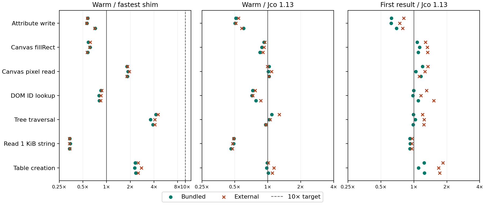

## Browser bindings at f2c5ef195

A checked synchronous export now enters its task without writing the async flags, the canonical result type, or the return and lift memories. The task uses its synchronous defaults. The compiler checks that the component has no `task.return`, cross-component callee, or other trampoline that could read the omitted metadata. Ordinary canonical lowering still uses the guest memory. Source-generation tests cover the internal Oxc bundle, the external checked package, opt-in custom providers, debug and tracked exports. [Compiler change, runtime rationale and test](https://github.com/vados-cosmonic/jco/commit/83bfa2d4c)

Across all 21 demos, each generated export dropped four calls and both minified renderers saved exactly **98 bytes per entry**. Gzip savings were **25–40 bytes internally** and **42–46 bytes externally**. All other served asset hashes matched the preceding matrix, including the guest Wasm, checked runtime modules, release, upstream and shim controls. [Full inventory and fresh-document samples](../web/bench/results/review-matrix-minified-f2c5ef195.json.gz)

The paired host-call experiment used one JS-to-Wasm entry per guest batch. At one host call per entry, internal Oxc took 817.1 ns and the external runtime took 844.5 ns, compared with 817.5 and 835.9 ns before the change. All ten individual 95% before/after intervals included parity across batches of 1, 4, 16, 64 and 256 host calls. The isolated one-call case still cost 26.5× direct Wasm internally and 27.2× externally. [Paired samples and compiler hashes](../web/bench/results/export-host-batch-f2c5ef195.json.gz)

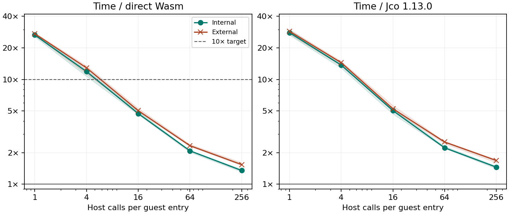

| Twelve-round Chromium matrix | Jco 1.13.0 | Upstream main at `326f52ab4` | Internal Oxc | External checked |
| --- | ---: | ---: | ---: | ---: |
| Median first result (ms) | 62.30 | 208.26 | 65.45 | 78.91 |
| Total JS (KiB) | 9.58 | 111.34 | 71.45 | 124.03 |
| Gzipped JS (KiB) | 3.01 | 25.42 | 18.92 | 40.54 |
| JS requests | 1 | 1 | 1 | 19 |
| Warm workloads matching or beating 1.13.0 | baseline | — | 15/21 | 15/21 |
| Worst warm ratio to the fastest compiled shim | — | — | 5.12× | 5.49× |

Both modes beat upstream main on 21/21 warm headline workloads and fell within 10× on 81/84 original subphases. The three exceptions are the bulk queries whose shim discards the result collection. No individual 95% warm interval was wholly slower than 1.13.0 in this run. First result was measurably slower on eight internal and fourteen external workloads. The preceding matrix found an internal Rust canvas readback regression. Its median here was 1.071× release with an interval of 0.995–1.179×. The two runs do not establish that removing these setters speeds up canvas readback. [Equal-work bulk comparisons and preceding matrix](#browser-bindings-at-6a00c9e7d)

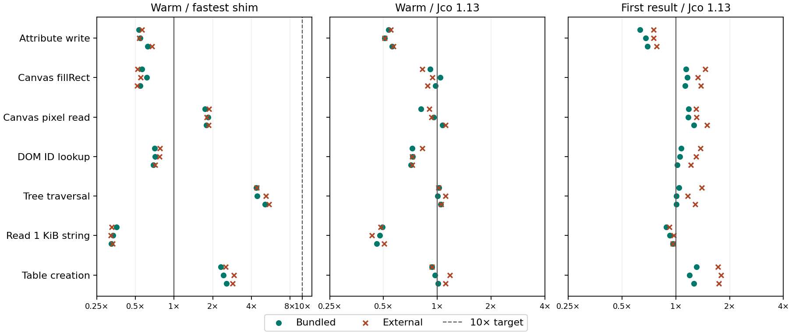

<details><summary>Reproduce the export-task and full browser measurements</summary>

Build the transpiler and checked runtime at `9e90e10f7` (before) and `f2c5ef195` (after). Use the benchmark setup below and the upstream compiler at `326f52ab4`. The host-call fixture runs all six builds on each of 18 fresh Chromium pages with identical guest Wasm. Each build occupies each timing position once at every batch size. The runner checks the checksum from each call. The full matrix uses 12 rounds and fresh documents. The inventory comparison checks that every asset outside the 42 candidate JS entries matches the previous matrix.

```sh
export CHROME_BIN=/path/to/chrome
node web/bench/export-host-batch.mjs \
  "$before/packages/jco-transpile" "$before/packages/jco-cm-runtime/dist" \
  "$after/packages/jco-transpile" "$after/packages/jco-cm-runtime/dist" \
  /tmp/batch.json.gz --sync-task-fields
python3 web/bench/export-host-batch-report.py /tmp/batch.json.gz --plot /tmp/batch.png
ROUNDS=12 node web/bench/review-matrix.mjs "$after" "$stage" /tmp/matrix.json.gz --minify-checked
python3 web/bench/review-matrix-report.py /tmp/matrix.json.gz --release-intervals \
  --compare-entries web/bench/results/review-matrix-minified-6a00c9e7d.json.gz --plot /tmp/matrix.png
```

</details>

## Browser bindings at 6a00c9e7d

Bindgen now reads the length of a compound list once. The internal Oxc bundle and external runtime use that length to allocate guest memory, lower the elements and report the count to the guest. A host list with 2,000 elements previously received 2,002 length reads. The runner checks that the loop bound is the only generated JS difference in all six DOM-query adapters and verifies identical guest Wasm. [Compiler change and regression test](https://github.com/vados-cosmonic/jco/commit/6a00c9e7d7e0364f6de5eb819e0b944128575ad9)

Across C, C++ and Rust, each guest returned and dropped 20,000 DOM handles per pass. For ordinary arrays, the individual 95% before/after timing intervals included parity in **9/9 internal** and **9/9 external** comparisons. The table shows the range of the three language medians at each batch size. The chart includes every language and its interval. [Matched before/after timings and asset hashes](../web/bench/results/bulk-dom-6a00c9e7d.json.gz)

| Handles per query | Internal / prior compiler | External / prior compiler | Internal / direct shim | External / direct shim |
| ---: | ---: | ---: | ---: | ---: |
| 25 | 0.99–1.02× | 0.99–1.01× | 1.43–1.44× | 1.45–1.46× |
| 250 | 1.00–1.01× | 0.98–1.00× | 1.56–1.59× | 1.55–1.63× |
| 2000 | 1.00–1.03× | 0.98–1.01× | 1.55–1.63× | 1.58–1.64× |

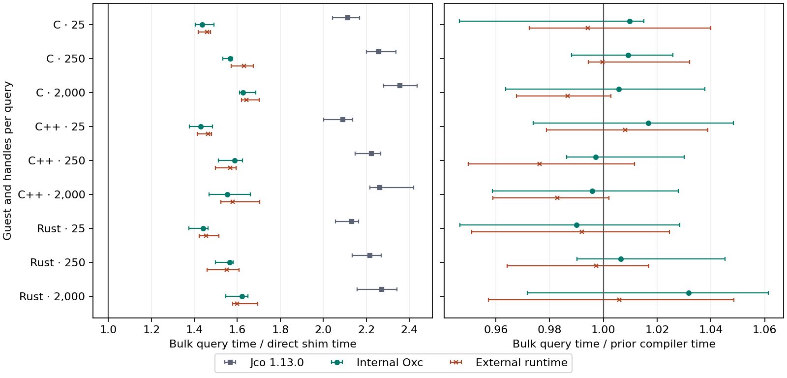

The full comparison used 12 rounds and 21 language/workload pairs. On the warm headline operation, both builds came within 10× of the fastest compiled shim in all 21 cases. Of 84 comparable subphases, 81 internal and 81 external fell within 10×. In the original bulk query the shim discards a live collection. The comparison above makes each implementation return all handles and run the guest's drop loop. [Full demo timings, compiler and module hashes](../web/bench/results/review-matrix-minified-6a00c9e7d.json.gz)

| Build | Entry JS (KiB) | Total JS (KiB) | Gzipped JS (KiB) | JS requests | Import (ms) | First result incl. import (ms) |
| --- | ---: | ---: | ---: | ---: | ---: | ---: |
| Jco 1.13.0 | 9.58 | 9.58 | 3.01 | 1 | 5.15 | 60.72 |
| Upstream main at `326f52ab4` | 111.34 | 111.34 | 25.42 | 1 | 12.14 | 205.50 |
| Internal Oxc | 71.54 | 71.54 | 18.95 | 1 | 9.71 | 63.65 |
| External checked | 25.08 | 124.13 | 40.59 | 19 | 22.57 | 77.35 |

Each of the six minified DOM-query entries shrank by seven bytes. The other 36 PR entries, the checked runtime modules and all separately served Wasm cores matched the previous matrix byte for byte. Each column is the median of the 21 workload medians. Gzip is the sum of compressed JS asset sizes per workload. HTTP timings use uncompressed loopback responses.

| Warm headline operation | Internal Oxc | External checked |
| --- | ---: | ---: |
| Matching or beating Jco 1.13.0 | 18/21 | 15/21 |
| Matching or beating upstream main | 21/21 | 20/21 |
| Worst ratio to the fastest compiled shim | 5.29× | 5.90× |

The internal Rust canvas pixel read took 1.067× the release time (individual 95% interval 1.014–1.152×). It was the only warm headline interval entirely above parity. For first result, seven internal and fourteen external intervals were entirely slower than release.

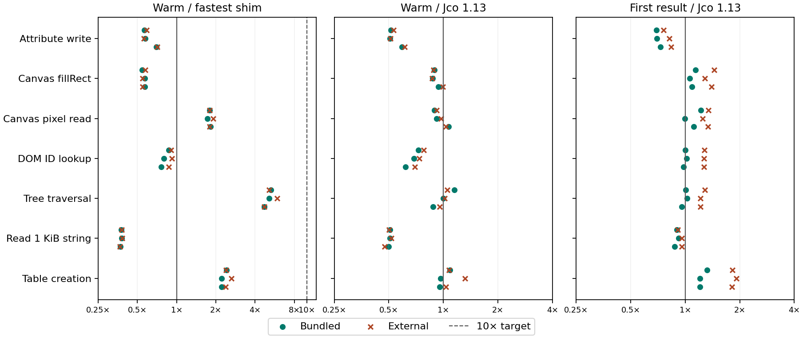

<details><summary>Reproduce the comparison</summary>

Use built Jco checkouts at `cbd43f45f` (before) and `6a00c9e7d` (after), plus the upstream build at `326f52ab4`. Each bulk comparison runs all six builds on one page with six warmups and six timed passes per build. Each build occupies every timing position. The matrix uses a fresh document per build and reports the second invocation as warm.

```sh
export CHROME_BIN=/path/to/chrome
ROUNDS=12 node web/bench/bulk-dom.mjs "$after" /tmp/bulk.json.gz "$before"
python3 web/bench/bulk-dom-report.py /tmp/bulk.json.gz --plot /tmp/bulk.png
ROUNDS=12 node web/bench/review-matrix.mjs "$after" "$stage" /tmp/matrix.json.gz --minify-checked
python3 web/bench/review-matrix-report.py /tmp/matrix.json.gz --release-intervals --plot /tmp/matrix.png
```

</details>

## Browser bindings at 89d7306a9

A task normally records its scope ID in a map so that dropping a borrowed handle can find the owning task. For a synchronous component that cannot create a borrowed handle, the checked compiler can prove that this lookup has no reader. The internal Oxc bundle and external runtime both skip the map insertion and deletion. They still assign a distinct scope ID to each task. Borrowed export arguments, cross-instance transfers and custom providers retain registration. [Runtime implementation and tests](https://github.com/vados-cosmonic/jco/commit/4b02f2fc1) · [Custom-provider compatibility](https://github.com/vados-cosmonic/jco/commit/8e64ebfdf)

For one JS call into Wasm that calls a scalar host function once and returns, elapsed time decreased by **15.8% (95% interval 10.6–16.9%) internally** and **16.7% (95% interval 14.6–19.0%) externally** relative to the previous compiler. At one host call per export the two renderers took 26.90× and 26.25× the direct Wasm time. With 16 host calls sharing one export they took 4.62× and 4.86×. The checked external entry differs from the control by a single property in the task context. The runner verifies this and checks identical guest Wasm across all six builds. [Paired timings, compiler and asset hashes](../web/bench/results/export-host-batch-89d7306a9.json.gz)

| Host calls per export | Internal after / before | External after / before | Internal / direct Wasm | External / direct Wasm |
| ---: | ---: | ---: | ---: | ---: |
| 1 | 0.842× (0.831–0.894) | 0.833× (0.810–0.854) | 26.900× (25.226–27.653) | 26.248× (25.377–27.427) |
| 4 | 0.871× (0.857–0.900) | 0.856× (0.834–0.870) | 12.797× (12.244–13.473) | 12.791× (11.884–13.302) |
| 16 | 0.895× (0.878–0.953) | 0.901× (0.878–0.928) | 4.620× (4.586–4.801) | 4.855× (4.667–5.017) |
| 64 | 0.936× (0.910–0.966) | 0.925× (0.908–0.970) | 2.002× (1.932–2.177) | 2.272× (2.146–2.373) |
| 256 | 0.955× (0.936–1.009) | 0.971× (0.942–1.013) | 1.327× (1.293–1.403) | 1.533× (1.459–1.627) |

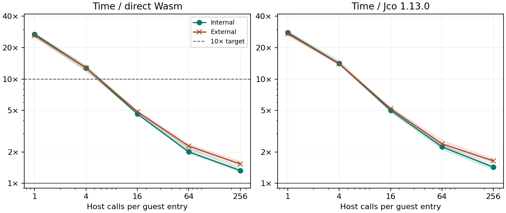

Across seven browser workloads in C, C++ and Rust, 12 rounds compared the same guest binaries against Jco 1.13.0, upstream main at `326f52ab4`, and the reference shims. All 21 checked external entries contained the new hint. Removing that property reproduced the previous entry byte for byte in each case. Each asset and time column is the median across 21 cases. The browser fetched uncompressed files over loopback. [Full demo measurements](../web/bench/results/review-matrix-minified-89d7306a9.json.gz)

| Build | Minified JS entry (KiB) | Total JS (KiB) | Total gzipped JS¹ (KiB) | JS requests | Import (ms) | First result including import (ms) |
| --- | ---: | ---: | ---: | ---: | ---: | ---: |
| Jco 1.13.0 | 9.58 | 9.58 | 3.01 | 1 | 5.10 | 61.90 |
| Upstream main | 111.34 | 111.34 | 25.42 | 1 | 12.37 | 204.88 |
| Internal Oxc | 71.55 | 71.55 | 18.96 | 1 | 9.55 | 63.03 |
| External checked | 25.08 | 124.13 | 40.59 | 19 | 22.61 | 80.45 |

¹ Sum of the compressed JS asset sizes for each workload.

| Warm demo measurements | Internal Oxc | External checked |
| --- | ---: | ---: |
| Within 10× of the fastest compiled shim | 21/21 | 21/21 |
| Matching or beating upstream main | 20/21 | 21/21 |
| Matching or beating Jco 1.13.0 | 16/21 | 13/21 |
| Comparable subphases within 10× of the fastest shim | 81/84 | 81/84 |
| Worst warm headline ratio to the fastest shim | 4.52× | 4.72× |

For the warm operation, external Rust table creation took 1.25× the release time (individual 95% interval 1.05–1.31×). The other warm intervals included parity or favored the PR. For first result, 6 internal and 14 external intervals were entirely slower than release.

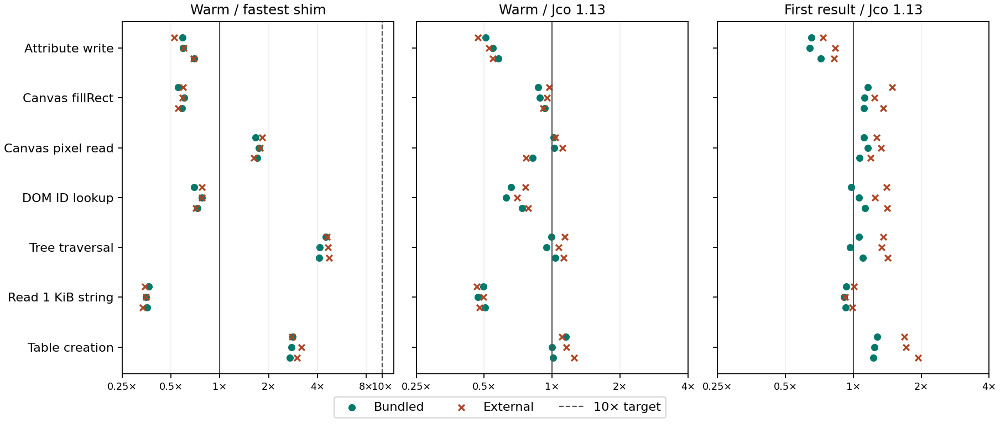

<details><summary>Reproduce both comparisons</summary>

Use the built Jco checkouts at `0309ec2a7` (before) and `89d7306a9` (after) and the upstream build at `326f52ab4`. The paired runner rotates all six builds through each timing position on 18 fresh pages per batch size. Its intervals use one paired observation per page. The full matrix runs each guest twice on a fresh document and reports the second invocation as warm.

```sh
export CHROME_BIN=/path/to/chrome
node web/bench/export-host-batch.mjs "$before/packages/jco-transpile" "$before/packages/jco-cm-runtime/dist" "$after/packages/jco-transpile" "$after/packages/jco-cm-runtime/dist" /tmp/batch.json.gz --borrow-scope-hint
python3 web/bench/export-host-batch-report.py /tmp/batch.json.gz --plot /tmp/batch.png
ROUNDS=12 node web/bench/review-matrix.mjs "$after" "$stage" /tmp/matrix.json.gz --minify-checked
python3 web/bench/review-matrix-report.py /tmp/matrix.json.gz --release-intervals --plot /tmp/matrix.png
```

</details>

## Browser bindings at 0c3d12ad0

The PR shares the synchronous host adapter between the internal Oxc bundle and the external runtime package. Twelve Chromium rounds compared the same C, C++ and Rust guests across seven browser workloads. The comparison uses the compiler from upstream main at `326f52ab4`. [Fork PR](https://github.com/vados-cosmonic/jco/pull/62) · [Upstream CI build](https://github.com/bytecodealliance/jco/actions/runs/45795485943) · [Measurements, asset sizes and compiler hashes](../web/bench/results/review-matrix-minified-0c3d12ad0.json.gz)

| Build | Minified JS entry (KiB) | Total JS (KiB) | Total gzipped JS¹ (KiB) | JS requests | Import (ms) | First result including import (ms) |
| --- | ---: | ---: | ---: | ---: | ---: | ---: |
| Jco 1.13.0 | 9.58 | 9.58 | 3.01 | 1 | 5.02 | 60.91 |
| Upstream main | 111.34 | 111.34 | 25.42 | 1 | 12.29 | 200.95 |
| Internal Oxc | 71.47 | 71.47 | 18.93 | 1 | 9.82 | 63.21 |
| External checked | 25.06 | 124.05 | 40.55 | 19 | 21.92 | 78.62 |

¹ Median across 21 workload and language pairs for each column. Gzip is the sum of compressed JS asset sizes. The timings use uncompressed loopback HTTP.

| Warm demo measurements | Internal Oxc | External checked |
| --- | ---: | ---: |
| Within 10× of the fastest compiled shim | 21/21 | 21/21 |
| Matching or beating upstream main | 21/21 | 21/21 |
| Matching or beating Jco 1.13.0 | 17/21 | 14/21 |
| Comparable subphases within 10× of the fastest shim | 81/84 | 81/84 |
| Worst warm headline ratio to the fastest shim | 4.29× | 4.84× |

On the second guest invocation, internal C canvas pixel read took 1.080× the 1.13.0 time (individual 95% interval 1.028–1.278×). It was the only internal interval entirely above parity. All external intervals included parity or favored the PR. For first result, 6 internal and 15 external intervals were entirely slower than release. [Materialized DOM queries](dom-performance.md#materializing-bulk-dom-query-results) · [Later warm invocations](dom-performance.md#warm-table-creation-and-tree-traversal) · [Repeat visits and HTTP caching](browser-delivery.md#repeat-visits-and-http-caching)

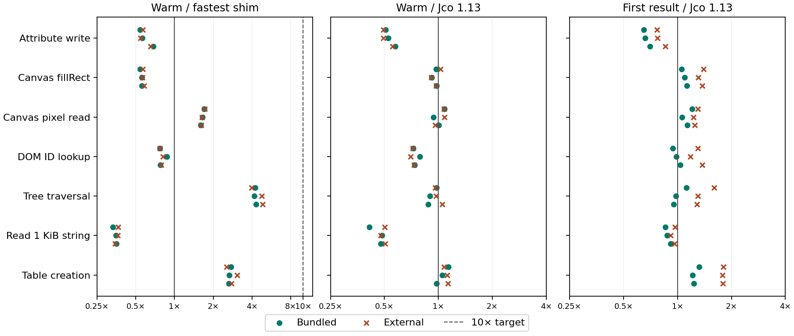

## Default browser bindings at revision b731ebc91

In the full timing run at `b731ebc91`, both the internal Oxc bundle and the external checked runtime stayed within 10× of the fastest compiled shim in **all 21 warm headline cases**. Tree traversal had the largest gap. The internal bundle took **5.50×** the shim’s time for the C guest, and the external runtime took **5.78×** for Rust. Cold startup and Jco 1.13.0 parity remain open. [Jco fork PR](https://github.com/vados-cosmonic/jco/pull/62) · [Minified builds](module-size.md#minified-browser-bindings) · [Equal-work bulk queries](dom-performance.md#materializing-bulk-dom-query-results) · [External runtime packaging](runtime-packaging.md#packaging-the-external-runtime-for-browsers) · [Warmed tables and traversal](dom-performance.md#warm-table-creation-and-tree-traversal)

| Headline comparison | Internal Oxc | External runtime |
| --- | ---: | ---: |
| Warm operation at or faster than upstream main | 20/21 | 21/21 |
| Warm operation at or faster than Jco 1.13.0 | 13/21 | 12/21 |
| First full result at or faster than Jco 1.13.0 | 5/21 | 4/21 |
| Warm subphases within 10× of the fastest compiled shim | 81/84 | 81/84 |

| Median across 21 workload and language pairs | Jco 1.13.0 | Upstream main | Internal Oxc | External runtime |
| --- | ---: | ---: | ---: | ---: |
| Import (ms) | 5.74 | 14.59 | 11.66 | 25.94 |
| First full result, including import (ms) | 65.70 | 246.70 | 72.12 | 87.55 |
| Generated JS entry (KiB) | 21.23 | 191.50 | 126.43 | 67.01 |
| Total JS transferred per document (KiB) | 21.23 | 191.50 | 126.43 | 165.94 |
| JS requests per document | 1 | 1 | 1 | 19 |

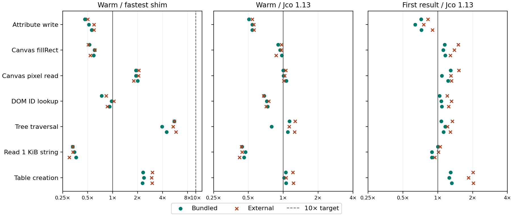

The full matrix ran in 776 fresh Chromium documents over eight balanced rounds. Each Jco build ran identical Wasm cores. The browser measured import and the first full guest call, then repeated the workload in the same document for the warm phase. Responses were uncompressed on loopback with caching disabled and DevTools disconnected. Release and upstream comparisons pair times within each round. Shim ratios divide each warm median by the lowest median from the compiled shims available for that operation. [Measured Jco revision](https://github.com/vados-cosmonic/jco/commit/b731ebc9160203466a5c2bf5bc2debb6a77d28e0) · [Measured upstream main](https://github.com/bytecodealliance/jco/commit/83e25bb19bc45c8a346e4ecdd19b4a1541700fe7) · [Raw samples, compiler hashes and request sizes](../web/bench/results/review-matrix-b731ebc91.json.gz)

The three subphases outside the 10× target were bulk DOM queries. The WIT interface materializes a list of handles and the Embind shim discards a live collection. At 2,000 handles per query, materializing the list on both sides measured 1.50–1.57× the direct shim’s time for the internal bundle and 1.53–1.60× for the external runtime. The single bundled headline above upstream main was Rust canvas pixel readback at 1.03×, with individual rounds on either side of parity. The number of warm medians at or below 1.13.0 also varied between the two full runs. The separate decoder trial isolates the effect of the import change. [Equal-work bulk query results](dom-performance.md#materializing-bulk-dom-query-results) · [Pre-decoder full run](#full-demo-matrix-on-the-merged-pr) · [Decoder trial](runtime-packaging.md#loading-the-utf-8-decoder-for-synchronous-imports)

The synchronous host adapter reuses an enclosing task. An isolated numeric guest export can skip task allocation entirely. The decoder change reduces dependencies when the external adapter takes a string. Each has a separate comparison that measures its effect. [Host calls, resource handles and short string results](#pr-head-against-upstream-main) · [Numeric exports](bindings.md#calling-a-scalar-wasm-export-from-javascript) · [External decoder requests and bytes](runtime-packaging.md#loading-the-utf-8-decoder-for-synchronous-imports)

<details><summary>All 21 headline comparisons and reproduction</summary>

| Operation | Guest | Bundled / shim | External / shim | Bundled / 1.13 warm | External / 1.13 warm | Bundled / 1.13 first result | External / 1.13 first result |
| --- | --- | ---: | ---: | ---: | ---: | ---: | ---: |
| Attribute write | C | 0.46× | 0.50× | 0.51× | 0.54× | 0.72× | 0.82× |
| Attribute write | C++ | 0.52× | 0.59× | 0.54× | 0.56× | 0.64× | 0.76× |
| Attribute write | Rust | 0.56× | 0.59× | 0.54× | 0.56× | 0.72× | 0.90× |
| Canvas fillRect | C | 0.53× | 0.51× | 0.90× | 0.97× | 1.15× | 1.50× |
| Canvas fillRect | C++ | 0.60× | 0.61× | 0.94× | 0.96× | 1.11× | 1.39× |
| Canvas fillRect | Rust | 0.59× | 0.53× | 0.97× | 0.87× | 1.16× | 1.28× |
| Canvas pixel read | C | 1.90× | 2.05× | 1.00× | 1.05× | 1.29× | 1.52× |
| Canvas pixel read | C++ | 1.90× | 2.05× | 1.00× | 1.02× | 1.08× | 1.30× |
| Canvas pixel read | Rust | 1.99× | 1.79× | 1.06× | 1.01× | 1.22× | 1.31× |
| DOM ID lookup | C | 0.74× | 0.83× | 0.69× | 0.68× | 1.04× | 1.20× |
| DOM ID lookup | C++ | 0.97× | 1.03× | 0.72× | 0.75× | 1.07× | 1.31× |
| DOM ID lookup | Rust | 0.92× | 0.86× | 0.73× | 0.71× | 1.09× | 1.24× |
| Tree traversal | C | 5.50× | 5.49× | 1.13× | 1.27× | 1.07× | 1.34× |
| Tree traversal | C++ | 3.92× | 5.35× | 0.79× | 1.13× | 1.16× | 1.22× |
| Tree traversal | Rust | 4.47× | 5.78× | 1.09× | 1.25× | 1.12× | 1.29× |
| Read 1 KiB string | C | 0.33× | 0.33× | 0.44× | 0.44× | 1.00× | 1.05× |
| Read 1 KiB string | C++ | 0.34× | 0.33× | 0.47× | 0.44× | 0.89× | 1.01× |
| Read 1 KiB string | Rust | 0.36× | 0.30× | 0.46× | 0.42× | 0.89× | 0.94× |
| Table creation | C | 2.32× | 3.01× | 1.05× | 1.21× | 1.29× | 2.01× |
| Table creation | C++ | 2.38× | 2.93× | 1.02× | 1.06× | 1.25× | 1.84× |
| Table creation | Rust | 2.29× | 2.99× | 1.06× | 1.22× | 1.32× | 2.03× |

Use Jco revision `b731ebc91` for the PR checkout in the [full-matrix setup](#full-demo-matrix-on-the-merged-pr). The same runner, pinned upstream compiler, release entries and alternative shims were used in both runs. To reproduce the table and figure from the saved data, run the following from this fork with Matplotlib installed.

```sh
python3 web/bench/review-matrix-report.py web/bench/results/review-matrix-b731ebc91.json.gz \
  --plot /tmp/review-matrix-b731ebc91.png
```

</details>

## PR head against upstream main

The PR incorporates upstream main at `83e25bb19`. In the same seven Chromium pages, both PR renderers recovered most of main’s scalar host-call overhead, and both beat 1.13.0 for resource handles and short string returns. The scalar call still cost 4.6 ns more than 1.13.0 with the internal bundle and 7.6 ns more with the external runtime. [PR head `ad2aacc9b`](https://github.com/vados-cosmonic/jco/commit/ad2aacc9be6fe35c02ae91d9c8c5cde3693e722d) · [Upstream revision](https://github.com/bytecodealliance/jco/commit/83e25bb19bc45c8a346e4ecdd19b4a1541700fe7)

| Warm operation, ns per guest iteration | Jco 1.13.0 | Upstream main | PR, internal Oxc | PR, external runtime |
| --- | ---: | ---: | ---: | ---: |
| Scalar host call | 16.8 | 2,378.8 | 21.4 | 24.4 |
| Acquire, borrow and drop a resource | 329.6 | 5,218.5 | 152.6 | 148.0 |
| Return a 16-byte ASCII string | 2,307.1 | 5,369.6 | 762.9 | 843.8 |

The generated JavaScript entry for this fixture was 9.6 KiB with 1.13.0, 182.4 KiB with upstream main and 118.5 KiB with the PR’s internal bundle. The external entry was 55.5 KiB plus its separately loaded runtime. Every mode ran identical Wasm cores. Each cell is the median of seven page medians, with two warmups, five measured passes and a checksum on every pass. The next section measures the complete demo suite on these revisions. [Runner](../web/bench/provider-loop.mjs) · [All 420 timed passes, generator hashes and entry sizes](../web/bench/results/provider-loop-83e25bb19.json)

Build the native `transpile` example with `--features embedded-cm-runtime` in each checkout, using separate Cargo target directories. Build the PR runtime with `pnpm --filter @bytecodealliance/jco-cm-runtime build` and install this fork’s web dependencies with `npm ci --prefix web`.

```sh
CHROME_BIN=/path/to/chrome node web/bench/provider-loop.mjs \
  /path/to/pr /path/to/pr/target/debug/examples/transpile /tmp/upstream-comparison.json \
  /path/to/upstream /path/to/upstream/target/debug/examples/transpile
```

## Full demo matrix on the merged PR

Both PR renderers beat upstream main and stayed within 10× of the fastest compiled shim in **all 21 warmed headline comparisons**. Rust tree traversal had the largest shim ratio for each renderer. The internal bundle took **7.58×** the fastest shim’s time and the external runtime took **6.95×**. Among the ten workload and guest pairs with a same-language shim, the largest ratios to the fastest such shim were **4.52×** and **4.63×**. [PR head `ad2aacc9b`](https://github.com/vados-cosmonic/jco/commit/ad2aacc9be6fe35c02ae91d9c8c5cde3693e722d) · [Upstream build at `83e25bb19`](https://github.com/bytecodealliance/jco/actions/runs/45785466713)

| Across 21 workload and language pairs | Jco 1.13.0 | Upstream main | PR, internal Oxc | PR, external |
| --- | ---: | ---: | ---: | ---: |
| Warm headline at or faster than 1.13.0 | — | — | 16/21 | 14/21 |
| First full result at or faster than 1.13.0 | — | — | 7/21 | 6/21 |
| Median import (ms) | 9.43 | 20.17 | 15.16 | 43.65 |
| Median time from import to first full result (ms) | 76.12 | 268.91 | 84.68 | 113.45 |
| Median generated JS entry (KiB) | 21.23 | 191.50 | 126.43 | 67.05 |
| Median total JS transferred during import and execution (KiB) | 21.23 | 191.50 | 126.43 | 193.20 |
| Median JS requests during import and execution | 1 | 1 | 1 | 23 |

Each of eight Chromium 156 processes ran 97 fresh documents with DevTools disconnected. Every document preloaded the shared benchmark host, imported one implementation, and ran the same full workload twice. The first call supplied the time to first result and the second supplied the warmed phase timings. Both calls had to produce a complete, finite guest report. Each four-round block balanced the order of the four Jco configurations within each guest and workload. Every Jco configuration used byte-identical external Wasm cores for that guest. Responses were uncompressed and served on loopback with caching disabled. The external column uses the checked package as individual ES modules. [Runner](../web/bench/review-matrix.mjs) · [Raw timings, asset sizes, compiler hashes and requests](../web/bench/results/review-matrix.json.gz)

The release comparisons divide times within each round before taking the median. Shim ratios compare the median warmed phase time with the lowest compiled-shim median for that phase. Import time, first result, bytes and request counts summarize the 21 workload medians. In the external renderer, C table creation was slower than 1.13.0 in all eight rounds (median paired ratio **1.14×**). For the internal bundle, every warm case had at least one round at or faster than 1.13.0. Both renderers exceeded 10× in three of the 84 comparable subphases. All three were bulk DOM queries, where the WIT interface materializes a list of handles and Embind discards a live collection. [Equal-work bulk query comparison](candidate-study.md#dom-bindings-with-identical-guest-code)

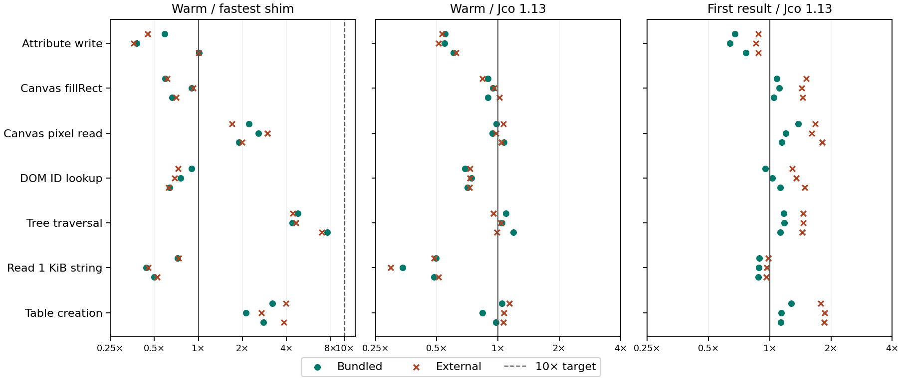

<details><summary>All 21 headline comparisons</summary>

| Operation | Guest | Bundled / shim | External / shim | Bundled / 1.13 warm | External / 1.13 warm | Bundled / 1.13 first result | External / 1.13 first result |
| --- | --- | ---: | ---: | ---: | ---: | ---: | ---: |
| Attribute write | C | 0.59× | 0.45× | 0.55× | 0.53× | 0.67× | 0.88× |
| Attribute write | C++ | 0.38× | 0.36× | 0.55× | 0.51× | 0.64× | 0.86× |
| Attribute write | Rust | 1.01× | 1.00× | 0.61× | 0.62× | 0.76× | 0.88× |
| Canvas fillRect | C | 0.59× | 0.61× | 0.89× | 0.84× | 1.08× | 1.51× |
| Canvas fillRect | C++ | 0.90× | 0.92× | 0.95× | 0.95× | 1.12× | 1.44× |
| Canvas fillRect | Rust | 0.66× | 0.70× | 0.89× | 1.02× | 1.05× | 1.45× |
| Canvas pixel read | C | 2.22× | 1.70× | 0.98× | 1.06× | 1.38× | 1.68× |
| Canvas pixel read | C++ | 2.58× | 2.96× | 0.94× | 0.98× | 1.20× | 1.61× |
| Canvas pixel read | Rust | 1.90× | 1.99× | 1.07× | 1.04× | 1.14× | 1.81× |
| DOM ID lookup | C | 0.90× | 0.73× | 0.69× | 0.73× | 0.95× | 1.29× |
| DOM ID lookup | C++ | 0.76× | 0.69× | 0.74× | 0.73× | 1.03× | 1.35× |
| DOM ID lookup | Rust | 0.64× | 0.63× | 0.71× | 0.72× | 1.13× | 1.49× |
| Tree traversal | C | 4.77× | 4.42× | 1.10× | 0.95× | 1.17× | 1.46× |
| Tree traversal | C++ | 4.39× | 4.63× | 1.04× | 1.04× | 1.18× | 1.46× |
| Tree traversal | Rust | 7.58× | 6.95× | 1.19× | 0.99× | 1.12× | 1.44× |
| Read 1 KiB string | C | 0.72× | 0.73× | 0.50× | 0.49× | 0.89× | 0.98× |
| Read 1 KiB string | C++ | 0.44× | 0.46× | 0.34× | 0.30× | 0.88× | 0.97× |
| Read 1 KiB string | Rust | 0.50× | 0.52× | 0.48× | 0.51× | 0.88× | 0.96× |
| Table creation | C | 3.22× | 3.96× | 1.04× | 1.14× | 1.28× | 1.78× |
| Table creation | C++ | 2.12× | 2.69× | 0.84× | 1.07× | 1.14× | 1.87× |
| Table creation | Rust | 2.78× | 3.83× | 0.98× | 1.06× | 1.14× | 1.85× |

</details>

<details><summary>Reproduce the merged-head comparison</summary>

Prepare the 1.13.0 demo files using the setup and size commands in [Reproduce the comparison](reproduce.md#reproduce-the-comparison). In a Jco checkout at `ad2aacc9b`, install dependencies and build both `@bytecodealliance/jco-cm-runtime` and `@bytecodealliance/jco-transpile` with their package build scripts. The commands below run from the benchmark fork. The upstream compiler uses the pinned dependencies in `web/bench/main`.

```bash
jco=/path/to/built/jco-pr
stage=$(mktemp -d web/bench/main/build.XXXXXX)
run=45785466713
commit=$(gh run view "$run" --repo bytecodealliance/jco --json headSha --jq .headSha)
test "$commit" = 83e25bb19bc45c8a346e4ecdd19b4a1541700fe7
gh run download "$run" --repo bytecodealliance/jco \
  --name jco-transpile-dist --name jco-transpile-vendor --dir "$stage"
mv "$stage/jco-transpile-dist" "$stage/dist"
mv "$stage/jco-transpile-vendor" "$stage/vendor"
echo "$commit" > "$stage/commit"
CHROME_BIN=/path/to/chrome ROUNDS=8 node web/bench/review-matrix.mjs \
  "$jco" "$stage" /tmp/review-matrix.json.gz
python3 web/bench/review-matrix-report.py /tmp/review-matrix.json.gz
```

The report can regenerate the figure with `--plot /tmp/review-matrix.png` and Matplotlib installed.

</details>

### Repeated DOM workloads on one page

The merged-head matrix found that external C table creation took 1.14× the 1.13.0 time after one warmup in separate documents. With the four builds interleaved on one page, external C table creation took **0.99×** the release time after four warmups, with an individual 95% median interval of **0.94–1.04×**. In this same-page run, even the second guest call had a median ratio of 0.99×. The two studies change both page isolation and execution order, so the difference cannot be attributed to warmup alone. [Fresh-document results](#full-demo-matrix-on-the-merged-pr) · [All paired samples](../web/bench/results/paired-dom-review.json.gz)

| Workload phase | Internal / 1.13.0 | External / 1.13.0 | Packed / external |
| --- | ---: | ---: | ---: |
| C table creation | 0.99× (0.91–1.04) | 0.99× (0.94–1.04) | 0.98× (0.94–1.08) |
| C selected-row update | 0.85× (0.83–0.88) | 0.87× (0.81–0.93) | 0.98× (0.96–1.06) |
| C unselected-row removal | 0.72× (0.71–0.75) | 0.75× (0.71–0.78) | 1.01× (0.97–1.05) |
| Rust tree construction | 0.80× (0.73–0.88) | 0.83× (0.70–1.07) | 0.96× (0.88–0.99) |
| Rust tree traversal | 0.87× (0.71–0.94) | 0.88× (0.84–0.92) | 0.98× (0.92–1.03) |

Each workload ran on 16 fresh Chromium pages. Each page loaded all four implementations, ran four warmups and measured four passes. Every build occupied each position once in those four passes. The denominator for each ratio ran on the same page in the same pass. Each page contributed its median ratio, and the reported intervals use the order statistics of the 16 page medians. Each row uses the same Wasm cores and host functions across renderers. For the packed comparison, a scoped import map served the exact same external entry against one application-bundled runtime module. The runner verified both provider layouts, the table report, and all 19,531 visited tree nodes per traversal.

With the built PR checkout used above, run the following from the benchmark fork. The report prints the table and the external-to-release ratio on each of the eight guest invocations. [Runner](../web/bench/paired-dom-review.mjs) · [Report](../web/bench/paired-dom-report.py)

```sh
CHROME_BIN=/path/to/chrome ROUNDS=16 node web/bench/paired-dom-review.mjs \
  /path/to/built/jco-pr /tmp/paired-dom-review.json.gz
python3 web/bench/paired-dom-report.py /tmp/paired-dom-review.json.gz
```

## Bundled and external runtime on the review branch

The review branch uses the same checked operations for synchronous calls in both renderers. This run compares them directly against a custom provider using the original API-v1 contract. All three used the same runtime source and the same two Wasm core binaries. The external modes differ only in whether the provider opts into the synchronous operations. [Jco PR #62](https://github.com/vados-cosmonic/jco/pull/62) · [Measured Jco revision](https://github.com/vados-cosmonic/jco/commit/275c3071a3760180de923cda62388fc08d34f7cf)

| Warm operation, ns per guest iteration | Bundled | External | External API-v1 compatibility |
| --- | ---: | ---: | ---: |
| Scalar host call | 42.7 | 54.9 | 6,485.0 |
| Acquire, borrow and drop a resource | 337.2 | 437.9 | 13,841.2 |
| Return a 16-byte ASCII string | 1,376.3 | 1,327.5 | 10,458.4 |

Each entry is the median of seven Chromium 156 page medians. Each page ran two warmups and five timed passes of 65,536 iterations per operation and mode, rotating execution order and checking every result. Compare columns within this run. The full demo matrix below used a separate run and workload. [Runner](../web/bench/provider-loop.mjs) · [Raw samples and core hashes](../web/bench/results/provider-loop.json)

To reproduce, build the review checkout with `cargo build -p js-component-bindgen --example transpile --features embedded-cm-runtime` and build its runtime with `pnpm --filter @bytecodealliance/jco-cm-runtime build`. From this benchmark checkout, after `npm ci --prefix web`, run the following with `wasm-tools` on the path.

```sh
CHROME_BIN=/path/to/chrome node web/bench/provider-loop.mjs /path/to/jco \
  /path/to/jco/target/debug/examples/transpile /tmp/provider-loop.json
```
