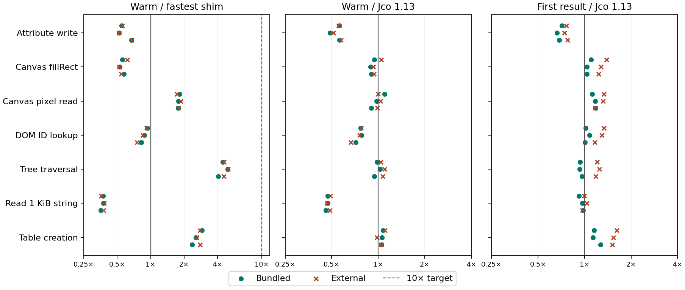
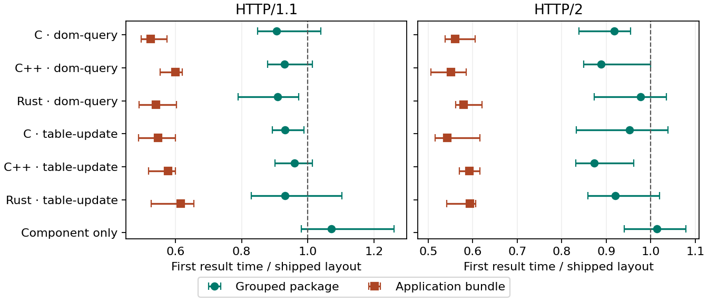
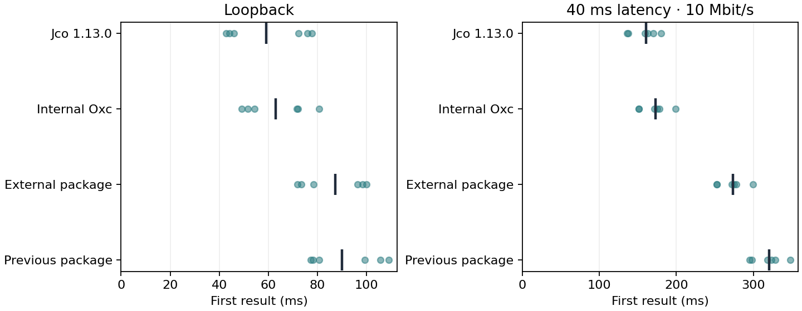
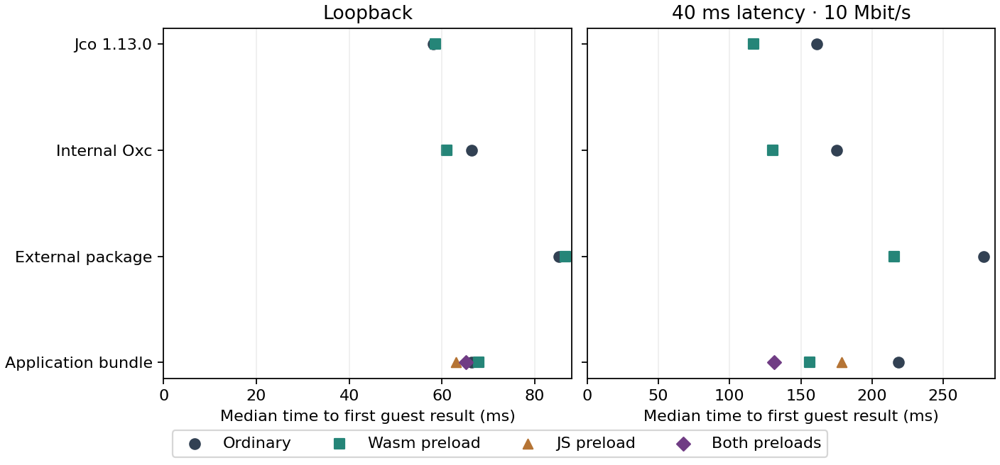
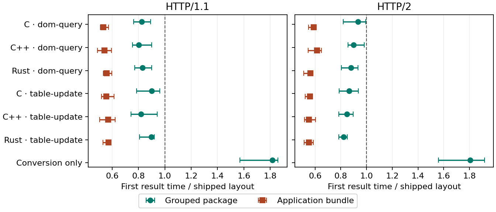
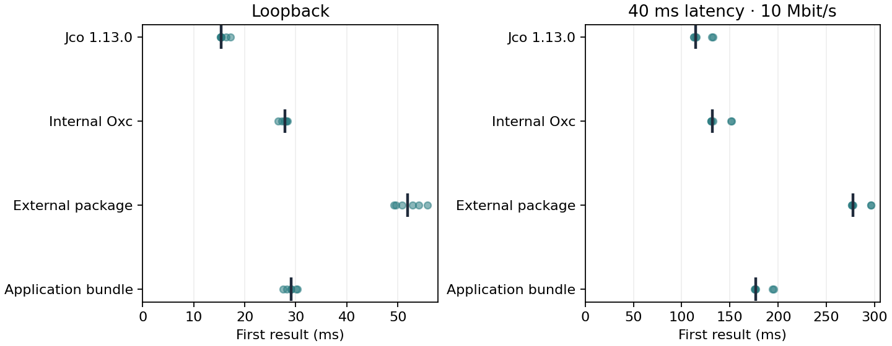
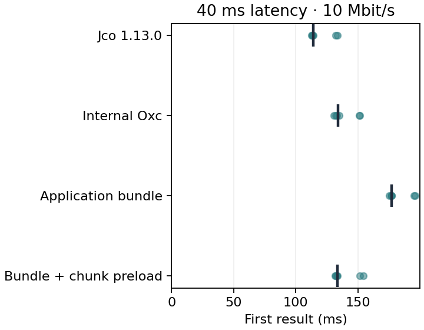
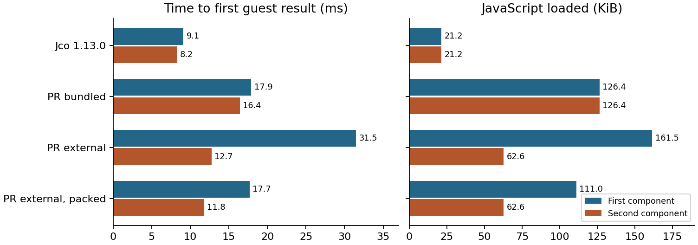

# External runtime packaging

[Benchmark overview](../README.md)

## Loading synchronous task operations in the browser

Synchronous imports on these 21 demos use seven task operations. The external runtime previously loaded the asynchronous task driver to get them. The new package entry re-exports those same seven functions. The compiler uses it when the standard synchronous adapter covers every requested task operation. Tracked calls, specialization opt-outs and custom providers keep their existing imports. Internal Oxc already removes the unused code. All 21 minified internal entries and all guest Wasm files matched their previous builds byte for byte. [Compiler and runtime rationale](https://github.com/vados-cosmonic/jco/commit/b51743055ea7205d972b6aa1fd0e83db1c218198) · [Entry hashes and provider controls](../web/bench/results/sync-task-entries-3e25d8d82.json.gz)

| External runtime fetched by each demo | Previous package | New package | Saved |
| --- | ---: | ---: | ---: |
| JavaScript modules | 15 | 14 | 1 |
| Raw bytes | 101,211 | 85,666 | 15,545 (15.4%) |
| Brotli bytes | 31,057 | 26,845 | 4,212 (13.6%) |

These sizes cover the runtime modules and exclude the generated entry and guest cores. Putting the seven functions in the existing sync entry saved another 424 Brotli bytes per demo, but increased a standalone import of that public entry by 10,216 Brotli bytes. The dedicated entry preserves the standalone sync cost. Importing the full async-task entry on its own costs 785 more Brotli bytes with this package layout. [Four layouts and standalone public-entry sizes](../web/bench/results/sync-task-layouts-3e25d8d82.json.gz)

The external build saved 4,677 gzip bytes at the median across its generated entry and runtime. Its paired import time fell 6.7% versus the previous external build (new/previous 0.933×, 95% interval 0.867–0.975). The first-result ratio was 0.970× (0.957–1.005) and warm execution was 0.995× (0.940–1.041). The byte-identical internal control measured 1.022× (1.002–1.030) for import, 1.000× (0.985–1.044) for first result and 1.028× (0.913–1.071) for warm execution. These suite-wide intervals use the median of the 21 paired workload ratios in each browser round.

A separate HTTP/2 trial served the actual packages with Brotli compression. It used the DOM-query and table-update workloads for each guest language, for a total of 768 fresh documents. On the 40 ms, 10 Mbit/s connection, the smaller package reduced paired first-result time by 1.2% (95% interval 0.7–2.2%). The loopback interval included parity. Each process ran all six workloads and four builds under both network profiles. The paired ratios below summarize the geometric mean across its six workloads. [Individual HTTP/2 requests and timing samples](../web/bench/results/shipped-task-entry-3e25d8d82.json.gz)

| HTTP/2 time to first result | Jco 1.13.0 | Internal Oxc | Previous external | New external | Paired new / previous (95% interval) |
| --- | ---: | ---: | ---: | ---: | ---: |
| Loopback | 57.12 ms | 62.93 ms | 82.71 ms | 82.62 ms | 1.013× (0.955–1.111) |
| 40 ms, 10 Mbit/s | 159.34 ms | 172.83 ms | 275.98 ms | 272.37 ms | 0.988× (0.978–0.993) |

The first four columns are medians across the six workload medians. On the limited connection, paired new-external first result took 1.723× release time (1.699–1.745) and 1.590× internal time (1.566–1.603).

Both modes met the 10× shim target on 81/84 original warm phases. In the three bulk DOM queries the fastest shim discards a live collection, while the component returns the handles. When the direct shim also materialized and dropped all 2,000 handles per query, the two modes took 1.46–1.64× its time across C, C++ and Rust, and 0.69–0.74× the release time. [Equal-work checks and timings](../web/bench/results/bulk-dom-sync-task-3e25d8d82.json.gz)



<details><summary>Reproduce the synchronous task entry measurements</summary>

Build the previous Jco checkout at `9863264e8` in `$before`, the candidate at `3e25d8d82` in `$after`, and their matching runtime packages. Set `$stage` to the staged upstream compiler at `326f52ab4` and `CHROME_BIN` to the Chromium binary. Run from the root of this fork. The network trial uses an HTTP/2 server, individually Brotli-compressed modules and a fresh browser process for each round.

```sh
set -e
test "$(cat "$stage/commit")" = 326f52ab4403466b21b989c995f9bb97b2b9e038
old=web/bench/results/review-matrix-captures-6c8454da9.json.gz
prev="$before/packages/jco-transpile"
dist="$before/packages/jco-cm-runtime/dist"
node web/bench/sync-task-layouts.mjs "$before" "$prev" "$old" /tmp/layouts.json.gz
node web/bench/sync-task-entries.mjs "$prev" "$after/packages/jco-transpile" "$old" /tmp/entries.json.gz
ROUNDS=12 node web/bench/review-matrix.mjs "$after" "$stage" /tmp/matrix.json.gz --compare-compilers "$prev" "$dist"
python3 web/bench/review-matrix-report.py /tmp/matrix.json.gz --compare-entries "$old" --release-intervals --plot /tmp/matrix.png --plot-builds /tmp/builds.png
patch -o web/bench/shipped-task-trial.mjs web/bench/runtime-chunks.mjs web/bench/experiments/shipped-task-entry.patch
ROUNDS=16 node web/bench/shipped-task-trial.mjs "$after" /tmp/matrix.json.gz /tmp/http2.json.gz --compare-packages "$prev" "$dist"
python3 web/bench/shipped-task-report.py /tmp/http2.json.gz /tmp/matrix.json.gz web/bench/shipped-task-trial.mjs
ROUNDS=12 node web/bench/bulk-dom.mjs "$after" /tmp/bulk.json.gz --checked-matrix /tmp/matrix.json.gz
python3 web/bench/bulk-dom-report.py /tmp/bulk.json.gz --matrix /tmp/matrix.json.gz
```

</details>

### Loading five runtime modules through one entry

The external bindings import task operations, component state, resource tables, JavaScript helpers and core operations through five public modules. Two package experiments re-exported those functions together. One added a public entry, and the other extended `intrinsics/sync-task`. An import map let each trial run the exact same generated bindings and Wasm as the shipping control. Chromium verified that every forwarded export from the five modules had the same identity as the original within that package. The test ran C, C++ and Rust DOM queries with eight elements and table updates with eight rows in 768 fresh documents. [Request traces, hashes and timings](../web/bench/results/sync-facades-fe136cf1a.json.gz)

| Build | Runtime requests | Runtime Brotli bytes | First result on loopback | First result at 40 ms, 10 Mbit/s |
| --- | ---: | ---: | ---: | ---: |
| Jco 1.13.0 | 0 | 0 | 15.74 ms | 113.94 ms |
| Shipping external runtime | 14 | 26,845 | 43.26 ms | 229.17 ms |
| Separate combined entry | 11 | 26,863 | 40.58 ms | 230.13 ms |
| Extended task entry | 10 | 26,656 | 39.53 ms | 228.59 ms |

The byte and request columns count the external runtime package alone. Jco 1.13.0 ships its helpers in each generated binding. Each time is the median across six workload medians. Pairing runs within each browser process, the separate and extended entries took **0.921×** (individual 95% interval 0.878–0.987) and **0.901×** (0.865–0.942) the shipping first-result time on loopback. On the limited connection the ratios were **1.007×** (0.996–1.011) and **0.999×** (0.995–1.010). The separate entry left every existing public module byte-identical. Extending the task entry added 1,125 Brotli bytes to a standalone task import. Both layouts remain experiments in this benchmark fork.

<details><summary>Reproduce the HTTP/2 package comparison</summary>

Build Jco at `fe136cf1a` in `$after`, set `CHROME_BIN` to Chromium, and run from the benchmark repository root. Each of 16 browser processes exercises both connection profiles and all four builds. The report checks the exact requests against the server log, the control assets against the shipping matrix and the order of treatments across rounds.

```sh
matrix=web/bench/results/review-matrix-sync-task-3e25d8d82.json.gz
patch -o web/bench/facade-trial.mjs web/bench/runtime-chunks.mjs web/bench/experiments/sync-facades.patch
node web/bench/facade-trial.mjs "$after" "$matrix" /tmp/facades.json.gz --compare-facades
python3 web/bench/facade-report.py /tmp/facades.json.gz "$matrix" web/bench/facade-trial.mjs
```

</details>

## External runtime startup at 427b9c0d7

The checked runtime package groups the short UTF-8 decoder, synchronous waiter and JS helpers into one shared chunk. Across all 21 generated C, C++ and Rust demos this removes three runtime requests, from 18 to 15. Each standalone numeric conversion still loads 2,779 bytes. The largest cost is for a standalone import of the component-state module, which grows by 5,613 bytes (1,502 gzipped). All 18 public entries expose the same names. The internal Oxc bundle gets its runtime from the embedded source. [Package build change](https://github.com/vados-cosmonic/jco/commit/427b9c0d7)

Two independent 20-round Chromium trials used six small DOM-query and table-update cases. Each trial ran 1,280 fresh documents. Each guest used the same Wasm and generated JS entry in both package layouts. The server used TLS on loopback and sent uncompressed responses. Relative gains pair builds within a workload and round. Absolute times summarize the six workload medians.

| Time to first guest result | Previous external | Grouped helpers | Paired reduction | Application bundle |
| --- | ---: | ---: | ---: | ---: |
| HTTP/1.1, first trial | 48.81 ms | 45.08 ms | 6.8% | 26.80 ms |
| HTTP/1.1, repeat | 49.54 ms | 45.67 ms | 7.0% | 27.74 ms |
| HTTP/2, first trial | 49.42 ms | 45.23 ms | 8.0% | 28.41 ms |
| HTTP/2, repeat | 49.47 ms | 45.29 ms | 8.1% | 28.28 ms |

The conversion-only import's timing intervals included parity on both protocols. The standalone component-state probe took 8.56 → 9.12 ms on HTTP/1.1 (paired time ratio 1.071×, individual 95% interval 0.980–1.260) and 8.97 → 9.00 ms on HTTP/2 (1.014×, 0.940–1.080). [First trial and conversion probe](../web/bench/results/compact-helpers-47f6dc0c1.json.gz) · [Replication and component-state probe](../web/bench/results/compact-component-47f6dc0c1.json.gz)



| Runtime layout | Runtime requests per demo | Runtime gzip per demo (KiB) | Standalone numeric conversion (bytes) | Largest standalone increase (bytes) |
| --- | ---: | ---: | ---: | ---: |
| Previous automatic splitting | 18 | 34.61 | 2,779 | — |
| One group for modules shared by at least four entries | 11 | 30.29 | 93,326 | 90,547 |
| Split that group by importing entries, 1 KiB merge threshold | 17 | 35.20 | 2,877 | 6,401 |
| Split by importing entries, 16 KiB threshold | 14 | 34.03 | 54,067 | 51,288 |
| Group component-state source files | 17 | 34.19 | 2,779 | 4,760 |
| Group the three helpers | 15 | 33.77 | 2,779 | 5,613 |

The analysis starts at the static imports of each generated adapter and follows the browser module graph. It checks each adapter against the full matrix, every original runtime file against its hash and all public export names across the eight layouts. Gzip is the sum of individually compressed runtime modules at level 9. [All layouts, module graphs, file sizes and hashes](../web/bench/results/runtime-layouts-47f6dc0c1.json.gz)

### Full workloads over compressed HTTP/2

A third trial used 2,000-element DOM queries and 2,000-row tables in C, C++ and Rust, across 16 rounds and 768 fresh documents. Chromium fetched Brotli-compressed modules over TLS. All 33 regenerated control modules matched the previous package byte for byte. The grouped package served the same entry and guest Wasm in each pair. [Timings, requests and browser settings](../web/bench/results/compact-helpers-http2-427b9c0d7.json.gz)

| Time to first guest result | Jco 1.13.0 | Internal Oxc | Previous external | Grouped helpers | Paired reduction vs previous external |
| --- | ---: | ---: | ---: | ---: | ---: |
| Loopback | 59.14 ms | 62.96 ms | 89.95 ms | 87.31 ms | 4.9% |
| 40 ms latency, 10 Mbit/s | 160.93 ms | 173.00 ms | 320.90 ms | 273.69 ms | 14.4% |

On the limited connection, individual paired 95% intervals favored the grouped package on all six workloads. On loopback, one favored grouping and five included parity. On the limited connection the median start of the guest Wasm fetch moved from 206.75 to 161.83 ms. Median Brotli JS fell from 36.14 to 35.37 KiB. Including the guest Wasm, the external builds used 20 and 17 requests respectively. Release and internal Oxc used two each.



### Starting the guest Wasm and shared JavaScript together

On a 40 ms, 10 Mbit/s connection, the application bundle of the external bindings reached its first guest result in **131.26 ms** when the page preloaded both assets, down from **218.72 ms** with ordinary loading. Internal Oxc with its guest Wasm preloaded took **130.40 ms**. The equivalent release control took **116.90 ms**. The compiled guest, generated entry and response bytes were identical within each scheduling comparison. [Raw first results, request timings, asset hashes and server inventories](../web/bench/results/core-hints-http2-427b9c0d7.json.gz)

| Build at `427b9c0d7` and preload choice | Loopback first result (ms) | Limited first result (ms) | Limited paired reduction vs ordinary |
| --- | ---: | ---: | ---: |
| Jco 1.13.0, ordinary → guest Wasm | 58.03 → 58.63 | 161.22 → 116.90 | 27.3% |
| Internal Oxc, ordinary → guest Wasm | 66.36 → 60.94 | 175.11 → 130.40 | 25.8% |
| External package, ordinary → guest Wasm | 85.17 → 86.51 | 278.44 → 215.44 | 21.1% |
| External application bundle, ordinary → guest Wasm | 66.30 → 67.83 | 218.72 → 156.38 | 28.4% |
| External application bundle, ordinary → shared JS | 66.30 → 63.07 | 218.72 → 178.58 | 19.6% |
| External application bundle, ordinary → both | 66.30 → 65.11 | 218.72 → 131.26 | 40.1% |

Six full-sized C, C++ and Rust DOM-query and table workloads ran in 20 rounds and 2,400 fresh Chromium documents with HTTP/2 and Brotli. Each page inserted the links immediately before importing its entry. Every observed request matched the server inventory and every guest Wasm transferred exactly once. The guest fetch for the application bundle started at 106.31 ms with ordinary loading and at 0.59 ms with both hints on the limited connection.

On that connection all six individual paired 95% intervals favored both hints over either hint alone. With an equally preloaded release, the median paired ratio was 1.115× for internal Oxc, 1.910× for the separately served external package and 1.121× for the external application bundle. On loopback all six intervals for adding the guest preload to a shared-JS preload included parity. [Application build and preload markup](https://github.com/vados-cosmonic/jco/blob/1cbc8afe9/packages/jco-cm-runtime/docs/runtime.md#bindings-that-import-the-runtime)



<details><summary>Reproduce the HTTP/2 preload comparison</summary>

Use built Jco at `427b9c0d7`, the staged demo assets and the same browser as the full matrix. The runner counterbalances the order of all 20 build, hint and network combinations on each workload. The report verifies their position and predecessor counts as well as the browser and server request records.

```sh
export CHROME_BIN=/path/to/chrome
matrix=web/bench/results/review-matrix-minified-427b9c0d7.json.gz
node web/bench/runtime-chunks.mjs "$before" "$matrix" /tmp/hints.json.gz --core-hints
python3 web/bench/runtime-chunks-report.py /tmp/hints.json.gz "$matrix" --plot /tmp/hints.png
```

</details>

### External runtime startup on HTTP/1.1 and HTTP/2

Across six small DOM workloads, building the external entries together reduced first-result time by **44% on HTTP/1.1** and **44% on HTTP/2** relative to loading the checked package directly. The application bundle uses the same generated inputs and guest Wasm. The improvement held in 6/6 and 6/6 individual 95% paired intervals, respectively. [Request traces, timings and asset hashes](../web/bench/results/runtime-chunks-6a00c9e7d.json.gz)

| Build | JS requests | Total JS (KiB) | Gzipped JS (KiB) | HTTP/1.1 first result (ms) | HTTP/2 first result (ms) |
| --- | ---: | ---: | ---: | ---: | ---: |
| Jco 1.13.0 | 1 | 9.71 | 3.07 | 14.73 | 15.01 |
| Internal Oxc | 1 | 71.87 | 19.13 | 26.59 | 26.85 |
| External, shipped package | 19 | 124.33 | 40.72 | 50.61 | 50.39 |
| External, grouped package | 12 | 122.87 | 36.40 | 42.48 | 43.46 |
| External, six-entry application bundle | 2 | 71.02 | 20.37 | 28.02 | 28.12 |

Each time is the median of six workload medians. The percentages above pair treatments within workload and round first. Gzip is the sum of individually compressed JS assets. Both protocols served uncompressed responses over TLS on loopback. For the demos, the timer starts after document navigation and host setup, immediately before importing the component. It ends after the first guest call.

The grouped-package experiment put code used by four or more package entries into one common chunk. It preserved all public export names and reduced demo runtime requests from 18 to 11. The same policy increased the download for a standalone numeric conversion from **2.71 KiB to 91.04 KiB**. Its median first result rose from 7.02 to 12.16 ms on HTTP/2. Application bundling lets a deployment optimize the components it loads together while retaining the smaller standalone import for other consumers. The runtime guide includes a two-entry configuration verified by loading both components independently in Chromium. [Browser build recipe](https://github.com/vados-cosmonic/jco/blob/a23e39602cb09c7cf55aefd23defcb43d3229f02/packages/jco-cm-runtime/docs/runtime.md#L197)



<details><summary>Reproduce the transport and package comparison</summary>

Use the built checkout at `6a00c9e7d`, Chromium, and OpenSSL. The runner creates an ephemeral loopback TLS certificate and pins its key in the test browser. It checks the negotiated protocol and exact transferred asset list on each document. Each of 20 fresh Chromium processes runs all treatments in balanced order, with a fresh document and HTTP caching disabled for every observation. The six workloads are the C, C++ and Rust DOM-query and table demos with eight elements or rows.

```sh
export CHROME_BIN=/path/to/chrome
matrix=web/bench/results/review-matrix-minified-6a00c9e7d.json.gz
node web/bench/runtime-chunks.mjs "$after" "$matrix" /tmp/chunks.json.gz
python3 web/bench/runtime-chunks-report.py /tmp/chunks.json.gz "$matrix" --plot /tmp/chunks.png
```

</details>

### Compressed browser startup on a limited connection

How much of the external runtime's startup cost comes from waiting for the next import? With HTTP/2 and Brotli, the multi-entry application bundle and internal Oxc took 29.08 and 27.92 ms on loopback. With Chromium set to 40 ms latency and 10 Mbit/s in both directions, they took 176.48 and 131.62 ms. The application downloaded only 1.10 KiB more JS and Wasm than internal Oxc, but its entry had to request a shared JS chunk before it could start the Wasm fetch. The median Wasm request began at 106.11 ms for the application and 62.59 ms for internal Oxc. [Per-request timings, sizes and digests](../web/bench/results/brotli-http2-6a00c9e7d.json.gz)

| Build | JS + Wasm requests | Brotli JS (KiB) | Brotli JS + Wasm (KiB) | First result on loopback (ms) | First result at 40 ms / 10 Mbit/s (ms) |
| --- | ---: | ---: | ---: | ---: | ---: |
| Jco 1.13.0 | 2 | 2.54 | 24.83 | 15.38 | 114.57 |
| Internal Oxc | 2 | 16.79 | 39.14 | 27.92 | 131.62 |
| External checked package | 20 | 36.15 | 58.50 | 51.88 | 277.24 |
| External multi-entry application | 3 | 17.90 | 40.24 | 29.08 | 176.48 |



In a second, paired trial on the limited connection, the page inserted a module preload for its shared chunk immediately before importing the entry. That moved the Wasm fetch from **106.43 to 63.16 ms** and the first result from **177.02 to 133.28 ms**. The same three assets loaded once in both layouts. With the hint, the browser started fetching the shared chunk before the entry response finished on all 96 hinted pages. The paired reduction in first-result time was 24.5%, with all six individual 95% intervals favoring the hint. Internal Oxc took 133.85 ms and Jco 1.13.0 took 113.90 ms in that same trial. All six individual intervals comparing the hinted bundle with internal Oxc included parity. All six still favored release over the hinted bundle. [Preload trial samples](../web/bench/results/brotli-preload-6a00c9e7d.json.gz)



The two trials used fresh Chromium documents, an established loopback TLS connection, no HTTP caching and precompressed Brotli quality 11 responses. Timing started after common host setup and included component import, any hint, initialization and the first call. Within each workload, every treatment occupied every timing position equally often across 16 fresh browsers. The runner checked the guest reports, HTTP/2, every requested URL, and both compressed and decoded lengths. The shipped inputs matched the matrix digests. The application bundler used those same inputs and copied the guest Wasm unchanged. Each reported time is the median of the six workload medians. The limited profile is Chromium network emulation.

<details><summary>Reproduce the compressed startup and shared-chunk preload trials</summary>

Use a built Jco checkout at `a23e39602`, the six demo guests from the benchmark setup, OpenSSL and Chromium.

```sh
matrix=web/bench/results/review-matrix-minified-6a00c9e7d.json.gz
export CHROME_BIN=/path/to/chrome
node web/bench/runtime-chunks.mjs /path/to/built/jco "$matrix" /tmp/brotli.json.gz --shaped
node web/bench/runtime-chunks.mjs /path/to/built/jco "$matrix" /tmp/preload.json.gz --shaped-preload
python3 web/bench/runtime-chunks-report.py /tmp/brotli.json.gz "$matrix" --plot /tmp/brotli.png
python3 web/bench/runtime-chunks-report.py /tmp/preload.json.gz "$matrix" --plot /tmp/preload.png
```

</details>

## Checked runtime package spelling

A trailing slash on `@bytecodealliance/jco-cm-runtime/` used to resolve the right JavaScript modules while selecting the general host-call adapter. On the scalar host-call loop, fixing package recognition brought the slash spelling from **2,091 ns to 15.6 ns per call**. The bare spelling took 15.8 ns and Jco 1.13.0 took 11.6 ns in the same pages. All four configurations ran identical guest cores. [Jco fix and regression tests](https://github.com/vados-cosmonic/jco/commit/e088182a963a0fef03a5831a4409df60feeeae11) · [Timing samples and asset hashes](../web/bench/results/provider-spelling-loop.json.gz)

Across all 21 browser workload and language pairs, the fix reduced the minified JS entry for the slash spelling by **41.8–45.6%**, saving 16,968–24,335 bytes per entry. Every emitted JS and Wasm file for both spellings now matches the published bare-package run byte for byte. Custom providers still select their own adapters. [Per-workload size and hash comparison](../web/bench/results/provider-spelling.json)

<details><summary>Reproduce the package spelling comparison</summary>

Build the Jco checkouts at `5e5b15606` and `e088182a9` using the [benchmark setup](reproduce.md#reproduce-the-comparison). From this fork, verify the 21 workloads, then generate the pre-fix loop fixture with the older CLI and pass it to the browser runner.

```sh
node web/bench/provider-spelling.mjs /path/to/before /tmp/before-spellings.json --before
node web/bench/provider-spelling.mjs /path/to/after /tmp/after-spellings.json
wasm-tools parse web/bench/import-loop.wat -o /tmp/loop.wasm
node /path/to/before/packages/jco/dist/jco.js transpile /tmp/loop.wasm -o /tmp/old-loop --minify --no-nodejs-compat --instantiation async --base64-cutoff 0 --cm-runtime-es-module @bytecodealliance/jco-cm-runtime/
CHROME_BIN=/path/to/chrome node web/bench/provider-spelling-loop.mjs /path/to/after /tmp/old-loop /tmp/spelling-loop.json.gz
```

Each of 16 isolated Chromium documents ran four warmups and four timed passes per configuration. Each pass made 65,536 guest-to-host calls and checked the guest's checksum. The reported times are medians of page medians. [Size verifier](../web/bench/provider-spelling.mjs) · [Browser runner](../web/bench/provider-spelling-loop.mjs)

</details>

## Packaging the external runtime for browsers

The checked external bindings at PR revision `eaca992c8` used 59 runtime exports across 15 small browser workloads. Packing those exports into one shared ES module reduced median first-result time from **31.48 to 17.67 ms** and total JavaScript from **161.5 to 111.0 KiB**. The same guests took **17.91 ms** with the internal Oxc bundle and **9.10 ms** with Jco 1.13.0. The first result includes importing the component and running its small workload. [Runner](../web/bench/provider-startup.mjs) · [Named exports and import map builder](../web/bench/shared-provider.mjs)



| Packed exports | JS requests, ordinary → packed | First-load JS, KiB | First-load JS gzip, KiB | First result, ms | Second component’s first result, ms | Paired first-result time, packed / ordinary |
| --- | ---: | ---: | ---: | ---: | ---: | ---: |
| 59 used by these components | 19 → 2 | 161.5 → 111.0 | 42.5 → 23.0 | 31.48 → 17.67 | 12.74 → 11.78 | 0.563× |
| All 318 checked exports | 19 → 2 | 161.5 → 289.4 | 42.5 → 65.5 | 30.54 → 24.62 | 12.44 → 11.36 | 0.791× |

The all-exports build can be prepared before the application knows which components it will load. It fetched more bytes than the shipped provider. Each row compares its packed configuration to the ordinary external runtime **within the same run**. Each run covered 720 fresh Chromium documents over 12 balanced rounds, with five small workloads in C, C++ and Rust. Each document imported and ran two identical guests under different module URLs. The second component could reuse the runtime from the first. The generated bindings and guest Wasm were byte-identical across external layouts. Responses were uncompressed on loopback. The gzip column gives calculated file sizes. [Used-export samples and hashes](../web/bench/results/provider-startup-used-eaca992c8.json.gz) · [All-export samples and hashes](../web/bench/results/provider-startup-all-eaca992c8.json.gz)

Each paired ratio is the median of the 15 per-case medians over 12 rounds. All 15 individual 95% sign-test intervals favored packing the used exports for the first component. Fourteen favored packing the complete runtime. For the used-export build against the internal Oxc bundle, all 15 intervals included parity. [Analysis script](../web/bench/provider-startup-report.py)

To reproduce, build the transpiler and checked runtime at the measured [Jco revision](https://github.com/vados-cosmonic/jco/commit/eaca992c895fbf08bdd7f0968e0e5e4e0fc8643e), then prepare the 1.13.0 baseline files as described in [Reproduce the comparison](reproduce.md#reproduce-the-comparison). Run each configuration with the same Chrome executable.

```sh
jco_checkout=/path/to/built/jco
transpiler="$jco_checkout/packages/jco-transpile/dist/transpile.js"
export CHROME_BIN=/path/to/chrome
node web/bench/provider-startup.mjs "$jco_checkout" "$transpiler" /tmp/used.json.gz
node web/bench/provider-startup.mjs "$jco_checkout" "$transpiler" /tmp/all.json.gz --all-exports
python3 web/bench/provider-startup-report.py /tmp/used.json.gz
python3 web/bench/provider-startup-report.py /tmp/all.json.gz
```

## Loading the UTF-8 decoder for synchronous imports

Synchronous host calls can decode a string without loading the general lifting module and its stream, future and error-context dependencies. The checked runtime now exposes the same decoder through the synchronous entry that these components already import. In six small DOM workloads, the external bindings fetched **19 JavaScript files instead of 23** and transferred **27.26 KiB less JavaScript** per component at the median. [Jco implementation](https://github.com/vados-cosmonic/jco/commit/36875ba1a) · [Measured PR head](https://github.com/vados-cosmonic/jco/commit/b731ebc9160203466a5c2bf5bc2debb6a77d28e0)

| Median across six workload and language pairs | Jco 1.13.0 | External before | External after | Internal Oxc after |
| --- | ---: | ---: | ---: | ---: |
| JavaScript requests | 1 | 23 | 19 | 1 |
| JavaScript transferred (KiB) | 21.49 | 193.48 | 166.21 | 127.00 |
| Import (ms) | 12.50 | 65.84 | 59.87 | 28.19 |
| First guest result (ms) | 21.31 | 81.62 | 75.16 | 44.75 |

Each of 16 Chromium processes ran C, C++ and Rust guests for a DOM query (8 elements, 2 iterations) and a table update (8 rows). Each configuration ran in a fresh document with DevTools disconnected. The 384 documents used identical guest cores, verified response sizes and checked the first guest result. All six cases had lower median first-result time with the new external bindings. Pairing within each case and round, then taking one median per browser, gave a first-result ratio of **0.925×**, with an individual 95% sign-test interval of **0.851–1.020×**. The request and byte savings are exact for these assets. The timing interval includes parity. [Per-document times, requests and compiler hashes](../web/bench/results/decoder-startup.json.gz) · [Report and per-case intervals](../web/bench/decoder-report.py)

Across all 34 demo inputs, the change moved the decoder import in 28 external entries and saved 42 bytes in each. The other six external entries stayed byte-identical. All original API-v1 external entries remained byte-identical. In internal Oxc output, only the location of a single decoder alias declaration changed in the 28 affected entries. Every emitted Wasm file matched byte for byte. [All generated-asset comparisons](../web/bench/results/decoder-assets.json)

Use clean Jco checkouts at `ad2aacc9b` and `b731ebc91`. Build the checked runtime in each with `pnpm --filter @bytecodealliance/jco-cm-runtime build` and the native example with `cargo build -p js-component-bindgen --features embedded-cm-runtime --example transpile`, using separate target directories. Prepare the 1.13.0 demo files as described in [Reproduce the comparison](reproduce.md#reproduce-the-comparison). From this benchmark checkout, run the following.

```bash
before=/path/to/previous-jco
after=/path/to/updated-jco
old_bin="$before/target/debug/examples/transpile"
new_bin="$after/target/debug/examples/transpile"
CHROME_BIN=/path/to/chrome ROUNDS=16 node web/bench/decoder-startup.mjs \
  "$before" "$old_bin" "$after" "$new_bin" /tmp/decoder-startup.json.gz
python3 web/bench/decoder-report.py /tmp/decoder-startup.json.gz
python3 web/bench/decoder-assets.py "$old_bin" "$new_bin" /tmp/decoder-assets.json
```
